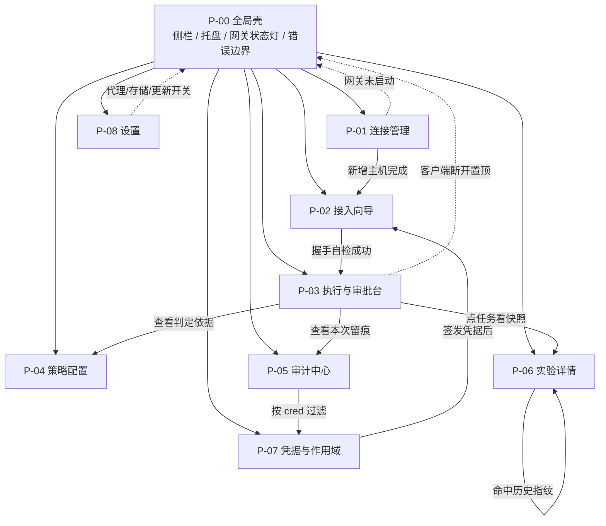

# 01 · 豆 Dou 接手版 PRD —— 现状梳理与需求池

> 本文件是**接手梳理产物**，不是架构设计、不是任务分解、不是测试策略。架构设计由高见远（架构师）输出，验收标准与测试策略由严过关（QA）输出，三者经交付总监齐活林汇总。

---

## 1. 文档信息

| 项 | 内容 |
|---|---|
| 文档名 | 01-接手版PRD-现状梳理.md |
| 版本 | **v1.1**（接手首版 v1.0 + 架构师 10 条口径澄清回执，见附录 A） |
| 日期 | 2026-11-11 |
| 修订日期 | 2026-11-11（v1.1 修订：吸收 `docs/handover/02-系统架构设计与任务分解.md` §14.4 的 10 条修正建议；边界为「只修订 01 PRD、不增删需求」） |
| 作者 | 许清楚（Xu）· 产品经理 |
| 派发 | 齐活林（交付总监）· 第 2 阶段任务；v1.1 为第 2 阶段补充任务 |
| 上游输入 | `docs/handover/00-项目预览-接手上下文包.md`（统一上下文，本文全部事实以其为准并抽样复核原文）；v1.1 另依据 `docs/handover/02-系统架构设计与任务分解.md` §14.4 / §2.6 / §11.2 / §14.5 的只读代码核验结论 |
| 下游读者 | 高见远（架构师，重点读 §3 / §6 / §11）、严过关（QA，重点读 §3 / §5 / §6 / §9）、齐活林（汇总） |
| 项目名 | `dou`（沿用工作区目录名；若需 snake_case 规范化由架构师定） |
| Language | 中文 |
| 技术栈口径 | 现状以代码为准：`crates/dou-gateway` = Rust + axum 0.8 + tokio + russh 0.65.1(ring) + russh-sftp 3 + rusqlite 0.41(bundled)；`app/` = Vue 3.5 + TS + Vite 8 + Tauri 2。**本文不预设目标技术栈**，形态选型属架构师职责（见 §11-4、Q4）。 |
| 工作流范围 | **部分工作流**：仅接手梳理 + 架构规划输入 + 任务分工输入。不写业务代码、不改现有源码、不运行构建 / 测试命令、不产出视觉稿、不产出架构设计与 WBS。 |
| 基线声明（铁律） | **一切以当前工作区代码为准。** `docs/PLAN-V2.md`、`docs/GAP-REPORT.md`、`docs/TEST-REPORT.md`、`docs/spike-report-009~011.md` 中带 ✅ 的「已达成」一律只当作**文档声称 / 历史态**，未经代码复核不得采信。尤其 `app/src/App.vue` 是 Tauri 模板 greet 表单、`app/src-tauri/src/lib.rs` 只有 `greet` 命令，文档描述的完整客户端代码**不在本仓库**。（v1.1 保留不变） |
| 与 00 上下文包的关系 | 00 包是「素材」，本文是「PM 专业产出」。本文不修改 00 包；§3 吸收其 §5 冲突表并补全 README 矛盾，§5/§6 吸收其 §7 缺口，§10 完整吸收其 §8 八问，§11 是给架构师的定向交接。00 包 §6 的 F1–F10 作为证据底座在 §3.2 复列。 |
| 数值口径 | 本文 **74.0 人天为 PM 初估（单点值，v1.1 保留不变）**，非实测、非承诺；v1.1 起在 §6.5.1 并列架构师独立复核值 **85.0**（含 v1.0 未含的「架构治理 4.0」分组），**两者均待交付总监与发起人确认后方可作为排期输入**；事实类结论一律附相对路径与行号，未核验处标注「待确认」。 |

### 1.1 阅读标记法（全文通用）

| 标记 | 含义 |
|---|---|
| 【代码已验证】 | 本轮只读打开源码核对过，附相对路径 / 行号 |
| 【文档声称】 | 来自 `docs/`，未在本工作区代码中复核，视为历史态 / 目标态 |
| 【PM 判断】 | 基于上述两者的产品推断，不是事实 |
| 【待确认】 | 见 §10，需发起人 / 交付总监 / 架构师拍板 |

### 1.2 执行摘要（先读这 6 条）

1. **真实基线**：工作区是「一个可运行的本地回环 MCP 网关 + 一个官方 Tauri/Vue 模板」，两套 Rust 工程**无桥接**，且**不是 git 仓库**。【代码已验证：`crates/dou-gateway/src/main.rs:6-20`、`app/src/App.vue:1-37`、`app/src-tauri/src/lib.rs:1-14`、顶层无 `.git`】
2. **头号风险**：`docs/PLAN-V2.md:12-19` 把完整客户端列为「已达成基线」，据此的 51.5 人天剩余排期**少了完整客户端、桥接、P0 安全收口**三块，直接沿用会凭空少算数十人天（本文重排为 74.0 人天 PM 初估，见 §6.5；v1.1 另列架构师独立复核 85.0，见 §6.5.1）。
3. **最高优先级安全缺口**：14 条 REST 路由中 13 条**裸奔**，只有 `/mcp` 走 Bearer 校验；任何本机进程都能读审计、签凭据、批准危险命令、代写客户端配置。【代码已验证：`main.rs:162-176` 无 middleware/layer】
4. **决策张力**：`docs/ADR-001-网关优先.md:36` 明确「暂不引入 Tauri 外壳」，但 `app/` 里就有一个 Tauri 工程；文档声称的完整客户端恰恰是 ADR-001 明确排除的形态 —— 那批 ✅ 不仅代码不在，方向上还与已采纳决策相悖（见 §2.3）。
5. **必须先拍板**：Q4 桥接形态二选一（HTTP 7419 / Tauri command spawn）是所有形态层工作的前置；Q1 编译副本能否找回、Q8 首发范围是否收缩，共同决定 74.0 初估 / 85.0 复核值是下沿还是可回落（见 §10、§6.5.1）。
6. **本文不做什么**：不给技术方案、不排 WBS、不写测试用例、不画视觉稿；只给「做什么 / 为什么 / 机器可验的验收要点 / 优先级 / 估算 / 角色」。

---

## 2. 产品定位与一句话结论

### 2.1 产品定义

| 项 | 内容 | 依据 |
|---|---|---|
| 豆 Dou 是什么 | **本地回环 MCP 网关**：让 WorkBuddy / Codex / VS Code 等 Agent 客户端在**不接触私钥**的前提下，经「三档策略（只读自动 / 变更待审 / 危险阻断）+ 全量审计」的受控通道操作远程服务器 | `README.md:1-7`；【代码已验证】`policy.rs:6-11`、`tools.rs:14-86`、`audit.rs` |
| 不是什么 | 不是终端替代品、不是堡垒机、不是 ML 实验平台、不是主机安全产品 | `docs/ADR-001-网关优先.md:16-19`；`docs/PLAN-V2.md:190-194` |
| 当前阶段 | **技术尖刀验证后段 / 可内测前**：网关协议层、策略层、审计层、SSH/TOFU/隔离区扫描/作用域已具备；产品化形态、安全收口、质量门禁未建立 | `README.md:6-7`；【代码已验证】`main.rs`、`tools.rs`、`hostkey.rs`、`scan.rs`、`scope.rs` |
| 差异化假设 | 「接入层受控通道」—— 不换终端，给现有终端 / Agent 加一层受控、可审计的通道；**唯一不可替代点 = 本地网关 + 私钥代签 + 入口审查** | `docs/ADR-001-网关优先.md:11,24`；`README.md:54` |
| 获客话术 | 从「换掉你的终端」变成「不用换终端，给现有终端加一层受控通道」，接入阻力低一个量级 | `docs/ADR-001-网关优先.md:24`【文档声称 / 决策依据】 |
| 目标用户 | 已有可用 SSH 客户端 / Agent 的科研与开发用户；**纯新手（没装过任何 SSH 客户端）不在首发客群** | `docs/ADR-001-网关优先.md:31` |
| 首发范围默认假设 | 收缩到「网关可内测」（见 Q8、§8） | `docs/ROADMAP.md:4` |

### 2.2 一句话结论

> 豆 Dou 是一个已能跑通「Agent → MCP 网关 → 三档策略 → 审计留痕 → SSH 执行」链路的**技术尖刀**，正处在「可内测前」；其差异化假设（受控接入层）尚未被证伪也尚未产品化，**接手第一风险是把 `PLAN-V2.md` 的历史态 ✅ 当成真实基线** —— 一旦采信，会在缺失完整客户端、缺失 Tauri↔网关桥接、REST 全端点无鉴权的前提下，按 51.5 人天排期，凭空少算数十人天且安全叙事站不住。

### 2.3 ADR-001 决策与现状的张力（本节为接手必读）

**决策原文**【文档声称，已采纳】：`docs/ADR-001-网关优先.md:14-19,34-39`

- 先做「豆 Gateway」（不含自有终端的代理接入层），终端形态作为第二阶段；
- 网关形态交付 = MCP 回环服务 + 三档策略 + 审计 + **一个极简审计面板**；不包含终端渲染、SFTP 文件树、内置编辑器；
- `:36` 明确「建立 `crates/dou-gateway`，先实现协议层与策略层，**暂不引入 Tauri 外壳**」；
- `:32` 代价第 3 条：「后期把终端补进来时，会话对象与事件总线要能承载两套形态，**架构不能只按网关设计**」。

**四处张力**：

| # | 决策 / 文档 | 现状【代码已验证】 | 张力结论 |
|---|---|---|---|
| T1 | ADR `:36` 暂不引入 Tauri 外壳 | `app/` 存在完整 Vue3 + Vite8 + Tauri2 工程（`app/package.json`、`app/src-tauri/Cargo.toml` 自带 462 包 lock）；`Cargo.toml` 用 `exclude=["app/src-tauri"]` 把它刻意隔离 | 「暂不引入」已被工作区事实推翻，需要一份**新 ADR 调和**（P2-05）；Q4 桥接形态就是这次调和的具体化 |
| T2 | ADR `:18` 配「极简审计面板」 | 只有 `main.rs` 里 `/console` 内联 HTML 控制台 + `GET /audit*` 只读端点；`app/src/App.vue` 是 greet 表单 | 面板未产品化，且控制台端点无鉴权（P0-01） |
| T3 | ADR `:32` 架构不能只按网关设计 | 网关是 `main.rs` 单根 + 16 个扁平 `mod`、**无 `lib.rs`**、无 `crate-type`；`AppState` 单结构体挂 5 个内存容器（`main.rs:38-50`） | 现状恰恰是「只按网关设计」的形状，补形态 / 补桥接必然触发分层重构（P2-02）与状态模型重设（P1-04） |
| T4 | ADR `:19` 不含终端渲染 / SFTP 树 / 编辑器 | `docs/TEST-REPORT.md:62-64`、`docs/GAP-REPORT.md:10-19` 声称左侧 7 项导航（终端 / 文件 / 接入向导 / 审批 / 凭据 / 导入 MobaXterm / 快照）、monaco、xterm.js 全部 ✅ | 那批 ✅ **方向与已采纳决策相悖**，且代码不在本工作区 —— 双重理由不得采信 |

**结论与需求**：ADR-001 的**方向**（网关优先、终端押后、8–10 周出可验证物）仍成立，与 `README.md:6-7`「技术尖刀」一致，本 PRD 全部需求池据此收敛（§8）。但「暂不引入 Tauri 外壳」这一条需以新 ADR 明确「壳存在但仅为模板，桥接形态待定」，并把它列为 §11 给架构师的第一份产出。（v1.1 保留不变；架构师 02 文档 §2.7 已给出调和表述，由 ADR-002 承接。）

---

## 3. 真实基线 vs 文档声称基线对照表

### 3.1 主对照表（覆盖 00 包 §5 全部 6 条 + README 自相矛盾 5 处）

> 结论取值：**已实现** / **部分** / **不存在** / **无法核验（仓库外）**。「证据路径」列全部为相对路径。

| # | 文档声称（出处） | 代码实际【代码已验证】 | 结论 | 证据路径 |
|---|---|---|---|---|
| C-01 | `docs/GAP-REPORT.md:10-19,43,51,59,63`：`App.vue` 有 tabs / visibleTabs / monaco / mitt / WebGLAddon / importMoba / doBroadcast / decideTask 等；`sftp.rs` / `transfer.rs` 在 `app/src-tauri/src/` | `app/src/App.vue` 仅 Tauri+Vite 模板 greet 表单；`app/package.json` 无 vue-router / pinia / mitt / xterm / monaco 依赖；`app/src-tauri/src/` 只有 `lib.rs`、`main.rs` | **不存在** | `app/src/App.vue:1-37`、`app/package.json`、`app/src-tauri/src/lib.rs:1-14` |
| C-02 | `docs/TEST-REPORT.md:8-13`：窗口 1320×1000 / 标题「豆 Dou」 / 左侧 7 项导航 / `dist` 主包 509.75 kB | `tauri.conf.json` 为 800×600 / `title: "app"` / `csp: null`；`app/dist` 不存在 | **不存在** | `app/src-tauri/tauri.conf.json`、`app/`（无 dist） |
| C-03 | `docs/TEST-REPORT.md:76`、`docs/GAP-REPORT.md:12-19`：`app/src-tauri/src/pty.rs`、`sftp.rs`、`transfer.rs` 存在且有 dead_code 警告 | `app/src-tauri/src/` 目录只有 `lib.rs`、`main.rs` 两个文件 | **不存在** | `app/src-tauri/src/` |
| C-04 | `docs/spike-report-009/010/011.md`：`gateway_status`、`ensure_gateway_started()`、xterm.js 终端、窗口自启网关已打通 | 全仓 `#[tauri::command]` 仅 1 处 = `greet`；无 xterm 依赖；`gen/schemas/acl-manifests.json` 只列 `core` / `opener` 权限 | **不存在** | `app/src-tauri/src/lib.rs:2`、`app/package.json`、`app/src-tauri/gen/schemas/` |
| C-05 | `docs/PLAN-V2.md:12-19`「已达成（✅，编译/接口已验证）」把完整客户端、五页面、终端、SFTP 树、鉴权闭环、三方编译列为基线 | 上述 C-01~C-04 的代码全部不在本工作区；仅 `/mcp` 走 Bearer，其余 13 路由无鉴权 | **不存在**（作为「基线」） | `crates/dou-gateway/src/main.rs:162-176`、C-01~C-04 证据 |
| C-06 | `docs/spike-report-006.md:17-19`：源码在 `E:\思考\dou\app\`、**编译副本在 `E:\dou-app\`** | `E:\dou-app\` 不在本工作区内，无法只读核验其存在与内容 | **无法核验（仓库外）** | 顶层目录树；`docs/spike-report-006.md:17-19`；见 Q1 |
| R-01 | `README.md:137-152` 目录树只列 9 个 `.rs` | 实际 16 个 `.rs`，`main.rs:6-20` 有 15 个 `mod` 声明；漏 `sftp / scan / snapshot / store / sanitize / scope / tasks` 7 个 | **部分**（文档滞后） | `crates/dou-gateway/src/main.rs:6-20`、`crates/dou-gateway/src/` |
| R-02 | `README.md:22` 表格称「主机密钥校验 **未实现**，当前无条件信任」 | `hostkey.rs` 已实现 TOFU fail-closed（公钥全文比对、损坏拒连），`ssh.rs` 已接入 `check_server_key`；且 `README.md:160` 自己也写「首次连接记录公钥全文…不一致即拒连」 | **已实现**（文档自相矛盾） | `crates/dou-gateway/src/hostkey.rs`、`ssh.rs`、`README.md:160` |
| R-03 | `README.md:23` 表格称「隔离区与静态扫描 **未实现**，阶段三」 | `scan.rs` 已实现三级降级扫描（Windows clamscan → WSL clamscan → 脚本规则），`sftp.rs` 已有 `quarantine_dir` | **已实现**（文档自相矛盾） | `crates/dou-gateway/src/scan.rs`、`sftp.rs` |
| R-04 | `README.md:161` 称「`echo` / `whoami` / `uname` / `hostname` 现在都判 pending，日常只读命令会大量卡审批」 | `policy.rs:29-35` 的 `AUTO_HEADS` 已包含 `whoami`(`:31`)、`uname`(`:31`)、`hostname`(`:32`)、`echo`(`:33`)，判 `Auto` | **已实现**（文档自相矛盾） | `crates/dou-gateway/src/policy.rs:29-35` |
| R-05 | `README.md:157` 称「令牌未做设备绑定、**未实现吊销时间戳**」 | `scope.rs:47,136,162,169-174` 已有 `revoked_at` 字段、写入、校验（`verify_token` 见 `revoked_at.is_some()` 即返回 `None`）、`revoke_token` 更新 | **已实现**（文档自相矛盾） | `crates/dou-gateway/src/scope.rs:47,136,162,169-174` |

**补充观察（不计入上述 5 处，但同样影响基线判断）**：

| # | 文档声称 | 代码实际 | 结论 | 证据 |
|---|---|---|---|---|
| R-06 | `README.md:16`「Bearer 令牌鉴权 已实现」 | 仅 `POST /mcp` 一条路由做 Bearer 校验；`/approve`、`/scope/*`、`/onboard/write`、`/audit/*` 等 13 条路由**无鉴权** | **部分**（叙述误导，范围被夸大） | `main.rs:162-176`、`main.rs::handle_mcp` |
| R-07 | `README.md:158`「路径越界校验未做：`cat /etc/shadow` 判只读放行」 | `tools.rs:376-393` 已有 `check_remote_path`（虽弱：字符串 `contains`、`/home/*/.ssh/id_` 的 `*` 是字面量、未防 `../` 与符号链接） | **部分**（已有但不足，见 P0-05） | `crates/dou-gateway/src/tools.rs:376-393` |

**分级统计**：C-01~C-05 共 5 条「文档声称的完整客户端能力」**全部为不存在**；C-06 为仓库外无法核验；README 5 处矛盾中 4 处是「代码已实现、文档说未实现」（低估现状），1 处是目录树滞后 —— 即 README 同时存在**低估**与**夸大**（R-06）两种偏差，不能整体采信任一侧。

### 3.2 证据底座：00 包 §6 已抽样核验事实（本文直接引用，供 QA / 架构师复核）

| # | 事实【代码已验证】 | 证据 | 本文对应需求 |
|---|---|---|---|
| F1 | 14 条路由无鉴权中间件，`/approve` `/scope/*` `/onboard/write` 裸奔 | `main.rs:162-176` | P0-01、US-09 |
| F2 | `DOU_DEV_MODE` 不设置即为 `true`（允许本机执行命令） | `main.rs:63` | P0-02 |
| F3 | 令牌 `rand_hex` 为 xorshift64* + 时间纳秒/pid 播种，非 CSPRNG；6 位配对码由时间纳秒 `% 1_000_000` 派生，同样可预测 | `auth.rs:63-84`、`auth.rs:90-101`；`scope.rs:65+` 同款 `rand_hex` | P0-03 |
| F4 | `scope.rs::hash_token` 用 `DefaultHasher`（SipHash）+ 固定盐，非密码学哈希 | `scope.rs:55-63` | P0-04 |
| F5 | `App.vue` / `lib.rs` 均为官方模板 | `app/src/App.vue:1-37`、`app/src-tauri/src/lib.rs:1-14` | P1-01/02/06 |
| F6 | 网关 5 个工具、三档策略按命令段（;`|`&` 分段取最坏档）判定 | `tools.rs:14-86`、`policy.rs:46-49` | US-05/06 |
| F7 | 主机密钥 TOFU fail-closed 已实现（非 README 所说未实现） | `hostkey.rs`、`ssh.rs` | P0-08、R-02 |
| F8 | 全仓 `#[test]` 仅 7 个，无 e2e / 集成测试 / CI / lint / test script | `policy.rs`(4)、`sanitize.rs`(3) | P2-03/04 |
| F9 | 非 git 仓库（无 `.git` / `.gitignore`），编译副本在 `E:\dou-app\` | 顶层；`docs/spike-report-006.md:17-19` | P2-01、Q1/Q3 |
| F10 | 令牌硬编码泄露：`tools/probe_approve.py:4` 与 `docs/spike-report-002.md:29` 含 `dou_ak_...` 明文（**静态两处**） | 同上 | P0-04、Q5 |

> **v1.1 补充（附录 A 修正 2，【代码已验证】）**：主令牌明文出口实为 **5 处** —— 除 F10 登记的静态两处外，另有运行时三处：`main.rs:74` 启动日志、`:288` `/console` 内联 HTML、`:378` `/onboard/config` 配置片段。依据 `docs/handover/02-系统架构设计与任务分解.md` §14.4-2、§8.6（B4）。F10 原文事实无误（它记的是静态硬编码），是 v1.0 把「清理范围」等同于 F10 的两处而漏了运行时回吐；P0-04 的清理与验收范围据此扩为「**全仓 + 运行时输出**」，见 §6.1、§10 Q5。

### 3.3 已确认「真实存在」的能力（避免矫枉过正）

| 能力 | 状态 | 证据 |
|---|---|---|
| MCP Streamable HTTP（initialize / ping / tools/list / tools/call，通知 202，`mcp-session-id` 头） | 已实现 | `main.rs::handle_mcp`、`rpc.rs` |
| 五工具定义与执行（session_list / exec / read / put / get） | 已实现（但契约与描述有缺陷，见 P0-06、P1-03） | `tools.rs:14-86` |
| 三档策略 + 60+ 只读白名单 + 危险阻断模式 | 已实现（但无参数级结构解析） | `policy.rs:29-44` |
| 审计 JSONL 只追加 + 链式哈希 + SQLite 双写 + 检索 / 导出 / 校验 | 已实现（但端点无鉴权、双写分散） | `audit.rs`、`main.rs:165-168` |
| SSH 密钥/口令认证 + 远端 exec + 8 类稳定错误码 | 已实现 | `ssh.rs`、`errors.rs` |
| known_hosts TOFU fail-closed | 已实现 | `hostkey.rs` |
| SFTP 按行区间读 / put / get / 隔离区目录 | 已实现 | `sftp.rs` |
| 七维作用域 + 令牌签发/校验/吊销 + 配额/租约（内存态） | 已实现（内存态，见 P1-04） | `scope.rs`、`main.rs:38-50` |
| 双视图脱敏（6 类正则 + 可配置追加，3 单测） | 已实现 | `sanitize.rs` |
| 隔离区静态扫描三级降级 | 已实现（但 WSL 分支可能 fail-open，见 P0-07） | `scan.rs` |
| 实验三段指纹 + 被动上下文采集 | 已实现（但 `upsert_snapshot` 裸 INSERT 主键冲突被吞） | `snapshot.rs`、`store.rs` |
| 6 类客户端配置片段生成 + JSON 代写 | 已实现（端点无鉴权，且 `:378` 回吐明文，见 §3.2 脚注） | `main.rs::onboard_config`、`onboard_write` |
| 任务与审批状态机（6 态） | 已实现（纯内存 `Vec<Task>`） | `tasks.rs` |

> **PM 判断**：网关侧「能力面」并不薄，问题集中在 **① 安全边界（鉴权/CSPRNG/逃逸）② 状态持久化 ③ 工具契约一致性 ④ 形态与桥接 ⑤ 工程质量门禁**。这五类即 §6 需求池的分组依据。

---

## 4. 干系人与使用场景

| 角色 | 目标 | 当前痛点【代码已验证 / 文档声称】 | 成功判据（可验收） | 与现状的落差 |
|---|---|---|---|---|
| **A. 科研用户**（不会写 SSH 配置） | 不碰命令行完成「连服务器 → 跑实验 → 看结果 → 查留痕」 | 连接靠环境变量 `DOU_SSH=user@host:port`（`main.rs:78-79` 注释自认「正式版由界面连接管理页写入」）；唯一界面是 `/console` 内联 HTML；`app/src/App.vue` 是 greet 表单 | 三步新增主机并选凭据；接入向导一键写配置；能看到快照五字段与审计；全程无空白态 / 白屏 | **形态层 0→1**：所有页面、路由、状态管理均不存在 |
| **B. Agent 客户端**（WorkBuddy / Codex / VS Code） | 通过标准 MCP 以受限方式操作服务器，拿到稳定工具契约与错误码 | `tools/list` 的 `inputSchema` 未声明 `background` 却读取该参数（`tools.rs:31-40` vs `:180`）；提示引用不存在的 `dou.task_status`（`:261`）；`dou.put` 描述称「先落隔离区」但实现直接 `remote_put`（`:59` vs `:471`）；`not_implemented()` 死代码（`:560`） | initialize 200、5 工具可列可调、错令牌 401、越权 `isError=true`、8 类 `E_*` 错误码稳定、schema 与实现零差异、会话租约可预期 | **契约一致性**：协议层已具备，语义层不可信 |
| **C. 运维 / 安全审计方** | 审计可对外提供、链式哈希可验、凭据可签发可吊销、私钥不出本机、危险操作必留痕 | 13 条 REST 端点无鉴权：任意本机进程可读审计 / 签凭据 / `POST /approve` 批准危险命令 / 代写客户端配置（`main.rs:162-176`）；令牌/配对码可预测（F3）；凭据哈希非密码学（F4）；`dou_ak_...` 明文泄露未轮换（F10，v1.1 扩充为 5 处）；`POST /approve` 无鉴权 | 全端点 Bearer 鉴权；`/audit/verify` `chain_ok=true`；吊销后 401；脱敏样本零漏检；已泄露令牌已轮换且全仓 + 运行时无明文；`dou.put` 先落隔离区 | **安全叙事不成立**：M2 出口无法达成 |
| **D. 单人开发者 / 接手方** | 能回滚、能一键构建测试、能看懂真实状态、能低风险重构 | 非 git 仓库（F9）；无 CI / lint / test script，仅 7 个单测（F8）；`.cargo/config.toml` 与 `scripts/build.ps1` 写死绝对路径 / WinGet 路径、`scan.rs::to_wsl_path` 写死 `C:`/`E:` 与 `Ubuntu-22.04`；README 与 4 份 docs 把历史态当基线（§3.1）；两套 Rust 工程 `exclude` 且无桥接 | `git log` 有 `handover-baseline` tag；一键 fmt/clippy/vue-tsc/test 全绿且 CI 阻断；换机器可按文档配置构建；文档状态表与代码逐条一致；桥接形态有 ADR | **工程治理 0→1**：无版本管理是最高杠杆风险（R-09） |

**角色优先级（本期）**【PM 判断】：C > B > D > A。理由：ADR-001 把「安全叙事 / 差异化验证」置于形态之前，且 C 类失败会直接否定产品存在理由；A 类的完整形态按 Q8 默认假设收缩到「极简审计面板 + 接入面」。

---

## 5. 用户故事（US-01 ~ US-16）

> 格式：作为…我希望…以便… ｜ 验收线索 ｜ 当前代码状态（**已具备 / 部分 / 缺失**）。状态判定依据 §3.1 / §3.2。

### 5.1 A · 科研用户

| ID | 用户故事 | 验收线索 | 代码状态 |
|---|---|---|---|
| US-01 | 作为不会写 SSH 配置的科研用户，我希望在界面三步新增主机并选择凭据，以便不碰 `user@host:port` 环境变量就能连上服务器 | 连接管理页三步表单提交 → `/mcp` initialize 成功 → 审计写 `connect` 事件 → 会话出现在 `dou.session_list` | **缺失**（`main.rs:78-79` 走环境变量；`App.vue` 为 greet 模板） |
| US-02 | 作为科研用户，我希望一键生成并写入 WorkBuddy / Codex / VS Code 的 MCP 配置片段，以便不必手改 JSON/TOML 顶层键 | 6 类客户端片段可生成；JSON 代写满足备份 / 解析校验 / 失败回滚 / 回报生效文件；TOML 降级复制；握手自检命中 `initialize` 判定成功 | **部分**（后端 `/onboard/config`、`onboard_write` 已具备；前端向导页缺失；端点无鉴权且 `:378` 回吐明文） |
| US-03 | 作为科研用户，我希望看到实验快照（命令 / cwd / pid / GPU / 日志尾 / 三段指纹）与历史命中提示，以便知道「这套参数跑过、结果在哪」 | 快照查询接口（`GET /snapshots`，N1）返回五字段；命中历史指纹时启动前提示并可跳转结果目录；`upsert_snapshot` 主键冲突不再被静默吞掉 | **部分**（`snapshot.rs` 指纹与 `record` 已具备；无查询接口、无前端页、裸 INSERT 冲突） |
| US-04 | 作为科研用户，我希望有一个能双击打开、显示网关状态与审批提醒的桌面窗口，以便不必手动跑 exe、记端口 | 窗口启动 → 网关探活 / 自启状态可见；待审任务置顶提醒；网关未启动时给出启动 / 重试入口而非白屏 | **缺失**（`tauri.conf.json` 800×600 / title "app" / `csp:null`；`lib.rs` 只有 `greet`；无桥接） |

### 5.2 B · Agent 客户端

| ID | 用户故事 | 验收线索 | 代码状态 |
|---|---|---|---|
| US-05 | 作为 Agent 客户端，我希望 initialize / tools/list / tools/call 走标准 MCP Streamable HTTP 并带稳定会话头，以便无需定制适配 | 握手 200 且返回 `protocolVersion` / `capabilities` / `serverInfo`；`tools/list` 返回 5 工具；响应带 `mcp-session-id`；错令牌 401 | **已具备**（`main.rs::handle_mcp`、`rpc.rs`、`README.md:105-106` 自检九项） |
| US-06 | 作为 Agent 客户端，我希望 `tools/list` 的 `inputSchema` 与实现读取的参数完全一致、提示不引用不存在的工具，以便不产生悬空调用 | schema 与实现参数逐项 diff 为空；全仓无 `dou.task_status` 字面量；5 工具无一条返回 `not_implemented` | **部分（不符）**（`tools.rs:31-40` 未声明 `background` 但 `:180` 读取；`:261` 悬空引用；`:560` 死代码） |
| US-07 | 作为 Agent 客户端，我希望 `dou.put` 先落隔离区并返回哈希供人工放行，以便不把文件直接写到远端（与工具描述一致） | 调用后文件在隔离区（`GET /quarantine`，N3）、返回 sha256 与大小；人工放行（`POST /quarantine/:id/promote`，N4）前远端无该文件；描述 / schema / 实现 / 文档四处一致 | **缺失（不符）**（`tools.rs:59` 描述 vs `:471` 直接 `remote_put`） |
| US-08 | 作为 Agent 客户端，我希望连接失败时拿到 `E_*` 稳定码 + 人话解释，以便可程序化分支处理 | **8 类**错误码（`E_CONN_REFUSED` / `E_CONN_TIMEOUT` / `E_AUTH_FAILED` / `E_KEY_LOAD` / `E_HOSTKEY_MISMATCH` / `E_KNOWN_HOSTS_CORRUPT` / **`E_UNSUPPORTED_ALGO`** / **`E_SSH_UNKNOWN`**）可区分且失败写审计 | **已具备**（`errors.rs:11-60` 共 8 码、`ssh.rs` / `hostkey.rs`；v1.1 按附录 A 修正 7 由「6 类」统一为 8 类，QA 需补 2 条用例） |

### 5.3 C · 运维 / 安全审计方

| ID | 用户故事 | 验收线索 | 代码状态 |
|---|---|---|---|
| US-09 | 作为安全审计方，我希望除 `/mcp` 外的所有 REST 端点也要求 Bearer 鉴权，以便本机任意进程不能代签凭据 / 批准危险命令 / 导出审计 | 无 Bearer 调 `/approve`、`/scope/tokens`、`/scope/revoke`、`/onboard/write`、`/audit/export` 及 N1~N7 新增端点均 401；`/health` 是否豁免随 Q4 拍板（§10 Q4 附注、02 文档 §2.6） | **缺失**（`main.rs:162-176` 无 layer） |
| US-10 | 作为安全审计方，我希望变更类命令必经人工审批、拒绝理由必填入审计、变更档不可关闭审批，以便每次写操作可追溯 | 审批三按钮；拒绝无理由 400 且拒绝理由入审计；change 档拒 `remember=true`；5min 未决自动拒绝并写审计；断连任务置顶可终止 | **部分**（`tasks.rs` 6 态状态机、`main.rs::approve_task` 已具备；`POST /approve` 无鉴权；超时挂起与断连置顶缺失） |
| US-11 | 作为安全审计方，我希望审计只追加、链式哈希可校验、可按时间 / 来源检索并导出 CSV，以便对外提供证据 | `/audit/verify` `chain_ok=true`；`/audit/export` 导出内容已脱敏；10 万条按时间 / 项目筛选 < 1s | **已具备**（`audit.rs` JSONL + SQLite 双写、`main.rs:165-168`；但端点无鉴权、双写分散） |
| US-12 | 作为安全审计方，我希望设备令牌由 CSPRNG 签发、库内只存密码学哈希、可吊销且吊销后立即 401、已泄露明文可轮换清理，以便凭据泄露不致命 | 见 P0-03 / P0-04 验收要点；**全仓 + 运行时输出**检索无 `dou_ak_` 明文（5 处） | **部分**（`scope.rs` issue / verify / revoke + `revoked_at` 已具备；但 rand_hex 可预测、`DefaultHasher`、明文泄露未清理） |
| US-13 | 作为安全审计方，我希望代理看到的输出经双视图脱敏且规则可配置，以便私钥 / 令牌 / 内网 IP 不进入 Agent 上下文 | 6 类正则样本集零漏检、误伤可控；`sanitize_rules.json` 追加规则生效；非法 / 缺失规则不阻断 | **已具备**（`sanitize.rs` 6 类 + 可配置 + 3 单测） |

### 5.4 D · 单人开发者 / 接手方

| ID | 用户故事 | 验收线索 | 代码状态 |
|---|---|---|---|
| US-14 | 作为接手开发者，我希望仓库已 git 化并有锁定当前基线的首个提交，以便能回滚与追溯 | `git log` 有 `handover-baseline` tag；`.gitignore` 排除 `node_modules` / `E:/dou-target` / `dist` / `token.txt` / `audit.db`；工作区状态干净 | **缺失**（F9） |
| US-15 | 作为接手开发者，我希望提交前格式化 / 静态检查 / 测试一键可跑且 CI 阻断，以便分层重构有安全网 | CI 全绿；覆盖率门槛（核心 ≥70% / 视图 ≥40%）生效；三道可一键跑 | **缺失**（无 CI / lint / test script；仅 7 单测） |
| US-16 | 作为接手开发者，我希望 README 与 docs 状态表与代码一致，以便不按假基线排期 | 见 P2-05 验收要点；所有 ✅ 标注复核日期或改标「历史态」 | **缺失 / 不符**（§3.1 共 11 行冲突） |

**覆盖校验**：接入（US-01/02/05）、执行（US-06/08）、审批（US-10）、审计（US-11/13）、凭据（US-12）、隔离区（US-07）、桌面形态（US-04/03）、工程治理（US-14/15/16）—— 全部覆盖，共 16 条 ≥ 12 条要求。

---

## 6. 需求池（核心）

> 说明：① 优先级 **P0 = 阻断 / 安全叙事**（不做则 M2 不成立、内测不可发）；**P1 = 形态与闭环**（不做则 M3 / M6 不成立）；**P2 = 质量门禁与发布**（不做则发布准入 6.3 不满足）。② 「机器可验的验收要点」只写可自动化 / 可判定的条件，不写「体验良好」类主观项。③ 人天为 **PM 初估单点值（74.0，v1.1 保留不变）**；架构师独立复核值 85.0 见 §6.5.1，两者均未作为承诺。④ 建议承接角色：架构师 / 工程师 / QA / PM。⑤ **v1.1 未新增或删除任何需求，25 条编号与优先级不变**；口径澄清的落点见附录 A。

### 6.0 全局共享约定（v1.1 补，不占需求编号）

> 本节记录跨多条需求的工程约定，**不是新增需求**（v1.1 派发边界：不增删需求）。承接方见 `docs/handover/02-系统架构设计与任务分解.md`。

| 约定 | 内容 | 来源 / 依据【代码已验证】 | 影响的需求 | PRD 处理方式 |
|---|---|---|---|---|
| **C-01 时间单位统一** | 内部持久化一律 **epoch 毫秒 INTEGER**（`created_ms` / `decided_ms` / `expires_ms` / `ts_ms`）；对外 JSON 一律 **ISO 8601 UTC**（`2026-11-11T08:30:00Z`）；`LEASE_SECS=1800` 保留为常量但比较时折算 `1_800_000 ms`；`credential.expires_at`（秒）更名 `expires_ms` 并迁移旧值 ×1000 | 现状混用：`store.rs::now_ms()` / `audit.rs::now_ts()` 毫秒存 TEXT、`scope.rs:123` 与 `tools.rs:167` 用秒、`auth.rs:119` `LEASE_SECS=1800`（02 文档 §14.4-10 / §8.4 D6 / W-11 / B7） | **P1-04（落地必踩坑）**、P1-05、P1-06、P2-03 | **不新增需求编号**（02 文档 W-11 已承接该工单）；作为 P1-04 验收前置写入其验收要点与依赖，并在 §11-7 交接段列明。机器可验：DB 时间列全为 INTEGER 毫秒、对外时间字段全为 ISO 8601 UTC、旧值迁移有回归用例 |

### 6.1 P0 · 阻断 / 安全叙事（8 条，小计 **13.0 人天**）

| 编号 | 需求描述 | 来源 | 优先级理由 | 机器可验的验收要点 | 涉及模块 / 路径 | 依赖 | 人天 | 角色 |
|---|---|---|---|---|---|---|---|---|
| P0-01 | 为 14 条 REST 路由统一加鉴权中间件，覆盖 `/approve`、`/scope/tokens`、`/scope/revoke`、`/onboard/write`、`/audit/*`、`/tasks`、`/console`；`/health` 是否豁免需拍板 | 00 包 §7 安全；F1；`main.rs:162-176`；US-09 | 任意本机进程可签凭据 / 批准危险命令 / 读审计 / 代写配置，安全叙事直接崩塌 | 无 / 错误 Bearer 调上述端点均 401；`/mcp` 行为不回归；`Router` 上存在统一 layer；审计写 `auth_deny` 事件 | `crates/dou-gateway/src/main.rs`、`rpc.rs` | — | 2.0 | 架构师（定 layer 位置）+ 工程师 |
| P0-02 | `DOU_DEV_MODE` 默认改为关闭，仅显式 `=1` 开启；启动时打印 dev 状态 | F2；`main.rs:63`；00 包 §7 | 不设变量即在**本机**执行命令，与「命令真在远端」叙事冲突，且 dev 兜底令牌绕过作用域 | 未设 `DOU_DEV_MODE` 时 `dev=false`；无 SSH 会话时 `dou.exec` 返回待审批 / 拒绝而非本机执行；`=1` 才允许本机执行；启动日志含 `dev` | `main.rs:63`、`tools.rs:316,342` | — | 0.5 | 工程师 |
| P0-03 | 令牌与 6 位配对码改用 OS CSPRNG；移除 xorshift64* 与「时间纳秒派生」逻辑 | F3；`auth.rs:63-84,90-101`、`scope.rs:65+`；00 包 §7 | 知签发时间即可反推令牌 / 配对码，凭据体系形同虚设 | 代码中无 `xorshift` / `as_nanos()` 派生种子；同一毫秒连续签发 1000 个令牌无重复；配对码不可由时间戳反推；引入 `getrandom` 类依赖可核 | `auth.rs`、`scope.rs`、`Cargo.toml` | — | 1.5 | 架构师 + 工程师 |
| P0-04 | `hash_token` 改密码学哈希（sha256 或慢哈希 + 盐）；**Q5 经发起人拍板后**才轮换已泄露令牌；清理 **5 处**明文出口（静态 2 + 运行时 3） | F4；F10（v1.1 扩充见 §3.2 脚注）；`scope.rs:55-63`；`tools/probe_approve.py:4`；`docs/spike-report-002.md:29`；`main.rs:74,288,378`；Q5；02 文档 §14.4-2/3、§8.6 | 非密码学哈希 + 已泄露明文令牌 + 运行时回吐，内测包一旦外发即凭据失守 | `DefaultHasher` 不再用于凭据；**全仓 + 运行时输出**均无主令牌明文（5 处：脚本 / 文档 / 启动日志 / `/console` 内联 HTML / `/onboard/config` 片段；运行时一律掩码 `dou_ak_****abcd`，复制需显式二次操作）；**未拍板前仅做占位符替换、不实际轮换**；拍板后旧令牌验证返回 401；`verify_token` 与签发链路回归通过 | `scope.rs`、`main.rs:74,288,378`、`tools/probe_approve.py`、`docs/spike-report-002.md` | P0-01（端点已受保护）、**Q5 发起人拍板（轮换动作的硬门禁）** | 1.5 | 架构师 + 工程师 + QA（**轮换须发起人授权后执行**） |
| P0-05 | 路径与命令逃逸加固：真实路径规范化（防 `../` 与符号链接）、命令参数级结构解析；`dou.exec` 补路径校验 | 00 包 §7；`tools.rs:376-393`、`policy.rs:39-44`；PLAN-V2 B3；US-06/07 | `/home/*/.ssh/id_` 的 `*` 是字面量、`contains` 匹配可绕过；`BLOCK_PATTERNS` 纯字符串无参数解析；`dou.exec` 完全不校验路径 | `../` 与符号链接绕过白名单被拒；`find -delete`、重定向到系统目录正确分档；`/etc/shadow` 类越界读取被拒；`dou.exec` 内含路径参数同样校验；越界尝试均写审计 | `tools.rs`（`check_remote_path` / `exec` / `read` / `put` / `get`）、`policy.rs`、`scope.rs` | P0-01 | 3.0 | 架构师 + 工程师 + QA |
| P0-06 | `dou.put` 描述 / schema / 实现 / 文档四处一致：落地「先落隔离区 + 静态扫描 + 人工放行后才写远端」的最小闭环（或经拍板统一降级为直接写并改掉全部描述） | 00 包 §7 功能一致性；`tools.rs:59` vs `:441-482`；US-07；ROADMAP §二 P1-3 | 工具描述公开承诺「先落隔离区审查」，实现直接 `remote_put`，是对 Agent 的**语义欺骗**，隔离区（差异化组件）实际未接入上传链路 | `dou.put` 后远端路径无文件直至人工放行；隔离区返回 sha256 / 大小 / 扫描处置；`local_ref` 描述与实现语义一致；`tools/list` 描述与实现一致；全仓无「先落隔离区」但未实现的悬空描述。**本条只做一致性收口与最小闭环；大文件 / 断点续传 / 后台任务化归 P1-03，不重复计量** | `tools.rs:58-70,441-482`、`sftp.rs`（`quarantine_dir`）、`scan.rs`、`ROADMAP.md`；新增端点见 §6.2.1 N3/N4 | P0-05 | 2.5 | 架构师 + 工程师 |
| P0-07 | 隔离区扫描三级降级的 fail-open 修复：扫描器不可用 / WSL 退出码异常时默认 `Deny`/`Pending`，不得 `Allow` | 00 包 §7 安全；`scan.rs` | 退出码非 1 的分支可能放行未扫描文件，与「四类处置」承诺冲突 | 每级降级注入故障（clamscan 缺失 / WSL 非零退出 / 规则脚本异常）均不返回 `Allow`；处置写入审计；`Disposition` 四态各有回归用例 | `scan.rs`、`tools.rs::get` | — | 1.0 | 工程师 + QA |
| P0-08 | 主机公钥变更二次确认锁定：首次 TOFU 记录，变更时需显式确认，拒绝则 `E_HOSTKEY_MISMATCH`，篡改 / 损坏可识别 | F7；`hostkey.rs`、`ssh.rs`；PLAN-V2 B2 | TOFU fail-closed 已实现（这是已有能力），但「变更即拒」缺人工确认通道，运维场景可用性不足 | 公钥变更 → 返回可比对指纹并等待确认；拒绝 → `E_HOSTKEY_MISMATCH`；确认后更新记录；`known_hosts.json` 损坏 → `E_KNOWN_HOSTS_CORRUPT` | `hostkey.rs`、`ssh.rs`、`main.rs`（确认入口见 §6.2.1 N5，受 P0-01 保护） | P0-01 | 1.0 | 工程师 |
| — | **P0 小计** | — | — | — | — | — | **13.0** | — |

### 6.2 P1 · 形态与闭环（10 条，小计 **34.5 人天**）

| 编号 | 需求描述 | 来源 | 优先级理由 | 机器可验的验收要点 | 涉及模块 / 路径 | 依赖 | 人天 | 角色 |
|---|---|---|---|---|---|---|---|---|
| P1-01 | **桥接形态决策（先出 ADR）**：HTTP 7419 或 Tauri command spawn 网关进程，二选一 | 00 包 §8 Q4；§1.3 桥接缺口；ADR-001 `:36` 张力 T1；§11-4 | 决定 `exclude` 是否保留、**是否需 `cdylib/staticlib` + workspace 合并（仅 B2）**、dev proxy / 生产 CSP 三件套、窗口进程生命周期、P1-06 能否落地；不定则形态层全部不可排期（`rlib` 抽取已由 D4 解耦、不在此列） | 产出一份新 ADR（状态 / 备选 / 代价 / 不可回退点）；明确 `Cargo.toml` 与双 `Cargo.lock` 治理方式；经发起人拍板 | `Cargo.toml`、`app/src-tauri/`、`crates/dou-gateway/src/main.rs`、`docs/ADR-001-网关优先.md` | Q4 / Q6 拍板 | 0.5 | **架构师**（PM 不定技术选型） |
| P1-02 | 按 P1-01 结论落地 Tauri↔网关最小打通：桌面壳能触发网关启动 / 探活并展示状态 | §1.3 三条通道全断；`vite.config.ts` 无 7419 proxy、`App.vue` 无 fetch、`lib.rs` 只有 `greet`；US-04 | 两套工程目前**零通道**，没有它就没有桌面形态 | 选定方案下存在一条可验证通道（dev proxy + 生产 `csp:connect-src` 或 `#[tauri::command]`）；壳内能读到网关 `/health` 状态；网关未启动时有明确启动 / 重试路径；`gen/schemas` 权限清单与新增命令一致；**proxy 不替代 P0-01 鉴权** | `app/vite.config.ts`、`app/src-tauri/tauri.conf.json`（`csp`）、`app/src/`、`app/src-tauri/src/lib.rs`、`app/src-tauri/capabilities/`、`main.rs` | P1-01 | 3.0 | 架构师 + 工程师 |
| P1-03 | 五工具闭环：清除 `not_implemented` 死代码与 `dou.task_status` 悬空引用；`inputSchema` 与实现参数一致；长命令 >30s 返回 job id 可查可终止 | 00 包 §7；`tools.rs:180,261,560`；ROADMAP §二 M3 出口「五个工具没有一个返回 not_implemented」；US-06 | Agent 契约不可信 + ROADMAP M3 出口未达成 | 5 工具各自成功路径跑通；`tools/list` schema 与实现参数 diff 为空；全仓无 `dou.task_status`；无工具返回 `not_implemented`；超时命令返回 job id、状态可轮询、可终止、重复触发被识别 | `tools.rs`、`tasks.rs`、`main.rs::tasks_list` | P0-06、P1-04 | 4.0 | 工程师 + QA |
| P1-04 | **4 类状态（Task / Lease / Quota / SessionMeta）持久化** + `sessions` 仅作运行时句柄缓存（`SshConnection` 含 `russh::client::Handle` 与私钥内存，**不可序列化、不可持久化**）；接入 `session` 表；重启后活动连接需重连并如实告知用户 | 00 包 §2.2 / §7；`main.rs:38-50`；`tasks.rs` 纯内存 `Vec<Task>`；`store.rs` `session` 表未接入；`TEST-REPORT.md:70` 自认「重启重置」；PLAN-V2 A5；**02 文档 §14.4-4、§5.2、§8.5 D5、W-13** | 进程重启即丢待审任务 / 配额 / 租约 / 会话元数据，闭环与审计不可信；**照 v1.0 字面「迁 5 个容器」会误导工程师试图持久化 SSH 连接对象** | 网关重启后已用次数 / 并发 / 租约起点 / 待审任务 / 会话元数据不丢；超 `max_calls` / 并发 / `LEASE_SECS(1800)` 仍拒并写审计；`session` 表有读写调用点；**`sessions` 不落库、重启后前端显示「会话需重连」而非假装在线**；内存仅缓存；**时间单位按 §6.0 C-01 统一后方可验收** | `main.rs`、`tasks.rs`、`store.rs`、`scope.rs`、`auth.rs`、`ssh.rs:80` | P2-01（建议前置）、**§6.0 C-01（时间单位统一，02 文档 W-11）** | 3.5 | **架构师**（状态模型）+ 工程师 |
| P1-05 | 审批闭环补齐：5min 超时自动拒绝并写审计、审批卡片四要素、断连任务置顶与人工终止、拒绝理由必填、change 档不可关闭审批 | PLAN-V2 A2/A3/A4；`tasks.rs`、`main.rs::approve_task`；US-10 | 待审任务悬空 / 卡片信息不足 / 客户端断开后无人接管 | 待审 5min 未决自动置拒绝并写审计；卡片含命令原文 / 目标路径 / 历史同类次数 / 预计影响；断连任务标注「客户端已断开」并可手动终止；拒绝无理由 400；change 档 `remember=true` 被后端拒 | `tasks.rs`、`tools.rs::create_pending`、`main.rs::approve_task`、`app/src/` | P1-04、P1-06 | 3.0 | 工程师 + QA |
| P1-06 | 客户端形态从 greet 模板起步：落地连接管理 / 策略配置 / 审计中心 / 实验详情 / 设置 5 个同级页面 + 接入向导 + 执行审批台 | PLAN-V2 C1；ADR-001 `:18` 极简审计面板；§3.1 C-01~C-05；US-01/02/03/04；**02 文档 §5.6（N1~N7）** | **真实基线是模板，不是「五页面骨架」** —— C 线性质由「补齐」变为「从零起」，这是 51.5 口径最大盲区 | 侧栏进入 5 个同级页面；连接管理三步新增主机并选凭据；策略配置可见 / 改三档与规则；审计中心按时间 / 来源 / 判定检索导出；实验详情看快照字段与结果目录；设置含代理 / 存储 / 语言 / 更新开关；接入向导 6 类客户端可达；**§6.2.1 的 N1~N7 新增端点全部挂 P0-01 鉴权（写类 M-only），不得漏挂** | `app/src/`（新增 `views/` `router/` `stores/` `components/`）、`app/package.json`、`main.rs` 只读查询接口 + **N1~N7 新增端点（见 §6.2.1）** | P1-01、P1-02、P1-04 | 8.0 | 架构师 + 工程师 |
| P1-07 | 四态封装 + 请求标识 + 错误边界：空 / 加载 / 错误 / 降级态、异步 requestId 比对过期丢弃、页面错误边界 | PLAN-V2 C2；US-04/01 | 非命令行用户遇空白态 / 白屏即流失；降级态是桥接未启动时的唯一出口 | 每个列表 / 面板四态可呈现；空态写明原因与下一步；200ms 内加载反馈；过期响应不覆盖新页面；渲染异常落可见错误态而非白屏；网关未启动显示「未运行 + 启动 / 重试」 | `app/src/`（shared 容器 / 错误边界）、`views/` | P1-06 | 3.0 | 工程师 + QA |
| P1-08 | 私钥本地加密库：密钥派生 + 字段级加密存储 + 本机解锁；代理全程不接触私钥原文 | PLAN-V2 B1；`README.md:54` 差异化声明；`ssh.rs` / `scope.rs` / `store.rs` | 「私钥不出本机」是唯一不可替代点，当前私钥 / 口令以明文或弱保护落盘，M2 出口不成立 | `credential` 表私钥 / 口令只存密文 + 盐；派生密钥经本机解锁；无任何读取明文私钥的代理接口；落库文件检索不出明文私钥片段 | `scope.rs`、`store.rs`、`ssh.rs`、新增 crypto 模块 | P1-04 | 5.0 | **架构师**（信任边界）+ 工程师 + QA |
| P1-09 | 策略可配置落地：`classify` 读 DB 规则而非硬编码常量；判定结果含命中规则 ID + 人话解释；修 `upsert_snapshot` 主键冲突 | 00 包 §7；`store.rs`（`list_rules/upsert_rule` 无调用点、`seed_builtin_rules` 写入但 `policy.rs` 用常量）；ROADMAP M4「策略可配置、可解释，付费点」 | 「策略可配置」是 ROADMAP M4 与付费点，当前是死代码 + 硬编码，等于未落地 | 改一条规则不用重编译且生效；每条判定返回 `rule_id` + 解释文本；重复快照不再静默吞错；`not_implemented` / `list_rules` 等死代码有调用点或删除 | `policy.rs`、`store.rs`、`snapshot.rs`、`tools.rs`；新增端点见 §6.2.1 N2 | P0-05 | 2.5 | 架构师 + 工程师 |
| P1-10 | 配对码 / 租约补齐 HTTP / MCP 入口（受 P0-01 鉴权保护）；接入向导代写三约束回归 | 00 包 §7「配对码与租约无 HTTP/MCP 入口」；`auth.rs::issue_pairing_code`、`main.rs::onboard_write`；US-02 | 已有实现但无入口，等于能力不可达；代写是高风险写操作需回归 | 配对码签发 / 校验、租约查询有明确入口且未鉴权调用 401；代写满足备份 / 解析校验 / 失败回滚 / 回报，并有自动化回归用例 | `auth.rs`、`main.rs`、`scope.rs`、`app/src/`；新增端点见 §6.2.1 N6 | P0-01、P0-03 | 2.0 | 工程师 + QA |
| — | **P1 小计** | — | — | — | — | — | **34.5** | — |

#### 6.2.1 P1-06 新增端点清单（N1~N7，v1.1 补）

> 来源：`docs/handover/02-系统架构设计与任务分解.md` §5.6（893-901 行）的端点矩阵，【代码已验证】现状均「不存在」。**本表只作引用，用于确保页面 / 需求不遗漏 P0-01 鉴权挂接**；「鉴权矩阵」与「事件名表」属 02 架构文档产出，PRD 不新建、不代写（见附录 A 修正 9 的部分采纳理由）。`M` = 主令牌，`D` = 设备令牌。

| 编号 | 端点 | 鉴权等级 | 对应页面 | 对应需求 | 说明 |
|---|---|---|---|---|---|
| N1 | `GET /snapshots` | `M` 或 `D`（`D` 按 project 过滤） | P-06 实验详情 | US-03 / P1-06 | 快照列表与五字段查询，目前不存在 |
| N2 | `GET /rules` · `PUT /rules/:id` | GET `M`/`D`；**PUT `M` only** | P-04 策略配置 | P1-09 | 规则读写；写类主令牌专属 |
| N3 | `GET /quarantine` | `M` 或 `D`（按 session） | P-03 / P1-06 | P0-06 / US-07 | 隔离区文件列表与哈希 / 处置 |
| N4 | `POST /quarantine/:id/promote` | **`M` only** | P-03 执行与审批台 | P0-06 | 人工放行后才 `remote_put`；拒绝亦走此入口 |
| N5 | `POST /hostkey/confirm` | **`M` only** | P-01 连接管理 | P0-08 | 公钥变更二次确认；拒绝 → `E_HOSTKEY_MISMATCH` |
| N6 | `GET/POST /pairing` · `GET /leases` | POST **`M` only**；GET `M`/`D` | P-02 / P-07 | P1-10 | 能力在 `auth.rs` 但无入口；租约查询 |
| N7 | `GET /config` | `M` 或 `D`（只读） | P-08 设置 | P1-06 | `DOU_DEV_MODE` 只读展示，不回传敏感值 |

> **收口判据（引自 02 文档 §5.6）**：路由表 `.route()` 总数为 14 + N1~N7；`EXEMPT_PATHS.len() <= 1`；`authorization` 解析点仅出现在统一鉴权中间件。PRD 只登记这三条作为 P0-01 / P1-06 的验收线索，测试用例由 QA 产出。

### 6.3 P2 · 质量门禁与发布（7 条，小计 **26.5 人天**）

| 编号 | 需求描述 | 来源 | 优先级理由 | 机器可验的验收要点 | 涉及模块 / 路径 | 依赖 | 人天 | 角色 |
|---|---|---|---|---|---|---|---|---|
| P2-01 | 仓库 git 化：初始化、`.gitignore`、锁定当前基线的首个提交与 `handover-baseline` tag；登记 `E:\dou-app\` 副本来源 | F9；00 包 §8 Q3；R-09；US-14 | 无版本管理就无法回滚 / 追溯，且后续任何重构 / 轮换 / 文档修订都建立在流沙上。**建议实际前置到任何编码之前**（PM 判断，见 R-09；02 文档 §14.3 亦列为执行上最前置） | `git status` 干净；`git log` 有基线提交与 tag；`.gitignore` 排除 `node_modules/` `E:/dou-target` `dist/` `token.txt` `audit.db` `known_hosts.json` `quarantine/`；Q1 副本若找回则登记来源 | 仓库根、`.gitignore`（新增）、`docs/handover/` | — | 0.5 | 交付总监 + 架构师 |
| P2-02 | 分层重构：Rust `core/adapters/commands/events`，前端 `views/components/stores/shared`；网关抽 **`rlib`（`lib.rs`）以支撑分层与集成测试，与 Q4 无关**；仅当 Q4 选 B2（in-process 链接进 Tauri 壳）才需 `cdylib/staticlib` + workspace 合并 | 00 包 §7「16 个 .rs 扁平无 lib.rs / 无分层」；PLAN-V2 D1；ADR-001 `:32` 张力 T3；**02 文档 §14.4-5、D4、§2.8、§12.3** | 现状恰是「只按网关设计」，补形态必然触发；`rlib` 抽取是分层 + 集成测试的前提（**D4 已把它从 Q4 阻塞项解耦，T02/T03 可提前**），**不是桥接复用的产物** | 目录按层切分；网关存在 `lib.rs` 且 `main.rs` 仅作入口；集成测试可从 `rlib` 引入；**`crate-type` 是否扩展取决于 Q4 裁定**；视图不持有业务状态副本；跨层只经事件 / 命令；反向引用构建期可检出 | `crates/dou-gateway/src/`、`app/src/`、`Cargo.toml` | P2-03（测试先行兜底）；**不再依赖 P1-01（D4 解耦）** | 5.0 | **架构师** + 工程师 |
| P2-03 | 测试体系与覆盖率：单测（策略 / 指纹 / 脱敏 / 审计）+ 集成测试（会话建立 / 隔离区流转 / MCP 调用 / REST 鉴权）+ 脱敏样本集 | F8；PLAN-V2 D2；US-13/15 | 仅 7 个 `#[test]`，重构与 P0 安全收口无安全网 | 核心层 ≥70%、视图层 ≥40%；含密钥 / 令牌 / 内网 IP / 绝对路径脱敏样本逐项核对漏检误伤；REST 13 端点 + N1~N7 鉴权有负例；8 类 `E_*` 错误码各有用例；`tools/*.py` 探测脚本或纳入或明确标注「非测试」 | `crates/dou-gateway/tests/`、`app/src/**/*.spec.ts`、`tools/`、CI | P0-01（有鉴权可测）、P2-01 | 7.0 | **QA 主导** + 工程师 |
| P2-04 | CI 与一键门禁：fmt / clippy / `vue-tsc --noEmit && vite build` / 单测 / 集成测试 / 覆盖率门槛 | 00 包 §1.2「无 CI / lint / test script」；PLAN-V2 D 线出口 | 单人项目无门禁，提交即回归 | CI 配置存在且一次运行覆盖全部 6 道；覆盖率门槛未达标即失败；三道可一键本地跑（脚本或 npm script）；提交前门禁阻断 | 仓库根 CI 配置、`app/package.json`、`scripts/build.ps1` | P2-03 | 2.0 | 架构师 + QA |
| P2-05 | 文档一致性修订：消除「历史态 ✅ 当基线」；调和 ADR-001 与 `app/` 现状 | §3.1 全表；00 包 §7 文档；R-13；US-16 | 本 PRD 落盘后若旧文档不改，后续仍会再次采信假基线 | README 目录树列全 16 个 `.rs`；README 状态表与代码一致（主机密钥 / 隔离区 / 吊销 / 只读白名单 / Bearer 范围 / 路径校验）；`PLAN-V2` / `GAP-REPORT` / `TEST-REPORT` / `spike-009~011` 加「历史态，非本工作区基线」声明或改标；ADR-001 张力有新 ADR（02 文档 §2.7 已给调和表述，由 ADR-002 承接）；所有 ✅ 标注复核日期 | `README.md`、`docs/PLAN-V2.md`、`docs/GAP-REPORT.md`、`docs/TEST-REPORT.md`、`docs/spike-report-*.md`、`docs/ADR-*.md` | P1-01（新 ADR） | 2.0 | **PM** + 架构师 |
| P2-06 | 打包 / 性能 / 兼容实测（环境级，条件受限）：Release 六项指标、10 万条审计检索、更新器哈希 / 签名校验、兼容矩阵 | PLAN-V2 E1/E2/E3、D3、`§5.1`；Q6/Q7 | 发布准入 6.3 要求实测结论；**不可在本机伪造** | 六项指标按 `docs/` 表 14 方法实测并记录真实值（不填假目标值）；10 万条筛选 <1s；更新包签名 / 哈希不匹配即拒、更新器可完全关闭；非目标设备明确标注「不支持」；受限项如实标注 | `scripts/build.ps1`、`app/src-tauri/`、`tools/benchmark.py`、`docs/` | 外部：靶机 / 样本 / 签名证书 / 多平台 | 8.0 | QA + 工程师 |
| P2-07 | 硬编码本机路径 / 盘符清理：`scan.rs::to_wsl_path` 写死 `C:`/`E:` 与 `Ubuntu-22.04`；`build.ps1` 写死 WinGet 路径；`.cargo/config.toml` 绝对路径 | 00 包 §4 本机硬约束、§7；US-15 | 换机器即构建失败，且中文路径 / MinGW 约束未在文档中可配置化 | 换盘符 / 新用户名可按文档配置完成构建；盘符与 WSL 发行版可配置；构建脚本不依赖用户级绝对路径；中文路径约束有文档化绕行说明 | `.cargo/config.toml`、`scripts/build.ps1`、`crates/dou-gateway/src/scan.rs`、`README.md:25-38` | — | 2.0 | 工程师 + 架构师 |
| — | **P2 小计** | — | — | — | — | — | **26.5** | — |

### 6.4 本期不做项（N-xx）

| 编号 | 不做项 | 来源 / 对齐 | 理由 | 重启条件 |
|---|---|---|---|---|
| N-01 | 自有终端渲染（xterm.js / Canvas-WebGL 双渲染 / 多标签 pty / tmux 接管 / 分组广播 / 导出净化 / MobaXterm 导入） | ADR-001 `:19,:38`；`ROADMAP.md:29` 默认假设「只做托盘 + 接入面，不做自有终端渲染，要自有终端则 P3 工期 ×3」；`PLAN-V2.md:190-194` | 占 60% 工作量、0% 差异化，且用户已有 MobaXterm / Tabby / VS Code | Q8 被推翻（首发改全量） |
| N-02 | 内置编辑器 / monaco 语法高亮 / SFTP 文件树 UI | ADR-001 `:19`；PLAN-V2 C3（本 PRD 不纳入，因其依赖 N-01 的形态前提） | 属终端形态，非接入层差异化 | 同上 |
| N-03 | 堡垒机 / 团队集中管控台、ML 实验平台、主机安全产品、云端托管、远端组件安装 | `PLAN-V2.md:192`；计划书 3.7 | 明确排除 | 立项重估 |
| N-04 | F-30 插件体系 / F-31 远端钩子 / F-32 多机看板 / F-33 动态沙箱观察 / F-34 录制回放 | `PLAN-V2.md:111-119,193` | P2 迭代，排首发后 | Beta 后 |
| N-05 | G 线商业付费墙（版本保留期 / 在线规则库 / 团队模板 / 定价转化） | `PLAN-V2.md:121-123,193` | 不阻断内测 | 首发后段 |
| N-06 | 0day / 免杀 / 混淆样本拦截；宣称「全放行档会拦截」；宣称脱敏零误伤 | `PLAN-V2.md:194` | 能力边界，须写入界面与文档而非承诺 | 不做，永久边界 |
| N-07 | ClamAV 离线扫描引擎（继续用哈希 + 隔离区 + 脚本规则替代） | `ROADMAP.md:30` 默认假设 | 会增加 8 人天并突破 30MB 包体约束 | 用户一句话推翻默认假设 |
| N-08 | 本次工作流内的：业务代码编写、现有源码修改、构建 / 测试执行、视觉稿、架构设计与 WBS、测试策略文档 | 派发任务「部分工作流」；00 包 §9 | 分别属工程师 / 架构师（高见远）/ QA（严过关）产出 | 下一阶段派发 |

### 6.5 人天汇总与 PLAN-V2 51.5 口径差异说明

| 分组 | 条数 | 小计（人天，PM 初估） |
|---|---|---|
| P0 阻断 / 安全叙事 | 8 | **13.0** |
| P1 形态与闭环 | 10 | **34.5** |
| P2 质量门禁与发布 | 7 | **26.5** |
| **总计** | **25** | **74.0** |
| 本期不做（N-01~N-08） | 8 | 0（不计入） |

> 口径：单人、5 工作日/周、Windows 单平台；**74.0 人天 ≈ 14.8 周**，为「接手重排的毛估下沿」，未扣减任何「已达成」工作量（因不可采信）。**v1.1 保留此 74.0 初估不变**（派发指令：不静默改数字）；架构师独立复核值 85.0 见 §6.5.1。所有数字待交付总监与发起人确认后方可作为排期输入。

**与 `docs/PLAN-V2.md:153-165` 的 51.5 人天差异 = +22.5 人天，来源逐行如下**（v1.1 仅修正 D 行措辞，数字不变）：

| PLAN-V2 线 | 原人天 | 该线隐含的（假）基线 | 本 PRD 对应 | 本 PRD 人天 | 差异 | 差异从何而来 |
|---|---|---|---|---|---|---|
| A 闭环补齐 | 11.0 | `session` 状态模型、30s 任务化、审批卡片、配额计数「已在」，只补齐收尾 | P1-03 / 04 / 05 / 10 | 12.5 | +1.5 | 【代码已验证】`tasks.rs` 是纯内存 `Vec<Task>`、`store.rs` 的 `session` 表未接入、配额/租约/会话全内存、`tools.rs` 有 `not_implemented` 死代码与 `dou.task_status` 悬空引用 —— A 线的多数前提不成立，需补状态模型而非「收尾」 |
| B 安全加固 | 9.5 | REST 鉴权闭环、令牌 CSPRNG、凭据密码学哈希「已达成」（见 `PLAN-V2.md:16,19`） | P0-01~08（13.0）+ P1-08（5.0） | 18.0 | +8.5 | **12.0 人天的 P0 是 PLAN-V2 记为 0 的净新增**：13 条 REST 端点裸奔、`DOU_DEV_MODE` 默认开、令牌/配对码可预测、`hash_token` 用 `DefaultHasher`、`dou.put` 描述与实现不符、扫描 fail-open、明文令牌泄露 —— 全部未在 51.5 内；B1 私钥加密 5.0 予以保留 |
| C 前端形态 | 11.0 | 五页面骨架 / 路由 / 编辑器「已在」，只补齐四态与详情 | P1-01 / 02 / 06 / 07 | 14.5 | +3.5 | 【代码已验证】真实基线是 greet 模板，`PLAN-V2.md:12-19` 的「已达成基线」整体不存在 → C1 性质由「补齐」变为「从零起」；另新增**桥接决策 0.5 + 最小打通 3.0**（PLAN-V2 完全未列，因其假设 Tauri↔网关已打通） |
| D 质量门禁 | 12.0 | 已有目录结构可切分、已有 CI 可挂门槛 | P2-01 / 02 / 03 / 04 / 05 / 07 | 18.5 | +6.5 | 净新增 git 化 0.5、CI 配置 2.0、文档一致性修订 2.0、硬编码路径清理 2.0；分层重构因 `main.rs` 644 行拆分 + 16 文件重定位由 4.0→5.0（**与 Q4 无关，见附录 A-5**）；测试因需覆盖 REST 鉴权 / 脱敏回归由 6.0→7.0 |
| E 打包实测 | 8.0 | 环境可得则实测 | P2-06 | 8.0 | 0 | 对齐未变；仍受 Q6（MSVC）/ Q7（靶机 / 证书 / 多平台）阻塞，不可在本机伪造 |
| （PLAN-V2 未列） | 0 | `seed_builtin_rules` 已生效 | P1-09 策略可配置 | 2.5 | +2.5 | 【代码已验证】`store.rs` 的 `list_rules/upsert_rule` 无调用点、`policy.rs::classify` 用硬编码常量；而 `ROADMAP.md:43` 把 M4「策略可配置、可解释」标为**付费点最需要做实** —— 该缺口未进 51.5 |
| **合计** | **51.5** | — | — | **74.0** | **+22.5** | — |

**差异的本质（三句话）**：

1. **基线错位是主因**：51.5 是「完整客户端 + 五页面 + 终端 + SFTP 树 + 鉴权闭环 + 三方编译通过」之后的**剩余收尾**；真实基线是「网关可用 + 前端为 greet 模板 + 无桥接 + 非 git」。少算的不是零头，是**整个形态层从零起 + 整套 P0 安全收口**。
2. **PLAN-V2 把未达成项记为 0**：REST 无鉴权、dev 默认开、CSPRNG、路径与命令逃逸、`dou.put` 描述与实现不符、配对码/租约无入口、策略可配置未落地 —— 这 7 类在 `PLAN-V2.md:12-19` 的 ✅ 里被当作「已完成」，因此 51.5 里完全没有它们的人天。
3. **联动 Q1**：若 `E:\dou-app\` 编译副本找回且经代码复核确与文档描述一致，P1-02（3.0）与 P1-06（8.0）可核减，总计会向 51.5 回落；**在 Q1 澄清前，74.0 是下沿而非上沿**（架构师复核口径 85.0 同样受 Q1 联动，见 §6.5.1）。若 Q8 被推翻改全量首发，`ROADMAP.md:29` 的「×3」规则触发，74.0 / 85.0 也会作废重估。

#### 6.5.1 架构师独立复核口径对照（v1.1 新增，仅供排期参考）

> **v1.0 的 74.0 人天 PM 初估保留不变**（派发指令：不静默改数字）。本节单列高见远在 `docs/handover/02-系统架构设计与任务分解.md` §11.2 / §14.5 的**独立复核值 85.0**，以及 v1.0 未含的「架构治理 4.0」分组。两者口径不同、并列对照，**以交付总监与发起人确认后的口径为排期输入**。

| 分组 | PM 初估（v1.0，保留） | 架构师复核值 | 差异 | 复核依据（摘要，详见 02 文档 §11.2） |
|---|---|---|---|---|
| P0 阻断 / 安全叙事 | 13.0 | **15.0** | +2.0 | P0-01 统一鉴权 2.0→3.0（抽 `http/router.rs` + 14+N 端点矩阵 + 明文端点处理）；P0-06 隔离区闭环 2.5→3.5（新增 `quarantine_file` 表 + `promote` 端点 + 状态机）；另单列「Q5 明文清理 / 轮换」0→0.5（对应附录 A 修正 2/3） |
| P1 形态与闭环 | 34.5 | **38.5** | +4.0 | P1-01 桥接 ADR 0.5→1.0；P1-04 状态持久化 3.5→5.5（`DbPool` 归口 + 5 新表 + 双 `open()` 合并 + 秒/毫秒统一，对应修正 4/10）；P1-06 前端 8.0→9.0（基建低估，对应修正 9） |
| P2 质量门禁与发布 | 26.5 | **27.5** | +1.0 | P2-02 分层 5.0→6.0（`main.rs` 644 行拆 5 模块 + 16 文件重定位；Q4=B2 时 8.0） |
| **架构治理（v1.0 未含分组）** | **0** | **4.0** | **+4.0** | A-01 统一状态 / 事件模型接口设计 1.0；A-02 鉴权中间件 + 端点矩阵 + 工具契约单一真源 0.5；A-03 SQLite 单一归口 + 审计双写合并 + 信任边界裁定 0.5；A-04 依赖选型评审 + 分批回退点 + 架构终审 1.0；A-05 全程评审 + Q1 副本代码复核 + Q6 环境核验 1.0 |
| **总计** | **74.0（≈14.8 周）** | **85.0（≈17.0 周）** | **+11.0** | 单人 5 工作日/周；三人并行 10~12 周（02 文档 §14.1）；**不使用 PLAN-V2 的 A~E 线做任何「已完成」抵扣** |

**条件值（不得当作承诺，引自 02 文档 §11.2）**：

| 条件 | 总量变化 | 说明 |
|---|---|---|
| Q4 = 方案 B1（spawn 独立进程） | 87.0（+2.0） | P1-02 3.0→5.0 |
| Q4 = 方案 B2（in-process） | 约 92.5（+7.5） | P1-02→7.0、P2-02→8.0、workspace/lock 治理 +1.5；触发 I1~I3 不可回退点 |
| Q1 副本找回且**经代码复核一致** | 约 77.0（−8.0） | P1-02 −2.0、P1-06 9.0→3.0；**未经代码复核不得核减** |
| Q8 推翻改全量首发 | 85.0 作废重估 | `ROADMAP.md:29` 「要自有终端则 P3 工期 ×3」触发 |
| Q6 = 无 MSVC | 约 −1.0，但 M6/M7 出口不满足 | 退化为 Web 前端直连 7419 / 只交付网关 |
| Q7 不可得 | P2-06 实际投入可能 <8.0，但发布准入 6.3 不满足 | 如实标注受限，不填假目标值 |

> 【PM 判断】85.0 与 74.0 的 **+11.0** 中，**4.0 是 v1.0 完全未含的架构自身投入**（不是需求估算偏低），另 7.0 是按代码事实对 8 条需求的上修。PM 不修改 74.0 初估，也不据此调整任何需求编号 / 优先级；排期采用哪个口径由交付总监与发起人拍板（见 §10 Q2、§8.1、附录 A 修正 8）。

---

## 7. UI / 交互信息架构

> **本次只定信息架构（页面清单 / 核心元素 / 四态 / 导航关系），不产出视觉稿、不定组件库、不定设计 token。** 页面取舍须先由 Q4（桥接形态）与 Q8（首发范围）拍板。

### 7.1 当前模板 UI 与目标 UI 的差距

| 维度 | 当前【代码已验证】 | 目标（本期信息架构） | 差距性质 |
|---|---|---|---|
| 页面 | 单页 greet 表单（1 个输入框 + 1 个按钮 + 响应文本），`app/src/App.vue` 约 160 行 | 8 个功能页 + 全局壳 | 0 → 1，不是「补齐」 |
| 路由 | 无 `router/`、无 vue-router | 侧栏同级页面 + 参数化跳转 | 不存在 |
| 状态管理 | 无 `stores/` / pinia；组件内局部 state | 全局网关状态 / 凭据 / 任务 / 请求标识 | 不存在 |
| 目录 | 仅 `main.ts` / `App.vue` / `vite-env.d.ts` / `assets/vue.svg` | `views/ components/ stores/ shared/` | 不存在 |
| 窗口 | `tauri.conf.json`：800×600 / `title: "app"` / `csp: null` / `frontendDist: "../dist"`（`app/dist` 不存在） | 标题「豆 Dou」、尺寸由 Q8 定；**`csp` 须显式放行 `connect-src`（生产直连 7419），由 Q4 三件套落地** | 模板默认值 |
| 数据通道 | `vite.config.ts` 无 7419 proxy、`App.vue` 无 fetch、`package.json` 无 HTTP 客户端 | 依 P1-01 结论（dev proxy + 生产 CSP 或 command） | 零通道 |
| 网关状态可见性 | 无 | 全局状态灯（运行中 / 未启动 / 降级） | 不存在 |

### 7.2 目标页面清单（P-00 ~ P-08）

| 页面 | 核心元素 | 数据来源（现状） | 空态 | 加载态 | 错误态 | 降级态 |
|---|---|---|---|---|---|---|
| **P-00 全局壳** | 侧栏导航、托盘、网关状态灯、全局错误边界、待审角标 | `/health`（**豁免与否随 Q4 拍板**；架构建议豁免 + 最小信息 `{"status":"ok"}`，禁止回传版本号 / 令牌 / 会话数 / 审计条数 / `bind` 地址，见 02 文档 §2.6）/ P1-02 通道 | 侧栏恒在 | 状态灯 pulse | 全局错误边界替换主区 | **网关未运行 → 显示「未启动 + 启动 / 重试」入口，不白屏** |
| **P-01 连接管理** | 主机列表、三步新增表单（地址 / 凭据 / 验证）、占用标记、连接 / 断开 | `dou.session_list`；`GET /onboard/config`；N5 `POST /hostkey/confirm`；新增接口待建 | 「暂无主机，点此新增」+ 下一步 | 骨架 / ≤200ms 反馈 | 8 类 `E_*` 错误码 + 人话 + 重试 | 网关未启动 → 只读缓存 + 明确提示；**重启后显示「会话需重连」而非假装在线（P1-04）** |
| **P-02 接入向导** | 6 类客户端选择、配置片段预览（**默认掩码**）、代写 / 复制、握手自检倒计时 | `GET /onboard/config`、`POST /onboard/write`（现有，`:378` 明文须脱敏）；N6 `GET/POST /pairing` | 未选客户端的步骤说明 | 片段生成中 | 代写失败含备份路径 / 回滚结果 | TOML(Codex) 不代写 → 降级「复制片段」 |
| **P-03 执行与审批台** | 待审任务列表、审批三按钮、命令原文 / 目标路径 / 历史同类次数 / 预计影响、倒计时、断连置顶、人工终止 | `GET /tasks`、`POST /approve`（现有，无鉴权）；N3 `GET /quarantine`、N4 `POST /quarantine/:id/promote` | 「暂无待审任务」 | 列表骨架 | 拒绝无理由 400 的可见提示 | 客户端断开 → 置顶「已断开」+ 终止入口 |
| **P-04 策略配置** | 三档开关、规则列表（可增删改）、`rule_id` + 人话解释、变更档「不可关闭审批」禁用提示 | `policy.rs`（硬编码）/ `store.rs`（死代码）；N2 `GET /rules` · `PUT /rules/:id` | 「使用内置规则，点此新增」 | 规则加载中 | 规则非法 → 保留上次可用配置 | 规则源不可用 → 只读内置规则 + 标注 |
| **P-05 审计中心** | 时间 / 来源 / 判定筛选、事件列表、链式校验按钮、CSV 导出、脱敏预览 | `GET /audit`、`/audit/query`、`/audit/verify`、`/audit/export`（现有，无鉴权） | 「所选范围无记录」 | 分页加载 | 校验 `chain_ok=false` 高亮 `broken_index` | 大样本 → 分页 / 按月分区提示 |
| **P-06 实验详情** | 快照列表、五字段（命令 / cwd / pid / GPU / 日志尾）、三段指纹、结果目录跳转、历史命中提示 | `snapshot.rs`（已实现）；N1 `GET /snapshots` | 「暂无快照，先跑一次实验」 | 详情骨架 | 指纹冲突 / 读取失败可见 | 上下文采集失败 → 显示已采字段 + 标注缺失项 |
| **P-07 凭据与作用域** | 令牌列表（仅哈希 / 掩码）、签发、吊销、七维作用域编辑、配额 / 租约展示 | `GET|POST /scope/tokens`、`POST /scope/revoke`（现有，无鉴权）；`scope.rs`；N6 `GET /leases` | 「暂无凭据，点此签发」 | 签发中 | 过期 / 已吊销 401 可见 | 持久化未就绪 → 标注「重启后可能重置」 |
| **P-08 设置** | 代理、存储路径、语言、更新开关、`DOU_DEV_MODE` 只读展示、边界声明（N-06） | 环境变量 / 配置文件；N7 `GET /config` | — | 配置读取中 | 配置非法 → 回退默认并提示 | 证书 / 靶机不可得 → 标注「受限，不伪造通过」 |

**四态通用定义**（供 QA 写验收标准时对齐）：空态必须写明「为什么空 + 下一步」；加载态 ≤200ms 有反馈；错误态必须可见、可重试、带稳定码（**8 类 `E_*`**）；降级态必须明确「当前能力受限在哪」，禁止静默白屏。

### 7.3 页面导航关系

| 来源 | 目标 | 触发 | 传参 | 依赖需求 |
|---|---|---|---|---|
| P-00 | P-01~P-08 | 侧栏点击 | 无 | P1-06 / P1-07 |
| P-01 | P-02 | 新增主机完成 | `host_id` | P1-06、P0-01 |
| P-02 | P-03 | 握手自检命中 `initialize` | `client_type` | P1-10、P1-02 |
| P-03 | P-06 | 点击任务 / 快照 | `task_id` / `snapshot_id` | P1-03、US-03 |
| P-03 | P-04 | 查看判定依据 | `rule_id` | P1-09 |
| P-03 | P-05 | 查看本次留痕 | `event_id` / 时间窗 | US-11 |
| P-05 | P-07 | 按凭据过滤 | `cred_id` | P0-01 |
| P-07 | P-02 | 签发凭据后去写配置 | `cred_id` | P1-10 |
| 任意页 | P-00 降级态 | 网关 `/health` 不可达 | — | **P1-01 / P1-02** |

> 【PM 判断】若 Q8 按默认假设收缩到「网关可内测」，建议首发仅落地 **P-00 / P-01 / P-02 / P-03 / P-05 / P-07**（ADR-001 `:18` 的「极简审计面板 + 接入面」），P-04 / P-06 / P-08 押后 —— 该取舍由发起人拍板，不在本 PRD 定案。

---

## 8. 功能边界与本期不做项（对齐 ROADMAP §0 / PLAN-V2 §5.3）

### 8.1 与 `docs/ROADMAP.md:9-30` 执行约定的对齐

| ROADMAP §0 默认假设 | 本 PRD 是否沿用 | 说明 |
|---|---|---|
| 靶机：一直用 WSL 自建 sshd，不申请真实服务器 | 沿用 | 见 Q7；E 线结论如实标注受限，不伪造通过（`README.md:76-82` 的 `sleep 3600` 约束仍有效） |
| 平台：Windows 单平台 | 沿用 | 加 macOS/Linux 则工期 ×1.8（`PLAN-V2.md:178`），本文 74.0 未含 |
| 计划书正文：暂不修订，只在 docs 里记录冲突 | 部分调整 | P2-05 只改 README / docs 的**状态表述**，不动计划书正文 |
| 终端形态：只做托盘 + 接入面，不做自有终端渲染 | 沿用 | 对应 §7.2 的 P-00 + 极简页面集；N-01 / N-02 |
| 病毒扫描：先不做 ClamAV，用哈希 + 隔离区替代 | 沿用 | N-07；但 P0-07 要求三级降级不得 fail-open |

**六种停机情形与本 PRD 待确认问题的对应**（`ROADMAP.md:13-20`）：

| 停机情形 | 对应问题 | 是否 PM 可默认推进 |
|---|---|---|
| 1. 需要账号 / 授权（真实服务器凭据、签名证书、商店账号） | Q5（令牌轮换）、Q7（靶机 / 证书） | **否**，需发起人 |
| 2. 需要花钱（云主机 / 证书 / 分发渠道） | Q7 | **否**，需发起人 |
| 3. 需要提权终端手动操作（装 MSVC、改系统级配置） | Q6 | **否**，需用户 |
| 4. 需求本身矛盾，两解法代价差 3 倍以上且不可回退 | **Q4**（桥接二选一）、Q8（首发范围） | **否**，架构师出 ADR + 发起人拍板 |
| 5. 法律 / 合规红线 | 暂无直接对应；Q5 明文令牌外发可能触及 | 需发起人 |
| 6. 主动叫停 | Q2（是否重排 51.5，v1.1 亦含 74.0 / 85.0 口径采用） | 需发起人 / 交付总监 |

> 【PM 判断】§10 的 8 个问题中有 5 个（Q2/Q4/Q5/Q6/Q7）恰好落在「必须停」的情形里 —— 这正是本次接手**不能跳过澄清直接排期**的依据；其余（Q1/Q3/Q8）属产品口径，由交付总监与发起人确认即可。v1.1 补充：Q5 的「拍板后才轮换」是 P0-04 的硬门禁，未拍板前只做占位符替换（附录 A 修正 3）。

### 8.2 与 `docs/PLAN-V2.md:190-194` §5.3 的对齐

- 不做：堡垒机 / 团队集中管控台、ML 实验平台、主机安全产品、云端托管、远端组件安装（计划书 3.7）→ N-03；
- F-30~F-34 与 G 线商业付费墙排首发后 → N-04 / N-05；
- 不拦 0day / 免杀 / 混淆样本、脱敏存在漏检误伤、全放行档只记录不拦截 → **N-06，且须写入界面（P-08）与文档（P2-05）**，不作为承诺。

### 8.3 本次工作流边界（再声明）

不做业务代码、不改现有源码（含 00 上下文包、02 架构文档）、不运行构建 / 测试、不产出视觉稿、不产出架构设计 / WBS（高见远）、不产出测试策略（严过关）、不定技术选型（Q4 归架构师）。本 PRD 的验收要点是「机器可验的条件」，不是测试用例。v1.1 新增内容（§6.0 / §6.2.1 / §6.5.1 / 附录 A）均为口径澄清与引用，不含技术方案。

---

## 9. 风险登记册（R-01 ~ R-14）

> 等级：概率（高 / 中 / 低）× 影响（灾难 / 高 / 中 / 低）。「影响里程碑」采用 `ROADMAP.md:38-46` 的 M1~M7 与 `PLAN-V2.md:144-151` 的 M2/M3/M4/M6 口径。

| 编号 | 风险描述 | 触发条件 | 影响里程碑 | 概率 | 影响 | 缓解措施 | 责任角色 |
|---|---|---|---|---|---|---|---|
| R-01 | **假基线排期**：把 `PLAN-V2.md:12-19` 的 ✅ 当真，沿用 51.5 人天 | 架构师 / 交付总监直接以 PLAN-V2 为排期输入 | 全部（M2/M3/M4/M6 全失准） | 高 | 灾难 | 以本 PRD §3 为唯一基线；所有 ✅ 逐条代码复核并签字；§6.5 明确 +22.5 差异来源 | PM + 架构师 + 交付总监 |
| R-02 | 完整客户端代码找不回 | Q1 确认 `E:\dou-app\` 不存在或不可信 | P1-06 形态、M6 | 高 | 高 | 按 greet 模板从零起估 8.0 人天；若找回且代码复核一致则核减 P1-02 / P1-06 | 发起人 + 架构师 |
| R-03 | 桥接形态迟迟不决 | Q4 两方案未拍板即开始形态层 | P1-01/02/06、P-00 全部阻塞 | 中 | 高 | §11-4 列为架构师**第一份产出**；先按 HTTP 7419 默认假设做接口预留，不写死 | 架构师 + 发起人 |
| R-04 | 无鉴权端点被本机恶意进程 / 浏览器页面利用 | 内测机上其他进程访问 `127.0.0.1:7419` | M2 安全叙事、凭据泄露 | 中 | 灾难 | P0-01 前置；内测前不对外暴露该端口；P0-04 同步轮换已泄露令牌（**须 Q5 拍板**） | 架构师 + QA |
| R-05 | 令牌 / 配对码可预测、凭据哈希非密码学 | 攻击者知签发时间即可反推 | M2、US-12 | 中 | 高 | P0-03 / P0-04；独立安全评审；禁止复用 `auth.rs` 与 `scope.rs` 的双份 `rand_hex` | 架构师 |
| R-06 | 已泄露 `dou_ak_...` 明文未轮换（v1.1：5 处，含运行时 3 处） | 内测包 / docs 外发，或 `/console`、`/onboard/config` 回吐 | M2 / M4 | 高 | 高 | P0-04 全仓 + 运行时检索替换 + 掩码 + 发布前扫描；**Q5 拍板后才实际轮换** | QA + PM |
| R-07 | 私钥加密库改动引入回归 | P1-08 改 `scope.rs` / `store.rs` / `ssh.rs` | M2 / M3 | 中 | 中 | P2-03 测试先行兜底；按模块分批、每批可独立回退（`PLAN-V2.md:184`） | 架构师 + QA |
| R-08 | 分层重构引入回归 | P2-02 移动 16 个扁平 `.rs` | M3 / M4 | 中 | 中 | P2-01 git 化先行 + P2-03 测试兜底 + 分批回退 | 架构师 |
| R-09 | 非 git 仓库无法回滚 / 追溯 | 任何一次误改、误删、轮换、重构 | 全部 | 高 | 高 | P2-01 虽列 P2 但**建议前置到任何编码之前**；首个 commit 锁定基线 + tag | 交付总监 + 架构师 |
| R-10 | 靶机 / 签名证书 / 多平台环境不可得 | Q6 / Q7 未落实 | E 线 / M4 验收（不可在本机伪造） | 高 | 中 | A/B/C/D 不依赖靶机的部分先行；E 线如实标注受限；命中 ROADMAP §0 停机 1/2/3 需发起人 | 发起人 + QA |
| R-11 | 本机工具链限制：MinGW / 无 MSVC / 中文路径 / GNU 下 `ld.exe: export ordinal too large: 92875` | 换机器或编译 Tauri 壳 | P1-02 打通、E1 打包 | 高 | 中 | Q6 拍板 MSVC 可得性；P2-07 去硬编码；澄清 `README.md:27` 与 `TEST-REPORT.md:21` 的 MSVC 矛盾 | 架构师 + 工程师 |
| R-12 | 策略判太严导致用户关闭策略 | P1-09 完成后内测初期误拦只读命令 | M4 付费点 | 中 | 中 | 用真实只读命令集回归，误拦即调规则（`PLAN-V2.md:185`） | PM + QA |
| R-13 | 文档继续分叉：本 PRD 落盘但旧 ✅ 文档未改 | P2-05 未执行 | 后续排期再次采信假基线 | 中 | 高 | P2-05 文档一致性修订；本 PRD §1 声明「唯一基线」；所有 ✅ 标复核日期 | PM |
| R-14 | 74.0 人天为 PM 初估未经复核 | 直接拿本文数字排期 / 对外承诺 | 全部里程碑 | 高 | 中 | 全文标注「PM 初估，待架构师 + QA 复核」；§6.5 说明是下沿且联动 Q1/Q8；**v1.1 已在 §6.5.1 并列架构师复核 85.0，采用哪个口径需交付总监与发起人拍板** | 架构师 + QA |

---

## 10. 待确认问题清单（完整吸收 00 包 §8 八问）

> 「默认假设」是**不推翻就按此推进**的产品口径；「若被推翻的代价」含工期影响（PM 初估）；「需要谁拍板」区分发起人 / 交付总监 / 架构师。

| # | 问题（00 包 §8 原文） | 默认假设 | 若被推翻的代价 / 工期影响 | 需要谁拍板 |
|---|---|---|---|---|
| Q1 | `E:\dou-app\` 编译副本 / 历史备份是否还存在？文档描述的完整客户端代码能否找回？ | 不存在或不可信 → 按「网关可用 + 前端为模板」为真实基线（§3.1 C-06） | 若找回且**经代码复核**与文档描述一致：P1-02（3.0）、P1-06（8.0）可核减，总计 74.0 向 51.5 回落（85.0 复核口径约回落至 77.0，见 §6.5.1）；若找回但与描述不一致：需追加一轮代码复核 +1~2 人天；若确认不存在：维持 74.0 下沿 | 发起人（巫伟鑫）+ 交付总监提供线索；**架构师执行代码复核**（PM 不采信未复核副本） |
| Q2 | 若找不回，是否接受「网关可用 + 前端为模板」为真实基线，重排 `PLAN-V2.md` 的 51.5 人天？ | 接受 → 本 PRD 74.0 为接手重排口径（§6.5）；v1.1 并列架构师复核 85.0（§6.5.1），**采用哪个口径需拍板** | 不重排 → 直接触发 R-01，M2/M3/M4/M6 全部失准，且 P0 安全收口无人认领 | 发起人（产品口径）+ 交付总监（排期口径）；架构师执行重排 |
| Q3 | 是否先把仓库 git 化（当前无版本管理，无法回滚 / 追溯）？ | 是，且**应作为一切改动的前置**（P2-01 建议提前，见 R-09；02 文档 §14.3 列为执行上最前置，可与 Q1/Q2/Q8/Q4 并行） | 不 git 化 → R-09 全程暴露；省下 0.5 人天但任何重构 / 轮换 / 文档修订不可回滚；Q1 找回的副本也无处合并 | 交付总监（工程治理）；架构师执行 |
| Q4 | Tauri 壳与网关的桥接形态二选一：**HTTP 7419** 还是 **Tauri command spawn 网关进程**？ | **HTTP 7419**（**网关产物形态不变**、复用现有 14 路由、`Cargo.toml` 的 `exclude` 保留）。**落地为三件套，不是「加 proxy 即可」**：① dev 态 `vite.config.ts` 加 7419 proxy；② 生产态 `tauri.conf.json` 的 `csp` 显式放行 `connect-src`（现状 `csp:null`，主令牌不得存 localStorage）；③ P0-01 统一鉴权兜住本机其他进程访问 7419 —— **proxy 不能替代鉴权**，且 `/console`(`main.rs:288`) 与 `/onboard/config`(`:378`) 现状回吐主令牌明文须先脱敏 | 若选 spawn：需新增 `#[tauri::command]`、网关进程生命周期 / 端口冲突治理、**仅 B2 才需 `cdylib/staticlib` + workspace 合并**（`rlib` 抽取已由 D4 与 Q4 解耦，见附录 A-5）、双 `Cargo.lock` 治理，并受 Q6（Tauri 壳 MSVC 编译）约束 → P1-02 由 3.0 上浮至 4.5~5.0（02 文档条件值 B1 5.0 / B2 7.0），P2-02 同步加重；两方案**不可回退、代价差可能 >3 倍**，命中 ROADMAP §0 停机第 4 条 | **架构师（高见远）出 ADR，发起人拍板**；PM 不定技术选型。附注：`/health` 豁免裁定随 Q4 同批确认（架构建议**豁免 + 最小信息 `{"status":"ok"}`**，见 02 文档 §2.6；**不单独拍板、不默认生效**） |
| Q5 | 已泄露的 `dou_ak_...` 令牌是否立即轮换？`probe_approve.py` / 文档中的明文如何清理？ | **Q5 由发起人拍板后**工程师才执行实际轮换；**未拍板前只做占位符替换（不实际轮换、不改动生效中的令牌）**。清理范围为 **5 处**：`tools/probe_approve.py:4`、`docs/spike-report-002.md:29`、`main.rs:74` 启动日志、`:288` `/console`、`:378` `/onboard/config`；全仓 + 运行时输出检索 `dou_ak_`；随 P0-04 执行 | 不轮换 → 内测包 / docs 一旦外发凭据可直接被用（R-06）；当前无 git 历史故无需改写历史，但若 Q1 副本含旧令牌需同步清理（+0.5 人天，02 文档 §11.2 已单列） | **发起人**（凭据属账号 / 授权，命中 ROADMAP §0 停机第 1 条，**轮换动作的硬门禁**）；架构师给流程与 5 处清单，QA + 工程师在拍板后执行 |
| Q6 | 本机是否具备 MSVC 工具链（决定 Tauri 壳能否编译），还是继续 MinGW 只做网关？ | 不具备 → 沿用 `README.md:27`「没有 MSVC 链接器」，继续 MinGW 只做网关，Tauri 壳编译押后 | 若具备：须先解释三处矛盾 —— `README.md:27`（无 MSVC）、`TEST-REPORT.md:21`（声称 MSVC 编译通过）、00 包 §4-4（GNU 下 `ld.exe: export ordinal too large: 92875`）；P1-02 / E1 方可闭环。若不具备但坚持桌面形态：只能走「Web 前端直连 7419 / 托盘」，形态范围重定（命中 §0 停机第 3 条，需提权安装） | 发起人 + 架构师（环境事实核验）；需提权操作则由用户在终端执行 |
| Q7 | 真实靶机 / 代码签名证书 / 多平台环境是否可获取（决定 E 线性能与兼容测试能否闭环）？ | 均不可得 → 沿用 WSL 自建 sshd（ROADMAP §0 默认），E 线（P2-06）标注受限、不伪造通过 | 若可得：E 线 8.0 可闭环，M4 可发 Beta；若不可得：M4 只能发「可内测但六项指标未实测」包，发布准入 6.3 不满足。签名证书属花钱 + 账号事项（§0 停机第 1/2 条），**必须用户提供** | 发起人（资源与预算）；QA 记录受限结论 |
| Q8 | 首发范围是否仍按《计划书第五版》全量，还是收缩到「网关可内测」？ | **收缩到「网关可内测」**（`ROADMAP.md:4` 适用范围原话 + ADR-001）：P0 + P1 最小集 + P2 门禁，形态为极简审计面板 / 接入面（§7.3 建议 6 页） | 若坚持全量：P1-06 由 8.0 上浮（五页面 + 终端 + SFTP 树 + 编辑器），`ROADMAP.md:29` 的「要自有终端则 P3 工期 ×3」触发，51.5 / 74.0 / 85.0 三套口径**同时作废**，需重新立项评估（命中 §0 停机第 4 条） | 发起人（产品范围）；交付总监确认排期口径 |

**八问的依赖顺序**【PM 判断】：`Q1 → Q2 → Q8 → Q4 → Q6 → Q3 → Q5 → Q7`。Q1/Q2/Q8 决定「做多少」，Q4/Q6 决定「怎么做」，Q3 是编码前置，Q5/Q7 是安全与验收的资源前置。Q4 未定之前，P1-02 / P1-06 / P-00 及全部桥接相关页面**不可排期**。v1.1 补充（引自 02 文档 §14.3）：**执行上 Q3 应最前置**，且 Q3 可与 Q1/Q2/Q8/Q4 并行推进，不必等范围结论才 git 化；Q4 的 `/health` 豁免裁定随 Q4 同批确认、不默认生效。

---

## 11. 给架构师的输入摘要（交接段 · 原文转交高见远）

> 以下 9 条是「架构设计必须以什么为基线 / 哪些约束不可协商 / 哪些决策必须先做 / 哪些需求是架构驱动的」。本 PRD 不给技术方案。**v1.1 已按 02 文档 §14.4 的 10 条澄清同步修订第 4/6/7/8 条，方向性结论不变。**

1. **唯一基线（不可协商）**：设计输入只能是 ① `crates/dou-gateway` 16 个扁平 `.rs`、`main.rs` 单根、14 条路由、5 个内存态共享容器（`main.rs:38-50`）；② `app/` 为 Vue3/Vite8/Tauri2 **官方模板**（`App.vue` greet 表单、`lib.rs` 唯一 `greet` 命令）；③ 两套 Rust 工程 `Cargo.toml` `exclude=["app/src-tauri"]`、双 `Cargo.lock`、**零桥接**；④ 非 git 仓库。凡 `docs/PLAN-V2.md` / `GAP-REPORT.md` / `TEST-REPORT.md` / `spike-report-009~011.md` 中带 ✅ 的「已达成」**一律不得作为设计输入**，逐条对照见本 PRD §3.1（11 行）与 §3.2（F1–F10）。

2. **不可协商的约束 · 安全**：13 条 REST 端点无鉴权必须在**架构层统一收口**（中间件 / layer 位置由你定，但不得逐路由打补丁）；`DOU_DEV_MODE` 默认必须关；令牌 / 配对码 / 凭据哈希必须是 CSPRNG + 密码学哈希；`/approve`、`/scope/*`、`/onboard/write` 不得再裸奔。对应 P0-01~04，是 M2 出口的前提，先于任何形态工作。**v1.1 补充**：`/console`(`main.rs:288`) 与 `/onboard/config`(`:378`) 回吐主令牌明文，须与启动日志(`:74`) 一并纳入 P0-04 的「全仓 + 运行时」清理范围。

3. **不可协商的约束 · 一致性**：`dou.put` 的「描述 / inputSchema / 实现 / 文档」必须四处一致；`tools/list` 与实现读取参数不得有差；不得保留悬空工具引用（`dou.task_status`）与 `not_implemented` 死代码；隔离区扫描降级不得 fail-open。对应 P0-05~07、P1-03 —— 这些是 Agent 契约，不是可选优化。

4. **必须先做的决策（建议作为你的第一份产出）**：**Q4 桥接形态 ADR** —— HTTP 7419 vs Tauri command spawn 网关进程，二选一。它一次性决定：`Cargo.toml exclude` 是否保留、**是否需 `cdylib/staticlib` + workspace 合并（仅 B2；`rlib` 抽取已由 D4 与 Q4 解耦、T02/T03 可提前）**、**dev proxy + 生产 CSP/`connect-src` 三件套**（proxy 不能替代 P0-01 鉴权）、窗口与网关进程的生命周期 / 端口冲突治理、以及 P1-06 页面能否落地。**未定之前 P1-02 / P1-06 / P-00 与 §7.3 全部导航关系不可排期。** 同时请一并裁定 `/health` 是否豁免鉴权（**架构建议豁免 + 最小信息 `{"status":"ok"}`**，见 02 文档 §2.6；不单独拍板、不默认生效）。ADR 还需调和 `docs/ADR-001-网关优先.md:36`「暂不引入 Tauri 外壳」与 `app/` 存在 Tauri 工程的冲突（本 PRD §2.3 张力 T1；02 文档 §2.7 已给出调和表述，由 ADR-002 承接）。

5. **必须先做的其余决策**：Q8 首发范围（网关可内测 vs 全量）、Q6 MSVC 可得性、Q1 编译副本是否找回 —— 三者共同决定形态层工作量是 8.0 人天还是数十人天（§10）。Q3 建议把 git 化前置到任何编码之前（R-09）。这些问题的拍板方见 §10 表格，你负责出 ADR / 复核，不负责替发起人拍板。

6. **架构驱动的需求（不是「功能点」，须先定形状再交工程师）**：P1-01/02（桥接）、**P1-04（4 类状态 Task / Lease / Quota / SessionMeta 持久化 + `session` 表接入；`sessions` 含 `SshConnection` / `russh::client::Handle`（`ssh.rs:80`），只作运行时句柄缓存、不可序列化不可持久化，重启后需重连并如实告知用户 —— 见附录 A 修正 4）**、**P2-02（分层：16 个扁平 `.rs` → `core/adapters/commands/events`，抽 `rlib` 以支撑分层与集成测试，与 Q4 无关；仅 B2 才需 `cdylib/staticlib` + workspace 合并 —— 见附录 A 修正 5）**、P0-01（鉴权层位置）、P1-08（私钥加密库的模块归属与「代理全程不可见明文」信任边界）。

7. **状态模型是多条需求的公共依赖，请统一设计一套**：`tasks.rs` 纯内存 `Vec<Task>`、`quota` / `leases` / `sessions` 全内存（`sessions` 为例外，见第 6 条）、`audit.rs` 与 `store.rs` 各自打开同一个 `%LOCALAPPDATA%/dou/audit.db`（§2.2 原文）—— 这一处结构决策同时影响 P1-03 / P1-04 / P1-05 / P1-06 / P1-08 / P2-03 / US-11。请勿让各线各建一套持久化与事件模型。**v1.1 补充：时间单位统一（§6.0 C-01，02 文档 D6 / W-11）是 P1-04 落地的硬前置 —— 内部 epoch 毫秒 INTEGER / 对外 ISO 8601 UTC，`LEASE_SECS` 折算为 1_800_000 ms，`expires_at`→`expires_ms` 迁移旧值 ×1000；现状秒 / 毫秒 / TEXT 混用，不统一则租约与过期判定必错。**

8. **人天口径（请独立复核，不要沿用 A~E 线做抵扣）**：本 PRD 74.0 为 PM 初估（P0 13.0 / P1 34.5 / P2 26.5），与 `PLAN-V2.md` 51.5 的 +22.5 差异逐行来源见 §6.5。请按**真实基线**重新出 WBS；`PLAN-V2.md` 的 A/B/C/D/E 线编号可映射参考，但其「已达成」前提不成立，不得作为已完成工作量抵扣。本文所有验收要点是「机器可验的条件」，可直接作为你写接口形状与 QA 写用例的共同输入。**v1.1 补充：你的独立复核值 85.0（P0 15.0 / P1 38.5 / P2 27.5 / 架构治理 4.0）已单列于 §6.5.1 与 74.0 并列对照，74.0 初估保留不变；排期采用哪个口径由交付总监与发起人确认。**

9. **交接边界**：架构设计、模块划分、接口形状、任务分解由你（高见远）产出；验收标准与测试策略由严过关（QA）产出；本 PRD 只给「做什么 / 为什么 / 优先级 / 验收要点 / 估算 / 角色」，不含技术方案、不含 WBS、不含视觉稿。所有跨成员信息经交付总监齐活林中转（00 包 §9），成员之间不直连。

---

*（本文完 · 版本 **v1.1** · 所有事实性结论均附相对路径，未经代码复核的 ✅ 一律标注为「文档声称」；**74.0 人天为 PM 初估（保留）**，架构师独立复核 **85.0** 见 §6.5.1，均待交付总监与发起人确认后方可作为排期输入。v1.0 基线声明与方向性结论不变，10 条口径澄清的处理结论见附录 A。）*

---

## 附录 A · v1.1 修订记录（架构师 10 条澄清回执）

> **来源**：`docs/handover/02-系统架构设计与任务分解.md` §14.4（2042-2059 行）、§2.6、§11.2、§14.5；派发：齐活林（交付总监）第 2 阶段补充任务。
> **边界**：只修订 01 PRD；不改 `00-项目预览-接手上下文包.md`、不改 02 架构文档、不改任何源码；未运行构建 / 测试；**未新增或删除任何需求（25 条编号与优先级不变）**；未代写架构设计与测试策略。
> **结论分布**：**采纳 8 条 / 部分采纳 2 条 / 不采纳 0 条**。10 条均为只读代码核验的事实纠偏或口径澄清，无方向性冲突，故无不采纳项；部分采纳的 2 条均因派发边界（禁止新增需求 / 禁止代写架构）而调整承载形式，实质内容全部吸收。

| # | 02 文档 §14.4 修正要点（摘要） | 处理结论 | 理由 | 落到 01 的位置 | 依据路径 |
|---|---|---|---|---|---|
| 1 | Q4「加 vite proxy 即可」→ dev proxy + 生产 CSP/`connect-src` + P0-01 统一鉴权**三件套**；`/console`/`onboard/config` 回吐明文，proxy 不能替代鉴权 | **采纳** | 代码事实纠偏（本 PRD §3.1 C-02 已记 `csp:null`）；「改动面小」易误导工程师漏做生产 CSP 与鉴权；限定为「网关产物形态不变」合理；不涉及需求增删 | §10 Q4 默认假设 / 推翻代价 / 附注；§6.2 P1-02；§7.1 窗口行；§11-4 | `app/src-tauri/tauri.conf.json`（`csp:null`）、`main.rs:288,378`；02 文档 §14.4-1、§2.8 |
| 2 | 明文出口实为 **5 处**（+`main.rs:74,288,378`），验收改「全仓 + 运行时输出无主令牌明文」 | **采纳** | F10 只登记静态两处，是 v1.0 把「清理范围」等同于 F10 而漏了运行时回吐；纯事实补正，F10 原文无误。「+0.5 人天 / 新增工单」属 02 文档 W-16 的复核口径，已在 §6.5.1 单列，**PRD 不新增需求编号、不静默改 74.0** | §3.2 F10 脚注；§6.1 P0-04 描述 / 来源 / 验收要点 / 涉及路径；§5 US-12 / US-02；§7.2 P-02；§10 Q5；§11-2；R-06 | `main.rs:74,288,378`、`tools/probe_approve.py:4`、`docs/spike-report-002.md:29`；02 文档 §14.4-2、§8.6、§11.2 |
| 3 | Q5 权责：发起人拍板后工程师才轮换；未拍板前只做占位符替换、不实际轮换 | **采纳** | v1.0 把「立即轮换」写成默认假设、又列工程师执行，与本 PRD §8.1「Q5 需发起人」自相矛盾；属门禁口径澄清 | §6.1 P0-04 描述 / 依赖 / 角色；§10 Q5 默认假设 / 拍板列；§8.1 停机表注；R-04 / R-06 | `ROADMAP.md:13-20` 停机第 1 条；02 文档 §14.4-3、§14.3 Q5 行、§12.3 |
| 4 | **P1-04「迁 5 个内存容器」会误导持久化 `SshConnection`** → 4 类状态持久化 + `sessions` 仅运行时句柄缓存 + 重启重连并如实告知 | **采纳（最重要）** | `ssh.rs:80` 的 `russh::client::Handle` + 私钥内存不可序列化；这是对工程师最有误导性的一句，必须改。方向性结论（状态模型统一设计）不变 | §6.2 P1-04 描述 / 优先级理由 / 验收要点 / 涉及路径 / 依赖；§7.2 P-01 降级态；§11-6、§11-7 | `ssh.rs:80`、`main.rs:38-50`；02 文档 §14.4-4、§5.2、§8.5 D5、W-13 |
| 5 | 抽 `rlib` 是分层 + 集成测试需要，与 Q4 无关；只有 B2 才需 `cdylib/staticlib` + workspace 合并（D4 已解耦，T02/T03 可提前） | **采纳** | v1.0 把 `lib.rs` / `crate-type` 绑到「桥接复用」，与架构裁定冲突；改后 P2-02 **不再依赖 P1-01**，是排期口径澄清非需求变更 | §6.3 P2-02 描述 / 优先级理由 / 验收要点 / **依赖（删 P1-01）**；§6.5 D 行措辞；§6.2 P1-01；§10 Q4 推翻代价；§11-4、§11-6 | `Cargo.toml`（`exclude`）；02 文档 §14.4-5、§2.8、§12.3、D4 |
| 6 | P-00 数据源「`/health`（现有，无鉴权）」把待定写成既定 → 改为「随 Q4 拍板，架构建议豁免 + 最小信息 `{"status":"ok"}`」 | **采纳** | 本 PRD §10 Q4 附注自己就写「/health 是否豁免需拍板」，§7.2 却写成既定，属内部不一致；02 文档 §2.6 明确「不单独拍板、不默认生效」 | §7.2 P-00 数据源列；§10 Q4 附注；§11-4；§5 US-09 | `main.rs:192-194`（现状 `"ok"`）；02 文档 §2.6、§14.4-6、§14.5 |
| 7 | 错误码实为 **8 类**，漏 `E_UNSUPPORTED_ALGO` / `E_SSH_UNKNOWN` | **采纳** | §3.3 / §4 已写 8 类，仅 §5 US-08 验收线索写 6 类并列举 6 个；统一后 QA 才不会漏 2 条用例 | §5 US-08 验收线索列（8 类 + 补 2 码）；§6.3 P2-03 验收要点；§7.2 四态通用定义 | `errors.rs:11-60`；02 文档 §14.4-7、§8.1 |
| 8 | 增加「架构治理 4.0」分组；总量注明复核值 **85.0**（P0 15.0 / P1 38.5 / P2 27.5 / 架构 4.0）；保留 74.0 以便对照 | **采纳**（以「单列对照子节」执行） | 派发明确「保留 74.0 初估、不静默改数字」，故**不把 4.0 并入 74.0 汇总表、不替换总计**；新增 §6.5.1 并列 74.0 / 85.0 两列 + 条件值，4.0 作为 v1.0 未含分组显式列出，并注明采用口径需拍板 | **§6.5.1（新增）**；§1 数值口径；§1.2 摘要第 2/5 条；§6.5 口径注 / 差异本质第 3 条；§10 Q2 / Q8、§8.1；R-14；§11-8 | 02 文档 §11.2（逐条复核表）、§14.5、§14.4-8、§14.1 |
| 9 | P1-06 补入 N1~N7 共 7 组新增端点，并纳入「§5.6 鉴权矩阵 / §8.2 事件名表」 | **部分采纳** | ① **采纳**：端点清单补入 PRD，避免新增端点漏挂 P0-01 鉴权 → 新增 §6.2.1（含各端点鉴权等级 / 对应页面 / 对应需求 + 三条收口判据），并收紧 P1-06 涉及路径与验收要点、回写到 §5 US-03/07/09、§7.2 各页、P0-06/08、P1-09/10、P2-03；② **不纳入**：「§5.6 鉴权矩阵 / §8.2 事件名表」是 **02 架构文档的章节**，PRD 不新建这两张表 —— 代写即越界（派发禁止代写架构 / 测试策略），清单只作引用 | §6.2 P1-06 涉及路径 / 验收要点；**§6.2.1（新增端点清单，仅引用）**；§5 US-03/07/09；§7.2 页面表；§6.1 P0-06/08；§6.2 P1-09/10；§6.3 P2-03 | 02 文档 §5.6 N1~N7（893-901 行）、§14.4-9；`main.rs:162-176` |
| 10 | 时间单位混用（毫秒 / TEXT / 秒 / `LEASE_SECS`）→ 新增「时间单位统一」共享约定工单（D6 / W-11） | **部分采纳** | ① **采纳**：把「内部 epoch 毫秒 INTEGER / 对外 ISO 8601 UTC / `LEASE_SECS` 折算 / `expires_at`→`expires_ms` 迁移」作为跨需求共享约定写入，设为 P1-04 验收前置并在 §11-7 交接段列明；② **不新增需求编号**：派发明确「不得新增或删除需求」，且 02 文档 W-11 已承接该工单 → 以 §6.0「全局共享约定（不占编号）」承载，25 条编号不变 | **§6.0（新增，不占需求编号）**；§6.2 P1-04 验收要点 / 依赖；§11-7 | `store.rs::now_ms()`、`audit.rs::now_ts()`、`scope.rs:123`、`tools.rs:167`、`auth.rs:119`；02 文档 §14.4-10、§8.4 D6、§11.2 W-11 |

### A.1 v1.1 未改内容（及原因）

| 未改项 | 原因 |
|---|---|
| 唯一基线、假基线风险 R-01、ADR-001 方向仍成立、Q4 需先拍板、状态模型统一设计 | 派发指令「保留 v1.0 的基线声明与方向性结论不变」；02 文档 §14.5「PRD 的方向性结论本设计全部采纳」 |
| 25 条需求编号 / 优先级 / **74.0 人天初估** / §6.5 与 51.5 的 +22.5 差异逐行表（数字） | 派发禁止新增 / 删除需求、要求保留 74.0 且「不要静默改数字」；85.0 另起 §6.5.1 并列；仅按修正 5 调整 D 行「支撑桥接」的措辞，数字未动 |
| §3.1 对照表主体、§4 干系人、§7.3 导航图与 Mermaid、§8 功能边界主体、§9 风险登记册 R-01~R-14 的编号与等级、§10 其余 6 问 | 未被 10 条修正指向，不擅自扩大修订范围（个别单元格为一致性回写，见上表「落到 01 的位置」列） |
| P0-04「sha256 或慢哈希 + 盐」的措辞 | 02 文档 D7「令牌哈希不引慢哈希（复用 sha2）」**未列入 10 条修正**，按边界不擅自改动；已在 `01b-PRD修正回执-v1.1.md` 登记，建议交付总监在下一轮或排期评审时一并裁定 |
| `00-项目预览-接手上下文包.md`、`02-系统架构设计与任务分解.md`、任何现有源码 | 派发明令禁止；本轮对 02 文档为只读核验 |
| 架构设计、WBS、测试用例、测试策略、视觉稿 | 分别属高见远 / 严过关产出，PRD 不代写；§6.2.1 端点清单仅为引用，不建鉴权矩阵 / 事件名表 |

### A.2 需发起人 / 交付总监拍板的条目（从 10 条修正引出）

| 条目 | 需拍板事项 | 拍板人 | 门禁与不决后果 |
|---|---|---|---|
| 修正 1 / 6 | Q4 桥接形态 ADR（A vs B1/B2）及 `/health` 是否豁免（架构建议豁免 + 最小信息 `{"status":"ok"}`） | **发起人**（架构师高见远出 ADR-002，不替拍板） | ROADMAP §0 停机第 4 条；02 文档 §2.6「随 Q4 一并确认、不单独拍板、不默认生效」；未定则 P1-02 / P1-06 / P-00 / §7.3 不可排期，85.0 条件值（B1 87.0 / B2 92.5）无法收敛 |
| 修正 3（关联 2） | Q5 已泄露 `dou_ak_...` 是否**实际轮换**，以及 5 处明文清理后的令牌签发 | **发起人**（账号 / 授权） | ROADMAP §0 停机第 1 条；02 文档 §14.3 Q5 行「未拍板前只做占位符替换」；未拍板则 P0-04 的「旧令牌 401」验收不成立，W-16 实际轮换动作不动 |
| 修正 8 | 排期采用 **74.0（PM 初估）** 还是 **85.0（架构复核，含架构治理 4.0）** | **交付总监**（排期口径）+ **发起人**（Q2 产品口径） | 02 文档 §14.5「待交付总监与发起人确认后方可作为排期输入」；两套口径并列，不得静默替换 |
| 关联（非 10 条新增） | Q8 首发范围（网关可内测 vs 全量） | 发起人 + 交付总监 | 影响修正 4（「重启需重连」交互是否进首发）、修正 5（B2 时 P2-02 上浮）、修正 9（N1~N7 中哪些页面进 6 页最小集）；`ROADMAP.md:29` ×3 规则 |
| 关联（非 10 条新增） | Q1 编译副本能否找回 / Q6 MSVC 可得性 | 发起人 + 架构师 | 决定 85.0 是否回落到约 77.0、Q4=B 是否可行（02 文档 §11.2 条件值表） |

> 修正 9 / 10 的「部分采纳」部分（承载形式选择）**不需拍板**，属 PRD 边界内的表达调整，已在本附录与 01b 回执中报备交付总监。

*（附录 A 完）*
