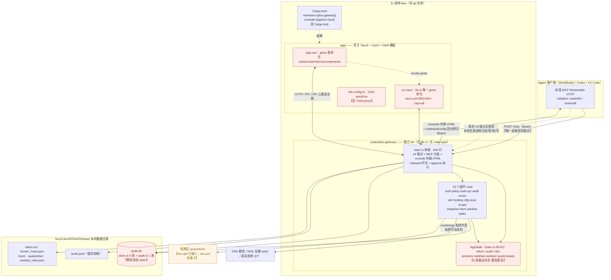
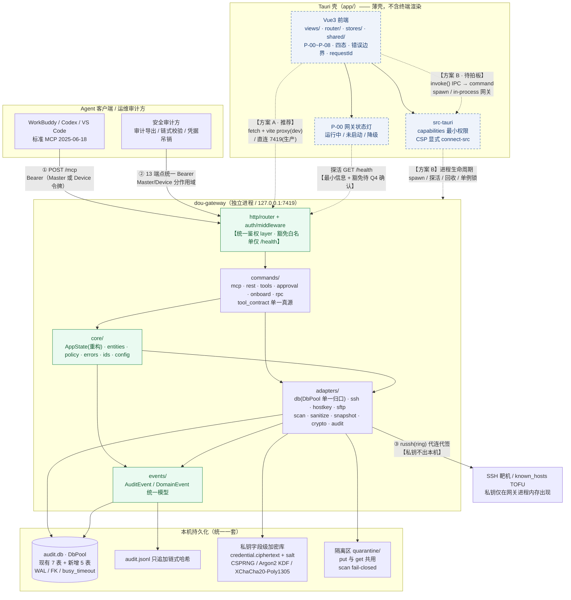
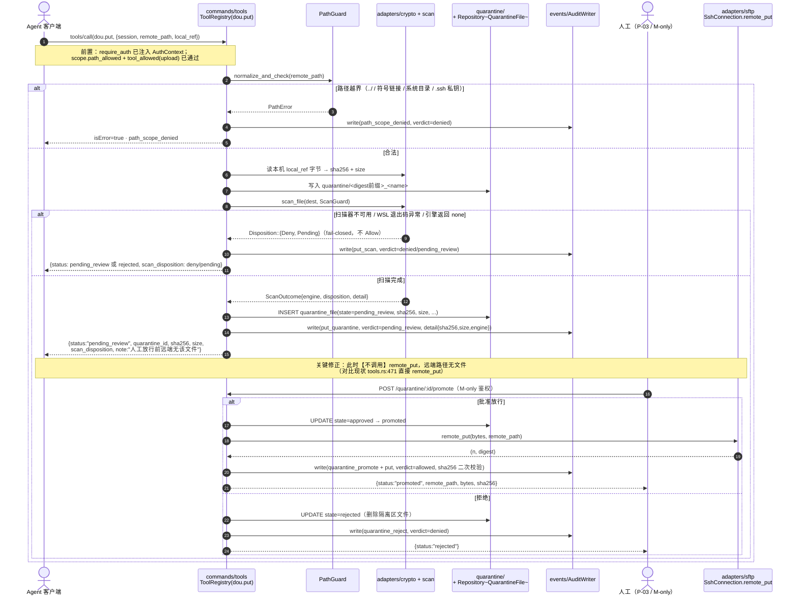
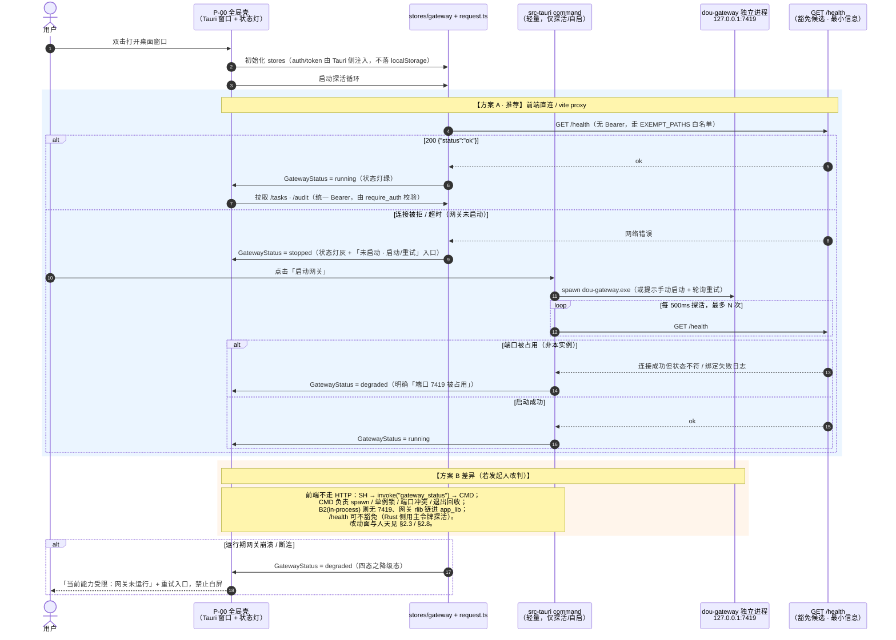
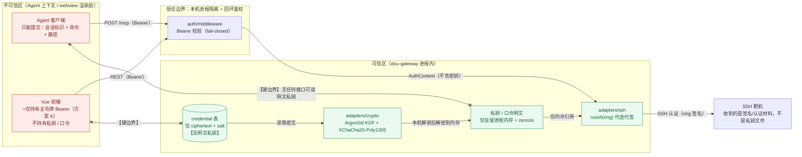

# 02 · 豆 Dou 系统架构设计与任务分解（接手版）

> 本文是**可直接照着开工的架构与分工说明书**：给出发起人/交付总监的决策门禁、给工程师的分层与接口形状、给 PM 的需求修正建议、给 QA 的共同验收输入（但**不含测试策略/用例**，那是严过关下一阶段产出）。
> 本阶段为**部分工作流**：只做接手梳理 + 架构规划 + 任务分工。不写业务代码、不改任何现有源码、不运行构建/测试命令、不产出视觉稿、不产出测试策略。

---

## 1. 文档信息 / 架构决策摘要

### 1.1 文档元数据

| 项 | 内容 |
|---|---|
| 文档名 | 02-系统架构设计与任务分解.md |
| 版本 | v1.0（接手首版架构与分工说明书） |
| 日期 | 2026-11-11 |
| 作者 | 高见远（Gao）· 架构师 |
| 派发 | 齐活林（交付总监）· 第 3 阶段任务 |
| 上游输入 | ① `docs/handover/00-项目预览-接手上下文包.md`（全貌勘察 / F1–F10 / 八问）；② `docs/handover/01-接手版PRD-现状梳理.md`（**完整通读**，重点 §3 真实基线、§6 25 条需求池、§7 信息架构、§9 风险、§10 八问、§11 九条交接要点）；③ 源码只读核验（清单见 §1.4） |
| 下游读者 | 齐活林（汇总）、许清楚（PM，需求修正）、严过关（QA，验收共同输入）、发起人巫伟鑫（Q1~Q8 拍板）、后端/前端工程师（照 §4/§5/§11 开工） |
| Language | 中文 |
| 性质 | 架构设计 + WBS + RACI；**非** 实现代码、**非** 测试策略、**非** 拍板结论 |

### 1.2 基线声明（铁律，沿用 00 包 §0 / PRD §1）

**唯一基线 = 当前工作区代码**。经本轮只读复核，确认以下事实为设计输入（全部【代码已验证】）：

| # | 基线事实 | 证据（相对路径 / 行号） |
|---|---|---|
| B1 | `crates/dou-gateway` 是 axum 0.8 + tokio + russh 0.65.1(ring) + russh-sftp 3.0.1 + rusqlite 0.41.1(bundled) + sha2 0.11.1 + regex 1.13.1 的可运行网关；`main.rs` 单根，15 条 `mod` 声明，共 16 个扁平 `.rs`，**无 `lib.rs` / 无 `crate-type`** | `crates/dou-gateway/Cargo.toml`、`src/main.rs:6-20` |
| B2 | `AppState`（`main.rs:38-50`）挂 `token / audit / dev / sessions / taskhub / sanitizer / quota / leases` 共 8 个字段（其中 5 个共享容器）；`tasks.rs` 为纯内存 `Vec<Task>`（`tasks.rs:54-56`），`quota`/`leases`/`sessions` 全内存，进程重启即丢；`store.rs` 的 `session` 表（`store.rs:66-73`）**无任何调用点** | `src/main.rs:38-50,151-160`、`src/tasks.rs:54-56`、`src/store.rs:164-180` |
| B3 | 14 个 HTTP 端点（`main.rs:162-176`，13 处 `.route()`，`/scope/tokens` 挂 GET+POST 两 method）中**仅 `/mcp` 在 handler 内部做 Bearer 校验**（`main.rs:563-574`），其余 13 个端点无鉴权；`Router` 上**无任何 middleware / layer** | `src/main.rs:162-176`、`src/main.rs:563-574` |
| B4 | `main.rs:63` `DOU_DEV_MODE` 未设置即 `unwrap_or(true)`；`:74` 启动日志**明文打印主令牌**；`:288` `/console` 内联 HTML 输出 `Authorization: Bearer {token}`；`:378` `/onboard/config` 生成含**明文 Bearer** 的配置片段 | `src/main.rs:63,74,288,378` |
| B5 | `auth.rs:63-84`、`scope.rs:65-83` 各有一份 xorshift64* `rand_hex`；`auth.rs:90-101` 配对码由时间纳秒派生；`scope.rs:55-63` `hash_token` 用 `DefaultHasher`（SipHash）+ 固定盐 | `src/auth.rs:63-84,90-101`、`src/scope.rs:55-63,65-83` |
| B6 | `store.rs:31-126` 建 6 表（project/host/credential/session/snapshot/policy_rule）+ `credential` 平滑补 5 列；`audit.rs:168-185` 另建 `audit` 表；**两模块各自 `Connection::open` 同一个 `%LOCALAPPDATA%/dou/audit.db`**（`store.rs:11-15` vs `audit.rs:163-165`） | `src/store.rs:11-15,31-126`、`src/audit.rs:163-185` |
| B7 | 时间单位混用：`store.rs::now_ms()` 用毫秒、`audit.rs::now_ts()` 毫秒但存为 TEXT、`credential.expires_at`（`scope.rs:123`）与 `leases`（`tools.rs:167`）用**秒**、`LEASE_SECS=1800`（`auth.rs:119`） | `src/store.rs:17-22`、`src/audit.rs:21-27`、`src/scope.rs:123`、`src/tools.rs:167`、`src/auth.rs:119` |
| B8 | `app/` 是官方 Tauri2 + Vue3.5 + Vite8 模板：`App.vue` 仅 greet 表单（`app/src/App.vue:1-48`）、`lib.rs` 唯一 `greet` 命令（`app/src-tauri/src/lib.rs:2-5`）、`tauri.conf.json` 800×600 / `title:"app"` / `csp:null`、`vite.config.ts` 无 7419 proxy、`app/dist` 不存在 | `app/package.json`、`app/vite.config.ts:16-31`、`app/src-tauri/tauri.conf.json:13-22` |
| B9 | `Cargo.toml` 用 `exclude=["app/src-tauri"]` 隔离；`app/src-tauri/Cargo.toml` 有**自己的** `[lib] crate-type=["staticlib","cdylib","rlib"]`（`name="app_lib"`）与独立 `Cargo.lock`；两条 Rust 工程**HTTP / Tauri IPC / FFI 三通道全断** | `Cargo.toml:1-4`、`app/src-tauri/Cargo.toml:10-15` |
| B10 | `tools.rs:59` `dou.put` 描述称「先落隔离区审查」，`:441-482` `put()` 直接 `conn.remote_put`；`:31-40` `dou.exec` 的 `inputSchema` 未声明 `background` 但 `:180` 读取；`:261` 提示引用不存在的 `dou.task_status`；`:560` `not_implemented` 死代码；`:376-393` `check_remote_path` 用字符串 `contains`（`/home/*/.ssh/id_` 的 `*` 是字面量）；`exec`（`:152-340`）**完全不调用** `check_remote_path` | `src/tools.rs:31-40,59,152-340,180,261,376-393,441-482,560` |
| B11 | `scan.rs:72-89`（Windows clamscan）、`:93-114`（WSL clamscan）均以 `code==1` 判感染，退出码为 2/其他时 `infected=false` → 无规则命中即 `Allow`；`:116-120` 三级降级 `engine:"none"` 无命中直接 `Allow` | `src/scan.rs:72-129` |
| B12 | `policy.rs:29-44` 用硬编码 `AUTO_HEADS`/`BLOCK_PATTERNS`；`store.rs:229-281` 的 `list_rules`/`upsert_rule`/`seed_builtin_rules` **无调用点**于 `classify`；`snapshot.rs:95` 固定 `id = "snap_{fp[..12]}"` 撞 `store.rs:197` 裸 `INSERT`（无 `ON CONFLICT`）→ 主键冲突被 `tools.rs:279 .unwrap_or(...)` 静默吞掉 | `src/policy.rs:29-44`、`src/store.rs:197,229-281`、`src/snapshot.rs:95`、`src/tools.rs:279` |
| B13 | 非 git 仓库（无 `.git`）；构建硬约束：`.cargo/config.toml` 写死 `E:/dou-target` 与用户级 WinGet 绝对路径、`scripts/build.ps1` 强制 `Stop-Process dou-gateway`、`scan.rs:46-55` 写死 `C:`/`E:` 与 `Ubuntu-22.04` | `.cargo/config.toml:9-14`、`scripts/build.ps1:8-40`、`src/scan.rs:46-55` |

> **一律不得作为设计输入**：`docs/PLAN-V2.md:12-19`、`docs/GAP-REPORT.md`、`docs/TEST-REPORT.md`、`docs/spike-report-009~011.md` 中带 ✅ 的「完整客户端 / 五页面 / 终端 / SFTP 树 / 1320×1000 窗口 / `gateway_status` / `ensure_gateway_started()` / 三方编译通过」—— 对应 PRD §3.1 的 C-01~C-05 全为「不存在」，C-06 `E:\dou-app\` 仓库外无法核验。逐行对照见 PRD §3.1（11 行）。

### 1.3 阅读标记法（全文通用）

| 标记 | 含义 |
|---|---|
| 【代码已验证】 | 本轮只读打开源码核对过，附相对路径 / 行号 |
| 【文档声称】 | 来自 `docs/`，未按代码复核，视为历史态 / 目标态 |
| 【PM 需求】 | 来自 `01-接手版PRD` §6 需求池，非架构结论 |
| 【架构决策】 | 本设计确定的技术方案 / 分层 / 接口 / 选型（架构师职责内） |
| 【架构裁定】 | 架构师对需求口径的澄清或修正（含对 PRD 的纠偏，见 §14） |
| 【待发起人拍板】 | 命中 `ROADMAP.md:13-20` 停机情形，架构师只给选项与代价，不替拍板 |
| 【独立复核】 | 本设计对 PM 初估人天 / 需求描述的复核值，附差异与依据 |

### 1.4 本轮只读核验的源码清单（未修改任何文件）

`crates/dou-gateway/src/`：`main.rs`、`tools.rs`、`auth.rs`、`scope.rs`、`store.rs`、`policy.rs`、`tasks.rs`、`audit.rs`、`scan.rs`、`hostkey.rs`、`ssh.rs`、`sftp.rs`、`errors.rs`、`rpc.rs`、`sanitize.rs`、`snapshot.rs`（16 个全覆盖）；
`Cargo.toml`、`crates/dou-gateway/Cargo.toml`、`.cargo/config.toml`、`scripts/build.ps1`；
`app/package.json`、`app/vite.config.ts`、`app/src/App.vue`、`app/src-tauri/tauri.conf.json`、`app/src-tauri/src/lib.rs`、`app/src-tauri/Cargo.toml`、`app/src-tauri/capabilities/default.json`；
`docs/ROADMAP.md`、`docs/ADR-001-网关优先.md`；`docs/handover/00-*`、`docs/handover/01-*`。

### 1.5 架构决策摘要（先读这 9 条）

| # | 决策 / 结论 | 类别 | 详见 |
|---|---|---|---|
| D1 | **Q4 推荐方案 A：HTTP 7419 独立进程 + 前端直连/proxy**；给出方案 B（Tauri command spawn / in-process）完整对比与不可回退点；**拍板归发起人**，状态「提议中，待发起人拍板」 | 【待发起人拍板】+【架构决策：推荐】 | §2 |
| D2 | **`/health` 架构裁定 = 豁免鉴权，但收敛为「最小信息探活」+ 显式白名单**，且随 Q4 一并请发起人确认（不单独拍板） | 【架构裁定】+【待发起人拍板】 | §2.6 |
| D3 | 13 个裸奔端点在**架构层统一收口**：`axum::middleware::from_fn_with_state` 单层挂在 `Router`，豁免清单集中常量；`/mcp` 现有 handler 内 Bearer 校验**上移**到中间件，杜绝逐路由打补丁 | 【架构决策】 | §5.4 / §7.2 |
| D4 | **把「抽 `lib.rs`」从 Q4 阻塞项里解耦**：抽 `lib.rs` + `crate-type=["rlib"]` 是分层与可测试性需要，**与 Q4 无关、可提前做**；只有「把网关链接进 Tauri 壳」才需要方案 B 的 `cdylib/staticlib` + workspace 合并 | 【架构裁定】（对 PRD §6.3 P2-02 的纠偏） | §4.3 / §14 |
| D5 | **统一一套状态模型**：新增 `task / lease / quota_counter / hostkey_challenge / quarantine_file` 5 表 + 现有 7 表归口到 `DbPool`；`audit.rs` 与 `store.rs` 的双 `open()` 合并；`sessions` 因含 `russh` handle **不可持久化**，仅元数据落 `session` 表、重启需重连（对 PRD P1-04 口径的纠偏） | 【架构决策】+【架构裁定】 | §5.2 / §5.3 / §14 |
| D6 | **时间单位统一**：内部 epoch 毫秒（INTEGER），对外 ISO 8601 UTC；`LEASE_SECS` 折算毫秒比较；消除 B7 的秒/毫秒混用 | 【架构决策】 | §8.4 |
| D7 | **令牌哈希不引入慢哈希**：设备令牌是高熵 CSPRNG 值，用 `sha256(random_salt || plain)`（复用已有 `sha2`）；`argon2` 仅用于 P1-08 私钥加密库的**用户解锁口令 KDF** | 【架构决策】 | §7.3 / §9.1 |
| D8 | **工具契约单一真源**：`commands/tool_contract.rs` 定义 5 工具 `ToolSpec`，`list()` 与 `call()` 从同一真源生成，根治 schema/实现漂移；`dou.put` 落「隔离区 + 扫描 + 人工放行」最小闭环 | 【架构决策】 | §5.5 / §6.2 |
| D9 | **人天独立复核 = 85.0 人天**（PM 初估 74.0，差异 +11.0）；拆 **5 个实现任务包（T01~T05，= 5 个 Batch）+ 38 个文件级验收工单（W-01~W-38）**；关键路径 = 决策门禁 → T01 → T02 状态模型 → T03 鉴权/契约 → T04 形态 → T05 门禁发布 | 【独立复核】 | §11 / §12 / §14 |

### 1.6 本设计不解决什么（工作流边界）

1. **不写业务代码**：只给 trait/struct/TS 类型的**签名与约束**（§5.7），不写函数体、不写 SQL 实现、不写组件模板。
2. **不修改任何现有文件**：含 `00-*`、`01-*`、`README.md`、全部 `src/**`、全部配置；本轮只新增 `docs/handover/02-*` 文件。
3. **不运行构建 / 测试 / lint**：未执行 `cargo`、`npm`、`vue-tsc`、`cargo test`、任何 `tools/*.py`。
4. **不产出测试策略 / 测试用例 / 覆盖率套件设计**：那是严过关（QA）下一阶段产出。本文只给「机器可验的完成判据」（§11）与「共享验收输入」（§5.5/§5.6/§8.1）。
5. **不核验仓库外 `E:\dou-app\`**（Q1，无只读权限），不编造其内容。
6. **不替发起人拍板**：Q1/Q2/Q3/Q4/Q5/Q6/Q7/Q8 全部只给门禁表、选项、代价与不决后果（§2 / §14.3）。
7. **不产出视觉稿 / 组件库 / 设计 token**：信息架构沿用 PRD §7（P-00~P-08），本设计只定其**目录、数据通道、鉴权依赖**。

---

## 2. ADR-002 · Tauri 壳与网关桥接形态（第一份产出）

> 依据 PRD §11-4 与派发任务要求，ADR-002 是架构师**第一份产出**。正式归档文件为 `docs/ADR-002-Tauri壳与网关桥接形态.md`（列入 §10 新增表 / T01），本节为其完整内容草案。
> 命中 `docs/ROADMAP.md:18` 停机第 4 条「需求本身矛盾，两种解法代价差 3 倍以上且不可回退」。

### 2.1 ADR 头信息

| 项 | 内容 |
|---|---|
| 编号 | ADR-002 |
| 标题 | Tauri 壳与 MCP 网关的桥接形态 |
| **状态** | **提议中 · 待发起人拍板**（架构师给推荐与代价，**不替拍板**） |
| 日期 | 2026-11-11 |
| 提议人 | 高见远（架构师） |
| 决策人 | **巫伟鑫（发起人）**；齐活林（交付总监）确认排期口径；许清楚（PM）确认范围口径 |
| 关联 | `docs/ADR-001-网关优先.md:36`（冲突，见 §2.7）、PRD §2.3 张力 T1 / §10 Q4 / §11-4、00 包 §1.3 桥接缺口、`docs/ROADMAP.md:18` 停机第 4 条 |
| 阻塞 | **Q4 未定前，P1-02 / P1-06 / P-00 及 PRD §7.3 全部导航关系不可排期**（本文 §11/§12 已体现该阻塞） |

### 2.2 背景（代码事实，非文档声称）

- 【代码已验证】网关是**独立二进制**：`main.rs:52` `#[tokio::main] async fn main()`，无 `lib.rs`、无 `crate-type`（B1）；监听 `127.0.0.1:7419`（`main.rs:35,64`），非回环地址 `exit(2)`（`main.rs:66-69`）。
- 【代码已验证】壳是**独立 Tauri 工程**：`app/src-tauri/Cargo.toml:10-15` 有自己的 `[lib] app_lib` + 3 种 crate-type + 独立 `Cargo.lock`；顶层 `Cargo.toml:3` `exclude=["app/src-tauri"]`（B9）。
- 【代码已验证】三条通道全断：`#[tauri::command]` 全仓仅 `greet`（`lib.rs:2`）；`vite.config.ts:16-31` 无 7419 proxy；`App.vue` 无 fetch；`package.json` 无 HTTP 客户端（B8）。
- 【文档声称 / 不可采信】`spike-report-009~011.md` 的 `gateway_status` / `ensure_gateway_started()` 在 `lib.rs` 中不存在（PRD §3.1 C-04）。
- 【代码已验证】网关 14 端点中 13 个无鉴权（B3），`/console` 与 `/onboard/config` 还会**回吐主令牌明文**（B4）。因此「壳能连上网关」与「连上之后是否安全」是两件事，Q4 必须与 P0-01 一并考虑。
- 【文档声称 / 环境事实待核】`00 包 §4-4`：Tauri 壳在 GNU 工具链下 `ld.exe: export ordinal too large: 92875`，文档称需 MSVC；而 `README.md:27` 称本机无 MSVC（PRD §10 Q6）。

### 2.3 两个备选方案

| 维度 | **方案 A · HTTP 7419（独立进程 + 前端直连 / vite proxy）** | **方案 B · Tauri command spawn（含 in-process 变体）** |
|---|---|---|
| **形态定义** | 网关保持现状的独立 `.exe`，监听回环 7419；Tauri 壳只是「浏览器窗口 + 托盘」，Vue 通过 proxy（dev）/ 直连（生产 webview）访问 7419；进程自启作为**可选增强**（托盘命令 / 快捷方式），不是桥接的必要条件 | 壳通过新增 `#[tauri::command]` 管理网关（启动/停止/探活/取状态），前端只走 IPC；变体 B2「in-process」把网关 `rlib` 链接进壳，HTTP 通道消失 |
| **改动面** | 前端为主：`vite.config.ts` 加 proxy、`app/src/**` 建页面、`tauri.conf.json` 收口 CSP/窗口/`productName`、`capabilities` 视是否加 spawn 命令而定；**网关产物形态零改动** | 前后端 + 工程治理全动：`lib.rs` 加多个 command、`main.rs` 启动顺序改造、`Cargo.toml` 去 `exclude` 或加 path 依赖、双 `Cargo.lock` 统一、网关抽 `lib.rs` + `crate-type`、IPC 权限清单、进程单例/回收 |
| **文件级影响** | `app/vite.config.ts`、`app/src/**`（views/router/stores/shared）、`app/src-tauri/tauri.conf.json`、`app/src-tauri/capabilities/default.json`（可选）、`app/package.json`；网关侧仅 `main.rs` 的 `/health` 收敛与鉴权层（属 P0-01，不算桥接成本） | 上述全部 + `app/src-tauri/src/lib.rs`、`app/src-tauri/src/main.rs`、`app/src-tauri/Cargo.toml`、`Cargo.toml`、两个 `Cargo.lock`、`crates/dou-gateway/Cargo.toml`（`[lib]`/`crate-type`）、`crates/dou-gateway/src/lib.rs`（**新建**）、`src/main.rs`（改为调用 lib） |
| **`exclude` / 双 Cargo.lock 治理** | **保留 `exclude`、保留双 `Cargo.lock`**：两套工程继续独立构建，互不污染；`scripts/build.ps1` 继续只管网关 | B1（spawn 独立进程）可保留 `exclude`；**B2（in-process）必须移除 `exclude`** 并把 `app/src-tauri` 纳入 workspace 或声明 path 依赖 → 双 lock 必须合并为一份，触发全量依赖解析与版本冲突排查（tauri 2 / edition 2024 vs 网关 edition 2021） |
| **`lib.rs` / `crate-type` 需求** | **桥接不要求**（见 §4.3 架构裁定 D4）。抽 `rlib` 仅为分层 + 集成测试，Q4 无关 | B1 不强制；**B2 强制**：网关需 `crate-type=["rlib", ...]` 且壳侧 `app_lib` 链接它；`main.rs` 不能再是唯一根 |
| **端口冲突治理** | 单端口 7419；已有 `main.rs:178-184` 绑定失败 `exit(3)`，补「启动前探活 / 已有实例则复用」即可；壳退出不必然杀网关（可常驻） | 同样要治理 7419（B1）；B2 无端口但需处理「壳内网关与外挂网关实例」并存；均需单例锁 + 崩溃重启 + 退出回收 |
| **进程生命周期** | 简单：网关生命周期与壳**解耦**，可独立启停、`build.ps1` 停进程逻辑不变；壳只负责「探活 + 状态灯 + 引导启动/重试」 | 复杂：壳必须管理子进程（spawn / kill / 崩溃重启 / 退出时回收 / 防止僵尸 / 端口占用重试）；B2 则网关随壳同生共死，壳崩溃=网关断 |
| **MSVC / Q6 依赖** | **弱**：Q6=无 MSVC 时可退化为「纯 Web 前端直连 7419 / 只交付网关 + `/console`」，形态范围不崩（对齐 PRD §10 Q6「Web 前端直连 7419 / 托盘」） | **强**：桌面壳必须能编译；Q6=无 MSVC 时整个桌面形态**不可交付**，且需解释 `README.md:27` / `TEST-REPORT.md:21` / 00 包 §4-4 三处矛盾；命中 ROADMAP 停机第 3 条（需提权装 MSVC） |
| **安全边界** | 主令牌需进入 webview（前端持有 Bearer）→ 必须 `csp` 收口 `connect-src 'self' http://127.0.0.1:7419`、禁 `unsafe-inline`、token 存 Tauri 侧而非 localStorage；本机其他进程访问 7419 由 P0-01 统一鉴权兜住 | 更强：token 可留在 Rust 侧由 command 注入 / 或 in-process 无网络暴露；但 IPC 命令本身成为新攻击面，`capabilities` 权限清单必须逐条最小化 |
| **可回退性** | **高**：改动集中在前端与配置，网关二进制与 workspace 结构不变；改判方案 B 只需追加 IPC 层，不推翻已做工作 | **低**：一旦合并 workspace / 统一 lock / 抽 `lib.rs` 链接进壳，回退到两套独立工程要拆回依赖、重分 lock、回改 `main.rs`，且前端已按 IPC 写的取值层要重写 |
| **人天（【独立复核】，仅桥接相关）** | P1-02 = **3.0**（含 proxy + 探活/状态灯 + CSP + 权限清单回归） | B1 = **5.0**；B2 = **6.5~7.0**（再加 workspace/lock 治理 1.5）；且 P2-02 分层由 6.0 上浮至 8.0 |
| **对 30MB 包体约束** | 网关与壳分体，壳包体只含前端；无新增大依赖 | in-process 会把 russh/ring/rusqlite(bundled) 链进壳二进制，包体显著上升，需重新对照 `ROADMAP.md:30` / `PLAN-V2.md:121` 的 30MB 口径 |

### 2.4 推荐方案与理由

> **【架构决策：推荐方案 A · HTTP 7419】** —— 但**最终拍板归发起人**，本条是建议不是结论。

理由（按权重）：

1. **贴合唯一基线、最小变更**：基线里网关就是「可运行的独立 bin」（B1），方案 A 保持其产物形态与 workspace 结构不变，只补前端与配置；方案 B2 要推翻 B1/B9 两处结构事实。ADR-001「网关优先」方向下，壳应保持**薄**。
2. **不触发不可逆的工程治理**：`exclude` / 双 `Cargo.lock` / `lib.rs`+`crate-type` 三项在方案 A 下全部不需为桥接而动（D4 把 `rlib` 抽取解耦为分层任务）。方案 B2 的 workspace 合并是**不可回退点**（§2.5）。
3. **Q6 未定时的韧性**：推荐方案在「无 MSVC」这一 PRD 默认假设下仍可退化为 Web 直连 / 只交付网关，形态不崩；方案 B 在 Q6=false 时**整体阻塞**。在 8 个问题有 5 个需停机的接手期，选对环境依赖更弱的一侧更稳。
4. **代价差 >3 倍且不可回退，应默认取低代价侧**：命中 ROADMAP §0 停机第 4 条，架构师有义务把「高代价不可逆」方案明确标为需发起人显式拍板，而不是自主选它。
5. **与 P0-01 解耦**：桥接只负责「连得上」，安全由统一鉴权中间件独立收口；方案 A 下两者可并行推进（T03 与 T04 部分并行）。

**诚实列出方案 A 的代价（不作为推荐障碍，但须写入工程约束）**：
- 主令牌进入 webview → `csp:null` 现状（`tauri.conf.json:21`）必须改为显式 CSP，token 不得落 `localStorage`；由 T01/T04 落地。
- `/console`（`main.rs:288`）与 `/onboard/config`（`main.rs:378`）回吐主令牌明文 → 必须 Master-only 鉴权 + 前端不缓存（§5.6）。
- 网关「自启」不是免费的：P-00 状态灯的「启动 / 重试」入口需要 Tauri 侧 command 或外部快捷方式（轻量，仍属方案 A）；若完全不做自启，则 US-04 的「双击打开、不必手动跑 exe」只能部分满足，须在 Q8 范围里如实标注。
- 端口 7419 被本机其他进程占用时需明确报错（`main.rs:181` 已有），壳要能区分「未启动」与「端口被占」。

### 2.5 不可回退点清单（供发起人重点看）

| # | 不可回退动作 | 属于 | 回退代价 |
|---|---|---|---|
| I1 | 移除 `Cargo.toml` 的 `exclude=["app/src-tauri"]`、把壳纳入 workspace | 方案 B2 | 需重新拆两套工程、重分依赖 |
| I2 | 合并双 `Cargo.lock` 为一份 | 方案 B2 | 依赖版本冲突排查（edition 2024 / 2021、tauri 2 vs russh 0.65 传递依赖），且历史锁文件不可复原 |
| I3 | 网关加 `crate-type=["cdylib","staticlib"]` 并把 `dou_gateway` 链接进 `app_lib` | 方案 B2 | `main.rs` 入口语义改变、FFI/ABI 面长期维护 |
| I4 | 前端取值层全面改为 `invoke()` IPC（不留 HTTP 通道） | 方案 B1/B2 | 页面数据层需重写；方案 A 的 proxy + fetch 层作废 |
| I5 | 把 `/health` 定为「永久豁免」并让外部监控依赖它 | 两方案共有 | 后续若要收紧鉴权，外部依赖方需同步改造（故 §2.6 要求「最小信息 + 显式白名单」） |
| I6 | 网关进程生命周期与壳绑定（壳退出即杀网关） | 方案 B1 | 与 `build.ps1:34-38` 的停进程逻辑、与「网关可独立内测」的 Q8 口径冲突，回退需重定启动约定 |

> **架构师的保守安排**：T01（基础设施）与 T04（形态）中所有涉及 I1~I4 的动作**一律排在 Q4 拍板之后**；Q4 未定前只做「两方案都需要的」公共项（git 化、`rlib` 分层、CSP 基线、统一鉴权、状态模型）。见 §11 门禁列与 §12 依赖图。

### 2.6 `/health` 鉴权裁定

> **【架构裁定】建议：豁免鉴权，但收敛为「最小信息探活 + 集中式显式白名单」；随 Q4 一并请发起人确认（不单独拍板、不默认生效）。**

| 项 | 裁定 |
|---|---|
| 是否豁免 | **建议豁免**（`/health` 是唯一豁免端点） |
| 返回体 | 由现状 `"ok"`（`main.rs:192-194`）改为 `{"status":"ok"}`；**禁止**回传版本号、令牌、会话数、审计条数、`bind` 地址等任何可枚举信息 |
| 实现位置 | 在统一鉴权中间件里用 `const EXEMPT_PATHS: &[&str] = ["/health"];` **集中声明**（§5.4），不是逐路由 `if`；`/mcp` 不豁免 |
| 审计 | 探活**不写**审计（避免高频噪声）；但探活频次异常可作为后续可观测项，不属本期 |
| 网络前提 | 沿用 `main.rs:66-69` 非回环 `exit(2)`；豁免仅在回环监听下成立 |
| 理由 | ① 桌面壳 P-00 状态灯、vite proxy 健康检查、外部探针都需要在**无凭据**时判断「网关活着」；② 若要求 Bearer，则壳启动前必须先拿到主令牌，而主令牌由网关签发/读取（`auth.rs:18-37`）→ 形成鸡生蛋；③ `/health` 不含敏感信息，豁免不扩大攻击面，真正的风险在另外 13 个端点（B3/B4），由 P0-01 统一收口 |
| 若不豁免的替代 | 方案 B 下可由 Tauri command 在 Rust 侧用主令牌探活（不需要 HTTP 豁免）；方案 A 下则需壳先从 `token.txt` 读主令牌 —— 但这等于把令牌文件交给壳，安全边界更差，**不推荐** |
| 对 PRD 的纠偏 | PRD §7.2 P-00 数据源写「`/health`（现有，无鉴权）」属于把「待拍板」写成「既定」；建议改为「`/health`（豁免与否随 Q4 拍板，架构建议豁免+最小信息）」，详见 §14 |

### 2.7 调和 ADR-001:36 冲突

【文档声称】`docs/ADR-001-网关优先.md:36`：「建立 `crates/dou-gateway`，先实现协议层与策略层，**暂不引入 Tauri 外壳**」。
【代码已验证】`app/` 存在完整 Vue3 + Vite8 + Tauri2 工程，`Cargo.toml:3` 用 `exclude` 刻意隔离（PRD §2.3 张力 T1）。

**调和结论（写入 ADR-002「后果」章节，供 T01 归档）**：

1. ADR-001 的**方向仍然成立**：网关优先、终端形态押后、8–10 周出可验证物、不含自有终端渲染 / SFTP 树 / 编辑器（`ADR-001.md:14-19`）、配「极简审计面板」（`:18`）。本设计全部需求收敛与 Q8 默认假设（收缩到「网关可内测」）据此不变。
2. `:36` 的「暂不引入 Tauri 外壳」应**重新界定语义**，而非判定 ADR-001 作废：其真实意图是「不把资源投到终端形态」，而 `app/` 里的 Tauri 工程是**官方模板脚手架**（`App.vue` 只有 greet、`lib.rs` 只有 `greet`），从未承载任何终端能力 → **脚手架的存在不等于「引入 Tauri 形态」**。
3. 因此新 ADR 的调和表述建议为：
   > ADR-001 的「暂不引入 Tauri 外壳」在接手时被工作区内的 `app/` 模板工程从字面上推翻，但从决策意图上并未被推翻。现明确：**`app/src-tauri` 仅作为预留的桌面壳模板存在，不构成已采纳的形态决策；Q4 桥接形态由 ADR-002 单独决策，且无论选 A 或 B，本期范围都不含 ADR-001 明确排除的终端渲染 / SFTP 文件树 / 内置编辑器（对齐 PRD N-01/N-02）。**
4. `ADR-001.md:32` 代价第 3 条「架构不能只按网关设计」**反而是本设计的直接依据**：现状 `main.rs` 单根 + 16 个扁平 `mod` + 无 `lib.rs`（B1）恰是「只按网关设计」的形状 → 触发 §4 分层重构与 §5 统一状态模型（P2-02 / P1-04）。本设计用 D4（抽 `rlib` 与 Q4 解耦）回应这条代价。
5. 文档状态标注：ADR-001 保持「已采纳」，但在 `docs/ADR-001-网关优先.md:36` 加脚注指向 ADR-002；由 P2-05 / T05 执行（PM + 架构师）。

### 2.8 对下游任务的影响矩阵（Q4 二选一）

| 下游任务 / 交付物 | 方案 A 下 | 方案 B 下 | 是否被 Q4 阻塞 |
|---|---|---|---|
| T01 · `Cargo.toml` / 双 lock 治理 | 保留原样，仅加 `[lib] rlib`（分层用） | 需去 `exclude` / 合 lock / 加 crate-type | **是**（B2 部分） |
| T01 · `vite.config.ts` proxy | 必须做 | 不需要（改 IPC） | **是** |
| T01 · `tauri.conf.json` CSP / 窗口 | 必须做（connect-src 放行 7419） | 必须做（但不含 7419） | **是**（内容不同） |
| T03 · 统一鉴权中间件 | 两方案都要（HTTP 端点仍在） | 两方案都要（B1 仍有 HTTP；B2 端点转 command 但鉴权语义不变） | 否（**可提前**） |
| T02 · 统一状态模型 / `DbPool` | 两方案都要 | 两方案都要 | 否（**可提前**） |
| T03 · MCP 五工具契约一致性 | 两方案都要 | 两方案都要 | 否 |
| P1-02 · 最小打通 | 3.0 人天 | B1 5.0 / B2 6.5~7.0 | **是** |
| P1-06 / P-00~P-08 前端页面 | 数据层走 `fetch` + Bearer | 数据层走 `invoke()` IPC | **是** |
| P2-02 分层重构 | 6.0 人天 | 8.0 人天（含 workspace 合并） | 部分（D4 已解耦 `rlib` 抽取，可提前） |
| `/health` 豁免裁定 | 建议豁免（鸡生蛋） | 可不豁免（Rust 侧探活） | **是**（随 Q4 拍板） |
| Q6（MSVC）耦合 | 弱，可退化 Web 直连 | 强，Q6=false 则整体阻塞 | **是** |
| Q8 首发范围 | 6 页最小集可交付 | 6 页最小集可交付但依赖壳编译 | **是**（间接） |

---

## 3. 现状架构图 → 目标架构图

### 3.1 现状架构（【代码已验证】基线，含缺口标注）



**现状图的 6 个结论**：① 三通道全断（`x--x`）；② 13 端点裸奔；③ 5 容器内存态；④ SQLite 两处各自 `open`；⑤ `dou.put` 未接隔离区；⑥ `/console` 与 `/onboard/config` 回吐主令牌明文。

### 3.2 目标架构（Q4 分叉用虚线表示）



**目标图要点**：
- **边界**：Agent 客户端 / 网关进程 / Tauri 壳 / SQLite / SSH 靶机 / 隔离区六者清晰分离；私钥只在「网关进程内存 → SSH 靶机」这条边上出现（§7.1）。
- **Q4 分叉**：方案 A 为 `WEB -.-> LAYER`（实线语义、虚线绘制表示「推荐但待拍板」）；方案 B 为 `WEB -.-> IPC -.-> GW2`，且 B2 会把 GW2 由独立进程改为壳内链接（图中不再画出 7419 端口）。**两条分支互斥，不可同时实现**。
- **统一收口**：`auth/middleware` 是唯一鉴权层，`/health` 是唯一豁免候选；`DbPool` 是 SQLite 唯一访问归口；`events/` 是审计与领域事件唯一出口。
- **状态持久化**：`core/entities` 的 Task / Lease / Quota / SessionMeta 由 `adapters/db` 落库，`sessions`（SSH 连接对象）仍是运行时句柄缓存，不落库（D5）。

---

## 4. 分层与模块划分

### 4.1 Rust 侧目标目录树（`core / adapters / commands / events` 四主干 + `auth / http` 两横切装配层）

> 【架构决策】`core/adapters/commands/events` 是主理人点名的主干四层；`auth/`（鉴权中间件与令牌/作用域）与 `http/`（路由装配）是**横切装配层**——它们既不属于纯领域逻辑，也不属于单一用例，单列以免污染四层依赖方向。
> **依赖方向（构建期可检出）**：`http → commands → core`；`commands → adapters`；`adapters → core`（仅依赖实体/接口，不反向依赖 commands）；`events` 被 core/adapters/commands 共同依赖；`auth` 被 `http` 依赖。**禁止 `core → adapters`、`core → commands` 的反向引用**（由 T05 的 CI 静态检查兜底，属判据不属测试设计）。

```
crates/dou-gateway/
├── Cargo.toml                          # 改：加 [lib] crate-type=["rlib"] + 新依赖（T01）
├── src/
│   ├── lib.rs                          # 新：crate root，pub mod 声明 + pub fn run()（T01/T02）
│   ├── main.rs                         # 改：仅 fn main() -> dou_gateway::run()（T01/T02）
│   ├── core/                           # 领域模型与纯逻辑（无 IO）
│   │   ├── mod.rs
│   │   ├── config.rs                   # 新：Config（bind/dev/data_dir/protocol_version）+ 环境变量收敛，dev 默认关
│   │   ├── state.rs                    # 新：AppState 重构（§5.2）+ StateCache
│   │   ├── entities.rs                 # 新：Task / Lease / QuotaCounter / SessionMeta / Credential / Scope / Quota 持久化实体
│   │   ├── policy.rs                   # 移：policy.rs；改读 DB 规则、参数级结构解析、返回 rule_id + 解释
│   │   ├── errors.rs                   # 移：errors.rs；稳定 8 码 + ErrorCode enum
│   │   └── ids.rs                      # 新：CSPRNG 统一 ID / trace_id / 配对码 / 令牌生成（合并两份 rand_hex）
│   ├── adapters/                       # 外部系统适配（唯一允许碰 IO 的层）
│   │   ├── mod.rs
│   │   ├── db/
│   │   │   ├── mod.rs
│   │   │   ├── pool.rs                 # 新：DbPool —— SQLite 唯一访问归口（禁止他处 Connection::open）
│   │   │   ├── schema.rs               # 移：store.rs 建表/迁移 + audit 表；新增 5 表 DDL
│   │   │   └── repositories.rs         # 移/新：task / lease / quota / session / credential / snapshot / rule / audit 的仓储
│   │   ├── audit.rs                    # 移：audit.rs 的 JSONL 只追加 + 链式哈希（LAST_HASH）
│   │   ├── crypto.rs                   # 新：CSPRNG 封装 / 密码学哈希 / 字段级加解密 / zeroize（P1-08）
│   │   ├── ssh.rs                      # 移：ssh.rs（接口保持不动）
│   │   ├── hostkey.rs                  # 移：hostkey.rs（TOFU 核心保持不动）
│   │   ├── sftp.rs                     # 移：sftp.rs（remote_read/put/get 保持不动）
│   │   ├── scan.rs                     # 移：scan.rs（三级降级改 fail-closed）
│   │   ├── sanitize.rs                 # 移：sanitize.rs（6 类正则保持不动）
│   │   └── snapshot.rs                 # 移：snapshot.rs（三段指纹算法保持不动）
│   ├── commands/                       # 用例编排
│   │   ├── mod.rs
│   │   ├── tool_contract.rs            # 新：5 工具 ToolSpec 单一真源（name/description/input_schema/handler）
│   │   ├── tools.rs                    # 移：tools.rs；由 tool_contract 驱动，dou.put 接隔离区闭环
│   │   ├── mcp.rs                      # 新：从 main.rs 抽 handle_mcp / initialize / ping / tools 分发
│   │   ├── rest.rs                     # 新：从 main.rs 抽 audit/tasks/scope/console 等只读 handler
│   │   ├── approval.rs                 # 新：从 main.rs 抽 approve_task + 超时自动拒绝 + 断连置顶/终止
│   │   ├── onboard.rs                  # 新：从 main.rs 抽 onboard_config / onboard_write（三约束回归）
│   │   └── rpc.rs                      # 移：rpc.rs（JSON-RPC 出口形状保持不动）
│   ├── events/                         # 统一事件模型
│   │   ├── mod.rs
│   │   ├── model.rs                    # 新：AuditEvent / DomainEvent 结构 + 事件名常量表（§8.2）
│   │   └── writer.rs                   # 新：AuditWriter 门面（JSONL 链式 + SQLite 双写统一收口）
│   ├── auth/                           # 横切：鉴权
│   │   ├── mod.rs
│   │   ├── middleware.rs               # 新：require_auth + EXEMPT_PATHS + AuthContext/Principal
│   │   ├── token.rs                    # 移：auth.rs（主令牌/配对码/租约常量；改 CSPRNG）
│   │   └── scope.rs                    # 移：scope.rs 的作用域判定部分（DB 部分移交 adapters/db）
│   └── http/
│       ├── mod.rs
│       └── router.rs                   # 新：14 端点唯一装配点 + 统一 layer + 端点→作用域矩阵
└── tests/                             # 新：集成测试目录（QA 主导，架构只给判据，见 §11 T05）
```

### 4.2 现有 16 个 `.rs` 逐一映射表（现路径 → 目标路径 → 层 → 理由）

> 「性质」列：**移**=仅换路径、接口不变；**拆**=单文件拆到多目标；**改**=路径或内容有实质变更；**保持**=路径与核心算法均不动。

| # | 现路径（`crates/dou-gateway/src/`） | 目标路径 | 层 | 性质 | 理由（含证据） |
|---|---|---|---|---|---|
| 1 | `main.rs` | `src/main.rs`（保留，内容收敛）<br/>+ `http/router.rs`、`commands/mcp.rs`、`commands/rest.rs`、`commands/approval.rs`、`commands/onboard.rs`、`core/state.rs`、`core/config.rs` | http/commands/core | **拆+改** | 644 行单根承载 14 路由 + MCP 分发 + `console_page` 内联 60 行 HTML（:239-304）+ `onboard_write`（:431-503）+ `approve_task`（:505-560），违反 ADR-001:32「不能只按网关设计」；`main.rs` 只留入口 |
| 2 | `auth.rs` | `auth/token.rs`（主令牌/配对码/租约常量）<br/>+ `core/ids.rs`（CSPRNG 生成）<br/>+ `core/config.rs`（`data_dir()`） | auth/core | **拆+改** | `:63-84` xorshift、`:90-101` 时间纳秒配对码须换 CSPRNG（F3）；`:13-16` `data_dir()` 是全局路径工具，应收归 `core/config.rs`；`LEASE_SECS`(:119) 保留但单位折算（D6） |
| 3 | `policy.rs` | `core/policy.rs` | core | **移+改** | 三态 `Verdict` + 分段取最坏档算法（:46-115）**保持不动**；`:29-44` 硬编码常量改为读 `policy_rule` 表、加参数级结构解析与 `rule_id` 解释（P1-09 / P0-05）；4 个单测随迁 |
| 4 | `tools.rs` | `commands/tools.rs` + `commands/tool_contract.rs` | commands | **拆+改** | `list()`(:14-86) 与 `call()`(:88-141) 参数漂移（B10）需单一真源；`put()`(:441-482) 接隔离区闭环；`exec()`(:152-340) 补路径校验与 `background` schema；`check_remote_path`(:376-393) 提取到 `core/policy.rs` 或独立 `core/path_guard.rs` 供 `exec/read/put/get` 共用 |
| 5 | `rpc.rs` | `commands/rpc.rs` | commands | **移** | `ok/err/http_err/accepted`(:10-47) 是 MCP 出口形状，Agent 契约，**保持不动**；仅换路径 |
| 6 | `audit.rs` | `events/model.rs`（事件结构）<br/>+ `adapters/audit.rs`（JSONL 链式）<br/>+ `adapters/db/repositories.rs`（SQLite 部分）<br/>+ `events/writer.rs`（双写门面） | events/adapters | **拆+改** | `:168-185` `init_sqlite` 与 `:188-205` `write_sqlite` 各自 `Connection::open`（B6）必须并入 `DbPool`；`:109-110` JSONL 与 SQLite 并行双写收口到 `AuditWriter`；链式哈希 `LAST_HASH`(:15) 算法保持 |
| 7 | `errors.rs` | `core/errors.rs` | core | **移** | 8 类稳定错误码（:11-60）是 Agent 契约，**保持不动**；仅补 `ErrorCode` enum 便于编译期约束 |
| 8 | `ssh.rs` | `adapters/ssh.rs` | adapters | **移** | russh 适配器 `connect_key/connect_password/exec`(:158-267) 与 `check_server_key`(:39-76) **保持不动**；P1-08 仅把密钥来源改为解密后内存，不碰 russh 调用 |
| 9 | `hostkey.rs` | `adapters/hostkey.rs` | adapters | **移+改** | TOFU fail-closed 比对逻辑（:68-83）**保持不动**（F7 已实现）；P0-08 只加「公钥变更二次确认」入口与 `hostkey_challenge` 表，不改 `Check` 四态语义 |
| 10 | `sftp.rs` | `adapters/sftp.rs` | adapters | **移** | `remote_read/remote_put/remote_get`(:59-150) 与 `quarantine_dir()`(:162-166) **保持不动**；`dou.put` 闭环在 commands 层加隔离区前置，不改 SFTP 原语 |
| 11 | `scan.rs` | `adapters/scan.rs` | adapters | **移+改** | 三级降级架构保持；`:72-89/93-114/116-120` 三处 fail-open 改 fail-closed（P0-07）；`:46-55` `to_wsl_path` 写死盘符与 `Ubuntu-22.04` 改可配置（P2-07） |
| 12 | `scope.rs` | `auth/scope.rs`（`tool_allowed/path_allowed/default_scope`）<br/>+ `core/entities.rs`（`Scope/Quota/Credential`）<br/>+ `adapters/db/repositories.rs`（`issue/verify/revoke/list_active`）<br/>+ `core/ids.rs`（`rand_hex`） | auth/core/adapters | **拆+改** | `:55-63` `DefaultHasher` 换密码学哈希（F4）；`:65-83` 第二份 xorshift 合并到 `core/ids.rs`（F3）；`:119-206` 的 DB 操作移交 `DbPool`；`default_scope.hosts` 为空（:90,99,108）需补按 host 校验调用点 |
| 13 | `snapshot.rs` | `adapters/snapshot.rs` | adapters | **移+改** | `fingerprint/normalize_args/extract_dataset_path`(:23-55) **保持不动**；`:95` 固定 `id` 撞 `store.rs:197` 裸 INSERT 主键冲突 → 由仓储层改 `ON CONFLICT DO UPDATE`（P1-09） |
| 14 | `store.rs` | `adapters/db/schema.rs`（建表/迁移/种子）<br/>+ `adapters/db/pool.rs`（`open()` 归口）<br/>+ `adapters/db/repositories.rs`（upsert/list/find） | adapters | **拆+改** | `:11-15` `db_path()` 与 `:25-28` `open()` 是 B6 双开根源 → 收归 `DbPool`；`:31-126` 六表 + 平滑补列迁 `schema.rs`；新增 5 表；`:197` 裸 INSERT 修；`:229-281` 规则/种子接入 `classify` |
| 15 | `sanitize.rs` | `adapters/sanitize.rs` | adapters | **移** | 6 类正则 + 可配置追加规则 + 3 单测（:26-96）**保持不动**（US-13 已具备）；仅换路径 |
| 16 | `tasks.rs` | `core/entities.rs`（`Task/TaskStatus`）<br/>+ `adapters/db/repositories.rs`（持久化）<br/>+ `commands/approval.rs`（状态机编排） | core/adapters/commands | **拆+改** | `:54-56` 纯内存 `Vec<Task>` → 落 `task` 表（P1-04）；6 态状态机（:11-32）与 `decide` 的「change 档不可 remember」(:100-102) **保持不动**；补 5min 超时自动拒绝 + 断连置顶（P1-05） |

> 映射统计：16 个文件 → **7 个「移/保持核心算法不动」**（3/5/7/8/9/10/15 中的纯迁移部分）、**9 个「拆或改」**；新增 `lib.rs` + 约 20 个模块文件。所有「移」均**不改函数签名**，把回归面压到最小（最小变更原则）。

### 4.3 `lib.rs` + `crate-type` 抽取方案（含 D4 架构裁定）

> **【架构裁定 D4】把「抽 `lib.rs`」从 Q4 阻塞项里解耦。** 依据：PRD §6.3 P2-02 写「抽 `lib.rs` 与 `crate-type` **以支持桥接复用**」；但方案 A（推荐）下桥接根本不需要库产物，方案 B2 才需要。若照字面把 `lib.rs` 绑死在 Q4 上，会让 P2-02 分层重构被一个未拍板的问题连带阻塞 —— 这是不必要的阻塞面。

| 项 | 【架构决策】 |
|---|---|
| `crates/dou-gateway/Cargo.toml` | 新增 `[lib] name = "dou_gateway"; path = "src/lib.rs"; crate-type = ["rlib"]`；**不** 加 `cdylib`/`staticlib`（除非 Q4 拍板方案 B2，见下） |
| `src/lib.rs` | crate root：`pub mod core; pub mod adapters; pub mod commands; pub mod events; pub mod auth; pub mod http;` + `pub fn run() -> ...`（承载原 `main()` 的初始化与 `axum::serve`），并 `pub use` 关键类型供 `tests/` 与下游复用 |
| `src/main.rs` | 收敛为**仅入口**：`fn main() { dou_gateway::run() }`；不再有 `mod` 声明、不再有 `AppState`、不再有 handler（`main.rs:6-20,38-50,162-176,192-560` 全部迁出） |
| 抽取收益 | ① `tests/` 可 `use dou_gateway::...` 做集成测试（P2-03 前置）；② 四层依赖方向可被编译期/静态检查约束；③ 为「未来若改判 FFI/IPC」留一个**零成本**的口子 |
| 与 workspace 的关系 | **不改 `Cargo.toml` 的 `exclude`、不动双 `Cargo.lock`**；`rlib` 只是同一 crate 内部的库目标，`cargo build` 仍产出 `dou-gateway.exe` |
| 若 Q4 = 方案 B2 | 追加 `crate-type += ["cdylib","staticlib"]`、去 `exclude`、把 `app/src-tauri` 纳入依赖、合并 lock —— 这些**排在 Q4 拍板之后**（§2.5 I1~I3），且由 `app/src-tauri/Cargo.toml:10-15` 已有 3 种 crate-type 可知壳侧具备链接库的条件 |
| 可回退性 | **高**：`rlib` 抽取不改变产物部署形态、不动 workspace、不动 lock；若发起人否决分层，也可保留 `lib.rs` 仅作测试入口 |

### 4.4 前端目标目录树（`views / components / stores / shared`）

> 沿用 PRD §7.2 的 P-00~P-08 信息架构与 §7.3 导航关系；本设计只定**目录、数据通道、鉴权依赖**，不定视觉稿/组件库/设计 token。

```
app/
├── package.json                       # 改：加 vue-router / pinia / vitest（T01/T04）；不引 axios / UI 库
├── vite.config.ts                     # 改：加 7419 proxy（方案 A，Q4 后）；保留 1420 strictPort / HMR 1421 / watch.ignored
├── index.html
├── src/
│   ├── main.ts                        # 改：createApp + router + pinia + 全局错误边界挂载
│   ├── App.vue                        # 改：greet 模板 → P-00 全局壳（侧栏 / 状态灯 / 错误边界 / 待审角标）
│   ├── router/
│   │   └── index.ts                   # 新：P-01~P-08 同级路由 + 参数化跳转（PRD §7.3 表）
│   ├── stores/
│   │   ├── gateway.ts                 # 新：网关状态（运行中/未启动/降级）+ /health 探活 + 启动/重试
│   │   ├── auth.ts                    # 新：主令牌持有（Tauri 侧注入，不落 localStorage）
│   │   ├── tasks.ts                   # 新：待审任务 / requestId 比对 / 断连置顶
│   │   ├── credentials.ts             # 新：凭据列表（仅掩码）/ 签发 / 吊销
│   │   └── request.ts                 # 新：统一 fetch 封装（Bearer / requestId / 过期丢弃 / 四态）
│   ├── views/
│   │   ├── ConnectionManage.vue       # P-01 连接管理（三步新增主机 + 选凭据）
│   │   ├── OnboardWizard.vue          # P-02 接入向导（6 类客户端 / 片段预览 / 代写 / 握手自检）
│   │   ├── ApprovalConsole.vue        # P-03 执行与审批台（三按钮 / 四要素 / 倒计时 / 断连置顶）
│   │   ├── PolicyConfig.vue           # P-04 策略配置（三档 / 规则增删改 / rule_id 解释）
│   │   ├── AuditCenter.vue            # P-05 审计中心（筛选 / 链式校验 / CSV 导出 / 脱敏预览）
│   │   ├── ExperimentDetail.vue       # P-06 实验详情（五字段 / 三段指纹 / 结果目录 / 历史命中）
│   │   ├── CredentialScope.vue        # P-07 凭据与作用域（掩码令牌 / 七维作用域 / 配额租约）
│   │   └── Settings.vue               # P-08 设置（代理 / 存储 / 语言 / 更新 / N-06 边界声明）
│   ├── shared/
│   │   ├── AsyncState.vue             # 新：空 / 加载 / 错误 / 降级 四态容器（P1-07）
│   │   ├── ErrorBoundary.vue          # 新：页面错误边界，禁止白屏
│   │   ├── types.ts                   # 新：TS 类型（§5.7 清单）
│   │   ├── api.ts                     # 新：14 端点 + 新增只读端点的强类型客户端
│   │   ├── errors.ts                  # 新：E_* 8 码 → 人话映射（与 core/errors.rs 对齐）
│   │   └── constants.ts               # 新：MCP 协议版本 / 事件名 / 端点路径常量
│   └── components/                    # 新：StatusLamp / TaskCard / RuleRow / AuditRow / HostForm 等无状态组件
└── src-tauri/
    ├── tauri.conf.json                # 改：productName「豆 Dou」/ 窗口尺寸（Q8 定）/ csp 显式 / identifier
    ├── capabilities/default.json      # 改：按 Q4 结论追加最小权限（现状仅 core:default + opener:default）
    ├── Cargo.toml                     # 改：仅在方案 B 下需要（去 exclude / 加 path 依赖）
    └── src/
        ├── lib.rs                     # 改：保留 greet 或移除；按 Q4 结论加探活/自启 command
        └── main.rs                    # 保持（release 隐藏控制台）
```

**前端分层约束（写进 §8 共享知识）**：`views/` **不持有业务状态副本**（状态只在 `stores/`）；组件跨层只经 `stores/` 与 `shared/api.ts`；所有 HTTP 调用必须经 `shared/request.ts` 统一注入 Bearer 与 requestId；`views/` 不得直接 `fetch`（避免鉴权与四态被绕过）。

### 4.5 明确「保持不动」的模块（最小变更原则）

> 以下模块**接口与核心算法不改**，仅换路径或加 trait/枚举包装。工程师不得借「重构」之名改写其行为，回归面以此清单为界。

| 模块 | 保持不动的内容 | 允许的改动 | 证据 |
|---|---|---|---|
| `adapters/ssh.rs` | `connect_key` / `connect_password` / `exec` / `check_server_key` 的 russh 调用与 `ExecOutcome` 形状 | 仅密钥来源改为「解密后内存」（P1-08），不改认证流程 | `ssh.rs:39-76,158-267` |
| `adapters/hostkey.rs` | `Check::{Match,FirstSeen,Mismatch,StoreCorrupted}` 四态、公钥全文比对、`load_ok=false → StoreCorrupted` fail-closed | 只**新增**变更二次确认入口与 `hostkey_challenge` 表（P0-08） | `hostkey.rs:15-92` |
| `adapters/sftp.rs` | `remote_read` / `remote_put` / `remote_get` / `quarantine_dir` | 无（隔离区闭环在 commands 层） | `sftp.rs:59-166` |
| `adapters/sanitize.rs` | 6 类正则、可配置追加规则、3 个单测、双视图语义 | 仅换路径 | `sanitize.rs:26-96` |
| `adapters/snapshot.rs` | `fingerprint` 三段算法、`normalize_args`、`extract_dataset_path`、`probe_command` | 仅 `record()` 的落库调用改走仓储的 `ON CONFLICT` | `snapshot.rs:23-55,82-126` |
| `core/errors.rs` | 8 类 `E_*` 码与人话文本 | 仅补 `ErrorCode` enum | `errors.rs:11-60` |
| `commands/rpc.rs` | `ok/err/http_err/accepted` 与 `mcp-session-id` 头 | 仅换路径 | `rpc.rs:10-67` |
| `core/policy.rs`（算法部分） | `Verdict` 三态、`;`/`|`/`&` 分段取最坏档、`find -delete` 特判、4 个单测 | 规则源由常量改 DB、加参数级解析与 `rule_id`（不改分段算法本身） | `policy.rs:6-11,46-115,117-151` |
| `commands/approval.rs`（状态机部分） | `TaskStatus` 6 态、`decide` 的「change 档不可 remember」校验 | 加 5min 超时、断连置顶、人工终止 | `tasks.rs:11-32,94-108` |
| `app/src-tauri/src/main.rs` | release 隐藏控制台 | 无 | 00 包 §3 |

---

## 5. 核心数据结构与接口

> 本节只给**签名与结构**（trait/struct/enum/TS type + 约束注释），**不写实现代码、不写 SQL 执行体**。DDL 以「要点」形式给出列名与约束，供工程师照此建表。

### 5.1 统一类图（Mermaid classDiagram）

```mermaid
classDiagram
    direction TB

    class Config {
        +bind: String
        +dev: bool
        +data_dir: PathBuf
        +protocol_version: &'static str
        +db_path() PathBuf
        +from_env() Result~Config, ConfigError~
    }
    note for Config "dev 默认 false（P0-02）；protocol_version = 2025-06-18"

    class AppState {
        +token: Arc~MasterToken~
        +config: Arc~Config~
        +db: Arc~DbPool~
        +audit: Arc~AuditWriter~
        +sanitizer: Arc~Sanitizer~
        +sessions: Arc~Mutex~HashMap~SessionId, SshConnection~~~
        +cache: Arc~StateCache~
        +new(cfg: Config) Result~AppState, InitError~
    }
    note for AppState "替代 main.rs:38-50 的 8 字段平铺；sessions 为运行时句柄，不落库（D5）"

    class MasterToken {
        +verify(presented: &str) bool
        +masked() String
    }
    class DbPool {
        +conn() Result~Connection, DbError~
        +migrate() Result~(), DbError~
        +with_tx~T~(f: FnOnce~Transaction~ -> Result~T~) Result~T, DbError~
    }
    note for DbPool "SQLite 唯一访问归口：仅此类型可调用 Connection::open（B6 收口）"

    class StateCache {
        +task(id: TaskId) Option~Task~
        +lease(sid: SessionId) Option~Lease~
        +quota(cred: CredId) QuotaCounter
        +invalidate(kind: CacheKey)
    }
    note for StateCache "读缓存；所有写穿 DbPool，进程重启从库恢复"

    class Task {
        +id: TaskId
        +session_id: SessionId
        +command: String
        +status: TaskStatus
        +reason: String
        +approver_note: String
        +remember: bool
        +policy: PolicyTier
        +stdout: String
        +stderr: String
        +exit_code: Option~i32~
        +created_ms: i64
        +decided_ms: Option~i64~
        +done_ms: Option~i64~
        +client_disconnected: bool
    }
    class TaskStatus {
        <<enumeration>>
        PendingApproval
        Approved
        Rejected
        Running
        Done
        Failed
    }
    class Lease {
        +session_id: SessionId
        +started_ms: i64
        +expires_ms: i64
        +is_expired(now_ms: i64) bool
    }
    class QuotaCounter {
        +cred_id: CredId
        +calls_used: u64
        +active: u32
        +updated_ms: i64
    }
    class SessionMeta {
        +id: SessionId
        +host_id: Option~HostId~
        +source: Source
        +status: SessionStatus
        +started_ms: i64
        +ended_ms: Option~i64~
        +lease_started_ms: i64
    }
    class Credential {
        +id: CredId
        +token_hash: String
        +salt: String
        +hash_alg: HashAlg
        +tier: PolicyTier
        +scope: Scope
        +expires_ms: i64
        +revoked_ms: Option~i64~
        +created_ms: i64
    }
    class Scope {
        +client_id: String
        +hosts: Vec~String~
        +tools: Vec~String~
        +paths: Vec~String~
        +command_patterns: Vec~String~
        +approval_policy: PolicyTier
        +quota: Quota
    }
    class Quota {
        +ttl_sec: u64
        +max_calls: u64
        +concurrency: u32
    }
    class HostKeyChallenge {
        +addr: String
        +old_key: String
        +new_key: String
        +state: ChallengeState
        +created_ms: i64
    }
    class QuarantineFile {
        +id: QuarantineId
        +session_id: SessionId
        +remote_path: String
        +local_path: String
        +sha256: String
        +size: u64
        +scan_engine: String
        +scan_disposition: Disposition
        +state: QuarantineState
        +created_ms: i64
    }

    class Principal {
        <<enumeration>>
        Master
        Device
    }
    class AuthContext {
        +principal: Principal
        +credential: Option~Credential~
        +scope: Option~Scope~
        +trace_id: String
        +is_master() bool
    }
    class AuthMiddleware {
        <<interface>>
        +require_auth(state, req, next) Result~Response, StatusCode~
        +exempt_paths() &'static [&'static str]
    }
    note for AuthMiddleware "axum::middleware::from_fn_with_state 单层；EXEMPT_PATHS 仅 /health（待 Q4）"

    class PolicyEngine {
        <<interface>>
        +classify(cmd: &str, tier: PolicyTier) Decision
        +reload_rules() Result~(), PolicyError~
    }
    class Decision {
        +verdict: Verdict
        +reason: String
        +segment: String
        +rule_id: Option~String~
        +explanation: String
    }
    class ToolSpec {
        +name: &'static str
        +description: &'static str
        +input_schema: Value
        +handler: ToolHandler
    }
    class ToolRegistry {
        +list() Value
        +call(st, name, args, ctx) Value
        +specs() &'static [ToolSpec]
    }
    note for ToolRegistry "tool_contract 单一真源；list() 与 call() 同源，禁止漂移（B10）"

    class AuditEvent {
        +ts_ms: i64
        +trace_id: String
        +source: Source
        +action: AuditAction
        +target: String
        +verdict: VerdictLabel
        +detail: Value
        +prev_hash: String
        +hash: String
    }
    class AuditWriter {
        <<interface>>
        +write(event: AuditEvent) Result~(), AuditError~
        +verify_chain() ChainResult
        +tail(n) Vec~AuditEvent~
        +query(filter) Vec~AuditEvent~
    }
    note for AuditWriter "JSONL 链式 + SQLite 双写统一门面（收口 audit.rs:75-111 + 188-205）"

    class Repository~T~ {
        <<interface>>
        +get(id) Result~Option~T~, DbError~
        +upsert(entity: T) Result~(), DbError~
        +list(filter) Result~Vec~T~, DbError~
    }
    class SshConnection {
        +exec(cmd, timeout) Result~ExecOutcome, String~
        +remote_read(...) Result~FileOutcome, String~
        +remote_put(...) Result~(usize, String), String~
        +remote_get(...) Result~(Vec~u8~, String), String~
    }
    class Sanitizer {
        +sanitize(text: &str) String
    }
    class Crypto {
        <<interface>>
        +random_bytes(n: usize) Result~Vec~u8~~, CryptoError~
        +hash_token(plain, salt) String
        +derive_key(passphrase, salt) Result~Key, CryptoError~
        +encrypt(plain, key) Result~Ciphertext, CryptoError~
        +decrypt(ct, key) Result~Vec~u8~~, CryptoError~
    }

    AppState *-- Config
    AppState *-- MasterToken
    AppState *-- DbPool
    AppState *-- AuditWriter
    AppState *-- Sanitizer
    AppState *-- StateCache
    AppState o-- SshConnection : sessions 运行时句柄
    StateCache o-- Task
    StateCache o-- Lease
    StateCache o-- QuotaCounter
    Task --> TaskStatus
    Credential *-- Scope
    Scope *-- Quota
    DbPool ..|> Repository~T~ : 由 repositories 实现
    Repository~T~ ..> Task
    Repository~T~ ..> Lease
    Repository~T~ ..> QuotaCounter
    Repository~T~ ..> SessionMeta
    Repository~T~ ..> Credential
    Repository~T~ ..> QuarantineFile
    Repository~T~ ..> HostKeyChallenge
    AuditWriter ..> AuditEvent
    AuditWriter --> DbPool : 双写
    AuthMiddleware ..> AuthContext : 注入 extensions
    AuthContext --> Credential
    AuthContext --> Scope
    PolicyEngine ..> Decision
    ToolRegistry *-- ToolSpec
    ToolRegistry --> PolicyEngine
    ToolRegistry --> AuditWriter
    ToolRegistry --> SshConnection
    ToolRegistry --> Sanitizer
    ToolRegistry --> Crypto
    Crypto ..> Credential : hash_token
    Crypto ..> QuarantineFile : sha256
```



### 5.2 `AppState` 重构后的结构（对比现状）

| 现状字段（`main.rs:38-50`） | 目标归属 | 变化说明 |
|---|---|---|
| `token: Arc<String>` | `token: Arc<MasterToken>` | 包装定长比较 + `masked()`；**启动日志不再打印明文**（B4） |
| `audit: Arc<PathBuf>` | `audit: Arc<AuditWriter>` | 路径收敛进 `Config`；双写由门面统一（B6） |
| `dev: bool` | `config.dev` | 收敛到 `Config::from_env()`，**默认 false**（P0-02） |
| `sessions: Arc<Mutex<HashMap<String, SshConnection>>>` | `sessions`（保留，类型化 `SessionId`） | **仍为内存**（含 russh handle，不可持久化）；元数据由 `SessionMeta` 落 `session` 表（D5） |
| `taskhub: Arc<TaskHub>` | `cache.task` + `Repository<Task>` | `Vec<Task>` → `task` 表；`TaskHub` 状态机迁 `commands/approval.rs` |
| `sanitizer: Arc<Sanitizer>` | `sanitizer`（保留） | 无变化 |
| `quota: Arc<Mutex<HashMap<String,(u64,u64)>>>` | `cache.quota` + `QuotaCounter` 表 | 累计次数/并发重启不丢（P1-04） |
| `leases: Arc<Mutex<HashMap<String,u64>>>` | `cache.lease` + `Lease` 表 | 起始秒 → 起始毫秒（D6）；`LEASE_SECS` 折算 |
| （新）`db: Arc<DbPool>` | 新增 | SQLite 唯一访问归口 |
| （新）`config: Arc<Config>` | 新增 | `bind` / `data_dir` / `protocol_version` 收敛 |

**约束**：`AppState: Clone + Send + Sync + 'static`（axum `with_state` 要求）；所有跨 `.await` 的锁用 `tokio::sync::Mutex`，`LAST_HASH` 这类不跨 await 的用 `std::sync::Mutex`（§8.5）。

### 5.3 SQLite 表结构变更 DDL 要点

> 现状 7 表（`store.rs:37-98` 的 project/host/credential/session/snapshot/policy_rule + `audit.rs:171-182` 的 audit）。**统一到 `adapters/db/schema.rs` 一处建表**，`PRAGMA journal_mode=WAL; PRAGMA foreign_keys=ON; PRAGMA busy_timeout=5000;`，全部 `CREATE TABLE IF NOT EXISTS` 幂等，列默认值与迁移用 `PRAGMA table_info` 平滑补列（沿用 `store.rs:103-125` 手法）。

| 表 | 动作 | 关键列 / 约束（要点，不写完整 SQL） | 对应需求 |
|---|---|---|---|
| `project` / `host` / `snapshot` / `policy_rule` | **保持** | 结构沿用 `store.rs:37-98`；`snapshot.id` 的写入改 `ON CONFLICT(id) DO UPDATE`（修 B12 主键冲突） | P1-09 |
| `credential` | **改** | 现有 `ciphertext/salt/host_id/created_at/revoked_at` + 迁移列 `scope_json/tier/client_id/expires_at`；**新增** `hash_alg TEXT NOT NULL DEFAULT 'sha256-salt-v2'`、`rotated_ms INTEGER`；`expires_at` 语义统一为 **epoch 毫秒**（原 `scope.rs:123` 用秒，D6）；`ciphertext` 存 `sha256(salt||plain)`，禁止 `DefaultHasher`（F4） | P0-04 / P1-08 |
| `session` | **改 + 接入** | 现状 6 列（`store.rs:66-73`）**无任何调用点**（B2）；补 `lease_started_ms INTEGER`、`cred_id TEXT`、`updated_ms INTEGER`；`record_session/close_session`（`store.rs:164-180`）接入 `commands/mcp.rs` 与 `commands/approval.rs` | P1-04 |
| `audit` | **保持 + 归口** | 列沿用 `audit.rs:171-182`；`ts_ms` 由 TEXT 改 **INTEGER**（D6），建 `idx_audit_ts / idx_audit_action`；写入只经 `AuditWriter` | P1-04 / §8.2 |
| `task` | **新增** | `id TEXT PK, session_id, command, status, reason, approver_note, remember INTEGER, policy, stdout, stderr, exit_code, created_ms, decided_ms, done_ms, client_disconnected INTEGER DEFAULT 0`；索引 `idx_task_status_created(status, created_ms)`；承接 `tasks.rs:34-52` 全部字段 | P1-04 / P1-05 |
| `lease` | **新增** | `session_id TEXT PK, started_ms INTEGER, expires_ms INTEGER`；索引 `idx_lease_expires` | P1-04 |
| `quota_counter` | **新增** | `cred_id TEXT PK, calls_used INTEGER, active INTEGER, updated_ms INTEGER` | P1-04 |
| `hostkey_challenge` | **新增** | `addr TEXT PK, old_key TEXT, new_key TEXT, state TEXT(pending/confirmed/rejected), created_ms INTEGER` | P0-08 |
| `quarantine_file` | **新增** | `id TEXT PK, session_id, remote_path, local_path, sha256, size, scan_engine, scan_disposition, state TEXT(pending_review/approved/rejected/promoted), created_ms`；索引 `idx_quarantine_state` | P0-06（隔离区闭环可持久化、可恢复） |

**统一约束**：① 所有 `*_ms` 列 = epoch 毫秒 INTEGER（D6）；② 对外 JSON 时间一律 ISO 8601 UTC 字符串（§8.4）；③ 所有新表带 `created_ms`；④ 禁止 `adapters/db/` 之外的任何模块出现 `rusqlite::Connection::open`（由 T05 CI 文本门禁兜底，属判据）。

### 5.4 鉴权中间件接口形状

> 【架构决策】选型：`axum::middleware::from_fn_with_state`（**不是** 裸 `tower::Layer`）。理由见 §7.2。

```rust
// auth/middleware.rs —— 仅签名与约束，不写实现
pub const EXEMPT_PATHS: &[&str];  // 建议 = ["/health"]，随 Q4 拍板（§2.6）；集中声明，禁止逐路由 if

pub enum Principal { Master, Device { cred_id: CredId } }

pub struct AuthContext {
    pub principal: Principal,
    pub credential: Option<Credential>,   // Device 时 Some；Master 时 None
    pub scope: Option<Scope>,             // Master 无作用域约束（保持现状 main.rs:566 语义）
    pub trace_id: String,
}
impl AuthContext { pub fn is_master(&self) -> bool; }

// axum from_fn_with_state 签名
pub async fn require_auth(
    State(state): State<AppState>,
    mut req: Request,
    next: Next,
) -> Result<Response, StatusCode>;
// 约束：① 提取 Authorization: Bearer；② Master 令牌经 MasterToken::verify（定长比较），
//       Device 令牌经 Repository<Credential>::get_by_hash（密码学哈希 + 未吊销 + 未过期）；
//       ③ 失败一律 401 且写 auth_deny 审计（fail-closed，不降级）；
//       ④ 成功则 req.extensions_mut().insert(AuthContext)；⑤ /mcp 现有 handler 内校验上移至此。

pub fn auth_layer(state: AppState) -> impl Layer + Clone;  // 返回可 .layer() 的中间件

// http/router.rs —— 14 端点唯一装配点
pub fn build_router(state: AppState) -> Router;
// 约束：所有 .route() 集中于此；末尾统一 .layer(auth_layer(state))；
//       不得在单个 handler 内再做 Bearer 校验（避免双份逻辑与漏挂）。
```

**关键语义保留**：现状 `handle_mcp:567-568` 是「`verify_token` 成功 **或** `auth::check(主令牌)` 成功」两档；中间件产出 `AuthContext` 后，`commands/mcp.rs` 与 `commands/tools.rs` 从 `extensions` 取，不再自行解析 header。`tools::call` 现有的 `cred: Option<&scope::Credential>` 参数（`tools.rs:88`）改为 `ctx: &AuthContext`，语义等价。

### 5.5 MCP 工具契约修正清单（5 工具，四处一致）

> 【架构决策】`commands/tool_contract.rs` 定义 `static TOOL_SPECS: &[ToolSpec]`，`ToolRegistry::list()` 与 `call()` 从**同一真源**生成；`description / inputSchema / 实现读取参数 / 文档（ROADMAP.md）` 四处一致。协议版本固定 `2025-06-18`（`main.rs:36`）。

| 工具 | 现状缺陷【代码已验证】 | 修正（架构层） | `inputSchema` 变更 |
|---|---|---|---|
| `dou.session_list` | 无重大缺陷 | 保持；`session_list` 只读、不返回地址与凭据（`tools.rs:143-150`） | 保持（`project` 可选） |
| `dou.exec` | ① `:31-40` schema 未声明 `background` 但 `:180` 读取；② `:152-340` 完全不调用 `check_remote_path`；③ `:261` 提示引用不存在的 `dou.task_status` | ① `background: boolean` 补进 schema（或经拍板移除该隐式参数，**推荐补声明**，因 `:225-265` 已有完整后台任务实现）；② 命令内含路径参数时复用统一 `PathGuard`；③ 悬空提示改为 `GET /tasks`（**不新增第 6 个工具**，遵守「五工具一个不多」`tools.rs:1`）；④ `timeout_sec` 保持 | **增补** `background: boolean` |
| `dou.read` | 依赖弱 `check_remote_path`（`:376-393` 字符串 `contains`、`*` 字面量、未防 `../`/符号链接） | 换 `PathGuard::normalize_and_check`：真实路径规范化、拒绝 `../` 逃逸与符号链接、白名单改前缀+glob 语义（非字面量）；越界写审计 | 保持 |
| `dou.put` | `:59` 描述「先落隔离区审查」vs `:441-482` 直接 `conn.remote_put` | **落最小闭环**：写 `quarantine/` → `sha256 + size` → `scan_file` fail-closed → 落 `quarantine_file` 表（`state=pending_review`）→ 返回处置 → **人工放行**（新 `POST /quarantine/:id/promote`，受鉴权）后才 `remote_put`；描述/schema/实现/文档四处一致 | 描述改准确；`local_ref` 语义明确「本机文件引用，不传绝对路径串」；返回增 `quarantine_id / sha256 / size / scan_disposition` |
| `dou.get` | 已接 `scan.rs`（`:505-551`），但三级降级可能 fail-open（B11） | 与 P0-07 联动：扫描器不可用/退出码异常 → `Deny`/`Pending`，不 `Allow`；处置写审计 | 保持 |

**新增只读端点（PRD §6.2 P1-06 提到「main.rs 只读查询接口」但未列全，【架构裁定】补入端点矩阵）**：
`GET /snapshots`（P-06）、`GET /rules` + `PUT /rules/:id`（P-04）、`GET /quarantine`（P-03 隔离区列表）、`POST /quarantine/:id/promote`（P0-06 放行）、`POST /hostkey/confirm`（P0-08）、`GET|POST /pairing`（P1-10）、`GET /leases`（P1-10）、`GET /config`（P-08）。**全部纳入 §5.6 鉴权矩阵与 §8.2 事件名表**，不得漏挂鉴权。

### 5.6 REST 端点鉴权矩阵（每条：豁免 / 作用域 / 审计事件名）

> 图例：`M` = Master 主令牌；`D` = Device 设备令牌（按 `Scope`）；`—` = 豁免候选。
> **【架构裁定】** `/audit/export`、`/approve`、`/scope/*`、`/onboard/write`、`/console`、`/onboard/config`、`/quarantine/:id/promote`、`/hostkey/confirm` 定为 **M-only**：它们或回吐主令牌明文（B4）、或批准危险命令、或代写用户配置、或写远端，属最高敏操作。

| # | 端点（method + path） | 现状 | 豁免 | 允许主体 | 作用域约束 | 审计事件名（`AuditAction`） | 证据 / 备注 |
|---|---|---|---|---|---|---|---|
| 1 | `POST /mcp` | 唯一走 Bearer（handler 内） | 否 | `M` 或 `D` | `D` 按 `scope.tools/paths/command_patterns/quota` | `initialize` / `tools_call` / `auth`（失败 `auth_deny`） | `main.rs:163,563-574`；校验上移到中间件 |
| 2 | `GET /health` | 无鉴权 | **建议豁免（待 Q4）** | — | 无 | 不写（探活免噪） | `main.rs:164,192-194`；收敛为 `{"status":"ok"}`（§2.6） |
| 3 | `GET /audit` | 无鉴权 | 否 | `M` 或 `D` | `D` 需 `observe+` | `audit_read` | `main.rs:165,196-205` |
| 4 | `GET /audit/query` | 无鉴权 | 否 | `M` 或 `D` | 同上 | `audit_query` | `main.rs:166,207-226` |
| 5 | `GET /audit/verify` | 无鉴权 | 否 | `M` 或 `D` | 同上 | `audit_verify` | `main.rs:167,228-237`；`chain_ok` |
| 6 | `GET /audit/export` | 无鉴权 | 否 | **`M` only** | — | `audit_export` | `main.rs:168,306-320`；CSV 导出属高敏 |
| 7 | `GET /tasks` | 无鉴权 | 否 | `M` 或 `D` | `D` 仅本 `cred_id` 相关 | `task_list` | `main.rs:169,322-331` |
| 8 | `POST /approve` | 无鉴权 | 否 | **`M` only** | — | `approve` / `reject` / `approve_exec` / `auth_deny` | `main.rs:170,505-560`；批准危险命令必须主令牌 |
| 9 | `GET /scope/tokens` | 无鉴权 | 否 | **`M` only** | — | `scope_list` | `main.rs:171,335-340` |
| 10 | `POST /scope/tokens` | 无鉴权 | 否 | **`M` only** | — | `issue_token` | `main.rs:171,342-356`；明文仅返回一次 |
| 11 | `POST /scope/revoke` | 无鉴权 | 否 | **`M` only** | — | `revoke_token` | `main.rs:172,358-368` |
| 12 | `GET /onboard/config` | 无鉴权 | 否 | **`M` only** | — | `onboard_config` | `main.rs:173,372-408`；`:378` **回吐明文 Bearer** |
| 13 | `POST /onboard/write` | 无鉴权 | 否 | **`M` only** | — | `onboard_write` | `main.rs:174,431-503`；三约束（备份/解析校验/回滚）回归 |
| 14 | `GET /console` | 无鉴权 | 否 | **`M` only** | — | `console_view` | `main.rs:175,239-304`；`:288` **内联 HTML 输出明文 Bearer** |
| N1 | `GET /snapshots` | 不存在 | 否 | `M` 或 `D` | `D` 按 project | `snapshot_query` | 新增（P-06 / US-03） |
| N2 | `GET /rules` · `PUT /rules/:id` | 不存在 | 否 | GET `M`/`D`；PUT **`M` only** | — | `rule_list` / `rule_upsert` | 新增（P-04 / P1-09） |
| N3 | `GET /quarantine` | 不存在 | 否 | `M` 或 `D` | 按 session | `quarantine_list` | 新增（P0-06） |
| N4 | `POST /quarantine/:id/promote` | 不存在 | 否 | **`M` only** | — | `quarantine_promote` / `quarantine_reject` | 新增；人工放行后才 `remote_put` |
| N5 | `POST /hostkey/confirm` | 不存在 | 否 | **`M` only** | — | `hostkey_confirm` / `hostkey_reject` | 新增（P0-08）；拒绝 → `E_HOSTKEY_MISMATCH` |
| N6 | `GET/POST /pairing` · `GET /leases` | 不存在（能力在 `auth.rs` 但无入口） | 否 | POST **`M` only**；GET `M`/`D` | — | `pairing_issue` / `pairing_check` / `lease_query` | 新增（P1-10） |
| N7 | `GET /config` | 不存在 | 否 | `M` 或 `D` | 只读 | `config_read` | 新增（P-08）；`DOU_DEV_MODE` 只读展示 |

> **收口判据**：`http/router.rs` 中 `.route()` 总数为 14 + N1~N7；`EXEMPT_PATHS.len() <= 1`；全仓检索 `authorization` 解析点仅出现在 `auth/middleware.rs`（`main.rs:564` 与 `auth.rs:39` 的旧解析随迁移删除）。这三条是「架构层统一收口、不逐路由打补丁」的机器可验条件。

### 5.7 关键 Rust trait/struct 与 TS 类型签名清单（不写实现）

**Rust 侧（签名 + 约束）**

```rust
// core/config.rs
pub struct Config { pub bind: String, pub dev: bool, pub data_dir: PathBuf, pub protocol_version: &'static str }
impl Config { pub fn from_env() -> Result<Self, ConfigError>; pub fn db_path(&self) -> PathBuf; }
// 约束：DOU_DEV_MODE 仅 "1" 为 true，其余/未设一律 false（P0-02）；bind 非回环 → 启动失败。

// core/ids.rs —— 合并 auth.rs:63-84 与 scope.rs:65-83 两份 xorshift
pub fn random_hex(bytes: usize) -> Result<String, CryptoError>;   // OS CSPRNG，非时间播种
pub fn new_prefixed_id(prefix: &str) -> Result<String, CryptoError>;
pub fn pairing_code() -> Result<String, CryptoError>;             // 6 位，CSPRNG，不可由时间戳反推
pub fn trace_id() -> String;
// 约束：全仓不得再出现 xorshift / as_nanos() 派生种子（F3）；同一毫秒 1000 次无重复。

// adapters/crypto.rs
pub trait Crypto: Send + Sync {
    fn hash_token(&self, plain: &str, salt: &[u8]) -> String;                 // sha256(salt||plain)
    fn derive_key(&self, passphrase: &str, salt: &[u8]) -> Result<Key, CryptoError>; // Argon2id，仅 P1-08
    fn encrypt(&self, plain: &[u8], key: &Key) -> Result<Ciphertext, CryptoError>;   // XChaCha20-Poly1305
    fn decrypt(&self, ct: &Ciphertext, key: &Key) -> Result<Vec<u8>, CryptoError>;
}
// 约束：私钥/口令密文 + 每凭据独立 salt；明文解锁后驻留内存并 zeroize；无任何「读取明文私钥」的对外接口。

// adapters/db/pool.rs
pub struct DbPool { /* 内部持有连接/路径，不公开 */ }
impl DbPool {
    pub fn open(cfg: &Config) -> Result<Self, DbError>;
    pub fn conn(&self) -> Result<Connection, DbError>;
    pub fn migrate(&self) -> Result<(), DbError>;
    pub fn with_tx<T>(&self, f: impl FnOnce(&Transaction<'_>) -> Result<T, DbError>) -> Result<T, DbError>;
}
// 约束：唯一 Connection::open 调用点；WAL + foreign_keys=ON + busy_timeout；短事务。

// adapters/db/repositories.rs
pub trait Repository<T> {
    fn get(&self, id: &str) -> Result<Option<T>, DbError>;
    fn upsert(&self, e: &T) -> Result<(), DbError>;
    fn list(&self, f: &Filter) -> Result<Vec<T>, DbError>;
}
// 为 Task / Lease / QuotaCounter / SessionMeta / Credential / QuarantineFile / HostKeyChallenge / PolicyRule 各实现。
// 约束：upsert 一律 ON CONFLICT DO UPDATE（修 B12）；Credential 另提供 get_by_hash(&str) -> Option<Credential>。

// core/policy.rs
pub trait PolicyEngine: Send + Sync {
    fn classify(&self, cmd: &str, tier: PolicyTier) -> Decision;  // 返回 rule_id + explanation（P1-09）
    fn reload_rules(&self) -> Result<(), PolicyError>;             // 改规则不重编译
}
pub trait PathGuard: Send + Sync {
    fn normalize_and_check(&self, raw: &str) -> Result<PathBuf, PathError>;
}
// 约束：防 ../ 与符号链接；白名单为规范化前缀 + 显式 glob（非字符串 contains）；解析失败一律拒绝（fail-closed）。

// events/writer.rs
pub trait AuditWriter: Send + Sync {
    fn write(&self, e: AuditEvent) -> Result<(), AuditError>;   // JSONL 链式 + SQLite 双写，一处收口
    fn verify_chain(&self) -> ChainResult;
    fn tail(&self, n: usize) -> Vec<AuditEvent>;
    fn query(&self, f: &AuditFilter) -> Vec<AuditEvent>;
}

// adapters/scan.rs（改）
pub fn scan_file(path: &Path, guard: &dyn ScanGuard) -> ScanOutcome;
// 约束：任一降级级扫描器不可用 / 退出码非预期 → Disposition::{Deny, Pending}，不得 Allow（P0-07）。

// commands/tool_contract.rs
pub struct ToolSpec { pub name: &'static str, pub description: &'static str,
                      pub input_schema: Value, pub handler: ToolHandler }
pub trait ToolHandler: Send + Sync {
    fn call(&self, st: &AppState, args: &Value, ctx: &AuthContext) -> Pin<Box<dyn Future<Output = Value> + Send>>;
}
// 约束：list() 由 TOOL_SPECS 生成；call() 按 name 查同一表；schema 与实现参数零差异。
```

**TS 侧（`app/src/shared/types.ts` 签名 + 约束）**

```ts
// 约束：与 Rust core/entities、events/model 字段一一对应；所有时间字段为 ISO 8601 UTC 字符串。
export type GatewayStatus = 'running' | 'stopped' | 'degraded';
export type AsyncPhase = 'empty' | 'loading' | 'error' | 'degraded';   // 四态（P1-07）
export type AsyncState<T> = { phase: AsyncPhase; data?: T; error?: ErrorInfo; reason?: string; requestId: string };
export interface ErrorInfo { code: string; message: string; retryable: boolean }  // 8 类 E_* 码对齐 core/errors.rs
export interface SessionView { id: string; user: string; status: 'connected' | 'closed' }
export interface TaskView { id: string; session: string; command: string; status: TaskStatus;
  reason: string; approverNote: string; policy: PolicyTier; createdAt: string; decidedAt?: string;
  doneAt?: string; clientDisconnected: boolean; exitCode?: number }
export interface AuditEventView { tsMs: string; traceId: string; source: 'human'|'agent';
  action: string; target: string; verdict: string; detail: Record<string, unknown>; hash: string }
export interface CredentialView { id: string; tier: PolicyTier; scope: ScopeView;
  expiresAt: string; revokedAt?: string; createdAt: string; tokenMasked: string }  // 绝不返回明文
export interface ScopeView { clientId: string; hosts: string[]; tools: string[]; paths: string[];
  commandPatterns: string[]; approvalPolicy: PolicyTier; quota: QuotaView }
export interface RuleView { id: string; tier: PolicyTier; pattern: string; action: string; enabled: boolean; builtin: boolean }
export interface SnapshotView { id: string; command: string; cwd: string; pid: string; gpu: string;
  logTail: string; fingerprint: string; resultDir: string; datasetPath: string; collectedAt: string; prior?: SnapshotView }
export interface QuarantineFileView { id: string; sessionId: string; remotePath: string;
  sha256: string; size: number; scanEngine: string; scanDisposition: string; state: string; createdAt: string }
export interface ClientSnippet { client: string; format: 'json'|'toml'; topKey: string;
  configPaths: string[]; endpoint: string; snippet: string; note: string }
export interface ApiClient {
  get<T>(path: string, q?: Record<string,string>): Promise<AsyncState<T>>;
  post<T>(path: string, body: unknown): Promise<AsyncState<T>>;
}
// 约束：所有请求经 shared/request.ts 注入 Bearer + requestId；过期响应（requestId 不匹配）丢弃不覆盖（P1-07）；
//       token 由 stores/auth.ts 从 Tauri 侧注入，禁止写 localStorage；csp 显式放行 connect-src。
```

---

## 6. 程序调用流程时序图

> 三张 `sequenceDiagram` 均使用 §4/§5 已定义的类型与端点；**不写实现代码**，只描述调用序列与分支。

### 6.1 时序图 ① Agent `tools/call` → 鉴权 → 策略判定 → 审批/执行 → 审计落盘

```mermaid
sequenceDiagram
    autonumber
    actor AG as Agent 客户端
    participant L as auth/middleware<br/>require_auth
    participant R as http/router + commands/mcp
    participant TR as ToolRegistry<br/>(tool_contract)
    participant PE as PolicyEngine + PathGuard
    participant AP as commands/approval<br/>TaskHub + Repository~Task~
    participant ADP as adapters<br/>DbPool / SshConnection / Sanitizer
    participant AW as events/AuditWriter

    AG->>L: POST /mcp · Bearer · tools/call(dou.exec, args)
    alt 令牌无效 / 缺失 / 已吊销 / 已过期
        L->>AW: write(auth_deny, verdict=denied)
        L-->>AG: 401 · JSON-RPC -32001
        Note over L,AG: fail-closed：不降级、不回退到 dev 兜底
    else 校验通过（Master 或 Device）
        L->>ADP: Repository~Credential~.get_by_hash(salt||plain)
        ADP-->>L: Credential + Scope
        L->>R: req.extensions.insert(AuthContext)
        R->>TR: call(name, args, &AuthContext)
        TR->>ADP: 作用域 tool_allowed / path_allowed / quota 检查
        alt 越权 / 超配额 / 租约过期
            TR->>AW: write(scope_deny / quota_calls / lease_expired)
            TR-->>AG: isError=true（稳定文本）
        else 允许
            TR->>PE: PathGuard.normalize_and_check(命令内路径) + classify(cmd, tier)
            PE-->>TR: Decision{verdict, rule_id, explanation}
            TR->>AW: write(exec, verdict=auto/pending/blocked)

            alt Verdict::Blocked
                TR-->>AG: {status:"blocked", reason, hint}
            alt Verdict::Pending（变更档）
                TR->>AP: create_pending(...) → INSERT task 表
                AP-->>TR: task_id
                TR-->>AG: {status:"pending_approval", task_id}
                Note over AG,AP: 人工在 P-03 审批台 POST /approve（M-only，见 6.1 注）；<br/>批准后后台执行、5min 未决自动拒绝并写审计
            else Verdict::Auto
                TR->>ADP: SshConnection.exec(cmd, timeout)
                ADP-->>TR: ExecOutcome{stdout, stderr, exit_code, timed_out}
                TR->>ADP: Sanitizer.sanitize(stdout/stderr)
                TR->>ADP: snapshot.record(...) → snapshot 表（ON CONFLICT）
                TR->>AW: write(exec_result, verdict=done)
                TR-->>AG: {status:"executed_remote", 脱敏输出, snapshot}
            end
        end
    end
    AW->>ADP: 双写 audit.jsonl(链式哈希) + audit 表（经 DbPool）
```

> 注：`POST /approve` 的完整序列是「`require_auth`(M-only) → `approve_task` 校验拒绝理由必填 / change 档拒 `remember` → `TaskHub.decide` → 后台 `SshConnection.exec` → `finish` → `approve_exec` 审计」，与 `main.rs:505-560` 现状一致，仅把鉴权上移、状态机落库，故不另画第四张图。

### 6.2 时序图 ② `dou.put` 隔离区闭环（修正后，四处一致）



**四处一致的落点**：`ToolSpec.description`（`tool_contract.rs`）= 「先落隔离区审查，人工放行后才写远端」；`inputSchema` 声明 `local_ref` 语义；实现按本图；`docs/ROADMAP.md:73`（P1-3）与 PRD US-07 同步（P2-05 执行）。

### 6.3 时序图 ③ 桌面壳启动 → 网关探活 / 自启 → 状态灯（按 Q4 推荐方案 A 绘制）



> 本图严格遵循 PRD §7.2 P-00 的「降级态 = 网关未运行 → 显示未启动 + 启动/重试，不白屏」；方案 B 差异以 `rect` 注释块标注，不混入主序列。

---

## 7. 安全与信任边界

### 7.1 私钥不出本机的信任边界图 / 说明



**边界说明（对应 P1-08 / `README.md:54` 差异化声明）**：

| # | 约束 | 现状缺口 | 落地依据 |
|---|---|---|---|
| S1 | MCP 侧只能提交「会话标识 + 命令 + 路径」，拿不到任何可自建连接的材料 | 【代码已验证】`ssh.rs:4-5` 已如此设计，`tools.rs` 五工具参数无密钥字段 | 保持；新增接口不得引入密钥参数 |
| S2 | `credential` 表私钥/口令**只存密文 + 每凭据独立 salt** | 【代码已验证】现状 `scope.rs:136-139` 只存 token 哈希；`ssh.rs:194` 私钥走 `DOU_SSH_KEY` 明文路径、`connect_password` 收明文口令；P1-08 前私钥/口令以明文或弱保护落盘 | `credential.ciphertext/salt/hash_alg`；落库文件检索不出明文私钥片段 |
| S3 | 派生密钥经**本机解锁**，解锁口令不进 DB | 无 | `Crypto::derive_key`（Argon2id），口令只在解锁交互出现并 `zeroize` |
| S4 | 代理全程不接触私钥原文；解密后的明文只在网关进程内存 | 无 | `MEM` 只在 TRUST 区；`AuthContext` 与所有 REST/MCP 响应不含密钥字段 |
| S5 | **主令牌本身也是秘密**：`/console`（`main.rs:288`）与 `/onboard/config`（`main.rs:378`）回吐明文 Bearer、启动日志（`:74`）明文打印 | 【代码已验证 B4】 | 三处收敛：`MasterToken::masked()` 用于日志/控制台；`onboard/config` 改为 M-only 且前端不缓存；`/console` 内联 HTML 不再输出可用 Bearer（改为掩码 + 「复制」需显式二次操作） |
| S6 | 回环之外不可达 | 【代码已验证】`main.rs:66-69` 非回环 `exit(2)` 已实现 | 保持；`DOU_BIND` 校验不得放宽 |

### 7.2 鉴权层位置：`axum middleware` vs `tower Layer`（选型理由）

> 【架构决策】采用 **`axum::middleware::from_fn_with_state` 单层挂在 `Router`**（`http/router.rs` 的 `.layer(auth_layer(state))`），**不** 自建 `tower::Layer` / `Service`。

| 对比项 | `axum::middleware::from_fn_with_state`（选用） | 裸 `tower::Layer` / 自定义 Service |
|---|---|---|
| 拿 `AppState` | 直接 `State<AppState>` 提取器，复用 `DbPool`/`MasterToken`，零胶水 | 需自己包 `Service`/`ServiceBuilder`/`HandleError`，状态要手动注入 |
| 与 axum 0.8 生态 | 一等公民，返回 `Response`/`impl IntoResponse`，`Next` 现成 | 需处理 `Body`/`BoxBody`/错误类型对齐 |
| 实现体量（工程师效率） | 一个 `async fn` + 一个 `EXEMPT_PATHS` 常量 | 至少 3 个类型 + trait 实现 |
| 「统一收口」可验性 | `build_router()` 一处 `.layer()`，静态可查漏挂 | layer 组合分散，漏挂更难查 |
| 未来跨服务复用 | 需要时可把 `require_auth` 包成 tower Layer（不阻塞本期） | 现在就付复杂度成本 |
| 结论 | **选它**：满足「架构层统一收口、不逐路由打补丁」，且改动面最小 | 不选：过度设计，与「简洁/实用」原则冲突 |

**补充约束**：`/mcp` 现有 `handle_mcp:564-574` 的 Bearer 校验**上移**到中间件，handler 只从 `extensions` 取 `AuthContext`；这样「全仓 `authorization` 解析点仅 1 处」成为可机器验证的收口判据（§5.6 末）。`tower`/`tower-http` 是 axum 的传递依赖，**本期不新增显式依赖**（§9.3）。

### 7.3 CSPRNG / 密码学哈希依赖选型与版本

| 用途 | 选型 | 版本（建议基线，落地以 `cargo add` 解析并锁 `Cargo.lock`） | 理由 / 约束 |
|---|---|---|---|
| OS CSPRNG | `getrandom` | `0.3` | 最小、直接 `getrandom::fill`，无算法依赖；替换 `auth.rs:63-84` 与 `scope.rs:65-83` **两份** xorshift 及 `auth.rs:90-101` 时间纳秒配对码（F3） |
| 定长比较 | `subtle` | `2.6` | 替换 `auth.rs:52-61` 手写 `constant_eq`，避免编译器优化引入时序差异 |
| 令牌哈希 / 文件哈希 / 链式哈希 | `sha2`（**已有** `0.11.1`） | `0.11.1` | `sha256(random_salt || plain)`；设备令牌是 **CSPRNG 高熵值（24 字节）**，慢哈希无收益且拖慢每次 `verify_token`，故**不用 Argon2 做令牌哈希**（D7） |
| 解锁口令 KDF（P1-08） | `argon2` + `password-hash` | `0.5` / `0.5` | 用户口令是**低熵**输入，必须 Argon2id；仅用于本机解锁，不用于令牌 |
| 字段级加密（P1-08） | `chacha20poly1305`（XChaCha20-Poly1305） | `0.10` | AEAD + 扩展 nonce，免 AES-GCM 的 nonce 复用风险；不引 `aes-gcm` |
| 内存清零 | `zeroize` | `1.8` | 明文私钥/口令/解锁密钥出作用域即清零 |
| **不引入** | `rand` 显式依赖 | — | `getrandom` 已够；显式 `rand` 易与 `russh`/`ring` 传递依赖的 `rand` 版本形成多版本共存，增大包体（对齐 30MB 约束） |

**版本对齐提醒**：项目 `sha2 = "0.11.1"`（`crates/dou-gateway/Cargo.toml:14`）属 `digest 0.11` 生态；`hmac`/`argon2` 等若引入需确认与 `digest 0.11` 兼容，落地以 `Cargo.lock` 解析结果为准，**不在本文写死未核验的 patch 版本**（避免编造）。

### 7.4 dev 模式默认值（P0-02）

| 项 | 现状【代码已验证】 | 目标【架构决策】 |
|---|---|---|
| `DOU_DEV_MODE` | `main.rs:63` `map(|v| v=="1").unwrap_or(true)` → **不设置即 true** | `core/config.rs`：`map(|v| v=="1").unwrap_or(false)` → 仅显式 `=1` 开启；其他值（含 `"true"`/`"0"`）一律 false |
| 启动日志 | `main.rs:76` 打印 `dev`（保留）、`:74` 打印 `token` 明文（**必须改掩码**） | 日志含 `dev=false/true`，token 用 `masked()` |
| dev 分支行为 | `tools.rs:315-327` 无 SSH 会话且 `st.dev` 时 `run_local` 本机执行（`cmd /C`，GBK 乱码风险，00 包 §4-5） | 保持 `=1` 才可本机执行；**未设时** `dou.exec` 返回待审批/拒绝而非本机执行（对齐 PRD P0-02 判据） |
| 兜底令牌作用域 | `main.rs:566` dev 兜底令牌无作用域约束 | 保留 Master 语义，但 Master 端点按 §5.6 矩阵受控；不得因 `dev=true` 绕过 `require_auth` |

### 7.5 令牌泄露轮换流程（Q5，【待发起人拍板】）

> Q5 命中 `ROADMAP.md:15` 停机第 1 条（账号/授权），**发起人拍板后**由工程师执行；架构师只给流程，不代拍板、不实际轮换。

```
1. 盘点明文出口（本轮只读核验，共 5 处，PRD 只登记 2 处）：
   a. tools/probe_approve.py:4           【PRD F10 已登记】
   b. docs/spike-report-002.md:29        【PRD F10 已登记】
   c. main.rs:74 启动日志打印 token      【架构新发现】
   d. main.rs:288 /console 内联 HTML     【架构新发现】
   e. main.rs:378 /onboard/config 片段   【架构新发现】
2. 全仓检索 `dou_ak_` → 上述 5 处 + 任何新增处 → 替换为占位符 `<REDACTED_TOKEN>`（c~e 改为运行时掩码，不是简单删字符串）。
3. 旧令牌失效：因当前主令牌来自 token.txt / DOU_DEV_TOKEN，轮换 = 用 core/ids.rs 的 CSPRNG 重新签发并写回 token.txt；
   DB 中已签发的 Device 凭据按 credential.revoked_ms 批量吊销（revoke_token 语义）。
4. 验证：旧令牌调用 /mcp 与 13 端点均 401；新令牌 initialize 200；/audit/verify chain_ok=true。
5. 若 Q1 找回 E:\dou-app\ 副本且含旧令牌 → 同步清理（PRD §10 Q5 估 +0.5 人天，本文沿用）。
6. 前置：Q3 git 化完成后再执行，保证可追溯；因当前非 git（B13），无需改写历史，但轮换动作本身要成为首个可审计提交之一。
```

### 7.6 fail-closed 原则在四处的落地

| # | 位置 | 现状 fail-open 风险【代码已验证】 | 目标（fail-closed） | 完成判据（机器可验） |
|---|---|---|---|---|
| FC1 | **鉴权** | `main.rs:162-176` 无 layer，13 端点裸奔；`handle_mcp:568` 校验失败才 401，但其他端点根本不校验 | `require_auth` 默认拒绝；`EXEMPT_PATHS` 仅 `/health`；任何解析异常/DB 异常 → 401，不降级到 Master | 无/错/过期/已吊销 Bearer 调 13 端点全 401；中间件异常路径注入后仍 401 |
| FC2 | **扫描降级** | `scan.rs:73,97` `code = unwrap_or(0)`、`infected = code==1`，退出码 2/其他 → 无规则命中即 `Allow`；`:116-120` `engine:"none"` 无命中直接 `Allow`（B11） | 扫描器缺失 / 退出码非 0 或 1 / 规则脚本异常 / 无引擎 → `Deny` 或 `Pending`；`Allow` 只在「引擎明确返回 clean」时产生；处置写审计 | 三级降级各注入故障均不返回 `Allow`；`Disposition` 四态各有回归判据 |
| FC3 | **主机密钥** | 【已实现，保持】`hostkey.rs:68-83` `load_ok=false → StoreCorrupted`、`Mismatch → 拒连`；`ssh.rs:65-74` 无旁路 | 保持；P0-08 的「变更二次确认」只在**显式人工确认**后才更新记录，拒绝 → `E_HOSTKEY_MISMATCH` | `known_hosts.json` 损坏 → `E_KNOWN_HOSTS_CORRUPT`；篡改公钥 → `E_HOSTKEY_MISMATCH`；确认前不写新记录 |
| FC4 | **路径校验** | `tools.rs:376-393` 字符串 `contains`、`/home/*/.ssh/id_` 的 `*` 是字面量、未防 `../` 与符号链接；`dou.exec` 完全不校验 | `PathGuard::normalize_and_check`：规范化真实路径 → 拒绝 `../` 逃逸/符号链接/系统目录；**解析失败 = 拒绝**；`dou.exec/read/put/get` 四个入口全调用 | `../`、符号链接、`/etc/shadow`、`find -delete`、重定向到系统目录均被拒；越界尝试均写审计 |

> 统一口径：**任何「不确定」都不等价于「允许」**。这是 M2 安全叙事的底线，也是 §8.1 错误码设计的依据。

---

## 8. 共享知识（跨文件约定）

> 本节目标是「让多个工程师并行开工也不互相打架」。所有约定**适用于 Rust 与 TS 两侧**，由 T05 的 CI 门禁静态兜底（判据，不是测试设计）。

### 8.1 错误码

| 类别 | 码 | 出处 / 约束 |
|---|---|---|
| SSH 稳定码（8 类，**保持不动**） | `E_CONN_REFUSED` / `E_CONN_TIMEOUT` / `E_AUTH_FAILED` / `E_KEY_LOAD` / `E_HOSTKEY_MISMATCH` / `E_KNOWN_HOSTS_CORRUPT` / `E_UNSUPPORTED_ALGO` / `E_SSH_UNKNOWN` | `core/errors.rs`（原 `errors.rs:11-60`）；MCP 结果经 `errors::to_json` 返回 `{status,code,message,raw}` |
| MCP JSON-RPC 码 | `-32001`（鉴权失败，配 HTTP 401）、`-32700`（parse error，HTTP 400）、`-32601`（method not found） | `commands/rpc.rs`（原 `rpc.rs:18-40`、`main.rs:573,579,619`） |
| HTTP 状态 | `200` 成功 / `401` 未鉴权 / `400` 参数或拒绝理由缺失 / `404` 任务不存在 / `409` `chain_ok=false`（`main.rs:233`） / `202` 通知（无 id，`main.rs:586-588`） | 全端点统一，不得各 handler 自定义 |
| 业务状态串（工具结果内） | `blocked` / `pending_approval` / `executed_remote` / `executed_local_dev` / `path_scope_denied` / `rejected_infected` / `pending_review` / `put` / `get` / `background_task` / `promoted` | `tools.rs:200-337,473-550` 现状串保持；新增 `pending_review`/`promoted` 由 `dou.put` 闭环引入 |
| 约束 | 所有对外错误必须含**稳定码 + 人话 + 可重试标记**（TS `ErrorInfo`）；禁止把原始 OS 错误串（如 `os error 10061`）直接透出 | 与 `errors.rs:1-4` 设计意图一致；PRD US-08 |

### 8.2 审计事件名（统一常量表）

> 【架构决策】`events/model.rs` 定义 `enum AuditAction`（`as_str()` 输出下表字符串），全仓禁止散落字符串字面量。现有事件名从 `audit.rs::event` 调用点提取，新增事件补齐。

| 分组 | `action` 名 | 来源 / 说明 |
|---|---|---|
| 鉴权 | `auth` / `auth_deny` | `main.rs:571`（bad token）；`auth_deny` 为 P0-01 新增，所有 401 必写 |
| MCP | `initialize` / `ping` / `tools_call` | `main.rs:595`；新增 `tools_call` 汇总（可选） |
| 执行 | `exec` / `exec_result` / `bg_exec_done` / `lease_expired` / `scope_deny` / `scope_cmd_deny` / `scope_path_deny` / `path_scope_denied` | `tools.rs:100,160,171,187,252,406,450,492` 等；越界/越权一律 `verdict=denied` |
| 配额 | `quota_calls` / `quota_concurrency` | `tools.rs:109,114`；新增 `quota_counter` 表后写穿落库 |
| 审批 | `approve` / `reject` / `approve_exec` | `main.rs:517-550`；新增「5min 超时自动拒绝」用 `reject` + `detail.reason="timeout"` |
| 凭据 | `issue_token` / `revoke_token` / `scope_list` / `onboard_config` / `onboard_write` / `console_view` | `main.rs:349,363,494`；后 3 个为 M-only 端点补记 |
| 审计自身 | `audit_read` / `audit_query` / `audit_verify` / `audit_export` | 新增（原 4 端点无事件，统一补） |
| 连接 / 主机密钥 | `connect` / `hostkey_confirm` / `hostkey_reject` | `main.rs:117`；P0-08 新增两条 |
| 隔离区 | `put_quarantine` / `put_scan` / `put` / `get` / `quarantine_list` / `quarantine_promote` / `quarantine_reject` | `tools.rs:473,516`；P0-06 闭环新增前 3 条与后 3 条 |
| 任务 / 快照 / 规则 / 配置 | `task_list` / `snapshot_query` / `rule_list` / `rule_upsert` / `pairing_issue` / `pairing_check` / `lease_query` / `config_read` | §5.6 新增端点配套 |
| 字段固定 | `ts_ms`(i64) / `trace_id` / `source`(human\|agent\|system) / `action` / `target` / `verdict`(allowed\|denied\|pending_review\|done\|failed\|auto\|blocked) / `detail`(JSON) / `prev_hash` / `hash` | 沿用 `audit.rs:113-123` 的 `event()` 形状；`ts_ms` 由 TEXT 改 INTEGER（D6） |
| 约束 | 链式哈希 `hash = sha256(prev_hash || 记录体)` 算法**保持不动**（`audit.rs:37-42,75-111`）；`verify_chain` 返回 `(chain_ok, broken_index)` | PRD US-11 |

### 8.3 命名规范

| 对象 | 规范 | 例 |
|---|---|---|
| Rust 模块 / 文件 | `snake_case`，层目录见 §4.1 | `core/entities.rs`、`adapters/db/repositories.rs` |
| Rust 类型 / trait | `PascalCase`；trait 用能力名 | `AuditWriter` / `PolicyEngine` / `Repository<T>` / `PathGuard` |
| Rust 常量 | `UPPER_SNAKE`；集中静态表 | `EXEMPT_PATHS` / `TOOL_SPECS` / `PROTOCOL_VERSION` / `LEASE_SECS` |
| ID 前缀 | 统一由 `core/ids.rs` 生成，保留现状前缀语义 | `dou_ak_`(令牌) / `cred_` / `task_` / `snap_` / `t`(trace) / `qtn_`(隔离区，新增) |
| 端点路径 | 小写 + 连字符；资源用复数或现状保持 | `/audit/query`、`/scope/tokens`、`/quarantine/:id/promote` |
| 事件名 | `snake_case` 动词_名词（§8.2 表） | `auth_deny`、`quarantine_promote` |
| TS 类型 / 文件 | `PascalCase` 类型、`*.vue` 视图、`*.ts` 逻辑 | `TaskView` / `ConnectionManage.vue` / `gateway.ts` |
| 表名 / 列名 | `snake_case` 单数表名（沿用现状）、`*_ms` 后缀表时间 | `task` / `quarantine_file` / `created_ms` |
| 禁止 | 不得新增 `dou.task_status` 之类悬空工具名；不得在 handler 内硬编码 `authorization` 解析 | B10 |

### 8.4 配置、环境变量、数据目录、时间单位

| 项 | 约定 |
|---|---|
| 环境变量（收敛到 `core/config.rs`，禁止散落 `std::env::var`） | `DOU_BIND`（默认 `127.0.0.1:7419`，非回环 `exit(2)`）、`DOU_DEV_MODE`（**默认 false**，仅 `=1` 开）、`DOU_DEV_TOKEN`、`DOU_SSH` / `DOU_SSH_KEY` / `DOU_SSH_PASS`（尖刀期临时，正式版由 P-01 连接管理写入）、`LOCALAPPDATA`；新增 `DOU_WSL_DISTRO`（替代 `scan.rs:94` 写死 `Ubuntu-22.04`）、`DOU_TARGET_DIR`（替代 `.cargo` 绝对路径，P2-07） |
| 数据目录 | `%LOCALAPPDATA%/dou/`（沿用 `auth.rs:13-16`）：`token.txt` / `audit.jsonl` / `audit.db` / `known_hosts.json` / `keys/id_ed25519` / `quarantine/` / `sanitize_rules.json`；**`DbPool` 是 `audit.db` 的唯一打开者**（B6 收口） |
| **时间单位（D6，重要）** | 内部持久化一律 **epoch 毫秒 INTEGER**（`created_ms` / `decided_ms` / `expires_ms` / `ts_ms`）；**对外** JSON 一律 **ISO 8601 UTC 字符串**（`2026-11-11T08:30:00Z`）；`LEASE_SECS=1800` 保留为常量但比较时折算为 `1_800_000 ms`；`credential.expires_at` 从秒改为毫秒并更名 `expires_ms`（迁移脚本负责旧值 ×1000，或按 `hash_alg` 版本判定） |
| 中文路径 / MinGW | 沿用 00 包 §4：产物放 ASCII 路径、linker/ar 走配置、`russh` 必须 `ring` 后端、`panic="abort"`（`Cargo.toml:10`）；P2-07 把绝对路径改为可配置项并文档化绕行说明 |
| Windows 命令 | `run_local`（`tools.rs:342-363`）走 `cmd /C`，仅 `dev=1` 时可用；不得依赖 Unix 命令；GBK 乱码须在文档标注为已知限制（N-06 类边界声明） |

### 8.5 并发与锁策略 / SQLite 单一访问归口

| 项 | 约定 |
|---|---|
| 跨 `.await` 的共享状态 | 用 `tokio::sync::Mutex`（现状 `main.rs:43,47,49` 已如此），**禁止** 持 `std::sync::MutexGuard` 跨 await |
| 不跨 await 的临界区 | `std::sync::Mutex`（`LAST_HASH` 见 `audit.rs:15`、`hostkey::KnownHosts` 见 `ssh.rs:32`），保持现状 |
| SQLite 归口 | **唯一 `Connection::open` 调用点 = `adapters/db/pool.rs::DbPool::open`**；`store.rs:25` 与 `audit.rs:169,189` 的三处 `open()` 全部删除；仓储只经 `DbPool::conn()/with_tx()` |
| 事务 | WAL + `foreign_keys=ON` + `busy_timeout=5000` + **短事务**（`with_tx` 内不得做网络/SSH IO）；现状 `store.rs:35` 已有 `PRAGMA journal_mode=WAL` |
| 写穿策略 | `StateCache` 只读缓存；`Task/Lease/QuotaCounter/SessionMeta` 的任何变更 = **先落库再更新缓存**；进程启动从库恢复待审任务/配额/租约/会话元数据（P1-04 判据） |
| `sessions` 例外 | `SshConnection` 含 `russh::client::Handle`（`ssh.rs:80`），**不可序列化、不可持久化**；重启后活动连接需重连，前端须如实显示「会话需重连」而非假装在线（D5 / §14 对 P1-04 的纠偏） |
| 审计链并发 | `LAST_HASH` 的读取→计算→写文件→更新必须**在同一把锁内**完成（`audit.rs:75-111` 现状分了两把锁，存在并发交错风险，归入 T02 收口，不新增并发模型） |

### 8.6 日志脱敏约定

| 项 | 约定 |
|---|---|
| 启动日志 | `main.rs:74` 的明文 token → `MasterToken::masked()`（如 `dou_ak_****abcd`）；`dev` 状态保留打印（P0-02 判据） |
| `/console` | `main.rs:288` 内联 HTML 的 `Authorization: Bearer {token}` → 掩码 + 「需显式二次操作才复制」；P-00 之后由前端页面替代内联 HTML，但过渡期必须脱敏 |
| `/onboard/config` | `main.rs:378` 生成的片段含明文 Bearer → 端点降为 M-only；前端 P-02 预览默认掩码，「复制」时才注入真实值且不缓存 |
| 审计 `detail` | 禁止写入私钥块、明文令牌、明文口令、明文 Bearer；命令/路径可写但经 `Sanitizer` 6 类规则过滤；`audit_export` CSV 内容已脱敏（PRD US-11） |
| Agent 输出 | `stdout/stderr` 一律经 `Sanitizer::sanitize`（现状 `tools.rs:297-298,540-541` 已如此，保持）；脱敏规则文件缺失/非法不阻断（`sanitize.rs:41-53`，保持） |

### 8.7 MCP 协议版本 / Windows / MinGW / 中文路径

| 项 | 约定 |
|---|---|
| 协议版本 | 固定 `2025-06-18`（`main.rs:36`）；`initialize` 返回 `protocolVersion/capabilities/serverInfo/instructions`，响应带 `mcp-session-id`（`rpc.rs:56-66`）—— **形状保持不动** |
| 通知语义 | 无 `id` 的 JSON-RPC 通知返回 `202 Accepted` 不回包（`main.rs:585-588`），保持 |
| 五工具 | **一个不多一个不少**（`tools.rs:1`）；`dou.task_status` 悬空引用删除，不新增第 6 工具；长命令状态查询走 `GET /tasks`（§5.5） |
| Windows / MinGW | `panic="abort"`、`opt-level="z"`、`lto=true`、`strip=true`（`Cargo.toml:6-11`）保持；`russh` 固定 `ring` 后端（不得改 `aws-lc-rs`）；中文字路径用 `target-dir` 绕行（P2-07 配置化） |
| 前端 | `vite.config.ts` 1420 `strictPort` / HMR 1421 / `watch.ignored=["**/src-tauri/**"]` 保持；proxy 仅在 Q4=方案 A 后加（`§2.8`） |

---

## 9. 依赖包清单

> 版本为**建议基线**，落地以 `cargo add` / `npm install` 解析结果锁定 `Cargo.lock` / `package-lock.json` 为准；本文不编造未核验的 patch 版本。所有新增依赖须对照 `docs/ROADMAP.md:30` 的 **30MB 包体约束**与 PRD **N-07（不引 ClamAV 离线引擎）**。

### 9.1 新增 Rust crates（`crates/dou-gateway/Cargo.toml`）

| crate | 建议版本 | 用途 | 引入任务 | 是否影响包体 | 备注 |
|---|---|---|---|---|---|
| `getrandom` | `0.3` | OS CSPRNG：令牌 / 配对码 / ID / salt / nonce | T02（W-05） | 极小 | 替换 `auth.rs` 与 `scope.rs` 两份 xorshift（F3） |
| `subtle` | `2.6` | 定长比较 | T03（W-12） | 极小 | 替换 `auth.rs:52-61` 手写 `constant_eq` |
| `zeroize` | `1.8` | 明文私钥 / 口令 / 解锁密钥内存清零 | T02（W-09） | 极小 | P1-08 信任边界 S3 |
| `argon2` + `password-hash` | `0.5` / `0.5` | **仅** 本机解锁口令 KDF（Argon2id） | T02（W-09） | 小 | D7：不用于令牌哈希 |
| `chacha20poly1305` | `0.10` | `credential` 字段级 AEAD 加密（XChaCha20-Poly1305） | T02（W-09） | 小 | 免 nonce 复用风险 |
| `sha2`（**已有**） | `0.11.1` | 令牌哈希 / 文件 sha256 / 审计链式哈希 | — | 无新增 | 复用 `Cargo.toml:14`，**不升级大版本**（避免 `digest` 生态断裂） |
| `serde` / `serde_json` / `regex` / `rusqlite`（已有） | 现状 | 实体序列化 / 脱敏正则 / SQLite | — | 无新增 | 保持 |
| `axum` / `tokio` / `russh` / `russh-sftp`（已有） | 现状 | HTTP / 异步 / SSH / SFTP | — | 无新增 | **不改 `ring` 后端** |

**`app/src-tauri/Cargo.toml`（仅 Q4=方案 B 时）**：新增 `dou-gateway = { path = "../../crates/dou-gateway" }`（B2 in-process），或仅 `tauri-plugin-shell`/`tauri` 的 process API（B1 spawn）。**Q4 未拍板前不写**（§2.5 I1~I4）。

### 9.2 新增前端 npm 依赖（`app/package.json`）

| 包 | 建议版本 | 用途 | 引入任务 | 备注 |
|---|---|---|---|---|
| `vue-router` | `^4` | P-01~P-08 同级路由 + 参数化跳转（PRD §7.3） | T04（W-25） | 当前 `package.json` 无 |
| `pinia` | `^2`/`^3` | `stores/` 全局状态（网关状态/凭据/任务/requestId） | T04（W-25） | 当前无 |
| `vitest` + `@vue/test-utils` | `^3` / `^2` | 视图层单测（**QA 主导**，架构只列依赖不设计套件） | T05（W-31） | 当前无 test script |
| `@playwright/test` | `^1`（可选） | e2e；受 Q6/Q7 环境限制，可能标注「不可用」 | T05（W-31） | 不伪造通过 |
| `typescript` / `vue-tsc` / `vite` / `@vitejs/plugin-vue` / `@tauri-apps/cli`（已有） | 现状 | 构建链 | — | `package.json:17-23` |
| `@tauri-apps/api` / `@tauri-apps/plugin-opener`（已有） | 现状 | IPC / opener | — | 方案 A 下 `invoke` 仅用于探活/自启 command |

### 9.3 明确**不引入**的依赖与理由（对齐 ROADMAP §0 / PRD N-xx）

| 不引入 | 理由 |
|---|---|
| `tower-http`（显式）、自建 `tower::Layer` | 统一鉴权用 axum 原生 `middleware::from_fn_with_state` 即可；回环服务不需要 CORS / TraceLayer / CompressionLayer；`tower` 已是 axum 传递依赖，显式引入徒增锁文件与包体（§7.2） |
| `rand`（显式） | `getrandom` 已够；避免与 `russh`/`ring` 传递依赖的 `rand` 多版本共存 |
| `argon2` 用于**令牌哈希** | 设备令牌是 24 字节 CSPRNG 高熵值，慢哈希无安全收益且拖慢每次 `verify_token`（D7）；Argon2 只给低熵解锁口令 |
| `thiserror` / `anyhow` | 现状错误模型是「稳定码 + 人话 String」（`errors.rs:6-9`），引入会扩散重构面；保持最小变更 |
| `chrono` / `time` / `uuid` | 时间用 `std::time` + 自写 ISO 8601 格式化；ID 用 `core/ids.rs` 的 CSPRNG 前缀串；避免体积与 TZ 数据库依赖 |
| `axum-extra` / `axum-macros` | 14 端点用现有 `routing::{get,post}` 足够 |
| `hmac` / `aes-gcm` | 令牌哈希用 `sha256(salt||plain)`（已有 sha2）；加密选 `chacha20poly1305` |
| `axios` / `ky` / 任何 HTTP 客户端库 | 原生 `fetch` + `shared/request.ts` 封装足以覆盖 Bearer / requestId / 四态 |
| `xterm.js` / `monaco-editor` / `mitt` / 任意 UI 组件库（Element Plus / Naive UI 等） | 对齐 **N-01 / N-02**（不做自有终端渲染、SFTP 树、编辑器）与 `ROADMAP.md:29`「要自有终端则 P3 工期 ×3」；本期页面用原生 Vue SFC + 少量自写无状态组件，控包体 |
| ClamAV 离线扫描引擎 / 任何 GPL 病毒库链接 | **N-07**：会增加 8 人天并突破 30MB 约束；沿用 `scan.rs` 的「外部 clamscan 调用 + 隔离区 + 脚本规则」三级降级（但必须 fail-closed，P0-07） |
| `aws-lc-rs`（russh 后端） | 需 CMake + MSVC，与 00 包 §4-3 硬约束冲突；固定 `ring` |
| 任何云端 / 遥测 / 远端组件 | **N-03**：明确排除云端托管与远端安装 |

---

## 10. 文件清单（相对路径，全量）

> 「可独立回退」= 在 git 化（W-03）完成后，该改动能否单独 `revert` 而不破坏其他工单。**本设计不删除任何整文件**（理由：非 git 仓库下整文件删除不可追溯，命中 R-09；且 `app/src/App.vue`、`lib.rs` 等保留路径可避免 Tauri 构建配置连锁改动）——「删除」表全部是**文件内的逻辑删除**。

### 10.1 新增文件表

| # | 相对路径 | 所属任务 | 改动性质 | 可独立回退 | 说明 |
|---|---|---|---|---|---|
| A01 | `docs/handover/02-系统架构设计与任务分解.md` | W-02 | 本文档 | 是 | 本阶段主交付物 |
| A02 | `docs/ADR-002-Tauri壳与网关桥接形态.md` | W-02 | ADR 归档 | 是 | §2 完整内容；状态「提议中·待发起人拍板」 |
| A03 | `.gitignore` | W-03 | git 化 | 是 | 排除 `node_modules/` `E:/dou-target` `dist/` `token.txt` `audit.db` `known_hosts.json` `quarantine/` |
| A04 | `.github/workflows/ci.yml` | W-08 / W-34 | CI 骨架 | 是 | 六道门禁占位（T01）→ 全绿（T05） |
| A05 | `crates/dou-gateway/src/lib.rs` | W-04 | crate root | 是 | `pub mod` + `pub fn run()`；D4 与 Q4 解耦 |
| A06 | `crates/dou-gateway/src/core/mod.rs` | W-04 | 层模块 | 是 | |
| A07 | `crates/dou-gateway/src/core/config.rs` | W-07 | Config / dev 默认关 | 是 | 收敛全部 `DOU_*` 环境变量 |
| A08 | `crates/dou-gateway/src/core/state.rs` | W-13 | `AppState` 重构 + `StateCache` | 否（依赖 A13/A14） | 替代 `main.rs:38-50` |
| A09 | `crates/dou-gateway/src/core/entities.rs` | W-12 | 8 类持久化实体 | 是 | `Task/Lease/QuotaCounter/SessionMeta/Credential/Scope/Quota/QuarantineFile` |
| A10 | `crates/dou-gateway/src/core/ids.rs` | W-09 | CSPRNG 统一 ID | 是 | 合并两份 xorshift（F3） |
| A11 | `crates/dou-gateway/src/core/path_guard.rs` | W-17 | `PathGuard` 实现 | 是 | 或并入 `core/policy.rs`，二选一由工程师定，不可两处都建 |
| A12 | `crates/dou-gateway/src/adapters/mod.rs` | W-04 | 层模块 | 是 | |
| A13 | `crates/dou-gateway/src/adapters/db/mod.rs` | W-11 | 层模块 | 是 | |
| A14 | `crates/dou-gateway/src/adapters/db/pool.rs` | W-11 | **`DbPool` 唯一归口** | 否（多处依赖） | 删除 he 处 `Connection::open` |
| A15 | `crates/dou-gateway/src/adapters/db/schema.rs` | W-11 | 7+5 表 DDL / 迁移 | 是 | 由 `store.rs:31-126` + `audit.rs:168-185` 迁入 |
| A16 | `crates/dou-gateway/src/adapters/db/repositories.rs` | W-12 | `Repository<T>` × 8 | 否 | 由 `store.rs` / `scope.rs` / `tasks.rs` 迁入 |
| A17 | `crates/dou-gateway/src/adapters/crypto.rs` | W-10 | CSPRNG/哈希/KDF/AEAD | 是 | P1-08 私钥加密库 |
| A18 | `crates/dou-gateway/src/commands/mod.rs` | W-04 | 层模块 | 是 | |
| A19 | `crates/dou-gateway/src/commands/tool_contract.rs` | W-21 | **5 工具单一真源** | 是 | 根治 B10 schema/实现漂移 |
| A20 | `crates/dou-gateway/src/commands/mcp.rs` | W-25 | `handle_mcp` 迁出 | 是 | 从 `main.rs:563-621` |
| A21 | `crates/dou-gateway/src/commands/rest.rs` | W-25 | 只读 handler 迁出 | 是 | 从 `main.rs:192-237,306-340` |
| A22 | `crates/dou-gateway/src/commands/approval.rs` | W-22 / W-25 | `approve_task` + 超时/断连 | 是 | 从 `main.rs:505-560` + `tasks.rs` 状态机 |
| A23 | `crates/dou-gateway/src/commands/onboard.rs` | W-24 / W-25 | `onboard_*` 迁出 | 是 | 从 `main.rs:372-408,422-503` |
| A24 | `crates/dou-gateway/src/events/mod.rs` | W-14 | 层模块 | 是 | |
| A25 | `crates/dou-gateway/src/events/model.rs` | W-14 | `AuditEvent` / `AuditAction` 常量表 | 是 | §8.2 全表 |
| A26 | `crates/dou-gateway/src/events/writer.rs` | W-14 | `AuditWriter` 双写门面 | 否 | 收口 `audit.rs:75-111` + `:188-205` |
| A27 | `crates/dou-gateway/src/auth/mod.rs` | W-04 | 层模块 | 是 | |
| A28 | `crates/dou-gateway/src/auth/middleware.rs` | W-15 | **`require_auth` + `EXEMPT_PATHS`** | 否（全局 layer） | 13 端点统一收口 |
| A29 | `crates/dou-gateway/src/http/mod.rs` | W-04 | 层模块 | 是 | |
| A30 | `crates/dou-gateway/src/http/router.rs` | W-15 | **14+N 端点唯一装配点** | 否 | `.layer(auth_layer)` 唯一处 |
| A31 | `crates/dou-gateway/tests/` | W-33 | 集成测试目录 | 是 | QA 主导；架构只给判据（不设计套件） |
| A32 | `app/src/router/index.ts` | W-27 | P-01~P-08 路由 | 是 | PRD §7.3 导航表 |
| A33 | `app/src/stores/gateway.ts` | W-27 | 网关状态 + 探活 | 是 | |
| A34 | `app/src/stores/auth.ts` | W-27 | 主令牌（Tauri 侧注入） | 是 | 禁止 localStorage |
| A35 | `app/src/stores/tasks.ts` | W-27 | 待审任务 + requestId | 是 | |
| A36 | `app/src/stores/credentials.ts` | W-27 | 凭据（仅掩码） | 是 | |
| A37 | `app/src/stores/request.ts` | W-27 | 统一 fetch + Bearer + 四态 | 否 | 所有 HTTP 必经此层 |
| A38 | `app/src/shared/types.ts` | W-27 | §5.7 TS 类型清单 | 是 | |
| A39 | `app/src/shared/api.ts` | W-27 | 14+N 端点强类型客户端 | 是 | |
| A40 | `app/src/shared/errors.ts` | W-27 | 8 类 `E_*` → 人话 | 是 | 对齐 `core/errors.rs` |
| A41 | `app/src/shared/constants.ts` | W-27 | 协议版本 / 事件名 / 路径 | 是 | `2025-06-18` |
| A42 | `app/src/shared/AsyncState.vue` | W-30 | 四态容器 | 是 | 空/加载/错误/降级 |
| A43 | `app/src/shared/ErrorBoundary.vue` | W-30 | 错误边界 | 是 | 禁止白屏 |
| A44 | `app/src/views/ConnectionManage.vue` | W-28 | P-01 | 是 | 三步新增主机 + 选凭据 |
| A45 | `app/src/views/OnboardWizard.vue` | W-28 | P-02 | 是 | 6 类客户端 / 代写 / 握手自检 |
| A46 | `app/src/views/ApprovalConsole.vue` | W-28 | P-03 | 是 | 审批三按钮 / 四要素 / 倒计时 |
| A47 | `app/src/views/PolicyConfig.vue` | W-29 | P-04（Q8 条件） | 是 | 规则增删改 / `rule_id` 解释 |
| A48 | `app/src/views/AuditCenter.vue` | W-28 | P-05 | 是 | 筛选 / 链式校验 / CSV / 脱敏预览 |
| A49 | `app/src/views/ExperimentDetail.vue` | W-29 | P-06（Q8 条件） | 是 | 五字段 / 三段指纹 |
| A50 | `app/src/views/CredentialScope.vue` | W-28 | P-07 | 是 | 掩码令牌 / 七维作用域 |
| A51 | `app/src/views/Settings.vue` | W-29 | P-08（Q8 条件） | 是 | 含 N-06 边界声明 |
| A52 | `app/src/components/` | W-28 | `StatusLamp` / `TaskCard` / `RuleRow` / `AuditRow` / `HostForm` | 是 | 无状态组件 |
| A53 | `app/src/**/*.spec.ts` | W-33 | 视图层单测文件 | 是 | QA 主导 |
| A54 | `scripts/gate.ps1`（或等价 npm script） | W-34 | 一键本地门禁 | 是 | fmt/clippy/vue-tsc/test |

> 新增合计 **54 项**（含目录占位）；其中 `W-11` 的 `PathGuard` 归属二选一已在 A11 标注，工程师不得同时建 `core/path_guard.rs` 与在 `core/policy.rs` 内重复实现。

### 10.2 修改文件表

| # | 相对路径 | 所属任务 | 改动性质 | 可独立回退 |
|---|---|---|---|---|
| M01 | `crates/dou-gateway/Cargo.toml` | W-04/W-05 | 加 `[lib] rlib` + 6 个新依赖 | 是 |
| M02 | `Cargo.toml`（根） | W-04 | **仅当 Q4=B2** 才改 `exclude`/成员（Q4 前不动） | 是（条件） |
| M03 | `crates/dou-gateway/src/main.rs` | W-04/W-07/W-25 | 644 行 → 仅 `fn main(){ dou_gateway::run() }` | 否（大拆分，分批回退） |
| M04 | `auth.rs → auth/token.rs` | W-16 | 换路径 + CSPRNG + `MasterToken` | 是 |
| M05 | `scope.rs → auth/scope.rs` + 拆分 | W-16 / W-12 | `DefaultHasher`→密码学哈希、DB 部分移交 | 否 |
| M06 | `policy.rs → core/policy.rs` | W-23 | 规则源改 DB + 参数级解析 + `rule_id` | 是 |
| M07 | `tools.rs → commands/tools.rs` | W-17/W-18/W-21 | schema 单一真源 / `dou.put` 闭环 / 路径校验 | 否（多工单叠加） |
| M08 | `rpc.rs → commands/rpc.rs` | W-25 | 仅换路径（形状不动） | 是 |
| M09 | `audit.rs → adapters/audit.rs` + `events/*` | W-14 | 双写收口 + 独立 `open()` 删除 | 否 |
| M10 | `errors.rs → core/errors.rs` | W-09 | 仅换路径 + `ErrorCode` enum | 是 |
| M11 | `ssh.rs → adapters/ssh.rs` | W-10 | 仅密钥来源改解密内存 | 是 |
| M12 | `hostkey.rs → adapters/hostkey.rs` | W-20 | 加二次确认入口（比对逻辑不动） | 是 |
| M13 | `sftp.rs → adapters/sftp.rs` | W-04 | 仅换路径 | 是 |
| M14 | `scan.rs → adapters/scan.rs` | W-19 / W-36 | fail-closed + 盘符/发行版可配置 | 是 |
| M15 | `sanitize.rs → adapters/sanitize.rs` | W-04 | 仅换路径 | 是 |
| M16 | `snapshot.rs → adapters/snapshot.rs` | W-12 | `record()` 落库改 `ON CONFLICT` | 是 |
| M17 | `store.rs → adapters/db/*` | W-11/W-12 | 拆为 pool/schema/repositories | 否 |
| M18 | `tasks.rs → core/entities.rs` + `commands/approval.rs` | W-12/W-22 | `Vec<Task>` → `task` 表 | 否 |
| M19 | `app/package.json` | W-06/W-27 | 加 vue-router / pinia / vitest / test script | 是 |
| M20 | `app/vite.config.ts` | W-06/W-26 | 加 7419 proxy（**Q4=A 后**）；1420/HMR/ignored 不动 | 是（条件） |
| M21 | `app/src/main.ts` | W-32 | `createApp` + router + pinia + 错误边界 | 是 |
| M22 | `app/src/App.vue` | W-32 | greet 模板 → P-00 全局壳（**文件保留**） | 是 |
| M23 | `app/src-tauri/tauri.conf.json` | W-06/W-32 | `productName`/窗口/`csp`/`identifier` | 是 |
| M24 | `app/src-tauri/capabilities/default.json` | W-26 | 按 Q4 结论加最小权限 | 是（条件） |
| M25 | `app/src-tauri/src/lib.rs` | W-26 | 移除/保留 `greet`；加探活/自启 command | 是（条件） |
| M26 | `app/src-tauri/Cargo.toml` | W-26 | **仅 Q4=B2** 加 path 依赖 | 是（条件） |
| M27 | `.cargo/config.toml` | W-36 | 绝对路径 → 可配置项 | 是 |
| M28 | `scripts/build.ps1` | W-36 | 去 WinGet 绝对路径硬编码 | 是 |
| M29 | `tools/probe_approve.py` | W-16 | `dou_ak_` 明文 → 占位符（Q5） | 是 |
| M30 | `docs/spike-report-002.md` | W-16 | `dou_ak_` 明文 → 占位符（Q5） | 是 |
| M31 | `README.md` | W-35 | 目录树列全 16 `.rs` + 状态表修正 + 构建文档 | 是 |
| M32 | `docs/PLAN-V2.md` / `docs/GAP-REPORT.md` / `docs/TEST-REPORT.md` / `docs/spike-report-009~011.md` | W-35 | 加「历史态，非本工作区基线」声明 | 是 |
| M33 | `docs/ADR-001-网关优先.md` | W-02 | `:36` 加脚注指向 ADR-002（正文不改） | 是 |
| M34 | `docs/ROADMAP.md` | W-18 | P1-3 描述与 `dou.put` 实现对齐 | 是 |
| M35 | `Cargo.lock` / `app/package-lock.json` | W-05/W-06 | 锁定新增依赖 | 是 |
| M36 | `docs/handover/00-*` / `01-*` | — | **禁止修改**（本阶段边界） | — |

### 10.3 「删除」表（全部为文件内逻辑删除，不删整文件）

| # | 位置（相对路径 + 行号） | 删除内容 | 所属任务 | 可独立回退 |
|---|---|---|---|---|
| D01 | `src/main.rs:6-20` | 15 条 `mod` 声明（迁至 `lib.rs`） | W-04 | 是 |
| D02 | `src/main.rs:38-50` | 平铺 `AppState`（迁 `core/state.rs`） | W-13 | 否 |
| D03 | `src/main.rs:74` | 启动日志明文 token | W-07 | 是 |
| D04 | `src/main.rs:239-304` | `console_page` 内联 60 行 HTML（迁前端 P-00；过渡期改 M-only + 掩码） | W-15/W-32 | 是 |
| D05 | `src/main.rs:288` | 内联 HTML 里的 `Authorization: Bearer {token}` 明文 | W-15 | 是 |
| D06 | `src/main.rs:378` | `onboard_config` 生成的明文 Bearer 片段 | W-15/W-16 | 是 |
| D07 | `src/main.rs:564-574` | `handle_mcp` 内的 Bearer 解析（上移到中间件） | W-15 | 否 |
| D08 | `src/auth.rs:63-84` | xorshift `rand_hex` | W-09 | 是 |
| D09 | `src/auth.rs:90-101` | 时间纳秒派生配对码 | W-09 | 是 |
| D10 | `src/scope.rs:65-83` | 第二份 xorshift `rand_hex` | W-09 | 是 |
| D11 | `src/scope.rs:55-63` | `DefaultHasher` + 固定盐 `hash_token` | W-16 | 是 |
| D12 | `src/tools.rs:261` | `dou.task_status` 悬空引用字符串 | W-21 | 是 |
| D13 | `src/tools.rs:560-565` | `not_implemented()` 死代码 | W-21 | 是 |
| D14 | `src/tools.rs:376-393` | 字符串 `contains` 版 `check_remote_path`（换 `PathGuard`） | W-17 | 是 |
| D15 | `src/tools.rs:471` | `put()` 中**无条件** `conn.remote_put`（改隔离区闭环） | W-18 | 是 |
| D16 | `src/store.rs:25-28` | `open()`（并入 `DbPool`） | W-11 | 否 |
| D17 | `src/audit.rs:169` / `:189` | 两处独立 `Connection::open` | W-14 | 否 |
| D18 | `src/store.rs:197` | 裸 `INSERT INTO snapshot`（改 `ON CONFLICT`） | W-12 | 是 |
| D19 | `src/scan.rs:73,97,116-120` | 三处 fail-open `Allow` 分支 | W-19 | 是 |
| D20 | `src/scan.rs:46-55` | 写死 `C:`/`E:`/`Ubuntu-22.04` | W-36 | 是 |
| D21 | `app/src/App.vue` greet 表单内容 | 模板内容（**文件保留**，改 P-00 壳） | W-32 | 是 |
| D22 | `app/src-tauri/src/lib.rs:2-5` | `greet` 命令（可保留作冒烟，不强制删） | W-26 | 是 |
| D23 | `tools/probe_approve.py:4`、`docs/spike-report-002.md:29` | `dou_ak_` 明文 | W-16 | 是 |

### 10.4 保持不动表（最小变更边界，工程师不得借重构改写）

| # | 相对路径 / 内容 | 保持理由 |
|---|---|---|
| K01 | `adapters/ssh.rs` 的 `connect_key/connect_password/exec/check_server_key` russh 调用 | F7 TOFU 已实现，只改密钥来源 |
| K02 | `adapters/hostkey.rs` 的 `Check` 四态 + 公钥全文比对 + `StoreCorrupted` | fail-closed 已正确 |
| K03 | `adapters/sftp.rs` 全部 SFTP 原语 + `quarantine_dir()` | 隔离区闭环在 commands 层 |
| K04 | `adapters/sanitize.rs` 6 类正则 + 3 单测 + 规则缺失不阻断 | US-13 已具备 |
| K05 | `adapters/snapshot.rs` 三段指纹 / `normalize_args` / `probe_command` | 仅修落库冲突 |
| K06 | `core/errors.rs` 8 类 `E_*` 码与人话文本 | Agent 契约 |
| K07 | `commands/rpc.rs` `ok/err/http_err/accepted` + `mcp-session-id` | MCP 出口形状 |
| K08 | `core/policy.rs` 三态 `Verdict` + 分段取最坏档 + 4 单测 | 只换规则源 |
| K09 | `commands/approval.rs` `TaskStatus` 6 态 + change 档拒 `remember` | 只加超时/断连 |
| K10 | `events/writer.rs` 链式哈希 `sha256(prev_hash || body)` 算法 | US-11 `/audit/verify` |
| K11 | `app/src-tauri/src/main.rs`（release 隐藏控制台） | 无改动需求 |
| K12 | `Cargo.toml:6-11`（release profile）/ `panic="abort"` / `russh ring` 后端 | MinGW 硬约束 |
| K13 | `app/vite.config.ts` 1420 `strictPort` / HMR 1421 / `watch.ignored` | 只**加** proxy，不改原值 |
| K14 | `main.rs:36` `PROTOCOL_VERSION="2025-06-18"`、`main.rs:66-69` 非回环 `exit(2)` | 协议与网络边界 |
| K15 | `main.rs:585-588` 无 `id` 通知返回 202 | MCP 通知语义 |
| K16 | `docs/handover/00-*` / `01-*` | 本阶段边界：只读 |

---

## 11. 任务列表（核心）

### 11.1 结构与编号说明（两层调和）

> **【架构决策】两层任务结构**：
> - **顶层 = 5 个实现任务包 `T01~T05`（= 5 个 Batch）**，这是给工程师/交付总监认领的正式任务，**不超过 5 个**、每包 ≥3 个文件、按层次/功能模块分组、`T01` 为「项目基础设施」（配置文件 + 入口文件 + 依赖声明全在一个任务）、依赖尽量只指向 `T01`。
> - **层内 = 38 个文件级验收工单 `W-01~W-38`**，**不是独立任务**，而是任务包内「逐条可指派、可机器验收」的指派单元，用于把 PRD 25 条需求 + 架构自身任务逐条落到文件、判据、角色、人天、风险。
> - 这样既满足「任务不碎片化」的工程纪律，又满足主理人「文件级、可指派、越详细越好」的分工要求。
>
> **工单表字段**：任务 ID ｜ PRD 需求 ID ｜ 标题 ｜ 目标与产出 ｜ 涉及文件（逐条相对路径）｜ 输入/前置产物 ｜ 完成判据（机器可验）｜ 依赖 ｜ 承接角色 ｜ 复核人天 ｜ 串并行 ｜ 风险与回退。
> **人天口径**：工单表为「按实现顺序重新分摊」的承接人天，§11.2 为「按 PRD 需求分组」的复核人天，两者**总量同为 85.0 人天**，口径不同不矛盾。

### 11.2 人天独立复核汇总（【独立复核】，对照 PM 初估 74.0）

| 分组 | 需求 | PM 初估 | **复核值** | 差异 | 复核依据（代码事实 / 架构裁定） |
|---|---|---|---|---|---|
| P0 | P0-01 统一鉴权 | 2.0 | **3.0** | +1.0 | 不只是「加 layer」：需抽 `http/router.rs`、把 `main.rs:564-574` 校验上移、`/console`+`onboard/config` 明文端点（B4）额外处理、14+N 端点矩阵落地 |
| P0 | P0-02 dev 默认关 | 0.5 | **0.5** | 0 | 1 行 + 启动日志脱敏（`main.rs:63,74`） |
| P0 | P0-03 CSPRNG | 1.5 | **1.5** | 0 | **两份** xorshift（B5）合并到 `core/ids.rs` + 配对码 + 依赖声明，1.5 合理 |
| P0 | P0-04 密码学哈希 | 1.5 | **1.5** | 0 | 但明确「不引 Argon2 做令牌哈希」（D7），复用 `sha2` |
| P0 | （Q5 明文清理/轮换，**PM 未单列**） | 0 | **0.5** | +0.5 | 明文出口实为 **5 处**而非 PRD 登记的 2 处（B4），含运行时掩码改造 |
| P0 | P0-05 路径/命令逃逸 | 3.0 | **3.0** | 0 | `PathGuard` + 参数级解析 + 4 个工具入口接入 |
| P0 | P0-06 `dou.put` 闭环 | 2.5 | **3.5** | +1.0 | 需新增 `quarantine_file` 表 + `promote` 端点 + 状态机 + 与 P0-07 扫描联动 + 四处一致（§6.2） |
| P0 | P0-07 扫描 fail-closed | 1.0 | **1.0** | 0 | 三处分支（`scan.rs:73,97,116-120`） |
| P0 | P0-08 主机密钥二次确认 | 1.0 | **1.0** | 0 | 加 `hostkey_challenge` 表 + 确认/拒绝入口，比对逻辑不动 |
| — | **P0 小计** | **13.0** | **15.0** | **+2.0** | |
| P1 | P1-01 桥接 ADR | 0.5 | **1.0** | +0.5 | 完整两方案对比 + 不可回退点 + 影响矩阵 + ADR-001 调和（§2），非 0.5 可覆盖 |
| P1 | P1-02 最小打通 | 3.0 | **3.0**（方案 A） | 0 | 若 Q4=B1 → 5.0；B2 → 7.0（§2.3 条件值） |
| P1 | P1-03 五工具闭环 | 4.0 | **4.0** | 0 | 保持 |
| P1 | P1-04 状态持久化 | 3.5 | **5.5** | +2.0 | 主理人 §11-7 要求「统一一套」：`DbPool` 归口 + 5 新表 + 双 `open()` 合并（B6）+ 秒/毫秒统一（B7）+ 事件模型 + 重启恢复，非「把 5 个 map 迁到 store.rs」 |
| P1 | P1-05 审批闭环 | 3.0 | **3.0** | 0 | 保持 |
| P1 | P1-06 前端页面 | 8.0 | **9.0** | +1.0 | 真实基线是 greet 模板（B8）：`router/stores/views/shared/components` 全套 + 6 页 + 14 端点鉴权对接；基建 2.0 被 PM 低估。Q8=全量 → 12.0 |
| P1 | P1-07 四态封装 | 3.0 | **3.0** | 0 | 保持 |
| P1 | P1-08 私钥加密库 | 5.0 | **5.0** | 0 | 跨 `crypto/credential/ssh/scope` 4 模块，5.0 合理 |
| P1 | P1-09 策略可配置 | 2.5 | **2.5** | 0 | 保持 |
| P1 | P1-10 配对码/租约入口 | 2.0 | **2.0** | 0 | 保持 |
| — | **P1 小计** | **34.5** | **38.5** | **+4.0** | |
| P2 | P2-01 git 化 | 0.5 | **0.5** | 0 | 保持（**前置到任何编码之前**，R-09） |
| P2 | P2-02 分层重构 | 5.0 | **6.0** | +1.0 | `main.rs` 644 行拆 5 模块 + 16 文件重定位 + 依赖方向检查；Q4=B2 时 8.0 |
| P2 | P2-03 测试体系 | 7.0 | **7.0** | 0 | **QA 主导，架构不设计套件**；保持 PM 值 |
| P2 | P2-04 CI 门禁 | 2.0 | **2.0** | 0 | 保持 |
| P2 | P2-05 文档一致性 | 2.0 | **2.0** | 0 | 保持 |
| P2 | P2-06 打包实测 | 8.0 | **8.0** | 0 | 保持；Q7 不可得则如实标注受限，不伪造通过 |
| P2 | P2-07 硬编码清理 | 2.0 | **2.0** | 0 | 保持 |
| — | **P2 小计** | **26.5** | **27.5** | **+1.0** | |
| 架构 | A-01 统一状态/事件模型接口设计（§5.1~5.3 类图/DDL/签名） | — | **1.0** | +1.0 | PM 25 条无对应；主理人 §11-7 明确要求的公共依赖 |
| 架构 | A-02 鉴权中间件 + 端点矩阵 + 工具契约单一真源接口设计 | — | **0.5** | +0.5 | 同上 |
| 架构 | A-03 SQLite 单一归口 + 审计双写合并 + 信任边界裁定 | — | **0.5** | +0.5 | 同上 |
| 架构 | A-04 依赖选型评审 + 分批回退点 + 架构终审 | — | **1.0** | +1.0 | 同上 |
| 架构 | A-05 全程评审 / Q1 副本代码复核 / Q6 环境核验 | — | **1.0** | +1.0 | 同上 |
| — | **架构自身小计** | **0** | **4.0** | **+4.0** | 【架构裁定】PM 74.0 未含架构治理投入，建议单列（§14.4-8） |
| — | **总计** | **74.0** | **85.0** | **+11.0** | 约 **17.0 周**（单人 5 工作日/周）；PM 为 14.8 周 |

**条件值（不得当作承诺）**：

| 条件 | 总量变化 | 说明 |
|---|---|---|
| Q4 = 方案 B1（spawn 独立进程） | **87.0**（+2.0） | P1-02 3.0→5.0 |
| Q4 = 方案 B2（in-process） | **约 92.5**（+7.5） | P1-02→7.0、P2-02→8.0、workspace/lock 治理 +1.5；且触发 §2.5 I1~I3 不可回退点 |
| Q1 副本找回且**经代码复核一致** | **约 77.0**（−8.0） | P1-02 −2.0、P1-06 9.0→3.0；**未经代码复核不得核减**（PRD §6.5 联动，不是 A~E 线抵扣） |
| Q8 推翻改全量首发 | **85.0 作废重估** | `ROADMAP.md:29` 「要自有终端则 P3 工期 ×3」触发（PRD §10 Q8） |
| Q6 = 无 MSVC | 约 −1.0，但 M6/M7 出口不满足 | 退化为 Web 前端直连 7419 / 只交付网关 |
| Q7 不可得 | P2-06 实际投入可能 <8.0，但发布准入 6.3 不满足 | 如实标注受限，不填假目标值 |

> **不使用 PLAN-V2.md 的 A~E 线做任何「已完成」抵扣**（PRD §11-8 / 主理人指令）：其「已达成基线」经 C-01~C-05 核验全为「不存在」。

### 11.3 五个实现任务包（T01~T05）总览

| 任务包 | 名称（= Batch） | 工单范围 | 复核人天 | 主要依赖 | 承接主力 | 出口标准（摘要，详见 §14.2） |
|---|---|---|---|---|---|---|
| **T01** | **项目基础设施与决策门禁** | W-01~W-08 | **6.0** | 无（第一个任务） | 架构师 + 交付总监 + 发起人 | Q1~Q8 闭环、ADR-002 归档、git 化完成、`lib.rs` 可编译骨架、依赖锁定、CI 六道占位 |
| **T02** | **领域内核与统一状态持久化** | W-09~W-14 | **13.0** | T01 | 架构师（设计）+ 后端工程师 | `DbPool` 单一归口、12 表就位、重启恢复判据通过、私钥加密库可解锁、`events` 统一模型落地 |
| **T03** | **安全收口与工具契约一致性** | W-15~W-25 | **27.0** | T01 + T02 | 后端工程师 + 架构师评审 | **M2 / M3 / M4 出口**：13 端点 401、dev 默认关、CSPRNG、隔离区闭环、五工具零死代码、策略可配置 |
| **T04** | **桌面形态与桥接** | W-26~W-32 | **15.0** | T01（**Q4/Q6/Q8 门禁**）+ T03 | 前端工程师 + 架构师 | **M6 出口**：6 页可达、四态齐备、状态灯不白屏、桥接通道可验证 |
| **T05** | **质量门禁、文档与发布实测** | W-33~W-38 | **24.0** | T01 + T02 + T03 + T04 | QA 主导 + 架构师 + PM | **M7 出口**：CI 全绿、覆盖率门槛、文档与代码一致、实测记录真实、里程碑清单签字 |
| — | **合计** | **38 工单 / 5 批次** | **85.0** | — | — | — |

**并行度分析**：`T01` 内 W-02/W-03/W-04/W-05/W-06/W-07/W-08 在 W-01 门禁拍板后**可并行**；`T02` 的 W-09/W-10 与 W-11~W-14 可并行（前者 crypto/ids，后者 db/events）；`T03` 的 W-15（鉴权）为强串行前置，W-16~W-24 在其后**部分并行**；`T04` 的 W-26~W-27（基建）可与 T03 后段并行，W-28~W-32 须待 T03 出口；`T05` 的 W-33 需 T03/T04 出口，W-35/W-36 可提前并行。**关键路径见 §12.2**。

### 11.4 T01 · 项目基础设施与决策门禁（W-01~W-08，6.0 人天）

| ID | PRD 需求 | 标题 | 目标与产出 | 涉及文件 | 输入/前置 | 完成判据（机器可验） | 依赖 | 角色 | 人天 | 串/并 | 风险与回退 |
|---|---|---|---|---|---|---|---|---|---|---|---|
| W-01 | Q1~Q8 / A-05 | 八问决策门禁闭环 | 形成《决策门禁表》（§14.3），取得 Q1/Q2/Q4/Q6/Q8 拍板结论；Q3/Q5/Q7 明确执行时点 | `docs/handover/02-*.md`（§14.3）、ADR-002 状态字段 | 00 包 §8、PRD §10 | 8 个问题各有「拍板人 / 结论 / 日期 / 卡住工单」记录；Q4 有发起人签字结论前，W-06/W-20/W-26 标记为 blocked | — | **发起人(A)** / 交付总监 / 架构师(R) / PM(C) | 0.5 | **串行（门禁）** | 不决 → 形态层全阻塞；回退：按 §2 推荐值预置接口但不实现 |
| W-02 | P1-01 / P2-05 / A-02 | ADR-002 归档 + ADR-001 调和 | 落盘 `ADR-002`；状态「提议中→已拍板」随 Q4 更新；`/health` 裁定记录；ADR-001:36 加脚注 | `docs/ADR-002-*.md`（A02）、`docs/ADR-001-网关优先.md`（M33） | W-01（Q4） | ADR 含 2 方案 12 维对比、6 条不可回退点、影响矩阵、`/health` 结论；`ADR-001.md:36` 有指向 ADR-002 的脚注 | W-01 | 架构师(R/A)、发起人(A 拍板) | 1.0 | 并行 | 若 Q4 迟迟不决 → ADR 保持「提议中」，不阻塞 T02/T03；回退：改状态字段即可 |
| W-03 | P2-01 / Q3 | 仓库 git 化 + 基线锁定 | 初始化 git、`.gitignore`、`handover-baseline` tag、工作区干净；预留 Q1 副本来源登记 | `.gitignore`（A03）、仓库根、`docs/handover/` | 发起人确认 Q3 | `git status` 干净；`git log` 有基线提交与 `handover-baseline` tag；`.gitignore` 含 7 项排除；首个 commit 不含 `token.txt`/`audit.db` | W-01 | 交付总监(A) + 架构师(R) | 0.5 | **串行（应最前置）** | 非 git 下任何误改不可回滚（R-09）；回退：无，必须完成 |
| W-04 | P2-02 地基 / D4 | `[lib] rlib` + `lib.rs` + `main.rs` 入口收敛 | crate 具备库目标；`main.rs` 仅 `fn main(){ dou_gateway::run() }`；四层目录骨架 + 模块声明 | `crates/dou-gateway/Cargo.toml`（M01）、`src/lib.rs`（A05）、`src/main.rs`（M03）、`core/mod.rs`（A06）、`adapters/mod.rs`（A12）、`commands/mod.rs`（A18）、`events/mod.rs`（A24）、`auth/mod.rs`（A27）、`http/mod.rs`（A29）、现 16 个 `.rs` 的换路径 | W-03 | `cargo build` 产出 `dou-gateway.exe` 且存在 `rlib` 目标；`main.rs` 行数 < 20、无 `mod` 声明；`tests/` 可 `use dou_gateway::...`；**`Cargo.toml` 的 `exclude` 与双 lock 未改** | W-03 | 架构师(R) + 后端工程师 | 1.0 | 并行 | 大拆分易引入回归 → 按模块分批、每批可 revert（依赖 W-03）；回退：保留 `lib.rs` 仅作测试入口 |
| W-05 | P0-03 前置 | Rust 新增依赖声明与锁文件 | 加 6 个 crate（§9.1），锁 `Cargo.lock`；`sha2` 不升级大版本 | `crates/dou-gateway/Cargo.toml`（M01）、`Cargo.lock`（M35） | W-04 | `Cargo.toml` 含 getrandom/subtle/zeroize/argon2/password-hash/chacha20poly1305；`russh` 仍 `ring`；`Cargo.lock` 已更新；编译解析无版本冲突 | W-04 | 后端工程师 | 0.5 | 并行 | `digest 0.11` 生态兼容风险 → 以 `cargo add` 解析为准，不写死 patch；回退：删依赖行 |
| W-06 | P1-02/P1-06 前置 | 前端脚手架配置 + CSP 基线 | `package.json` 加 router/pinia/vitest（**安装，不写页面**）；`tauri.conf.json` 改 `productName`/`csp` 显式/`identifier`；`vite.config.ts` 留 proxy 占位 | `app/package.json`（M19）、`app/vite.config.ts`（M20 占位）、`app/src-tauri/tauri.conf.json`（M23）、`app/package-lock.json`（M35） | **W-01（Q4/Q8）** | `csp != null` 且 `connect-src` 已声明；`productName` 非 `"app"`；无 `xterm`/`monaco`/UI 库依赖；**proxy 实体配置留到 W-26** | W-01 | 前端工程师 + 架构师(C) | 1.0 | 并行（受 Q4 阻塞内容） | Q4 未定 → 只做「两方案共有」的 CSP/窗口/依赖，proxy 不写死；回退：改配置文件 |
| W-07 | P0-02 / B4 | `core/config.rs` + dev 默认关 + 日志脱敏 | 环境变量收敛；`DOU_DEV_MODE` 默认 false；启动日志 token 改掩码 | `src/core/config.rs`（A07）、`src/main.rs:63,74`（D03） | W-04 | 未设 `DOU_DEV_MODE` 时 `Config.dev == false`；`=1` 才 true；启动日志无 `dou_ak_` 明文；日志含 `dev=` | W-04、W-05 | 后端工程师 | 0.5 | 并行 | 与 W-15 的端点收口独立；回退：改默认值 + 掩码函数 |
| W-08 | P2-04 骨架 | CI 六道骨架 + 一键脚本位 | `ci.yml` 占位 6 道（fmt / clippy / vue-tsc / vite build / 单测 / 集成 + 覆盖率门槛位）；`scripts/gate.ps1` 占位 | `.github/workflows/ci.yml`（A04）、`scripts/gate.ps1`（A54）、`app/package.json`（test script 位） | W-03 | CI 文件存在且 6 个 step 命名齐全（**本阶段不要求全绿**，全绿在 W-34）；本地一键脚本可调用 | W-03 | 架构师 + QA(C) | 1.0 | 并行 | 无 MSVC 时 Tauri 构建 step 需条件跳过 → 标注受限；回退：删 step |

> **T01 出口标准**：Q1~Q8 有结论记录（至少 Q4/Q6/Q8 已拍板或明确「暂缓」）；`git status` 干净且有 `handover-baseline`；`cargo build` 在 `rlib` 目标下通过；新增依赖已锁；CI 六道占位就位；**未触碰 `exclude` / 双 `Cargo.lock` / 任何 13 端点的鉴权逻辑**（那些属 T03，避免 Q4 未定就动不可逆项）。

### 11.5 T02 · 领域内核与统一状态持久化（W-09~W-14，13.0 人天）

| ID | PRD 需求 | 标题 | 目标与产出 | 涉及文件 | 输入/前置 | 完成判据（机器可验） | 依赖 | 角色 | 人天 | 串/并 | 风险与回退 |
|---|---|---|---|---|---|---|---|---|---|---|---|
| W-09 | P0-03 / A-02 | `core/ids.rs` + `core/errors.rs` | CSPRNG 统一 ID/令牌/配对码/trace；8 码迁层 + `ErrorCode` enum | `src/core/ids.rs`（A10）、`errors.rs→core/errors.rs`（M10）、`src/auth.rs:63-84`（D08）、`:90-101`（D09）、`src/scope.rs:65-83`（D10） | W-05、W-04 | 全仓检索无 `xorshift` / `as_nanos()` 派生种子；同毫秒连续签发 1000 令牌无重复；配对码不可由时间戳反推；8 类 `E_*` 文本零变更 | W-05 | 架构师(R 签名) + 后端工程师 | 1.0 | 并行 | 与 W-16 的 `scope.rs` 改动同文件 → 约定 W-09 只删 `rand_hex`、W-16 改 `hash_token`；回退：保留函数但标注 deprecated |
| W-10 | P1-08 / P0-04(哈希基础) | 私钥本地加密库 + 本机解锁 | `adapters/crypto.rs` + `credential` 密文 + Argon2id KDF + XChaCha20-Poly1305 + zeroize；`ssh.rs`/`scope.rs` 接入 | `src/adapters/crypto.rs`（A17）、`src/adapters/ssh.rs`（M11）、`src/adapters/db/schema.rs`（credential 列）、`src/core/entities.rs`（A09） | W-11（表）、W-09 | `credential` 表私钥/口令仅 `ciphertext+salt`；落库文件检索不出明文私钥片段；无任何对外读明文私钥接口；解锁口令不落 DB；解密内存出作用域清零 | W-09、W-11 | **架构师(信任边界 A)** + 后端工程师 + QA(C) | 5.0 | 并行（与 W-11~W-14） | 改动跨 4 模块，回归风险（R-07）→ 分批、W-33 测试兜底；回退：按模块独立 revert |
| W-11 | P1-04 / A-01/A-03 | `DbPool` 单一归口 + 12 表 DDL | `adapters/db/pool.rs` + `schema.rs`；7 表统一建表 + 5 新表；WAL/FK/busy_timeout；**时间单位统一毫秒** | `src/adapters/db/pool.rs`（A14）、`schema.rs`（A15）、`src/store.rs:11-15,25-28,31-126`（D16）、`src/audit.rs:168-185`（D17 之一） | W-04、W-05 | 全仓 `Connection::open` 出现 **1 处**；`sqlite_master` 含 12 表；`PRAGMA foreign_keys=ON`；所有 `*_ms` 列为 INTEGER；旧 `expires_at`(秒) 有迁移路径 | W-04 | 架构师(R 状态模型) + 后端工程师 | 2.5 | **串行（公共依赖）** | 合并 `audit.rs`/`store.rs` 双开是多条需求公共依赖（§11-7）→ 不得各建一套；回退：保留 `DbPool` 但双写暂不改 |
| W-12 | P1-04 / P1-09 部分 | 8 类实体 + `Repository<T>` + 快照冲突修 | `core/entities.rs` + `adapters/db/repositories.rs`；`upsert_snapshot` 改 `ON CONFLICT DO UPDATE` | `src/core/entities.rs`（A09）、`src/adapters/db/repositories.rs`（A16）、`src/store.rs:197`（D18）、`src/adapters/snapshot.rs`（M16）、`src/tasks.rs`（M18 之一）、`src/scope.rs`（M05 之一） | W-11 | 8 个实体各有 `Repository` 实现；重复 `snapshot` 主键不再静默吞错（返回 `duplicate=true` 或更新）；`list_rules/upsert_rule` 有调用点 | W-11 | 后端工程师 | 1.5 | 并行（与 W-10） | 与 W-13 同改 `AppState` 周边 → 边界：W-12 只做实体/仓储，W-13 做 `AppState`；回退：单仓储 revert |
| W-13 | P1-04 剩余 / D5 | `AppState` 重构 + 写穿缓存 + 重启恢复 | `core/state.rs`；`StateCache` 写穿；`session` 表接入；重启恢复 Task/Lease/Quota/SessionMeta | `src/core/state.rs`（A08）、`src/main.rs:38-50`（D02）、`src/main.rs:151-160`、`src/adapters/db/repositories.rs`（session） | W-11、W-12 | 网关重启后已用次数/并发/租约起点/待审任务/会话元数据不丢；`session` 表有读写调用点；`sessions`（SSH 句柄）明确「重启需重连」且前端如实显示；内存仅缓存 | W-11、W-12 | 架构师(R) + 后端工程师 | 1.5 | **串行** | **不可试图序列化 `SshConnection`**（含 `russh::Handle`）→ 见 §14.4-4 对 P1-04 的纠偏；回退：缓存退化为空实现、直读 DB |
| W-14 | A-01 / A-03 | 统一事件模型 + `AuditWriter` 双写门面 | `events/model.rs`（`AuditAction` 全表）+ `events/writer.rs`；拆分 `audit.rs` 的 JSONL 与 SQLite | `src/events/model.rs`（A25）、`src/events/writer.rs`（A26）、`src/adapters/audit.rs`（M09）、`src/audit.rs:75-111,188-205`（D17） | W-11 | 全仓审计写入只经 `AuditWriter::write`；`audit.jsonl` 链式哈希与 `audit` 表双写一处收口；`/audit/verify` `chain_ok=true`；事件名无散落字符串字面量 | W-11 | 架构师(R) + 后端工程师 | 1.5 | 并行 | `LAST_HASH` 并发锁收口（§8.5）；链式算法**保持不动**（K10）；回退：门面保留、暂时双路径兼容 |

> **T02 出口标准**：`DbPool` 是唯一 `Connection::open`；12 表就位且时间单位统一；重启恢复判据通过；`credential` 无明文私钥；`AuditWriter` 唯一出口；**T02 不改任何鉴权/工具/前端**（边界清晰，便于 T03/T04 并行）。**Q4 无关，可提前**（D4）。

### 11.6 T03 · 安全收口与工具契约一致性（W-15~W-25，27.0 人天）

| ID | PRD 需求 | 标题 | 目标与产出 | 涉及文件 | 输入/前置 | 完成判据（机器可验） | 依赖 | 角色 | 人天 | 串/并 | 风险与回退 |
|---|---|---|---|---|---|---|---|---|---|---|---|
| W-15 | **P0-01** | 统一鉴权中间件 + 路由收口 | `auth/middleware.rs` + `http/router.rs`；14 端点矩阵；`/mcp` 校验上移；`/health` 最小信息；明文端点降 M-only | `src/auth/middleware.rs`（A28）、`src/http/router.rs`（A30）、`src/main.rs:162-176,564-574,288,378,239-304`（D04~D07） | **W-13（AppState）**、W-14（审计） | 无/错/过期/已吊销 Bearer 调 13 端点全 401；`EXEMPT_PATHS.len()≤1`；全仓 `authorization` 解析仅 1 处；`/health` 仅返回 `{"status":"ok"}`；`/console`/`onboard/config` 无可用明文 Bearer；`auth_deny` 事件必写 | W-13、W-14、W-02（Q4 对 /health） | **架构师(layer 位置 A)** + 后端工程师 | 3.0 | **串行（强前置）** | 13 端点裸奔是最高优先缺口（F1）；逐路由打补丁被明令禁止；回退：`auth_layer` 可整体摘除但会重新裸奔，须同批回退审计判据 |
| W-16 | **P0-04** + Q5 | 密码学哈希 + 令牌轮换 + 5 处明文清理 | `scope.rs` 拆分；`hash_token` 换 `sha256(salt||plain)`；Q5 轮换；5 处明文出口清理 | `scope.rs→auth/scope.rs`（M05）、`src/scope.rs:55-63`（D11）、`tools/probe_approve.py`（M29）、`docs/spike-report-002.md`（M30）、`src/main.rs:74,288,378`（D03/D05/D06 联动）、`app/src/`（不缓存 token） | **W-15（端点已受保护）**、W-09、W-10、W-01（Q5 拍板） | `DefaultHasher` 不再用于凭据；全仓检索无 `dou_ak_` 明文（含运行时输出）；旧令牌验证 401；`verify_token` 与签发链路回归通过；`credential.hash_alg` 有值 | W-15、W-09、W-10 | 架构师 + 后端工程师 + **QA(C)** + 发起人(A 拍板 Q5) | 2.0 | 并行 | Q5 未拍板 → 只做占位符替换，不实际轮换；回退：哈希算法版本字段支持灰度 |
| W-17 | **P0-05** | `PathGuard` + 参数级解析 + `dou.exec` 补校验 | 真实路径规范化、防 `../`/符号链接；`BLOCK_PATTERNS` 参数级结构解析；4 个工具入口统一校验 | `src/core/path_guard.rs`（A11，**或** `core/policy.rs`）、`src/commands/tools.rs`（M07）、`src/tools.rs:376-393`（D14）、`src/core/policy.rs`（M06 之一） | W-15、W-12 | `../` 与符号链接绕过被拒；`find -delete`、重定向到系统目录正确分档；`/etc/shadow` 类越界被拒；`dou.exec` 内含路径参数同样校验；越界尝试均写审计 | W-15 | 架构师 + 后端工程师 + QA(C) | 3.0 | 并行 | 解析失败一律拒绝（FC4）；回退：`PathGuard` 可切回旧函数但判据失效，须同批回退 W-18 |
| W-18 | **P0-06** | `dou.put` 隔离区闭环 + 四处一致 | `quarantine_file` 表 + `promote` 端点 + 状态机；描述/schema/实现/文档一致 | `src/commands/tools.rs`（M07）、`src/tools.rs:59,441-482`（D15）、`src/adapters/db/repositories.rs`、`src/http/router.rs`（N4）、`docs/ROADMAP.md:73`（M34）、`src/adapters/sftp.rs`（只读） | **W-17**、W-11、W-19 | `dou.put` 后远端路径无文件直至人工放行；返回 `quarantine_id/sha256/size/scan_disposition`；`tools/list` 描述与实现一致；全仓无「先落隔离区」但未实现的悬空描述；`promote` 为 M-only | W-17、W-11、W-19 | 架构师 + 后端工程师 | 3.5 | 并行（依赖 W-17/W-19） | 与 W-19 扫描联动，须同批评审；回退：整体 revert `put()` 与 `quarantine_file` 表 |
| W-19 | **P0-07** | 隔离区扫描 fail-closed | 三级降级任一异常 → `Deny`/`Pending`，不 `Allow`；处置写审计 | `src/adapters/scan.rs`（M14）、`src/scan.rs:73,97,116-120`（D19）、`src/commands/tools.rs::get` | W-14 | 每级降级注入故障（clamscan 缺失 / WSL 非零退出 / 规则脚本异常）均不返回 `Allow`；`Disposition` 四态各有回归判据 | W-14 | 后端工程师 + QA(C) | 1.0 | 并行 | 与 N-07「不引 ClamAV」不冲突（沿用外部调用）；回退：单文件 revert |
| W-20 | **P0-08** | 主机公钥变更二次确认 | `hostkey_challenge` 表 + 确认/拒绝入口（M-only）；拒绝 → `E_HOSTKEY_MISMATCH` | `src/adapters/hostkey.rs`（M12）、`src/http/router.rs`（N5）、`src/adapters/db/repositories.rs`、`src/adapters/ssh.rs`（只读） | W-15、W-11 | 公钥变更返回可比对指纹并等待确认；拒绝 → `E_HOSTKEY_MISMATCH`；确认前不写新记录；`known_hosts.json` 损坏 → `E_KNOWN_HOSTS_CORRUPT` | W-15、W-11 | 后端工程师 | 1.0 | 并行 | **比对逻辑（K02）不动**，只加通道；回退：摘除确认端点 |
| W-21 | **P1-03** | 五工具契约单一真源 + 死代码清除 | `tool_contract.rs`；`list()`/`call()` 同源；清 `not_implemented` 与 `dou.task_status`；job id 可查可终止 | `src/commands/tool_contract.rs`（A19）、`src/commands/tools.rs`（M07）、`src/tools.rs:31-40,180,261,560`（D12/D13）、`src/commands/approval.rs`（A22 之一） | W-15、W-13 | 5 工具各自成功路径跑通；`tools/list` schema 与实现参数 diff 为空（含 `background`）；全仓无 `dou.task_status`；无工具返回 `not_implemented`；超时返回 job id、可轮询/终止/去重 | W-15、W-13 | 后端工程师 + QA(C) | 4.0 | 并行 | 「五工具一个不多」（K 约束）→ 不新增第 6 工具，用 `GET /tasks`；回退：单真源保留、旧 `list()` 兼容 |
| W-22 | **P1-05** | 审批闭环补齐 | 5min 超时自动拒绝 + 卡片四要素 + 断连置顶/终止 + 拒绝理由必填 + change 档拒 `remember` | `src/commands/approval.rs`（A22）、`src/main.rs:505-560`、`src/tasks.rs`（M18）、`app/src/views/ApprovalConsole.vue`（A46 联动） | W-13（task 落库）、W-15 | 待审 5min 未决自动置拒绝并写审计；卡片含命令原文/目标路径/历史同类次数/预计影响；断连标注「客户端已断开」并可终止；拒绝无理由 400；change 档 `remember=true` 被拒 | W-13、W-15 | 后端工程师 + QA(C) | 3.0 | 并行 | 状态机 6 态（K09）不动；回退：超时任务可单独 revert |
| W-23 | **P1-09** | 策略可配置落地 | `classify` 读 DB 规则；判定含 `rule_id` + 解释；`upsert_snapshot` 冲突修；死代码接线 | `src/core/policy.rs`（M06）、`src/adapters/db/repositories.rs`（rule）、`src/adapters/snapshot.rs`（M16）、`src/commands/tools.rs` | W-12、W-15 | 改一条规则不重编译且生效；每条判定返回 `rule_id` + 解释文本；重复快照不再静默吞错；`list_rules/upsert_rule` 有调用点 | W-12、W-15 | 架构师 + 后端工程师 | 2.5 | 并行 | **分段算法（K08）不动**；误拦风险 R-12 → 用真实只读命令集回归；回退：规则源可切回常量 |
| W-24 | **P1-10** + §5.5 N1~N7 | 配对码/租约入口 + 代写回归 + 新增只读端点 | `GET/POST /pairing`、`GET /leases`、`GET /snapshots`、`GET|PUT /rules`、`GET /quarantine`、`GET /config`；`onboard_write` 三约束回归 | `src/commands/onboard.rs`（A23）、`src/auth/token.rs`（M04）、`src/http/router.rs`（A30）、`src/main.rs:431-503`、`app/src/views/OnboardWizard.vue`（A45 联动） | W-15、W-09、W-11 | 配对码签发/校验、租约查询有入口且未鉴权 401；代写满足备份/解析校验/失败回滚/回报并有回归判据；所有新端点在 §5.6 矩阵内且受 `auth_layer` 保护 | W-15、W-09、W-11 | 后端工程师 + QA(C) | 2.0 | 并行 | 新端点**不得漏挂鉴权**（收口判据）；回退：逐端点摘除 |
| W-25 | **P2-02 剩余** | `main.rs` 五模块拆分收尾 + 16 文件重定位 | `commands/mcp.rs`/`rest.rs`/`approval.rs`/`onboard.rs`/`rpc.rs` 全部迁出；依赖方向检查 | `src/commands/mcp.rs`（A20）、`rest.rs`（A21）、`approval.rs`（A22）、`onboard.rs`（A23）、`rpc.rs`（M08）、`src/main.rs`（M03）、现 16 个 `.rs` 的换路径、`crates/dou-gateway/tests/`（A31 目录） | W-15~W-24（各 handler 已可独立迁出） | `main.rs` 仅入口；目录按 `core/adapters/commands/events/auth/http` 切分；视图不持有业务状态副本；**反向引用（`core→adapters`/`core→commands`）构建期可检出**；`rpc.rs` 形状零变更 | W-15~W-24 | 架构师(R 分层) + 后端工程师 | 2.0 | **串行（收尾）** | 大拆分回归（R-08）→ 依赖 W-03 git + W-33 测试兜底、分批回退；回退：按模块逐个 revert |

> **T03 出口标准（= M2 + M3 + M4）**：13 端点 401 全覆盖、`/mcp` 不回归；`dev` 默认关；CSPRNG + 密码学哈希 + 5 处明文清零；路径/命令逃逸与扫描 fail-closed；`dou.put` 隔离区闭环；五工具零死代码零悬空、schema/实现零差异；策略可配置且可解释；审批闭环齐备。**此批次整体不被 Q4 阻塞**（§2.8），是接手期最可先行的高价值批次。

### 11.7 T04 · 桌面形态与桥接（W-26~W-32，15.0 人天）

| ID | PRD 需求 | 标题 | 目标与产出 | 涉及文件 | 输入/前置 | 完成判据（机器可验） | 依赖 | 角色 | 人天 | 串/并 | 风险与回退 |
|---|---|---|---|---|---|---|---|---|---|---|---|
| W-26 | **P1-02** | Q4 方案 A 桥接打通 + P-00 状态灯 | vite proxy（`7419`）+ Tauri 探活/自启 command + 状态灯 + capabilities + CSP 实配 | `app/vite.config.ts`（M20）、`app/src-tauri/src/lib.rs`（M25）、`app/src-tauri/capabilities/default.json`（M24）、`app/src/stores/gateway.ts`（A33）、`app/src/components/StatusLamp.vue`（A52）、`app/src-tauri/tauri.conf.json`（M23） | **W-01（Q4 拍板）** + W-15（鉴权可用）+ W-06 | 选定方案下存在一条可验证通道（proxy 或 command）；壳内能读到网关 `/health` 状态；网关未启动时有明确「启动/重试」路径；`gen/schemas` 权限清单与新增命令一致；端口占用报错可区分 | W-01、W-15、W-06 | 架构师 + 前端工程师 | 3.0 | **串行（受 Q4 阻塞）** | **Q4 未定则整单 blocked**；Q6=无 MSVC 退化为 Web 直连；回退：proxy 配置可删，通道重选代价见 §2.5 I4 |
| W-27 | P1-06 基建 | `router/stores/shared` 全套 | 5 个 store + 5 个 shared + 路由表 + 统一 `request.ts` | `app/src/router/index.ts`（A32）、`app/src/stores/*.ts`（A33~A37）、`app/src/shared/types.ts`（A38）、`api.ts`（A39）、`errors.ts`（A40）、`constants.ts`（A41） | W-06、W-15（端点矩阵定稿） | `vue-router` 覆盖 P-01~P-08；所有 HTTP 经 `shared/request.ts`（Bearer + requestId）；`types.ts` 与 §5.7 清单一一对应；`views/` 无直接 `fetch` | W-06、W-15 | 前端工程师 + 架构师(C) | 3.0 | 并行（可与 T03 后段） | 基建与页面解耦，可先于 Q4 实体 proxy 落地；回退：单 store revert |
| W-28 | P1-06（Q8 最小集） | 核心 6 页 + P-00 全局壳 | P-00/01/02/03/05/07 六页 + 无状态组件 | `app/src/views/ConnectionManage.vue`（A44）、`OnboardWizard.vue`（A45）、`ApprovalConsole.vue`（A46）、`AuditCenter.vue`（A48）、`CredentialScope.vue`（A50）、`app/src/App.vue`（M22）、`app/src/components/*`（A52） | W-26、W-27、W-24（新端点） | 侧栏进入 6 个同级页面；连接管理三步新增主机并选凭据；审计中心按时间/来源/判定检索导出；接入向导 6 类客户端可达；凭据页仅显示掩码令牌 | W-26、W-27 | 前端工程师 | 4.0 | 并行 | Q8 若推翻改全量 → 启用 W-29；回退：单页 revert |
| W-29 | P1-06（Q8 条件） | 押后 3 页 | P-04 策略配置 / P-06 实验详情 / P-08 设置 | `app/src/views/PolicyConfig.vue`（A47）、`ExperimentDetail.vue`（A49）、`Settings.vue`（A51） | **W-01（Q8 拍板）**、W-28 | 三页可达；P-04 规则可增删改 + `rule_id` 解释；P-06 五字段与三段指纹；P-08 含 N-06 边界声明与 `DOU_DEV_MODE` 只读展示 | W-01、W-28 | 前端工程师 | 2.0 | 并行（**Q8 未定则 blocked**） | Q8 默认「网关可内测」→ 此单可整批押后（人天仍计入 85.0 下沿，属可回落项）；回退：整批不启用 |
| W-30 | **P1-07** | 四态 + requestId + 错误边界 | `AsyncState.vue` / `ErrorBoundary.vue`；过期响应丢弃；降级态不白屏 | `app/src/shared/AsyncState.vue`（A42）、`ErrorBoundary.vue`（A43）、`app/src/stores/request.ts`（A37）、全部 `views/` | W-27、W-26 | 每个列表/面板四态可呈现；空态写明原因与下一步；≤200ms 加载反馈；过期响应不覆盖新页面；渲染异常落可见错误态；网关未启动显示「未运行 + 启动/重试」 | W-27、W-26 | 前端工程师 + QA(C) | 3.0 | 并行 | 与 W-26 状态灯联动；回退：单组件 revert |
| W-31 | P1-06/P1-07 联调 | 前端与鉴权矩阵联调 | Bearer 注入、401 统一处理、四态与各端点对接 | `app/src/shared/api.ts`（A39）、`app/src/stores/auth.ts`（A34）、`app/src/stores/request.ts`（A37）、`app/src/shared/errors.ts`（A40） | W-15（鉴权出口）、W-27、W-28 | 401 统一跳「未授权/重试」而非白屏；8 类 `E_*` 显示人话；M-only 端点在 `D` 令牌下 401 有可见提示；无令牌写入 `localStorage` | W-15、W-27 | 前端工程师 + QA(C) | 1.5 | 并行 | 回退：逐端点调整 |
| W-32 | P1-06 / PRD §7.2 | `main.ts` 挂载 + `App.vue` greet→P-00 + 窗口定稿 | 应用入口、全局壳、窗口尺寸/标题/identifier 定稿 | `app/src/main.ts`（M21）、`app/src/App.vue`（M22）、`app/src-tauri/tauri.conf.json`（M23） | **W-01（Q8）**、W-06、W-30 | `createApp` 挂 router/pinia/错误边界；`App.vue` 无 greet 残留；`title` 非 `"app"`；`csp != null`；`app/dist` 可由 `npm run build` 产出 | W-01、W-06 | 前端工程师 | 1.5 | 并行 | 窗口尺寸属 Q8 范围 → 未拍板用推荐默认值并标注；回退：配置 revert |

> **T04 出口标准（= M6）**：Q4 已拍板且通道可验证；P-00 状态灯三态正确、网关未启动不白屏；6 页（Q8 最小集）可达、四态齐备、requestId 生效；`app/dist` 可构建；**未引入 xterm/monaco/UI 库**（N-01/N-02）。**W-26/W-29/W-32 被 Q4/Q8 阻塞**（§12.3 门禁）。

### 11.8 T05 · 质量门禁、文档与发布实测（W-33~W-38，24.0 人天）

| ID | PRD 需求 | 标题 | 目标与产出 | 涉及文件 | 输入/前置 | 完成判据（机器可验） | 依赖 | 角色 | 人天 | 串/并 | 风险与回退 |
|---|---|---|---|---|---|---|---|---|---|---|---|
| W-33 | **P2-03** | 测试体系与覆盖率（**QA 主导**） | 单测/集成测试/脱敏样本集；REST 鉴权负例；隔离区流转；重启不丢；`tools/*.py` 归类 | `crates/dou-gateway/tests/`（A31）、`app/src/**/*.spec.ts`（A53）、`tools/`（M 归类）、`policy.rs`/`sanitize.rs`（现 7 单测随迁） | **W-15（有鉴权可测）**、W-03、T02/T03/T04 出口 | 核心层 ≥70% / 视图层 ≥40%；13 端点鉴权有负例；含密钥/令牌/内网 IP/绝对路径脱敏样本逐项核对漏检误伤；`tools/*.py` 或纳入或明确标注「非测试」 | W-15、W-03、T02/T03/T04 | **QA(R/A)** + 后端/前端工程师(C) | 7.0 | 串行（待各批出口） | **本设计不写测试策略/用例/套件设计**（工作流边界）；回退：逐用例 revert |
| W-34 | **P2-04** | CI 六道全绿 + 一键门禁 | `ci.yml` 六道生效；覆盖率门槛阻断；`scripts/gate.ps1` 可用 | `.github/workflows/ci.yml`（A04）、`scripts/gate.ps1`（A54）、`app/package.json`（M19 test script） | W-08、W-33 | CI 一次运行覆盖 fmt / clippy / `vue-tsc --noEmit && vite build` / 单测 / 集成 / 覆盖率；门槛未达标即失败；三道可一键本地跑；提交前门禁阻断 | W-08、W-33 | 架构师 + QA | 2.0 | 并行 | 无 MSVC 的 Tauri step 条件跳过并标注受限；回退：改 step |
| W-35 | **P2-05** | 文档一致性修订 | README 目录树列全 16 `.rs` + 5 处矛盾修正；4 份 docs 加历史态声明；✅ 标复核日期；ADR 交叉引用 | `README.md`（M31）、`docs/PLAN-V2.md`/`GAP-REPORT.md`/`TEST-REPORT.md`/`spike-report-009~011.md`（M32）、`docs/ADR-001-网关优先.md`（M33）、`docs/ADR-002-*.md`（A02） | W-02（新 ADR）、T03 出口 | README 状态表与代码一致（主机密钥/隔离区/吊销/只读白名单/Bearer 范围/路径校验）；所有 ✅ 标注复核日期或改标「历史态」；ADR-001↔ADR-002 互相引用 | W-02 | **PM(R)** + 架构师(C) | 2.0 | 并行（可提前） | 不改计划书正文（PRD §8.1）；回退：单文档 revert |
| W-36 | **P2-07** | 硬编码本机路径清理 | `to_wsl_path` 盘符/发行版可配；`build.ps1` 去 WinGet 绝对路径；`.cargo` 可配置化；中文路径文档 | `src/adapters/scan.rs`（M14、D20）、`scripts/build.ps1`（M28）、`.cargo/config.toml`（M27）、`README.md:25-38`（M31） | W-19 | 换盘符/新用户名可按文档配置完成构建；盘符与 WSL 发行版由 `DOU_WSL_DISTRO` 等配置；构建脚本不依赖用户级绝对路径；中文路径约束有文档化绕行说明 | W-19 | 后端工程师 + 架构师(C) | 2.0 | 并行（可提前） | 与 W-19 同文件 → 约定 W-19 改处置、W-36 改路径；回退：单文件 revert |
| W-37 | **P2-06** | 打包 / 性能 / 兼容实测 | Release 六项、10 万条审计检索、更新器哈希/签名校验、兼容矩阵 | `scripts/build.ps1`（M28）、`app/src-tauri/`（M23/M26）、`tools/benchmark.py`、`docs/`（记录） | **Q6（MSVC）/ Q7（靶机/证书/多平台）**、T04 出口 | 六项指标按 `docs/` 表 14 方法**实测并记录真实值**（不填假目标值）；10 万条筛选 <1s；更新包签名/哈希不匹配即拒、更新器可完全关闭；非目标设备明确标注「不支持」；受限项如实标注 | Q6、Q7、T04 | **QA(R)** + 后端工程师 | 8.0 | 串行（外部条件） | **不可在本机伪造**（PRD §10 Q7）；若不决则 M4/M7 发布准入不满足；回退：标注受限不撤记录 |
| W-38 | A-04 / A-05 | 里程碑出口复核 + 架构终审 | M2/M3/M4/M6/M7 出口清单；分批回退点验收；架构师终审签字 | `docs/handover/02-*.md`（§14.2）、`docs/handover/` 汇总件（交付总监产出） | T01~T05 全部出口 | 5 个里程碑各有「判据逐条核对 + 复核人 + 日期」；每个 Batch 的回退点已验证可 revert；架构决策与 PM 需求、发起人拍板项三者标记无混淆 | T01~T05 | **架构师(R)** + 交付总监(A) + PM/QA(C) | 3.0 | **串行（收尾）** | 回退：无（终审） |

> **T05 出口标准（= M7）**：CI 全绿且覆盖率门槛生效；README/docs 与代码逐条一致；六项性能/兼容指标为**实测真值或如实受限标注**；M2/M3/M4/M6 出口清单签字；`git` 历史可追溯到 `handover-baseline`。

### 11.9 工单 → PRD 需求覆盖校验

| PRD 需求 | 承接工单 | PRD 需求 | 承接工单 |
|---|---|---|---|
| P0-01 | W-15 | P1-05 | W-22 |
| P0-02 | W-07 | P1-06 | W-06/W-27/W-28/W-29/W-31/W-32 |
| P0-03 | W-05/W-09/W-16 | P1-07 | W-30/W-31 |
| P0-04 | W-10/W-16 | P1-08 | W-10 |
| P0-05 | W-17 | P1-09 | W-12/W-23 |
| P0-06 | W-18 | P1-10 | W-24 |
| P0-07 | W-19 | P2-01 | W-03 |
| P0-08 | W-20 | P2-02 | W-04/W-25 |
| P1-01 | W-02 | P2-03 | W-33 |
| P1-02 | W-06/W-26 | P2-04 | W-08/W-34 |
| P1-03 | W-21 | P2-05 | W-02/W-35 |
| P1-04 | W-11/W-12/W-13 | P2-06 | W-37 |
| — | — | P2-07 | W-36 |
| Q1~Q8 / 架构 A-01~A-05 | W-01/W-02/W-09/W-11/W-14/W-38 | **合计** | **25 条 PRD 全覆盖 + 8 问 + 5 项架构任务 → 38 工单** |

---

## 12. 依赖图与实现顺序

### 12.1 任务 ID 级依赖图（subgraph = 5 个 Batch；菱形 = 决策门禁；粗线 = 关键路径）

```mermaid
flowchart TD
    QG1{"门禁 G1<br/>Q1/Q2/Q8<br/>范围与基线"}
    QG2{"门禁 G2<br/>Q4 桥接<br/>+ /health"}
    QG3{"门禁 G3<br/>Q6 MSVC"}
    QG4{"门禁 G4<br/>Q7 靶机/证书"}
    QG5{"门禁 G5<br/>Q3 git / Q5 轮换"}

    subgraph B1["T01 · 基础设施与决策门禁（6.0 人天）"]
        direction TB
        W01["W-01 八问门禁"]
        W02["W-02 ADR-002"]
        W03["W-03 git 化"]
        W04["W-04 lib.rs/入口"]
        W05["W-05 Rust 依赖"]
        W06["W-06 前端脚手架"]
        W07["W-07 config/dev"]
        W08["W-08 CI 骨架"]
    end

    subgraph B2["T02 · 领域内核与统一状态（13.0 人天）"]
        direction TB
        W09["W-09 ids/errors"]
        W10["W-10 私钥加密库"]
        W11["W-11 DbPool+12表"]
        W12["W-12 实体/仓储"]
        W13["W-13 AppState/重启恢复"]
        W14["W-14 事件/双写门面"]
    end

    subgraph B3["T03 · 安全收口与工具契约（27.0 人天）"]
        direction TB
        W15["W-15 统一鉴权"]
        W16["W-16 哈希/明文轮换"]
        W17["W-17 PathGuard"]
        W18["W-18 dou.put 闭环"]
        W19["W-19 扫描 fail-closed"]
        W20["W-20 主机密钥确认"]
        W21["W-21 五工具真源"]
        W22["W-22 审批闭环"]
        W23["W-23 策略可配置"]
        W24["W-24 入口/代写回归"]
        W25["W-25 main.rs 拆分"]
    end

    subgraph B4["T04 · 桌面形态与桥接（15.0 人天）"]
        direction TB
        W26["W-26 桥接/状态灯"]
        W27["W-27 router/stores"]
        W28["W-28 核心 6 页"]
        W29["W-29 押后 3 页"]
        W30["W-30 四态/边界"]
        W31["W-31 前端联调"]
        W32["W-32 main.ts/窗口"]
    end

    subgraph B5["T05 · 质量门禁与发布（24.0 人天）"]
        direction TB
        W33["W-33 测试体系 QA"]
        W34["W-34 CI 全绿"]
        W35["W-35 文档一致性"]
        W36["W-36 硬编码清理"]
        W37["W-37 打包实测"]
        W38["W-38 里程碑终审"]
    end

    QG1 ==> W01
    QG5 ==> W03
    W01 ==> W02
    W01 --> W06
    W02 --> W06
    W03 ==> W04
    W03 --> W08
    W04 ==> W05
    W04 --> W07
    W05 --> W09
    W05 --> W10

    W04 ==> W11
    W09 --> W10
    W10 --> W16
    W11 ==> W12
    W11 ==> W14
    W12 ==> W13
    W14 ==> W15
    W13 ==> W15
    W11 --> W19
    W11 --> W20
    W11 --> W22
    W12 --> W23
    W12 --> W24

    W15 ==> W17
    W15 --> W16
    W15 --> W20
    W15 --> W21
    W15 --> W22
    W15 --> W23
    W15 --> W24
    W17 ==> W18
    W19 --> W18
    W17 --> W21
    W13 --> W21
    W21 ==> W25
    W18 --> W25
    W22 --> W25
    W23 --> W25
    W24 --> W25

    QG2 ==> W26
    QG3 ==> W26
    QG1 ==> W29
    QG1 ==> W32
    W15 --> W26
    W06 --> W26
    W06 --> W27
    W15 --> W27
    W15 --> W31
    W25 --> W31
    W26 ==> W28
    W27 --> W28
    W28 --> W29
    W28 --> W30
    W27 --> W30
    W30 --> W31
    W30 --> W32
    W26 --> W32

    W25 ==> W33
    W31 --> W33
    W08 --> W34
    W33 --> W34
    W02 --> W35
    W19 --> W36
    QG4 ==> W37
    QG3 --> W37
    W32 --> W37
    W33 --> W37
    W34 --> W38
    W35 --> W38
    W36 --> W38
    W37 ==> W38

    classDef gate fill:#fdecea,stroke:#c0392b,color:#7b241c,stroke-width:2px;
    classDef crit fill:#e8f0fe,stroke:#1a56a0,color:#12386e,stroke-width:2px;
    class QG1,QG2,QG3,QG4,QG5 gate;
    class W01,W03,W04,W11,W12,W13,W14,W15,W17,W18,W21,W25,W26,W28,W33,W37,W38 crit;
```



### 12.2 关键路径（文字说明）

> **不可压缩主链**（粗线 `==>`）：
>
> `G1(Q1/Q2/Q8)` → `W-01 八问门禁` → `W-02 ADR-002` / `W-03 git 化` → `W-04 lib.rs+入口收敛` → `W-11 DbPool+12 表` → `W-12 实体/仓储` → `W-13 AppState+重启恢复` → `W-14 事件/双写门面` → **`W-15 统一鉴权（T03 强前置）`** → `W-17 PathGuard` → `W-18 dou.put 闭环` → `W-21 五工具单一真源` → `W-25 main.rs 拆分收尾` → `G2(Q4)+G3(Q6)` → `W-26 桥接/状态灯` → `W-28 核心 6 页` → `W-33 测试体系` → `G4(Q7)` → `W-37 打包实测` → `W-38 里程碑终审`。
>
> **三个结构判断**：
> 1. **统一状态模型（W-11~W-14）是全项目的公共依赖**（主理人 §11-7）：P1-03/04/05/06/08、P2-03、US-11 全部挂在它上面。若各线各建一套持久化与事件模型，会在 W-25 收尾时产生不可收敛的冲突 —— 故 `W-11` 是**唯一** `Connection::open` 归口，`W-14` 是**唯一**审计出口。
> 2. **`W-15` 是 T03 的强串行前置**：13 端点裸奔不收口，W-16~W-24 的「端点是否受保护」判据全部无法验收，QA 也无法写鉴权负例（W-33 依赖 W-15）。
> 3. **`G2(Q4)` 是形态层的硬闸门**：`W-26` 之前若无 Q4 结论，`app/vite.config.ts` 的 proxy 与 `lib.rs` 的 command 二选一无法定稿；`W-29/W-32` 还需 `G1(Q8)` 定范围。**但 Q4 不阻塞 T02/T03**（§2.8 / D4），这是本设计刻意压缩阻塞面的结果。

**可并行段**（缩短日历时间）：
- `W-05/W-06/W-07/W-08` 在 `W-03` 后并行；
- `W-09/W-10`（crypto/ids）与 `W-11~W-14`（db/events）在 `W-04` 后并行；
- `W-16/W-19/W-20/W-22/W-23/W-24` 在 `W-15` 后并行（与 `W-17→W-18→W-21` 主链并行）；
- `W-27`（前端基建）**可与 T03 后段并行**（只依赖端点矩阵定稿，不依赖端点实现）；
- `W-35`（文档）、`W-36`（硬编码）可提前并行到 T03 期间；
- `W-34`（CI 全绿）与 `W-33` 部分并行。

**单人串行 17.0 周**；若后端 / 前端 / QA 三人按上述并行段分工，关键路径可压缩到约 **10~12 周**（决策门禁等待、联调、Q7 外部条件仍串行，不可压缩）。

### 12.3 决策门禁插在哪些任务之前（Q1/Q3/Q4/Q5/Q6/Q7/Q8）

| 门禁 | 插在哪些工单之前 | 不决的后果 | 建议时点 |
|---|---|---|---|
| **Q1**（编译副本能否找回） | `W-01`、`W-26`（人天核减前提）、`W-28` | 74.0/85.0 是下沿还是可回落无法判定；若副本含旧令牌还需 W-16 同步清理 | 第 3 阶段末 / T01 之前 |
| **Q2**（是否重排 51.5） | `W-01`、`W-38`（排期口径） | 不重排 → R-01，全部里程碑失准 | 与 Q1 同批 |
| **Q8**（首发范围） | `W-06`、`W-29`、`W-32`、`W-37`（打包范围） | 坚持全量 → `ROADMAP.md:29` ×3 触发，85.0 作废重估 | T01 之前 |
| **Q4**（桥接形态） | **`W-26`**、间接 `W-06`（proxy 内容）、`W-32`、`/health` 裁定 | P1-02 / P1-06 / P-00 及 §7.3 全部导航关系不可排期；两方案不可回退、代价差 >3 倍（ROADMAP 停机第 4 条） | **T01 之内、W-26 之前**（ADR-002 已备好选项） |
| **Q6**（MSVC 可得性） | `W-26`、`W-37` | 无 MSVC 且坚持桌面形态 → 命中停机第 3 条；可退化为 Web 直连 | 与 Q4 同批（Q4 选 B 时 Q6 权重更高） |
| **Q3**（git 化） | **`W-03` 及之后一切编码工单** | R-09 全程暴露；轮换/重构/文档修订不可回滚 | **实际最前置**（虽编号 P2，PRD R-09 建议提前） |
| **Q5**（令牌轮换） | `W-16`（实际轮换动作） | 内测包/docs 外发即凭据失守（R-06）；未拍板前只做占位符替换 | T03 内、W-16 之前 |
| **Q7**（靶机/证书/多平台） | `W-37` | E 线不可闭环，M4/M7 发布准入 6.3 不满足，只能如实标注受限 | T05 内、W-37 之前 |

> **Q4 未定前的可先行清单**（本设计对阻塞面的收敛成果）：`W-03/W-04/W-05/W-07/W-08`（基础设施）、**全部 T02**（状态模型）、**全部 T03**（安全收口与工具契约）、`W-27`（前端基建）、`W-35/W-36`（文档与硬编码）。只有 `W-06` 的 proxy 实体、`W-26/W-29/W-32` 需等门禁。

---

## 13. 角色分工矩阵（RACI）

> 符号：**R** = 执行负责、**A** = 最终问责（每批唯一）、**C** = 事前协商、**I** = 事后知会。
> 角色：发起人（巫伟鑫）、交付总监（齐活林）、PM（许清楚）、架构师（高见远）、后端工程师、前端工程师、QA（严过关）。

### 13.1 批次 × 角色 RACI

| 批次 | 发起人 | 交付总监 | PM | 架构师 | 后端工程师 | 前端工程师 | QA |
|---|---|---|---|---|---|---|---|
| **T01 基础设施与决策门禁** | **A**（Q1/Q2/Q4/Q6/Q8 拍板） | **R**（git 化 / 排期口径） | C（范围口径） | **R**（ADR / 分层 / 依赖 / CI 骨架） | C（依赖解析） | C（脚手架） | I（门禁占位） |
| **T02 领域内核与统一状态** | I | I | I | **A**（状态模型/信任边界/事件模型裁定） | **R**（DbPool / crypto / 实体 / 迁移） | I | C（重启恢复判据） |
| **T03 安全收口与工具契约** | C（Q5 轮换拍板） | I | C（需求口径） | **R**（layer 位置 / 契约真源 / 评审） | **A**（实现与回归） | I | **C**（鉴权负例 / 脱敏样本） |
| **T04 桌面形态与桥接** | **A**（Q4/Q6/Q8 拍板） | I | C（§7 信息架构） | C（桥接/CSP/契约） | C（端点支撑） | **R**（页面 / stores / 四态 / 联调） | C（四态判据） |
| **T05 质量门禁与发布** | C（Q7 资源/预算） | **A**（M7 出口 / 汇总签字） | **R**（文档一致性 W-35） | **R**（架构终审 W-38） | R（W-36/W-37 支撑） | C（视图测试支撑） | **A**（测试体系 W-33 / 实测 W-37 / CI 门槛） |

> 说明：`T05` 出现两个 A 是**按工单分工**而非按批次 whole-sale：QA 对 `W-33/W-34/W-37` 负最终问责，交付总监对 `W-38` 里程碑汇总与整期出口负最终问责；二者不冲突（已在 §13.2 拆到工单级）。

### 13.2 成员任务包清单（具体到任务 ID）

| 角色 | 主责（R/A）工单 | 参与（C/I）工单 | 大致人天（主责工作量） | 交付物 |
|---|---|---|---|---|
| **发起人**（巫伟鑫） | `W-01`（拍板 Q1~Q8）、`W-02`（ADR 拍板）、`W-16`（Q5）、`W-37`（Q7 资源） | 全部批次 I | **0**（决策工时，不计入 85.0 工作量） | 八问结论表、Q4 桥接形态拍板、`/health` 裁定确认、Q5 轮换授权、Q7 靶机/证书/预算 |
| **交付总监**（齐活林） | `W-03`（git 化 / tag）、`W-38`（整期汇总与 M7 签字） | `W-01`（排期口径）、全文汇总 | **2.0** | `handover-baseline` tag、干净工作区、`docs/handover/` 汇总件、三份产出（01/02/03）汇总 |
| **PM**（许清楚） | `W-35`（文档一致性修订）、§14.4 需求修正建议的确认 | `W-01/W-02`（范围口径）、`W-28/W-29`（§7 信息架构） | **2.0** | README/docs 状态表与代码一致、PRD 修正回执（§14.4 十条）、✅ 复核日期标注 |
| **架构师**（高见远） | `W-02`（ADR-002）、`W-04`（分层/`lib.rs`）、`W-08`（CI 骨架）、`W-11`（状态模型设计）、`W-13`（`AppState`）、`W-14`（事件模型）、`W-15`（layer 位置）、`W-17`（`PathGuard` 设计）、`W-18`（隔离区闭环形状）、`W-23`（策略引擎）、`W-25`（分层收尾）、`W-38`（架构终审） | 全部 T03/T04 工单 C | **4.0**（架构自身 A-01~A-05；设计与评审工时，另作为 C 参与不计） | 本文档 + ADR-002 + §4 分层 + §5 接口/DDL/矩阵 + §6 时序图 + §12 依赖图 + 关键路径与回退点 |
| **后端工程师** | `W-05/W-07/W-09/W-10/W-12/W-16/W-19/W-20/W-21/W-22/W-24/W-36` 及 `W-11/W-13/W-14/W-15/W-17/W-18/W-23/W-25` 的实现部分 | `W-06/W-26/W-37` C | **45.0** | 网关四层代码、12 表、13 端点鉴权、5 工具契约、隔离区闭环、私钥加密库、策略可配置 |
| **前端工程师** | `W-06/W-26/W-27/W-28/W-29/W-30/W-31/W-32` | `W-15/W-24` C | **15.0** | `app/` 六~八页 + router/stores/shared/components、状态灯、四态、CSP、桥接通道 |
| **QA**（严过关） | `W-33`（测试体系）、`W-34`（CI 门槛）、`W-37`（打包/性能/兼容实测） | `W-15/W-16/W-17/W-19/W-22/W-24/W-30/W-31` C（验收共同输入） | **17.0** | **下一阶段产出：验收标准与测试策略**（本文不含）、覆盖率门槛、实测真值/受限标注、M2~M7 判据核对 |
| — | — | — | **85.0** | — |

> 口径：上表「大致人天」按**每个工单只有一个主责角色**分摊，合计 85.0；某角色作为 C/I 的评审投入为重叠工时，**不另计入总量**，故不可按人头累加为 FTE。发起人决策工时为管理动作，不计入 85.0。
> **QA 衔接提示**（供交付总监转达严过关）：本文 §5.5（工具契约修正清单）、§5.6（端点鉴权矩阵）、§7.6（fail-closed 四处）、§8.1/§8.2（错误码/事件名）、§11 各工单「完成判据」是写验收标准的共同输入；但**测试套件设计、用例、覆盖率策略仍由 QA 独立产出**，本文未代写。

---

## 14. 排期、里程碑与待明确事项

### 14.1 批次排期（基于复核后 85.0 人天，单人 5 工作日/周）

| 批次 | 任务包 | 人天 | 单人周数 | 建议周次（串行基线） | 可与哪些批次重叠 | 出口标准 |
|---|---|---|---|---|---|---|
| **Batch 1** | T01 基础设施与决策门禁 | 6.0 | 1.2 周 | W1–W2 | —（起点） | §11.4 T01 出口（门禁结论 / git / rlib / 依赖锁 / CI 占位） |
| **Batch 2** | T02 领域内核与统一状态 | 13.0 | 2.6 周 | W2–W5 | T01 尾段 | §11.5 T02 出口（DbPool 唯一 / 12 表 / 重启恢复 / 无明文私钥 / 事件唯一出口） |
| **Batch 3** | T03 安全收口与工具契约 | 27.0 | 5.4 周 | W5–W11 | T02 尾段、T04 的 W-27、T05 的 W-35/W-36 | **M2 + M3 + M4 出口**（§11.6） |
| **Batch 4** | T04 桌面形态与桥接 | 15.0 | 3.0 周 | W9–W13 | T03 后段（W-27/W-35 提前） | **M6 出口**（§11.7） |
| **Batch 5** | T05 质量门禁与发布实测 | 24.0 | 4.8 周 | W13–W17 | T04 尾段 | **M7 出口**（§11.8） |
| — | **合计（单人串行）** | **85.0** | **17.0 周** | **W1–W17（约 4 个月）** | 三人并行可压缩至 **10~12 周** | — |

**排期口径说明**：
1. 与 PM 初估 74.0（14.8 周）相比 **+11.0 人天 / +2.2 周**，来源逐条见 §11.2（主要是「统一状态模型 +2.0」「架构治理 +4.0」「dou.put 闭环 +1.0」「鉴权收口 +1.0」「前端 +1.0」「分层 +1.0」「ADR +0.5」「Q5 明文 +0.5」）。
2. **决策门禁等待时间未计入 17.0 周**（Q1/Q4/Q6/Q8 属外部拍板，日历上可能额外阻塞）；Q7 的靶机/证书获取同理。
3. 本排期为「接手重排的**工作量下沿**」，联动 Q1/Q4/Q8 的条件值见 §11.2 表；**不得对外承诺为交付日期**（PRD §6.5 / R-14 同口径）。
4. 与 `ROADMAP.md:38-46` 的 W1–W10 / M1~M7 旧排期**不做抵扣对齐**：其 ✅ 基线经 C-01~C-05 核验不存在（R-01）。M1（可演示接入链路）作为已具备能力保留，M2~M7 按 §14.2 重新定义出口。

### 14.2 M2 / M3 / M4 / M6 / M7 出口判据（本期）

| 里程碑 | 对应批次 | 出口判据（逐条机器可验 / 可核对） | 关联 PRD / ROADMAP |
|---|---|---|---|
| **M2 · 安全叙事成立** | T03 出口 | ① 13 个非 `/mcp` 端点无/错 Bearer 全 401，且 `EXEMPT_PATHS.len()≤1`；② `DOU_DEV_MODE` 未设时 `dev=false`，启动日志含 `dev=` 且无明文 token；③ 全仓无 `xorshift` / `DefaultHasher` 凭据哈希 / `dou_ak_` 明文（含运行时输出）；④ `/audit/verify` `chain_ok=true`；⑤ 吊销后令牌 401；⑥ `dou.put` 调用后远端无文件直至人工放行；⑦ 主机公钥变更拒绝 → `E_HOSTKEY_MISMATCH`、`known_hosts.json` 损坏 → `E_KNOWN_HOSTS_CORRUPT`；⑧ 扫描三级降级均不返回 `Allow` | PRD §6.1 / `ROADMAP.md:41,65` |
| **M3 · 五工具全通** | T03 出口 | ① 5 工具成功路径全跑通，**无一返回 `not_implemented`**（`ROADMAP.md:78` 原话）；② `tools/list` 的 `inputSchema` 与实现读取参数 diff 为空（含 `background`）；③ 全仓无 `dou.task_status` 字面量；④ 长命令返回 job id，可轮询/终止/去重；⑤ `dou.exec/read/put/get` 内含路径参数均经 `PathGuard`，越界写审计；⑥ 8 类 `E_*` 稳定且失败写审计 | PRD P1-03 / US-06/08 / `ROADMAP.md:78` |
| **M4 · 策略可配置、可解释（付费点）** | T02 + T03 出口 | ① 改一条 `policy_rule` 不重编译即生效；② 每条判定返回 `rule_id` + 人话解释；③ 重复快照不再静默吞错；④ `list_rules/upsert_rule/seed_builtin_rules` 有调用点；⑤ 判定结果可解释到「命中哪条规则、为什么这一档」；⑥ 用真实只读命令集回归，误拦即调规则（R-12） | PRD P1-09 / `ROADMAP.md:43,91` |
| **M6 · 非命令行用户能用** | T04 出口 | ① Q4 通道可验证、壳内可读网关状态；② P-00 状态灯三态（运行中/未启动/降级）；③ Q8 最小集 6 页（P-00/01/02/03/05/07）同级可达；④ 每个列表/面板四态齐备、空态写明原因与下一步、≤200ms 加载反馈、过期响应不覆盖、错误态可见可重试；⑤ 网关未启动显示「未启动 + 启动/重试」**不白屏**；⑥ 接入向导 6 类客户端可达；⑦ `app/dist` 可构建 | PRD §7 / P1-06/07 / `ROADMAP.md:45,115` |
| **M7 · 可内测版本** | T05 出口 | ① CI 六道全绿且覆盖率门槛（核心 ≥70% / 视图 ≥40%）生效阻断；② README 目录树列全 16 个 `.rs`、状态表与代码一致、4 份历史态 docs 已声明、所有 ✅ 标复核日期；③ Release 六项指标 / 10 万条审计检索 / 更新器签名校验为**实测真值或如实受限标注**（不伪造）；④ `git log` 可追溯到 `handover-baseline`；⑤ M2/M3/M4/M6 出口清单逐条签字；⑥ 内测包含「已知限制清单」（N-06 边界声明） | PRD §6.3 / `ROADMAP.md:46,126` |

> **受限即受限**：若 Q7 不可得，M7 只能发「可内测但六项指标未实测」包，`PLAN-V2.md` 发布准入 6.3 不满足 —— 如实标注，**不得为了过里程碑填假目标值**（PRD §10 Q7 / R-10）。

### 14.3 Q1~Q8 决策门禁表（谁拍板 / 卡住什么 / 不决后果）

| # | 问题（沿用 00 包 §8 / PRD §10） | 谁拍板 | 架构师角色 | 卡住哪些工单 / 任务 | 不决的后果 | 建议时点 |
|---|---|---|---|---|---|---|
| **Q1** | `E:\dou-app\` 编译副本能否找回、完整客户端代码能否复用 | **发起人**（线索）+ 交付总监（登记） | **执行代码复核**（不采信未复核副本） | `W-01`、`W-26`（人天）、`W-28` | 85.0 是下沿还是可回落到 ~77.0 无法判定；副本若含旧令牌需 `W-16` 同步清理 | T01 之前 |
| **Q2** | 是否接受「网关可用 + 前端为模板」为真实基线并重排 51.5 | **发起人**（产品口径）+ 交付总监（排期口径） | 执行重排（本文 85.0） | `W-01`、`W-38` | 不重排 → R-01，M2/M3/M4/M6 全失准，P0 安全收口无人认领 | 与 Q1 同批 |
| **Q3** | 是否先 git 化 | **交付总监**（工程治理） | 执行 `W-03` | **`W-03` 及其后一切编码工单** | R-09 全程暴露；轮换/重构/文档修订不可回滚；Q1 副本找回也无处合并 | **实际最前置**（虽 PRD 编号 P2） |
| **Q4** | 桥接形态：HTTP 7419 vs Tauri command spawn | **发起人**（架构师出 ADR，PM 不定技术选型） | 出 ADR-002 + 代价 + 推荐（**不替拍板**） | **`W-26`**、`W-06` proxy 实体、`W-29/W-32` 间接、`/health` 裁定；PRD §7.3 全部导航 | P1-02 / P1-06 / P-00 不可排期；两方案不可回退、代价差 >3 倍（ROADMAP 停机第 4 条）；选 B2 则 +7.5 人天且触发 I1~I3 | **T01 内、W-26 之前** |
| **Q5** | 已泄露 `dou_ak_...` 是否立即轮换、明文如何清理 | **发起人**（账号/授权，停机第 1 条） | 给流程与 5 处明文清单 | `W-16`（实际轮换动作） | 内测包/docs 外发即凭据失守（R-06）；未拍板前只做占位符替换 | T03 内、`W-16` 前 |
| **Q6** | 本机是否具备 MSVC 工具链 | **发起人** + 架构师（环境事实核验）；提权操作由用户终端执行 | 核验三处矛盾（`README.md:27` / `TEST-REPORT.md:21` / 00 包 §4-4） | `W-26`、`W-37`；选 Q4=B 时权重更高 | 无 MSVC 且坚持桌面形态 → 停机第 3 条；可退化为 Web 直连 7419 / 只交付网关，M6/M7 出口不满足 | 与 Q4 同批 |
| **Q7** | 真实靶机 / 代码签名证书 / 多平台能否获取 | **发起人**（资源与预算，停机第 1/2 条） | 无（QA 记录受限结论） | `W-37` | E 线不可闭环，M4/M7 发布准入 6.3 不满足；只能标注受限 | T05 内、`W-37` 前 |
| **Q8** | 首发范围：全量 vs 收缩到「网关可内测」 | **发起人**（产品范围）+ 交付总监（排期口径） | 出范围影响矩阵 | `W-06`、`W-29`、`W-32`、`W-37`（打包范围） | 坚持全量 → `ROADMAP.md:29` ×3 触发，51.5/85.0 两套口径同时作废，需重新立项 | T01 之前 |

**八问依赖顺序**（沿用 PRD §10 并补充架构视角）：`Q1 → Q2 → Q8 → Q4 → Q6 → Q3 → Q5 → Q7`；但**执行上 Q3 应最前置**（R-09），`Q3` 与 `Q1/Q2/Q8/Q4` 可并行推进，不必等范围结论才 git 化。

### 14.4 对 PRD 的澄清与修正建议（【架构裁定】，共 10 条，请 PM / 发起人确认）

> 以下均基于本轮**只读代码核验**，非猜测。目的是避免工程师按 PRD 字面开工时踩坑；**不修改 01 文件**（本阶段边界），仅提出修正建议。

| # | PRD 位置 | 现状表述 | 问题（【代码已验证】） | 修正建议 |
|---|---|---|---|---|
| 1 | §10 Q4 默认假设 | 「HTTP 7419……`vite.config.ts` 加 proxy 即可」 | proxy 只解决**开发态**；生产 Tauri webview 直连 7419 还需 `tauri.conf.json` 的 `csp` 放行 `connect-src`（现状 `csp:null`，B8）；且 `/console`(`main.rs:288`) 与 `/onboard/config`(`:378`) **回吐主令牌明文**，proxy 不能替代鉴权 | 改为「加 proxy（dev）+ CSP/`connect-src` 收口（生产）+ P0-01 统一鉴权（安全）**三件套**」；并把「改动面小」限定为「网关产物形态不变」 |
| 2 | §6.1 P0-04 / §3.2 F10 | 「清理**两处**明文（`probe_approve.py:4`、`spike-report-002.md:29`）」 | 明文出口实为 **5 处**：另含 `main.rs:74` 启动日志、`:288` `/console` 内联 HTML、`:378` `/onboard/config` 片段（B4） | P0-04 验收要点补「**全仓 + 运行时输出**无主令牌明文」；新增一条工单（本文 `W-16` 已含，人天 +0.5，见 §11.2） |
| 3 | §6.1 P0-04 / §10 Q5 | 把「立即轮换」写成默认假设，又把轮换列为工程师任务 | Q5 拍板归发起人（凭据属账号/授权，ROADMAP 停机第 1 条），P0-04 却由工程师执行，权责混淆 | 明确「**Q5 由发起人拍板后**工程师执行；未拍板前只做占位符替换，不实际轮换」；本文 `W-16` 已按此拆分 |
| 4 | **§6.2 P1-04** | 「把 `AppState` **5 个内存容器**迁到 `store.rs`」 | `sessions` 装的是 `SshConnection`（含 `russh::client::Handle`，`ssh.rs:80` + 私钥内存），**不可序列化、不可持久化**；照字面迁移会误导工程师试图持久化 SSH 连接对象 | 改为「**4 类状态**（Task / Lease / Quota / SessionMeta）持久化 + `sessions` 仅作运行时句柄缓存，重启后活动连接需重连并如实告知用户」；本文 D5 / §5.2 / `W-13` 已据此设计 |
| 5 | §6.3 P2-02 / §11-6 | 「网关抽 `lib.rs` 与 `crate-type` **以支持桥接复用**」 | 抽 `rlib` 是**分层 + 集成测试**需要，与 Q4 无关；只有「把网关链接进 Tauri 壳」（方案 B2）才需要 `cdylib/staticlib` + workspace 合并 | 改为「以支撑分层与集成测试；是否为桥接复用取决于 Q4」；本文 **D4 已把 `rlib` 抽取从 Q4 阻塞项解耦**，使 T02/T03 可提前（§2.8 / §12.3） |
| 6 | §7.2 P-00 数据源 | 「`/health`（现有，**无鉴权**）」 | `/health` 是否豁免**待 Q4 拍板**（PRD §10 Q4 附注自己也这么说），页面设计不应把待定项写成既定 | 改为「`/health`（豁免与否随 Q4 拍板，架构建议豁免 + 最小信息 `{"status":"ok"}`）」；见 §2.6 |
| 7 | §5 US-08 / §3.3 | 「**6 类**错误码」并列举 6 个 | `errors.rs:11-60` 实为 **8 类**，漏 `E_UNSUPPORTED_ALGO` 与 `E_SSH_UNKNOWN`（`:50-59`） | 统一为 8 类并补两个码；否则 QA 写用例会漏两条（本文 §8.1 已按 8 类） |
| 8 | §6.5 人天汇总 | 74.0（P0 13.0 / P1 34.5 / P2 26.5） | ① 未含**架构自身任务**（ADR/状态模型接口设计/契约矩阵/信任边界/评审回退点）；② 统一状态模型、隔离区闭环、鉴权收口、`main.rs` 拆分按代码事实偏低 | 建议 §6.5 增加「**架构治理 4.0 人天**」分组，或由交付总监在排期口径单列；总量按本文复核 **85.0**（逐条差异见 §11.2） |
| 9 | §6.2 P1-06 | 「`main.rs` **只读查询接口**」一笔带过 | 快照 / 规则 / 隔离区 / 配置 / 配对码 / 租约 / 主机密钥确认等**新增只读与写端点未列入任何清单**，容易漏挂鉴权 | 补入端点清单并纳入 §5.6 鉴权矩阵与 §8.2 事件名表（本文已补 N1~N7 共 7 组端点） |
| 10 | §11-7 / §2.2 | 已指出「秒/毫秒」未提，但需求池无对应条目 | 时间单位**混用**：`store.rs::now_ms()` 毫秒、`audit.rs::now_ts()` 毫秒存 TEXT、`credential.expires_at`(`scope.rs:123`) 与 `leases`(`tools.rs:167`) 用**秒**、`LEASE_SECS=1800`（`auth.rs:119`）（B7） | 新增一条「时间单位统一」共享约定工单（本文 D6 / §8.4 / `W-11` 已含）；否则 P1-04 落地必踩坑 |

> **补充观察（非修正，供 PM 参考）**：PRD §3.3「已确认真实存在的能力」清单准确，本设计 §4.5「保持不动」清单与之对应；PRD §6.4 N-01~N-08 与本文 §9.3「明确不引入」完全对齐（尤其 N-07 ClamAV 与 30MB 约束）。**PRD 的方向性结论（唯一基线、ADR-001 方向仍成立、Q4 需先拍板、状态模型统一设计）本设计全部采纳**，以上 10 条均为口径澄清与工程落地补强，不涉及需求增删。

### 14.5 全文结论与交付物

| 项 | 结论 |
|---|---|
| **唯一基线** | 网关 = 16 个扁平 `.rs` / `main.rs` 单根 / 14 端点 / 5 内存容器；`app/` = 官方模板 / 三通道全断 / `exclude` + 双 lock / 非 git（§1.2 B1~B13，全部【代码已验证】） |
| **Q4 推荐** | **方案 A · HTTP 7419 独立进程 + 前端直连/proxy**；理由 5 条、不可回退点 6 条、影响矩阵见 §2；**状态「提议中·待发起人拍板」，架构师不替拍板** |
| **`/health` 裁定** | 建议**豁免 + 最小信息 `{"status":"ok"}` + 集中式显式白名单**，随 Q4 一并确认（§2.6） |
| **ADR-001 调和** | 方向仍成立；`:36` 语义重界定为「脚手架存在 ≠ 引入 Tauri 形态」，由 ADR-002 承接（§2.7） |
| **架构硬约束落地** | 13 端点统一 `axum middleware` 收口（D3）、`lib.rs` 抽取与 Q4 解耦（D4）、统一一套状态模型 + `DbPool` 单一归口（D5）、时间单位统一（D6）、令牌哈希不引慢哈希（D7）、工具契约单一真源（D8） |
| **复核人天** | **85.0 人天**（PM 74.0，**+11.0**）；单人 17.0 周 / 三人并行 10~12 周；条件值 77.0 ~ 92.5（§11.2） |
| **任务与批次** | **5 个实现任务包（T01~T05 = 5 个 Batch）+ 38 个文件级验收工单（W-01~W-38）**；25 条 PRD 需求 + 8 问 + 5 项架构任务全覆盖（§11.9） |
| **关键路径** | 决策门禁 → T01 → **T02 状态模型** → **T03 鉴权/契约** → （G2 Q4 + G3 Q6）→ **T04 形态** → T05 门禁发布；`W-11` 与 `W-15` 是两个不可绕过的强前置（§12.2） |
| **被 Q4 阻塞** | 仅 `W-26`（P1-02）、`W-06` 的 proxy 实体、`W-29/W-32`（间接）、`/health` 裁定；**T02/T03 全部可提前**（§12.3） |
| **工作流边界** | 未写业务代码、未改 `00/01` 或任何现有源码、未运行构建/测试、未产出测试策略/用例（QA 下一阶段）、未产出视觉稿、未替发起人拍板 |
| **交付物** | ① `docs/handover/02-系统架构设计与任务分解.md`（本文，14 分节）；② `docs/handover/02-class-diagram.mermaid`（§5.1 类图抽取）；③ `docs/handover/02-sequence-diagram.mermaid`（§6 三张时序图抽取）。②③ 为便于下游工具复用的抽取件，带 `02-` 前缀以保持 `handover/` 的 01/02/03 编号序列；**内容以本文为准** |

---

*（本文完 · 版本 v1.0 · 所有事实性结论均附可核对的相对路径与行号；【架构决策】/【PM 需求】/【待发起人拍板】/【独立复核】四类标记已全文区分；人天为架构师复核值，待交付总监与发起人确认后方可作为排期输入。）*


