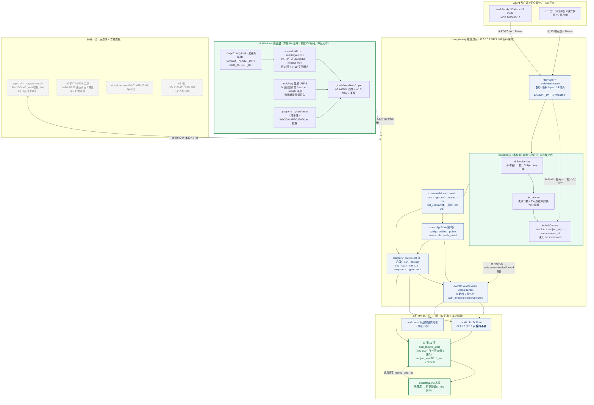
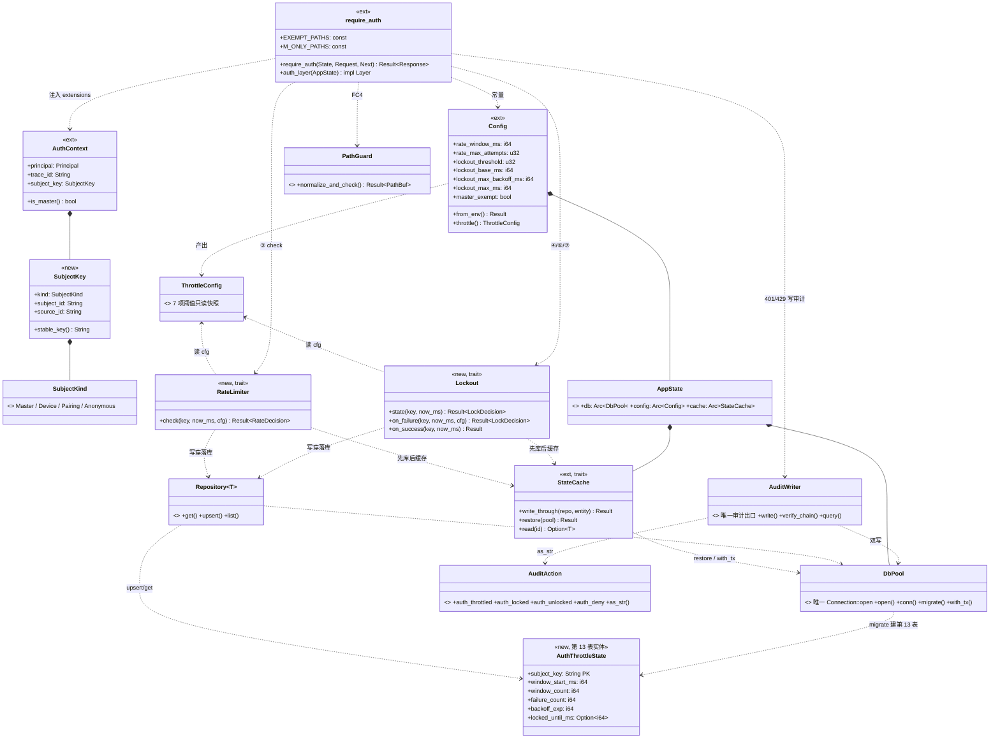
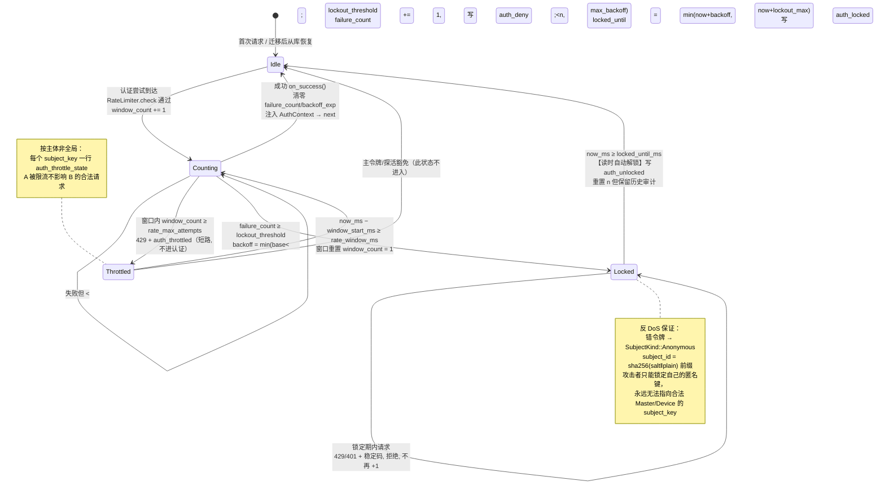
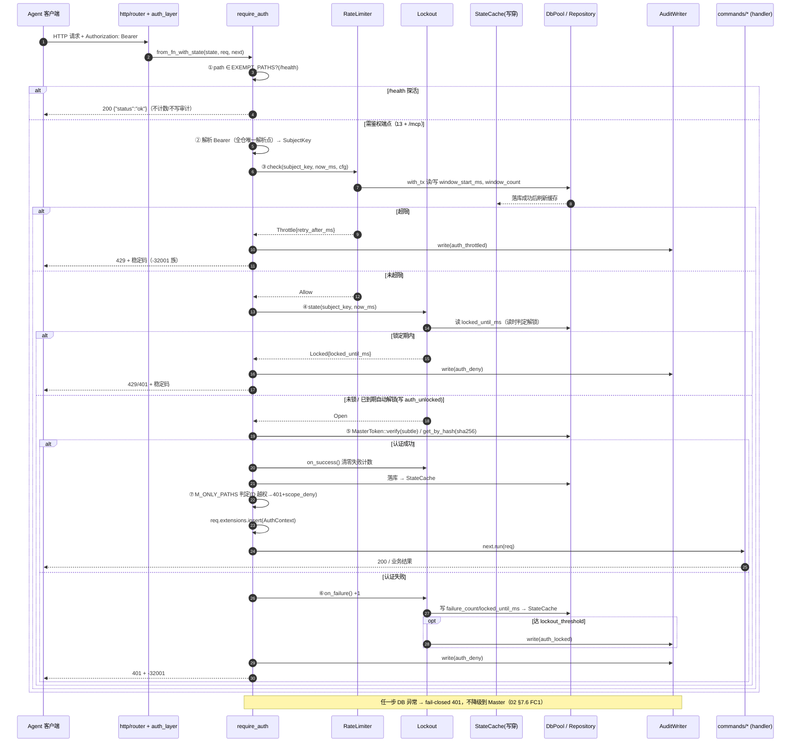
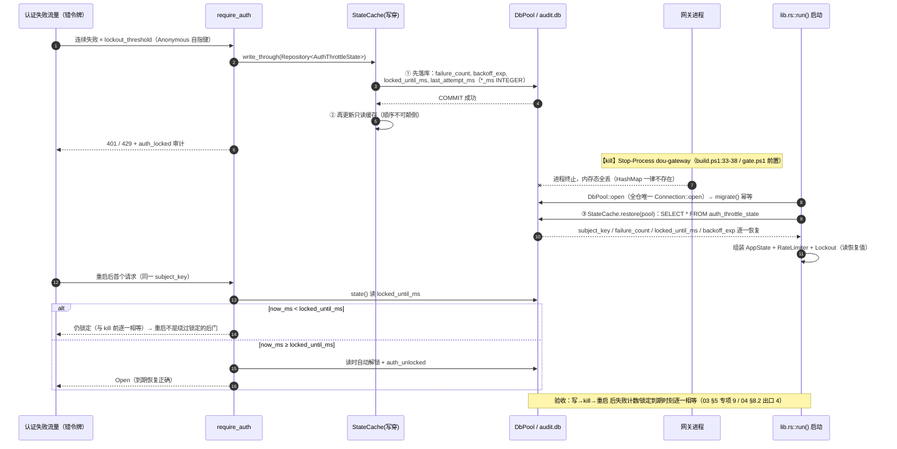

# 05 · 增量架构设计与实施任务列表 —— Windows 11 兼容 + 风控 / 防绕过 / 防爆破 + W-03→W-11→W-15 工单链

> 作者：高见远（Gao）· 架构师 ｜ 版本 **v1.0** ｜ 日期：2026-11-11
> 派发：齐活林（交付总监）· 标准 SOP 增量开发工作流 **第 2 阶段**（增量架构设计 + 文件级实施任务列表）
> 上游输入：`04-增量PRD-Windows11兼容与风控.md`（v1.0，361 行，**完整读取，本阶段主要输入**）；`02-系统架构设计与任务分解.md`（v1.0，2082 行，**直接复用，不重做**）；`00-项目预览-接手上下文包.md`；`01-接手版PRD-现状梳理.md` v1.1；`01b-PRD修正回执-v1.1.md`；`03-验收标准与测试策略分工.md`。
> 只读核验源码：`crates/dou-gateway/src/{main.rs,auth.rs,scope.rs,store.rs,audit.rs,tools.rs}`、`Cargo.toml`、`crates/dou-gateway/Cargo.toml`、`.cargo/config.toml`、`scripts/build.ps1`、`tools/{mcp_probe.py,probe_approve.py}`、`app/package.json`、`docs/spike-report-002.md`、`docs/handover/03-...md`（5 行明文上下文）。
> 本阶段动作：**只读核验上游文档与源码；只新增本文件（及 §9 登记的两份 Mermaid 抽取件）；未修改 `00`~`04` 任何文件、未修改任何现有源码、未运行构建 / 测试、未写实现代码、未写测试用例 / 测试策略、未替发起人拍板 Q4 / Q5 / NEW-2**。

---

## 阅读标记法（全文通用，沿用 `02 §1.3` + `04 §1`）

| 标记 | 含义 |
|---|---|
| 【代码已验证】 | 本轮或 `00`/`02`/`04` 阶段只读打开源码核对过，附相对路径 / 行号 |
| 【实测环境】 | 交付总监本轮实测的环境事实（`04 §3.2` E-01~E-09 + 本轮目录复核） |
| 【架构裁定】 | 本设计确定的技术方案 / 分层 / 接口 / 选型 / 口径澄清（架构师职责内） |
| 【PM 需求】 | 来自 `04` 增量 PRD 的 24 条 INC 需求或 10 个既有 W 工单，非架构结论 |
| 【独立复核】 | 本设计对 PM 初估 38.0 人天的复核值，附逐条差异与代码依据（§12） |
| 【待拍板】 | Q4 / Q5 / NEW-1 / NEW-2 及本轮新发现需交付总监或发起人裁定项，架构师只给选项与代价 |

> **基线铁律**：唯一基线 = 当前工作区代码（`02 §1.2` B1~B13、`00 §0`）。`docs/PLAN-V2.md` / `GAP-REPORT.md` / `TEST-REPORT.md` / `spike-report-009~011.md` 的 ✅ 一律历史态，**不得作为设计输入**。`85.0`（`02 §11.2` 全量复核）与 `74.0`（`01` PM 全量初估）**均不是本轮人天**，不得相加相减或冒充（`04 §7.2`）。

---

## 1. 文档信息 / 增量设计摘要

### 1.1 文档元数据

| 项 | 内容 |
|---|---|
| 文档名 | `05-增量架构设计与实施任务列表.md` |
| 版本 | v1.0（增量架构设计与文件级 WBS 首版） |
| 作者 / 角色 | 高见远（Gao）· 架构师 |
| 派发 / 阶段 | 齐活林（交付总监）· 标准 SOP 增量开发 **第 2 阶段** |
| 下游读者 | 齐活林（汇总）、寇豆码（后端工程师，照 §4/§6/§9/§10 真实写代码并编译通过）、严过关（QA，§12.5 验收输入）、许清楚（PM，§12 人天复核）、发起人巫伟鑫（§12.3 待拍板项） |
| Language | 中文 |
| 性质 | 增量架构设计 + ADR-003 决策表 + 接口 / DDL 签名 + 文件级实施任务列表；**非** 实现代码、**非** 测试策略 / 用例、**非** 拍板结论 |

### 1.2 基线声明（【代码已验证】本轮复核，与 `02 §1.2` / `04 §3.3` 一致，不重复论证）

| # | 基线事实 | 证据（相对路径 / 行号） |
|---|---|---|
| B1 | `crates/dou-gateway` = axum `0.8` + tokio + russh `0.65.1`(`ring`) + russh-sftp `3.0.1` + rusqlite `0.41.1`(`bundled`) + sha2 `0.11.1` + regex `1.13.1`；`main.rs` 单根、15 条 `mod` 声明、**无 `lib.rs` / 无 `crate-type`**、16 个扁平 `.rs` | `crates/dou-gateway/Cargo.toml:7-16`、`src/main.rs:6-20` |
| B2 | `AppState`（8 字段 / 5 共享容器）：`token/audit/dev/sessions/taskhub/sanitizer/quota/leases`；`tasks.rs` 纯内存 `Vec<Task>`；`store.rs` 的 `session` 表无调用点 | `src/main.rs:38-50` |
| B3 | `main.rs:162-176` 14 端点（13 处 `.route()`，`/scope/tokens` 挂 GET+POST）**无任何 layer**；`main.rs:563-574` 是**唯一** Bearer 校验点 | `src/main.rs:162-176,563-574` |
| B4 | `main.rs:63` dev `unwrap_or(true)`；明文回吐 3 处 `:74`（启动日志）/ `:288`（`/console` 内联 HTML `<code>Authorization: Bearer {token}</code>`）/ `:378`（`format!("Bearer {}", st.token.as_str())`） | `src/main.rs:63,74,288,378` |
| B5 | `auth.rs:52-61` 手写 `constant_eq`；`:63-84` 与 `scope.rs:65-83` **两份** xorshift；`auth.rs:90-101` 时间纳秒配对码；`scope.rs:55-63` `DefaultHasher` 凭据哈希 | `src/auth.rs:52-101`、`src/scope.rs:55-83` |
| B6 | `store.rs:25-28` 与 `audit.rs:169` / `:189` **三处** `Connection::open`（同一 `%LOCALAPPDATA%/dou/audit.db`）；`audit.rs:171-182` 建 `audit.ts_ms TEXT`；`audit.rs:140-160` `query()` 用 `as_str()` 解析 `ts_ms` | `src/store.rs:25-28`、`src/audit.rs:140-160,168-205` |
| B7 | 时间单位混用：`store.rs::now_ms()` 毫秒、`audit.rs::now_ts()` 毫秒存 **TEXT**、`credential.expires_at`（`scope.rs:123`）与 `auth.rs:119` `LEASE_SECS=1800` 用**秒** | `src/store.rs:17-22`、`src/audit.rs:21-27`、`src/scope.rs:123`、`src/auth.rs:119` |
| B8 | `data_dir()` 未设 `LOCALAPPDATA` 回退 `"."`；`db_path()` 回退 `"audit.db"`（均可能落仓库根） | `src/auth.rs:13-16`、`src/store.rs:11-15` |
| B9 | `run_local` 走 `cmd /C` + `from_utf8_lossy`；`check_remote_path` 用字符串 `contains`（`/home/*/.ssh/id_` 的 `*` 是字面量），`dou.exec` 完全不调用 | `src/tools.rs:342-363,376-393` |
| B10 | 全仓 7 个 Rust `#[test]`；仓库**非 git**（本轮复核：无 `.git` / `.gitignore` / `.gitattributes` / `.github`）；`scripts/` 仅 `build.ps1`；`tools/` 5 个 `.py`；`app/package.json` 无 `test` script | `00 §1.2`、本轮 `ls` 复核、`app/package.json:6-11` |

### 1.3 本轮设计解决什么 / 不解决什么

| 维度 | 内容 |
|---|---|
| **解决（三类增量）** | ① **防爆破**（`02` 未覆盖）：速率限制 / 失败计数 / 临时锁定 / 指数退避 / 恒定时间比较 / 审计告警 / 反 DoS 边界，状态统一落 W-11；② **Windows 11 兼容**（`02` 未覆盖）：中文路径 / GBK / 双工具链 / PATH 注入 / CI 双 job / 端口占用；③ **7 处静态明文清零**（P0 硬门禁）+ 3 处运行时回吐掩码 |
| **不解决（边界）** | 不重做 `02` 已定设计（`§4` 分层 / `§5.3` DDL / `§5.6` 鉴权矩阵 / `§5.7` 签名 / `§7.6` fail-closed 四处 / `§8` 共享约定 / `§10` 文件清单 / `§11` 38 工单判据 / `§12.2` 关键路径 / `§14.3` 门禁，**原样复用**）；不写实现代码 / 测试用例 / 测试策略 / 视觉稿；不改前端形态（A-06）；不新增 N1~N7 端点（本轮 `.route()` 仍 **14**）；不做 W-10 私钥加密库 / W-16 实际轮换 / W-17 完整参数级解析 / W-26~W-38；不引反调试 / 加壳防逆向（A-01，标注后续增量） |
| **不改文件（硬边界）** | `docs/handover/00-*`、`01-*`、`01b-*`、`02-*`、`04-*` **一字不动**；`docs/handover/03-*` **仅** `:33 / :418 / :432 / :556 / :987` 五行占位符化，其余一字不动；`app/src/**`、`app/src-tauri/**` 本轮不动；任何既有源码**业务逻辑**不改（明文占位符化 / 掩码属安全整改例外，须留痕） |

### 1.4 与 `02` 的关系（哪些章节原样复用 / 哪些是增量）

| `02` 章节 | 本轮关系 | 落点 |
|---|---|---|
| `§1.2` 基线 B1~B13、`§1.3` 标记法 | **原样复用**（本轮 §1.2 复核一致） | §1.2 |
| `§4.1` 四主干 + 两横切目录树、`§4.2` 16 文件映射、`§4.3` D4 `lib.rs` 解耦、`§4.5` 保持不动清单 | **原样复用**（文件清单骨架） | §4 / §9 |
| `§5.2` `AppState` 重构、`§5.3` 12 表 DDL | **原样复用 + 增量**：12 表不变，**新增第 13 表** `auth_throttle_state`（§6） | §6 |
| `§5.4` 中间件接口形状、`§5.6` 端点鉴权矩阵（14 端点）、`§5.7` 签名清单 | **原样复用 + 增量字段 / 签名**（§4） | §4 / §7 |
| `§7.2` `from_fn_with_state` 选型、`§7.3` 依赖选型 / D7、`§7.6` fail-closed 四处 | **原样复用**（ADR-003 ③④ 引用，不重新论证） | §2 |
| `§8.1` 8 类 `E_*`、`§8.2` 事件名常量表、`§8.4` 毫秒 D6、`§8.5` 写穿 / `DbPool` 归口、`§8.6` 脱敏、`§8.7` MinGW | **原样复用 + 增量**（新增 3 事件名 / 7 配置项 / 429 状态码） | §7 |
| `§9.3` 明确不引入清单 | **原样复用**（§8 追加本轮不引入项） | §8 |
| `§10` 文件清单（54 新增 / 36 修改 / 23 逻辑删 / 16 保持） | **裁剪复用**：只取本轮 10 个 W 工单涉及的文件；T04/T05 及 `app/src/**` 剔除 | §9 |
| `§11` 38 工单判据、`§12.2` 关键路径、`§12.3` 门禁、`§14.3` 门禁表 | **原样复用**（10 个 W 工单判据不改写、不削弱）；新增 24 个 I 工单 | §10 / §11 |
| `§11.2` 人天独立复核方法（按需求分组 + 架构治理单列） | **方法复用、数值不复用**（本轮独立复核见 §12，不引用 85.0） | §12 |

### 1.5 实测环境事实（【实测环境】，`04 §3.2` E-01~E-09 + 本轮复核）

| 编号 | 事实 | 本轮设计落点 |
|---|---|---|
| E-01 | git `2.55` 已装；仓库非 git（本轮复核无 `.git` / `.gitignore` / `.gitattributes` / `.github`） | B0 可直接 `git init`，但见 E-07 硬门禁 |
| E-02 | `cargo`/`rustc`/`rustup` 实体在 `C:/Users/mrhua/.cargo/bin/`，**未进当前 shell PATH** | ADR-003 ⑦；`build.ps1` / `gate.ps1` 显式注入（§12.4 命令片段） |
| E-03 | 已装 `stable-x86_64-pc-windows-gnu` + `stable-x86_64-pc-windows-msvc` 两套 toolchain（**Q6 已解决**） | ADR-003 ⑥；I-21 / I-23 |
| E-04 | `dlltool.exe` 在 WinLibs 包 `mingw64/bin/`；已有产物 `E:/dou-target/debug/dou-gateway.exe` | I-22 / I-17 |
| E-05 | Node `v22.22.2` / npm `10.9.7` | 仅 CI 环境基线登记（本轮不动前端） |
| E-06 | `.cargo/config.toml:10` `target-dir = "E:/dou-target"`（本轮复核确认）；`:13-14` linker/ar 为**用户级 WinGet 绝对路径**；`scripts/build.ps1:33-38` 编译前强制 `Stop-Process dou-gateway`（本轮复核确认 `:22` 已注入 `$bin;$env:USERPROFILE\.cargo\bin`） | I-17 / I-19 / I-22 |
| E-07 | 真实令牌 `<REDACTED_TOKEN>` 静态出现在 **7 处**：`tools/probe_approve.py:4`、`docs/spike-report-002.md:29`、`03` 的 `:33/:418/:432/:556/:987`（本轮 `ripgrep` 逐行复核一致） | **P0 硬门禁** I-01 → W-03 之前 |
| E-08 | 运行时回吐 3 处 `main.rs:74/288/378`（本轮复核确认 `:288` 为内联 HTML、`:378` 为配置片段 `Bearer` 生成） | I-01 掩码 / 运行时注入 |
| E-09 | `%LOCALAPPDATA%/dou/` 下 `token.txt` / `audit.jsonl` / `audit.db` / `known_hosts.json` / `quarantine/` / `keys/` 绝不入库 | I-02 `.gitignore` |

> **【待拍板·本轮新发现 F-1】**：全仓 `ripgrep "<REDACTED_TOKEN>"` 实际命中 **10 处**，除 E-07 的 7 处外，`04-增量PRD-...md` 自身 `:75`（E-07 表）、`:180`（INC-S11 判据）、`:317`（R-INC-01）三行以**元描述**形式包含完整令牌文本。按 §1.3 硬边界 `04` 一字不动，故 P0 门禁的「命中数 = 0」口径必须显式定义为「**7 个业务明文点 + 3 处运行时回吐 = 0**」，检索命令须排除 `docs/handover/00~05` 的**元描述行**（或用「赋值 / 请求头构造上下文」精确匹配），否则验收永远无法为 0。此口径由交付总监确认（§12.3 NEW-4），架构师不擅自改 `04`、不擅自放宽门禁。
>
> **【待明确·本轮新发现 F-2】**：`03` 的 `:418`（专项 5 ③ Bearer 脱敏**正样本**）与 `:432`（样本日志行5）是把真令牌当**测试夹具**写的。占位符化后这两处样本将不再是合法 `dou_ak_...` 串，可能使「③ Bearer 正则正样本必须替换」的断言失去输入。占位符化属安全整改例外（只改这 5 行），**样本语义的补正由 QA 在下一阶段用运行时注入的假令牌 / 合成样本处理**（§12.5），架构师不写用例、不改 `03` 其余内容。

---

## 2. 增量架构裁定（ADR-003 决策表）

> **ADR-003 头信息**：状态 =【架构裁定】**已采纳（架构师职责内）**；涉及发起人语义的 ⑤（Q4）、⑥ runner 可得性（NEW-1）保持【待拍板】开关，不替拍板。命中 Q4 / Q5 / NEW-2 的部分只给「开关收敛点 + 代价」，见 §12.3。
> **总原则**：8 项决策全部满足三条不可协商约束（`04 §11-2/3/7`）——限流 / 锁定状态落 W-11 统一模型、`DbPool` 单一归口、不重做 `02` 已有设计；且**不引 Argon2 做令牌哈希**（`02 §14.4` D7：`sha256(salt‖plain)`，复用已有 `sha2 0.11.1`，`argon2` 仅属 W-10 私钥加密库且不在本轮）。

| # | 决策点 | 备选方案 | 【架构裁定】选型 | 理由（代码依据 / `02` 复用） | 代价 | 可回退性 |
|---|---|---|---|---|---|---|
| **①** | **限流算法 + 主体维度**（INC-S06 / S10 / US-S08 / R-INC-04/05） | (a) 固定窗口计数；(b) **滑动窗口计数**；(c) 令牌桶；(d) 进程内 `governor`/`tower` 限流 | **选 (b) 滑动窗口计数**；主体维度 = `SubjectKey = (SubjectKind, SubjectId, SourceId)`；`SubjectId` 对**校验失败的令牌**取 `sha256(salt‖token)` 前缀（匿名自指），**不得**用被猜测的合法主体 id | ① 状态必须落 `DbPool`（约束 2）：滑动窗口只需存「窗口起点 + 窗口内计数」两列，令牌桶需存 token 余额 + 上次补充时刻且**跨重启补充逻辑易漂移**，无法用「重启后逐一相等」验收（INC-S09）；② 固定窗口有临界 2× 突发，靠较短窗口（默认 60s）+ ② 的锁定退避兜底即可；③ 反 DoS 结构性保证：错令牌**无法指定他人 `cred_id` 作为计数键**，从根上阻断「用错令牌轰击冻结合法主体」（S10 / US-S08 / R-INC-05）；④ 不引第三方限流库（§8） | 窗口边界存在 ≤2× 临界突发；`SourceId` 在回环监听下只有 `127.0.0.1`，维度实际退化为「主体」，需文档标注（§7 已知限制） | **高**：`RateLimiter` 是 trait，换令牌桶只需替换实现 + 加两列，接口与 DDL 不动；不触碰 W-11 12 表 |
| **②** | **锁定状态落点 + 退避上限**（INC-S07 / S09 / §6） | (a) `credential` 表加字段；(b) **新增独立表** `auth_throttle_state`；(c) 进程内 `HashMap`（**明令禁止**） | **选 (b) 新增第 13 表**（单表同时承载「滑动窗口计数 + 连续失败计数 + 锁定状态」）；退避 `2^n` 双封顶：`min(base_ms << n, lockout_max_backoff_ms)` 且 `locked_until_ms - now_ms ≤ lockout_max_ms`；**到期读时判定自动解锁，不依赖定时器** | ① `credential` 只覆盖设备令牌，无法承载主令牌 / 配对码 / **匿名失败主体**三类（INC-S06 三类 + S10 反 DoS 匿名键）；② 单表 = 单 `Repository` 实现 = 单写穿路径，符合 `02 §8.5`；③ 新表纳入 `02 §5.3` 同一套 `CREATE TABLE IF NOT EXISTS` + `PRAGMA table_info` 幂等迁移；④ 读时判定解锁使「重启期间到期的锁」自然恢复，无需后台线程（简化 + 可验） | 多一张表 → `03 §4.1` W-11 行「`sqlite_master` 含 12 表」判据须**增补为 13**（不改写原判据，§12.5）；`auth_throttle_state` 随失败主体增长，需 `last_attempt_ms` 定期清理策略（§6 索引） | **高**：整表可独立 `DROP`（新表无外键），限流降级为「只失败计数不限流」；退避参数全在 `Config`（⑧） |
| **③** | **中间件层位置**（INC-S01 / S02 / W-15） | (a) `axum::middleware::from_fn_with_state` **单层** + `AuthContext` 注入 `extensions`；(b) 裸 `tower::Layer`；(c) 逐路由 handler 内校验 | **选 (a)**，**原样复用 `02 §7.2 / §5.4`**，不重新论证 | `build_router()` 一处 `.layer(auth_layer(state))`，静态可查漏挂；「全仓 `authorization` 解析点 = 1」「`EXEMPT_PATHS.len()≤1`」「13 端点全 401」三条机器可验收口判据成立；`tower` 已是 axum 传递依赖，不新增显式依赖 | `require_auth` 成为全局热点，DB 异常必须 **fail-closed 401 不降级到 Master**（`02 §7.6` FC1） | **高**：`auth_layer` 可整体摘除（但会重新裸奔，须同批回退审计判据） |
| **④** | **M-only 判定方式**（INC-S13 / W-15） | (a) 逐路由 handler 内 `if ctx.is_master()`；(b) **集中式 `M_ONLY_PATHS` 常量表 + `AuthContext.is_master()`**；(c) 提取器宏 | **选 (b)**：`const M_ONLY_PATHS: &[&str]` 在 `auth/middleware.rs` 集中声明，`build_router()` 装配时按表匹配，判定在 `require_auth` 内完成 | 与 `EXEMPT_PATHS` 同构（⑤ 的「开关收敛一处」），改判只改一处；`02 §5.6` 已定 6 类 M-only（`/audit/export`、`/approve`、`/scope/*`、`/onboard/write`、`/console`、`/onboard/config`），逐路由易漏挂；D 令牌越权可机器验 401 + `scope_deny`/`auth_deny` | 常量表与 14 路由需一致性人工核对（由 §12.4 全局一致性审查兜底） | **高**：常量表可增删，不改 handler |
| **⑤** | **`/health` 豁免开关收敛点**（A-03 / Q4 / W-15） | (a) 逐路由 `if`；(b) **`EXEMPT_PATHS` 一处常量 + Q4 分支开关**；(c) 硬编码永久豁免 | **选 (b)**：`pub const EXEMPT_PATHS: &[&str] = ["/health"];`（Q4 改判「不豁免」时改为 `[]`），`/health` 仅返回 `{"status":"ok"}`、不写审计、不计数；**Q4 本身【待拍板】，本轮按 A-03 实现，不写成既定断言** | `02 §2.6 / §5.4` + `01b §4.3 第 6 条` + `03 §5 专项 1` Q4 分叉：改判只改一处常量（+0.5 人天），用例保留 Q4 分支开关；主令牌与 `/health` 探活**豁免限流计数**（S10 / US-S08） | 若发起人改判方案 B，Q4 分支开关需同步 QA 用例（不阻塞 T02/T03，`02 §2.8`） | **高**：改 1 行常量 + 1 处断言分支 |
| **⑥** | **Windows 双工具链 CI 形态**（INC-W06 / W08 / E-03） | (a) GNU 单 job；(b) **GNU 必跑 job + MSVC 条件 job**；(c) 双 job 均必跑 | **选 (b)**：`job A` = `x86_64-pc-windows-gnu`（fmt / clippy / 单测 / 集成 / 探测 / 覆盖率门槛位）**必跑**；`job B` = `x86_64-pc-windows-msvc`（`cargo build` + `cargo test`）**条件**（Q6 实测已满足，但 runner 可得性属 NEW-1【待拍板】；不可得则 `if: false` 并**如实标注受限，不判通过**） | 沿用 `03 §7.4` job A / B / C / D 矩阵，本轮只取 A + B（C 前端 / D 性能属 T04/T05，不在本轮）；E-03 两套 toolchain 具备前提；`russh` 固定 `ring`（`02 §8.7`）、`sha2` 不升大版本、`panic="abort"` 保持 | job B 在 runner 无 MSVC 时需受限标注，出口四项「双工具链全绿」可能只能达成 GNU 侧（`04 §8.2` 如实标注） | **高**：job B 是 CI 配置，可独立启停；不影响产物 |
| **⑦** | **PATH 注入 + `CARGO_TARGET_DIR` 覆盖**（INC-W01 / W07 / E-02/E-04/E-06） | (a) 保留 `.cargo/config.toml` 用户级 WinGet 绝对路径；(b) **脚本注入 PATH + 自动发现 `mingw64/bin` + `CARGO_TARGET_DIR` / `DOU_TARGET_DIR` 覆盖 + 去掉 linker/ar 硬编码**；(c) 强制开发者手配 PATH | **选 (b)**：`build.ps1` / `gate.ps1` 顶部注入 `$env:USERPROFILE\.cargo\bin` + 自动发现（或 `$env:DOU_MINGW_BIN` 指定）的 `mingw64/bin`，断言 `cargo` / `dlltool.exe` 存在；`.cargo/config.toml` 去掉 `:13-14` 用户级绝对路径（linker/ar 由 PATH 中的 `gcc`/`ar` 解析），`target-dir` 保留 `E:/dou-target` 作为**默认值但可被 `CARGO_TARGET_DIR` / `DOU_TARGET_DIR` 覆盖**；CI checkout 到 ASCII 路径 | E-02 实测 cargo 不在 PATH；E-06 换机即失败；`04 §4.3` INC-W01/ W07 判据「全仓检索无 `E:/dou-target` 硬编码作为**唯一**取值」「脚本含 `dlltool.exe` 存在性断言」「换机改一处配置即可构建」；`03 §7.4` job A 用 runner 临时 ASCII 路径 | **耦合风险**：去掉 linker/ar 硬编码后 GNU 工具链依赖 PATH 中的 `gcc`/`ar`，I-17 与 I-22 必须**同批**落地并回归编译（§10 标注）；中文路径 + `dlltool` 乱码仍需 ASCII `target-dir` 兜底 | **高**、**中**：`.cargo/config.toml` 改动可 revert；PATH 注入幂等、无副作用 |
| **⑧** | **时间单位 + 失败阈值配置化**（INC-S06/S07/S10 / `02 §8.4` D6） | (a) 硬编码常量散落；(b) **`Config` 新增 7 个 `DOU_*` 字段集中收敛 + 全部毫秒 INTEGER**；(c) 配置文件（TOML） | **选 (b)**：`Config::from_env()` 收敛全部 `std::env::var`（`02 §8.4`）；新增 `rate_window_ms` / `rate_max_attempts` / `lockout_threshold` / `lockout_base_ms` / `lockout_max_backoff_ms` / `lockout_max_ms` / `master_exempt` 七项，默认值与环境变量名见 §7.1；阈值调整**不改代码** | ① `04 §4.3`/`§5.3` 多处「阈值可配置」；② 与 `02 §8.4` 毫秒 D6、`§8.5` 写穿一致；③ 反 DoS 边界（R-INC-05）需要可调参以便在压测中回归；④ 不引配置 crate（`02 §9.3` 不引 `thiserror`/`chrono` 同精神） | 新增 7 个环境变量需写进 `README.md` / `tools/README.md`（I-20 / I-24） | **高**：字段有默认值，未设即安全默认（限流开启、退避封顶） |

### 2.1 ADR-003 的三条显式声明（不可协商约束落地）

1. **【架构裁定】不引 Argon2 做令牌哈希**：设备令牌是 24 字节 CSPRNG 高熵值，`hash_token = sha256(random_salt ‖ plain)` 复用已有 `sha2 0.11.1`（`02 §7.3 / §14.4` D7）；`argon2` 仅属 W-10 私钥加密库（**本轮不做**）。本轮 `Cargo.toml` **不新增** `argon2` / `password-hash` / `chacha20poly1305` / `zeroize`（§8）。
2. **【架构裁定】限流 / 锁定状态唯一落点 = W-11 统一状态模型**：新增第 13 表走 `02 §5.3` DDL、`§8.4` 毫秒 INTEGER、`§8.5` `StateCache` 写穿（**先落库再更新缓存**）、`DbPool` 单一归口（全仓 `Connection::open` 仍 **1 处**）；**禁止另起进程内 `HashMap`**——这是 INC-S06/S07/S09 唯一落点，也是 QA「重启后锁定不丢」可验的前提（静态检索无独立认证计数 `HashMap`）。
3. **【架构裁定】`/health` 与 Q5 只收敛开关、不拍板**：Q4 改判改 `EXEMPT_PATHS` 一处常量（⑤）；Q5 未拍板只占位符化 / 运行时注入，**不实际轮换、旧令牌不失效**（A-04，残余风险 R-INC-10 显式登记于 §12.3）。

---

## 3. 目标架构增量图

> 【架构裁定】本图在 `02 §3.2` 目标架构之上**叠加**两个本轮新增横切层（防爆破层 / Windows 兼容层），用虚线框标出「本轮改动边界」与「不动的部分」。`02 §3.2` 的六者分离、`DbPool` 唯一归口、`events/` 唯一出口、Q4 分叉箭头全部**原样保留**，本图只画增量。图例：实线框 = `02` 已有目标架构；**粗虚线框 = 本轮 B0~B4 改动边界**；点虚线框 = 明确不动；`⊕` = 本轮新增组件。



### 3.1 图的三个结论（对齐三条不可协商约束）

| # | 结论 | 证据 |
|---|---|---|
| 1 | **防爆破层不是独立进程 / 独立状态**：`RateLimiter`/`Lockout`/`AuthContext` 全部挂在 `02 §7.2` 的**单层中间件**内，状态读写经 `W-13 StateCache` → `W-11` 第 13 表；图中 `NEWDB` 与 `DB` 同属 `DbPool` 一个库、一个 `open` 点 | `04 §6.3` W-15 交付边界②、`§11-3`、`02 §8.5` |
| 2 | **Windows 兼容层不进运行时调用链**：`CFG/PS/CI/PY/ATTR` 只以「构建 / 门禁」虚线连到网关，不改 14 端点、不新增 `.route()`、不动 `app/`（A-06） | `04 §2.3`、`§4.3` 注、`§4` 兼容矩阵 |
| 3 | **冻结边界显式**：`app/`、T04/T05、`00/01/01b/02/04` 一字不动；`03` 仅 5 行；`02` 的 12 表与链式哈希算法不变，只加第 13 表 | `04 §11-5`、`§1.3` 本设计 |

> 【架构裁定】本图**不重画** `02 §3.2` 的 Q4 方案 A/B 分叉（两条互斥分支原样保留在 `02`），因为本轮 Q4 未拍板、按 A-03 只收敛 `EXEMPT_PATHS` 开关（ADR-003 ⑤），不引入新的形态分叉。

---

## 4. 接口与签名清单（不写实现）

> 【架构裁定】本节 = `02 §5.4 / §5.7` 签名清单的**增量层**：`02` 已定义的 `DbPool`、`Repository<T>`、`PathGuard`、`AuditWriter`、`PolicyEngine`、`ToolSpec`、`ToolHandler`、`Config`、`AuthContext`、`require_auth`、`EXEMPT_PATHS`、`Principal` **原样复用**；本轮只补 ① `Config` 新增字段、② 防爆破三个新类型（`SubjectKey` / `RateLimiter` / `Lockout`）、③ `AuthContext` / `require_auth` 的增量字段与约束、④ `StateCache` 写穿签名、⑤ `main.rs` 收敛后的入口形状。**全部只给签名 + 约束，不写函数体、不写 SQL 实现、不写组件模板**（工作流边界）。
> TS 侧：**本轮无新增类型**（A-06 不改前端；`02 §5.7` TS 清单原样保留，`app/src/shared/types.ts` 等不新增 / 不修改）。

### 4.1 `core/config.rs` —— `Config` 新增字段（ADR-003 ⑧）

```rust
// 【增量】在 02 §5.7 的 Config 上追加字段；全部由 Config::from_env() 收敛，禁止散落 std::env::var
pub struct Config {
    // —— 02 已有（保持不动）——
    pub bind: String,
    pub dev: bool,
    pub data_dir: PathBuf,
    pub protocol_version: &'static str,

    // —— 本轮新增：限流 / 锁定阈值（全部 epoch 毫秒 INTEGER，02 §8.4 D6）——
    pub rate_window_ms: i64,          // 滑动窗口长度，默认 60_000
    pub rate_max_attempts: u32,       // 窗口内单主体最大认证尝试数，默认 60
    pub lockout_threshold: u32,       // 连续失败触发锁定阈值，默认 5
    pub lockout_base_ms: i64,         // 退避基数 base_ms，2^n 的底，默认 1_000
    pub lockout_max_backoff_ms: i64,  // 单次退避封顶，默认 60_000
    pub lockout_max_ms: i64,          // 最大锁定时长封顶，默认 900_000（15 min）
    pub master_exempt: bool,          // 主令牌是否豁免失败计数，默认 true（S10 / US-S08）
}
impl Config {
    pub fn from_env() -> Result<Self, ConfigError>;   // 02 已有签名，扩展新字段解析（缺省即安全默认）
    pub fn db_path(&self) -> PathBuf;                 // 02 已有（B8：必须 %LOCALAPPDATA%，回退 fail-closed）
    pub fn throttle(&self) -> ThrottleConfig;        // ⊕ 增量：把 7 个阈值打包传给 RateLimiter/Lockout，避免逐字段透传
}
pub struct ThrottleConfig { /* 上述 7 项的只读快照，Clone + Send + Sync */ }
// 约束：① 所有 *_ms 为 i64 毫秒；② 未设环境变量时取安全默认（限流开启、退避封顶、master_exempt=true）；
//       ③ dev 仅显式 "1" 为 true（02 §7.4 / INC-S12）；④ 环境变量名见 §7.1。
```

### 4.2 `auth/middleware.rs` —— `SubjectKey` / `AuthContext` / `require_auth`（增量）

```rust
// ⊕ 新增：限流主体键（ADR-003 ① 反 DoS 的结构性保证）
pub enum SubjectKind { Master, Device, Pairing, Anonymous }
pub struct SubjectKey {
    pub kind: SubjectKind,
    pub subject_id: String,   // Master="master"；Device=cred_id；Pairing=配对入口 id；
                              // Anonymous=sha256(salt‖plain) 前缀（错令牌自指，绝不写被猜测的合法 id）
    pub source_id: String,    // 回环下通常为 "127.0.0.1"，预留按来源维度（§7 已知限制）
}
impl SubjectKey {
    pub fn stable_key(&self) -> String;  // 拼接 + sha256 → auth_throttle_state.subject_key（定长、不存明文）
}

// 02 §5.4 已有 AuthContext；⊕ 追加 subject_key 字段（其余字段保持不动）
pub struct AuthContext {
    pub principal: Principal,             // 02 已有：Master | Device{cred_id}
    pub credential: Option<Credential>,   // 02 已有
    pub scope: Option<Scope>,             // 02 已有
    pub trace_id: String,                 // 02 已有
    pub subject_key: SubjectKey,          // ⊕ 增量：供限流/锁定按主体计数（M/探活豁免）
}
impl AuthContext { pub fn is_master(&self) -> bool; }   // 02 已有

// 02 已有签名（形状不动，约束扩充）
pub const EXEMPT_PATHS: &[&str];     // = ["/health"]；ADR-003 ⑤：Q4 改判只改这一处
pub const M_ONLY_PATHS: &[&str];     // ⊕ 增量：6 类 M-only 端点集中表（`02 §5.6`），ADR-003 ④
pub async fn require_auth(
    State(state): State<AppState>,
    mut req: Request,
    next: Next,
) -> Result<Response, StatusCode>;
// 【约束增量，顺序不可颠倒（§5 时序图）】：
//   ① EXEMPT_PATHS 命中（/health）→ 不计数、不写审计、直接 next；
//   ② 解析 Authorization: Bearer（全仓唯一解析点，02 §5.6 收口）；构造 SubjectKey；
//   ③ RateLimiter::check（超限 → 429 + auth_throttled 审计，短路）；
//   ④ Lockout::state（锁定期内 → 429/401 + 稳定码，短路）；
//   ⑤ MasterToken::verify（subtle 定长比较）/ Repository<Credential>::get_by_hash（sha256(salt‖plain)）；
//   ⑥ 失败 → Lockout::on_failure（+1 失败计数，达阈值写 auth_locked 审计）→ 401 + auth_deny；
//   ⑦ 成功 → Lockout::on_success（清零连续失败）→ M_ONLY_PATHS 判定（D 令牌越权 → 401 + scope_deny）
//            → req.extensions_mut().insert(AuthContext) → next.run(req)；
//   ⑧ 任一步 DB 异常 → fail-closed 401，不降级到 Master（02 §7.6 FC1）。
pub fn auth_layer(state: AppState) -> impl Layer + Clone;   // 02 已有
```

### 4.3 ⊕ 新增 `RateLimiter` / `Lockout` trait（`auth/` 下，实现落 `adapters/db`）

```rust
// ⊕ 新增：滑动窗口速率限制（ADR-003 ①）
pub enum RateDecision { Allow, Throttle { retry_after_ms: i64 } }
pub trait RateLimiter: Send + Sync {
    // 读-改-写必须原子：经 DbPool::with_tx 短事务；计数落 auth_throttle_state（不经 HashMap）
    fn check(&self, key: &SubjectKey, now_ms: i64, cfg: &ThrottleConfig)
        -> Result<RateDecision, ThrottleError>;
    // 约束：窗口过期（now_ms - window_start_ms ≥ rate_window_ms）→ 重置 window_count=1、window_start_ms=now_ms；
    //       未过期且 window_count ≥ rate_max_attempts → Throttle；主令牌/探活在调用前已由 ① 短路豁免；
    //       写穿：先落库（DbPool）再更新 StateCache（02 §8.5），禁止只更新缓存。
}

// ⊕ 新增：失败计数 / 临时锁定 / 指数退避（ADR-003 ②）
pub enum LockDecision { Open, Locked { locked_until_ms: i64 } }
pub trait Lockout: Send + Sync {
    fn state(&self, key: &SubjectKey, now_ms: i64) -> Result<LockDecision, ThrottleError>;
    // 读时判定：locked_until_ms ≤ now_ms 即视为 Open（自动解锁，写 auth_unlocked 审计），无定时器
    fn on_failure(&self, key: &SubjectKey, now_ms: i64, cfg: &ThrottleConfig)
        -> Result<LockDecision, ThrottleError>;
    // 约束：failure_count += 1；若 ≥ lockout_threshold → backoff = min(base<<n, max_backoff_ms)，
    //       locked_until_ms = min(now_ms + backoff, now_ms + lockout_max_ms)（双封顶），写 auth_locked 审计；
    //       按 SubjectKey 而非全局；三类主体分别计数不互相污染。
    fn on_success(&self, key: &SubjectKey, now_ms: i64) -> Result<(), ThrottleError>;
    // 约束：清零 failure_count / backoff_exp / locked_until_ms；写过 auth_locked 的主体解锁时补 auth_unlocked。
}
// 约束（不可协商）：RateLimiter/Lockout 的所有状态只经 Repository<AuthThrottleState> → DbPool，
//   禁止任何进程内认证计数 HashMap（04 §11-3）；StateCache 只作只读缓存（写穿）。
```

### 4.4 `core/state.rs` —— `StateCache` 写穿签名（增量，`02 §8.5` 落地）

```rust
// ⊕ 增量：把 02 §8.5「先落库再更新缓存」显式成签名，供限流/锁定复用
pub trait StateCache: Send + Sync {
    // 唯一写入通道：repo.upsert 成功（落库）后才刷新缓存；失败不得更新缓存
    fn write_through<T>(&self, repo: &dyn Repository<T>, entity: &T) -> Result<(), StateError>;
    fn read<T>(&self, id: &str) -> Option<T>;
    // 进程启动从 DbPool 恢复：Task/Lease/QuotaCounter/SessionMeta + AuthThrottleState（W-13 判据 + INC-S09）
    fn restore(&self, pool: &DbPool) -> Result<(), StateError>;
}
// 约束：AppState: Clone + Send + Sync + 'static（02 §5.2）；跨 await 用 tokio::sync::Mutex；
//       sessions（含 russh::Handle）仍不持久化（02 D5 / §14.4-4），只有元数据落 session 表。
```

### 4.5 `02` 已有签名 —— 本轮原样复用（列清单，不重写）

| 类型 / trait | `02` 位置 | 本轮增量用法 |
|---|---|---|
| `DbPool::{open,conn,migrate,with_tx}` | `§5.7` / `§8.5` | **全仓唯一 `Connection::open` 点**；第 13 表纳入 `migrate()` |
| `Repository<T>`（`get/upsert/list`）+ `Credential::get_by_hash` | `§5.7` | 增一个实现 `Repository<AuthThrottleState>`；`upsert` 一律 `ON CONFLICT DO UPDATE` |
| `PathGuard::normalize_and_check` | `§5.7` / `§7.6 FC4` | I-13 最小切片：`dou.exec/read/put/get` 四入口统一调用、解析失败=拒绝 |
| `AuditWriter::{write,verify_chain,tail,query}` | `§5.7` / `§8.2` | 全仓唯一审计出口；新增 3 事件名进 `AuditAction` 常量表；`query(since_ms)` 迁移回归（§6） |
| `PolicyEngine::classify` / `MasterToken::verify` / `ToolSpec` | `§5.7` / `§7.3` | 前者本轮不动；`MasterToken::verify` 走 `subtle` 定长比较（I-03）；工具数=5 不变 |
| `core/ids.rs::{random_hex,new_prefixed_id,pairing_code,trace_id}` | `§5.7` | `getrandom` CSPRNG 替换两份 xorshift（I-05） |
| `build_router(state) -> Router` | `§5.4` | **14 端点唯一装配点**；末尾统一 `.layer(auth_layer(state))`；本轮不新增端点 |

### 4.6 `main.rs` 收敛为纯入口后的形状（`02 §4.3` D4，签名级）

```rust
// crates/dou-gateway/src/main.rs —— 收敛后仅入口（02 §4.3，行数 < 20、无 mod 声明、无 AppState、无 handler）
fn main() { dou_gateway::run() }
// crates/dou-gateway/src/lib.rs —— crate root（02 §4.3 / §10 A05）
pub mod core; pub mod adapters; pub mod commands; pub mod events; pub mod auth; pub mod http;
pub fn run() /* -> () */;   // 承载原 main() 的初始化 + auth_layer 装配 + axum::serve
// 约束：① :6-20 的 15 条 mod 声明迁 lib.rs；:38-50 AppState 迁 core/state.rs；
//       ② :74/:288/:378 三处明文回吐改掩码/运行时注入（I-01，Q5 未拍板不轮换）；
//       ③ :162-176 的 14 路由迁 http/router.rs 且仅此处 .layer()；:563-574 Bearer 解析上移中间件；
//       ④ :66-69 非回环 exit(2) 保持不动（INC-W05）；:178-184 端口绑定失败 exit(3) 改可区分错误（I-19）；
//       ⑤ 根目录 Cargo.toml 的 exclude 与双 Cargo.lock 未改（02 §4.3 / W-04 判据）。
```

### 4.7 增量类图（Mermaid classDiagram，关系总览）

> 【架构裁定】下图是 `02 §5.1` 统一类图之上的**增量层**（`02` 全量类图原样保留）；`<<new>>` = 本轮新增、`<<ext>>` = `02` 已有类型的扩展、`<<reuse>>` = 原样复用。逐属性 / 逐方法完整版见同目录抽取件 `05-class-diagram.mermaid`，内容以本节为准。**关系重点**：`require_auth` 是唯一编排点，`RateLimiter`/`Lockout` 的状态**只经** `Repository<AuthThrottleState>` → `DbPool`（第 13 表）→ `StateCache` 写穿，不落任何进程内 `HashMap`。



> 【架构裁定】§4 全部为签名与约束；工程师「照清单真实写代码」时，函数体、SQL、错误处理实现由 I 工单（§10）逐条落地，**本文件不含任何实现代码**（工作流边界）。

---

## 5. 防爆破状态机与时序图

> 【架构裁定】本节 3 张 Mermaid 覆盖 `04 §5.3` INC-S06~S10 与 §8.2 出口 4 的**行为口径**（不是测试用例，QA 侧压测口径见 §12.5）。四条不可违反的语义：① 三类主体（主令牌 / 设备令牌 / 配对码）**分别计数不互相污染**；② **按主体而非全局**锁定；③ 主令牌 + `/health` 探活**豁免计数**；④ 错令牌轰炸**不能冻结合法主体**（反 DoS，ADR-003 ① `SubjectKey` 匿名自指）。

### 5.1 状态机：单 `SubjectKey` 的认证尝试生命周期（stateDiagram-v2）



**状态机四条约束（对应 §12.5 压测口径）**：

| # | 约束 | 落点 | 依据 |
|---|---|---|---|
| 1 | 三类主体分别计数 | `SubjectKind::{Master,Device,Pairing,Anonymous}` 各自独立 `subject_key` 行；设备令牌 `subject_id=cred_id`、配对码 `subject_id=pairing 入口 id`、主令牌 `=master`（且默认豁免） | `04 §5.3` INC-S06/S07、`§5.1` US-S03 |
| 2 | 按主体非全局锁定 | 锁写 `auth_throttle_state.locked_until_ms` 单行；**无全局 `locked` 标志位** | `04 §5.3` INC-S10、R-INC-05 |
| 3 | 主令牌 / 探活豁免计数 | `/health` 在 `require_auth` 第①步短路；`Config.master_exempt=true` 时 Master 失败不写 `on_failure` | `04 §4.3` INC-S06、`§5.1` US-S08、A-03 |
| 4 | 反 DoS 边界 | 错令牌归 `Anonymous` 自指键；错令牌轰炸后合法主令牌仍可 `initialize` 200；锁定 ≤ `lockout_max_ms`、退避 ≤ `lockout_max_backoff_ms`、到期自动解锁 | `04 §5.3` INC-S10、`§8.2` 出口 4、ADR-003 ①② |

### 5.2 时序图 ①：请求 → 限流 → 认证 → 失败计数 → 锁定 → 审计（sequenceDiagram）



### 5.3 时序图 ②：写 → kill → 重启 → 锁定状态恢复（sequenceDiagram）



> 【架构裁定】两张时序图共同证明「状态只经 `DbPool`」：`StateCache` 在 ② 中是**结果**而非**来源**（写穿），重启恢复靠 `restore()` 从库读；这是 INC-S09「不许另起内存 HashMap」与 QA「重启后锁定不丢」能同时成立的根本原因。

---

## 6. W-11 数据库增量 DDL

> 【架构裁定】`02 §5.3` 的 **12 表保持不变**（`project/host/credential/session/snapshot/policy_rule/audit/task/lease/quota_counter/hostkey_challenge/quarantine_file`），本轮**新增第 13 表**作为 INC-S06/S07/S09 的唯一落点。全部沿用 `02 §5.3` 的统一约束：① `*_ms` = epoch 毫秒 **INTEGER**（D6）；② 对外 JSON 时间 ISO 8601 UTC；③ 新表带 `created_ms`；④ **禁止 `adapters/db/` 之外出现 `rusqlite::Connection::open`**；⑤ `CREATE TABLE IF NOT EXISTS` 幂等 + `PRAGMA table_info` 平滑补列（沿用 `store.rs:103-125` 手法）；⑥ `WAL / foreign_keys=ON / busy_timeout=5000 / 短事务`。

### 6.1 新增表 `auth_throttle_state`（DDL 要点，不写完整 SQL 实现）

| 项 | 内容 |
|---|---|
| 表名 | `auth_throttle_state`（单数，遵循 `02 §8.3` 命名规范） |
| 用途 | 单表同时承载「滑动窗口速率计数 + 连续失败计数 + 临时锁定状态」（ADR-003 ②，避免多表 / 多写穿路径） |
| 主键 / 唯一约束 | `subject_key TEXT PRIMARY KEY`（= `SubjectKey::stable_key()` 的 sha256 定长串；**不存明文令牌 / 口令 / 私钥**）；唯一约束即主键，无第二唯一索引 |
| 字段（全部 NOT NULL 除锁定到期列） | `subject_key TEXT PK`；`subject_kind TEXT NOT NULL`（`master\|device\|pairing\|anonymous`）；`window_start_ms INTEGER NOT NULL`；`window_count INTEGER NOT NULL DEFAULT 0`；`failure_count INTEGER NOT NULL DEFAULT 0`；`backoff_exp INTEGER NOT NULL DEFAULT 0`；`last_attempt_ms INTEGER NOT NULL`；`created_ms INTEGER NOT NULL`；`updated_ms INTEGER NOT NULL`；`locked_until_ms INTEGER`（NULL = 未锁定；到期读时判定自动解锁） |
| 索引 | `CREATE INDEX IF NOT EXISTS idx_throttle_locked ON auth_throttle_state(locked_until_ms)`（启动清理 / 锁定期查询）；`CREATE INDEX IF NOT EXISTS idx_throttle_last ON auth_throttle_state(last_attempt_ms)`（过期匿名键清理，防表无限增长） |
| 时间单位 | 全部 `*_ms` 为 **INTEGER 毫秒**（`02 §8.4` D6 / `03 §4.2 #2`）；无任何秒 / TEXT 时间列 |
| 写穿 | 所有写经 `Repository<AuthThrottleState>::upsert`（`ON CONFLICT(subject_key) DO UPDATE`）→ `DbPool::with_tx` → 成功后刷新 `StateCache`；**禁止进程内认证计数 HashMap** |
| 对应关系 | 12 表 + 该表 = **13 表**；`03 §4.1` W-11 行的「`sqlite_master` 含 12 表」判据需**增补为 13**（不改写原判据，见 §12.5） |

> 【代码已验证】新增表不改动 `store.rs:31-126` 六表与 `audit.rs:168-185` audit 表的既有列；`credential.expires_at`（`scope.rs:123` 用秒）与 `audit.ts_ms`（`audit.rs:173` 为 `TEXT`）的**迁移**见 §6.2，与新表无关。

### 6.2 迁移 SQL 要点（幂等可重跑 + 迁移前备份 + 查询回归）

> 【架构裁定】迁移脚本落 `adapters/db/schema.rs`，由 `DbPool::migrate()` 统一调用；参照 `03 §4.2 #2`（W-11 偏弱判据补强）与 `04 §6.2` W-11 交付边界④。以下是**要点与顺序**，不是实现 SQL。

| # | 迁移动作 | 代码依据 / 顺序约束 | 幂等保证 |
|---|---|---|---|
| M0 | **迁移前备份** `audit.db` → `audit.db.bak.{ts_ms}`（落 `%LOCALAPPDATA%/dou/`，`02 §8.4`；绝不入库 / 绝不落仓库根） | `04 §9` R-INC-06；备份失败即中止迁移（fail-closed） | 每次备份带 `ts_ms` 不覆盖；已有备份不阻断 |
| M1 | `credential.expires_at`（**秒**，`scope.rs:123` `now_sec()+ttl`）→ 语义统一为 **epoch 毫秒**：旧值 **×1000**；列名按 `02 §5.3` 更名 `expires_ms`（或按 `hash_alg` 版本判定，二者择一，不可混用） | `02 §8.4` D6、`§5.3` credential 行；`scope.rs:123,163` 比较处同步折算 | **迁移标记表** `schema_migration(version TEXT PK, applied_ms INTEGER)` 记录 `v_*`，已执行则跳过，防 ×1000 二次执行 |
| M2 | `audit.ts_ms` **TEXT → INTEGER**：`audit.rs:171-182` 建表 `ts_ms TEXT`、`audit.rs:115` `event()` 写 `now_ts()` 字符串；迁移后 `event()` 写 i64 毫秒、`write_sqlite` 绑 INTEGER | `02 §5.3` audit 行（"`ts_ms` 由 TEXT 改 INTEGER"）、`audit.rs:21-27,113-123,188-205` | SQLite 用「建新表→`CAST(ts_ms AS INTEGER)` 灌入→`DROP`/`RENAME`」或 `PRAGMA writable_schema` 之外的安全路径；由 `schema_migration` 标记 |
| M3 | **`query(since_ms)` 过滤回归**（`03 §4.2 #2` 明确的静默失效）：`audit.rs:140-160` 的 `query()` 用 `v.get("ts_ms").and_then(\|x\| x.as_str())` 解析 → 改 `as_i64()`；`/audit/query` handler（`main.rs:207-226`）的 `since_ms` 参数保持毫秒语义 | `03 §4.2 #2`、`§5 专项 9 样本 5`；`02 §5.3` 建 `idx_audit_ts/idx_audit_action` | 迁移后必须验证「`query(since_ms=…)` 返回条数**严格小于全量**」，否则判迁移失败（失败判定由 QA 侧执行） |
| M4 | 新增第 13 表 `auth_throttle_state` + 2 索引（§6.1） | INC-S09 | `CREATE TABLE/INDEX IF NOT EXISTS` |
| M5 | 12 表统一建表 + `PRAGMA foreign_keys=ON` + `WAL` + `busy_timeout=5000`（`02 §5.3` 原样） | `store.rs:35` 已有 WAL | `IF NOT EXISTS` + `PRAGMA table_info` 补列 |
| M6 | **收口三处 `Connection::open`**：`store.rs:25-28` `open()`、`audit.rs:169` `init_sqlite()`、`audit.rs:189` `write_sqlite()` 全部删除，改经 `DbPool::conn()/with_tx()` | `02 §8.5`、B6；`03 §4.1` W-11 行「全仓 `Connection::open` = 1 处」 | 收口后静态检索 `ripgrep "Connection::open"` 命中 **1**（`DbPool::open`） |

> 【架构裁定】`DbPool` 是**全仓唯一 `Connection::open` 点**：`adapters/db/pool.rs::DbPool::open(cfg)` 是唯一入口，`store.rs` / `audit.rs` / 新增第 13 表 / 限流 / 锁定 / 审计 / 事件全部经 `DbPool::conn()/with_tx()`；`sessions`（`russh::client::Handle`）仍是运行时句柄缓存不落库（`02` D5），不受迁移影响。

### 6.3 迁移与新表对 `02 §5.3` 的影响对照

| `02 §5.3` 项 | 本轮是否改动 | 说明 |
|---|---|---|
| 7 表既有结构（`project/host/snapshot/policy_rule` 等） | **不动** | 仅 `upsert_snapshot` 改 `ON CONFLICT`（W-12，`02 §5.3` 已含） |
| `credential` 列 + `hash_alg` / `rotated_ms` | **不动**（W-16 不实际轮换） | M1 只做单位迁移 ×1000，Q5 未拍板不轮换 |
| `audit.ts_ms` TEXT → INTEGER | **M2 迁移**（`02 §5.3` 已规划，本轮落实 + M3 回归） | 03 §4.2 #2 补强 |
| 5 新表（task/lease/quota_counter/hostkey_challenge/quarantine_file） | **不动** | 12 表计数保持 |
| 建 `idx_audit_ts / idx_audit_action` | 落实（随 M2） | `02 §5.3` audit 行 |
| **新增 `auth_throttle_state`** | **本轮唯一新增表**（第 13 表） | INC-S06/S07/S09 唯一落点 |
| 统一约束 ①~④（毫秒 / ISO 8601 / created_ms / 禁 `open`） | **原样复用** | 新表同样遵守 |

---

## 7. 共享知识增量（跨文件约定，让并行开工不互相打架）

> 【架构裁定】本节 = `02 §8` 共享约定的**增量层**；`§8.1` 8 类 `E_*` 码、`§8.2` 事件名常量表结构、`§8.3` 命名规范、`§8.4` 毫秒 D6、`§8.5` 写穿 / `DbPool` 单一归口、`§8.6` 脱敏、`§8.7` MinGW **全部原样复用**。工程师唯一真源：配置项看 §7.1、事件名看 §7.2、错误码看 §7.3、时间看 §7.4、脚本编码看 §7.6；**任何新字段 / 新字符串字面量不得绕过这四处**。

### 7.1 新增配置项清单（唯一真源 `core/config.rs::Config::from_env()`）

> 约束：全部 `std::env::var` 收敛到 `core/config.rs`（`02 §8.4` / INC-S12 判据「全仓 `std::env::var` 收敛」）；未设即**安全默认**（限流开启、退避封顶、豁免开启）；`master_exempt` 只影响失败计数，不影响 401 鉴权本身。

| # | 环境变量名 | `Config` 字段 | 类型 | 默认值 | 用途 / 依据 | 承接工单 |
|---|---|---|---|---|---|---|
| C1 | `DOU_RATE_WINDOW_MS` | `rate_window_ms` | `i64` ms | `60_000` | 滑动窗口长度（ADR-003 ①） | I-14 / I-03 |
| C2 | `DOU_RATE_MAX_ATTEMPTS` | `rate_max_attempts` | `u32` | `60` | 窗口内单主体最大认证尝试数；正常 Agent 高频 `tools/call` 不误伤（R-INC-04） | I-14 |
| C3 | `DOU_LOCKOUT_THRESHOLD` | `lockout_threshold` | `u32` | `5` | 连续失败触发锁定阈值（INC-S07） | I-15 |
| C4 | `DOU_LOCKOUT_BASE_MS` | `lockout_base_ms` | `i64` ms | `1_000` | 退避 `base << n` 的底（2^n） | I-15 |
| C5 | `DOU_LOCKOUT_MAX_BACKOFF_MS` | `lockout_max_backoff_ms` | `i64` ms | `60_000` | 单次退避封顶 | I-15 / I-16 |
| C6 | `DOU_LOCKOUT_MAX_MS` | `lockout_max_ms` | `i64` ms | `900_000` | 最大锁定时长封顶（15 min，反 DoS） | I-15 / I-16 |
| C7 | `DOU_MASTER_EXEMPT` | `master_exempt` | `bool` | `true` | 主令牌豁免失败计数；仅 `"0"` 关闭，其余/未设 true（仿 dev 口径） | I-16 |
| C8 | `DOU_TARGET_DIR` / `CARGO_TARGET_DIR` | （构建期，非 `Config` 字段） | `PathBuf` | `E:/dou-target` | 覆盖 `.cargo/config.toml:10` 硬编码；优先级 `DOU_TARGET_DIR > CARGO_TARGET_DIR > 默认`（INC-W01 / ADR-003 ⑦） | I-17 / I-22 |
| C9 | `DOU_MINGW_BIN` | （构建期，非 `Config` 字段） | `PathBuf` | 自动发现 WinLibs | `mingw64/bin` 显式指定，含 `dlltool.exe`（INC-W07 / E-04） | I-22 |
| — | `DOU_DEV_MODE` / `DOU_DEV_TOKEN` / `DOU_BIND` / `LOCALAPPDATA` / `DOU_WSL_DISTRO` | `02 §8.4` 已有 | — | `02` 原值 | **保持不动**；`dev` 仅显式 `=1` 开（INC-S12）；非回环 `exit(2)` 不动（INC-W05） | W-07 / I-03 |

> 【架构裁定】C1~C7 是 `02` 完全没有的**新增**配置；C8/C9 是构建期环境变量（不进 `Config` 结构体，避免把 CI 关注点灌进运行时）；`Q5` / `Q4` 不新增配置项——Q5 未拍板只占位符化（不轮换），Q4 改判改 `EXEMPT_PATHS` 常量而非配置开关（ADR-003 ⑤，避免把待拍板项伪装成「可配置默认」）。

### 7.2 新增审计事件名（进 `02 §8.2` `AuditAction` 常量表）

> 【架构裁定】`events/model.rs` 的 `enum AuditAction` 增补 3 个变体，**全仓禁止散落字符串字面量**（`02 §8.2` 约束）；`verdict` 取值沿用 `02 §8.2` 七值（`allowed/denied/pending_review/done/failed/auto/blocked`），**不新增 verdict 文本**；`detail` 不含明文令牌 / 口令 / 私钥（`02 §8.6`）。

| 新增 `action` | 触发点（§5.2 时序） | `verdict` | `detail` 允许字段 | `source` | 依据 |
|---|---|---|---|---|---|
| `auth_throttled` | `RateLimiter::check` 返回 `Throttle` | `denied` | `subject_kind` / `retry_after_ms` / `window_count`（**不含 subject_id 明文**） | `system` | INC-S06 / S10 |
| `auth_locked` | `Lockout::on_failure` 达 `lockout_threshold` | `blocked` | `subject_kind` / `failure_count` / `locked_until_ms` / `backoff_ms` | `system` | INC-S07 / S10 |
| `auth_unlocked` | 读时判定 `now_ms ≥ locked_until_ms` 或 `on_success` 解锁 | `auto` | `subject_kind` / `reason`（`expired` \| `success`） | `system` | INC-S07 / S10 |

**已有事件本轮复用不改**：`auth`（`/mcp` 成功）、`auth_deny`（**所有 401 必写**，INC-S05）、`scope_deny` / `scope_cmd_deny` / `scope_path_deny`（D 令牌越权，INC-S13）、`audit_read/query/verify/export`、`tools_call`、`exec*`、`issue_token/revoke_token` 等（`02 §8.2` 原表）。`/health` 探活**不写任何审计**（`02 §2.6` / INC-S05）。

> 【架构裁定】告警级别：达 `auth_locked` / 连续 `auth_throttled` 时 `detail` 带 `severity="warn"`（不新增事件名、不新增系统），对齐 `04 §5.3` INC-S10「达阈值写告警级审计」；告警**不引入邮件 / 网络外发**（N-03 云端排除）。

### 7.3 稳定错误码（对齐 `02 §8.1`，不新增 `E_*` 文本）

| 场景 | HTTP 状态 | MCP JSON-RPC 码 | 规则 | 依据 |
|---|---|---|---|---|
| 无 / 错 / 过期 / 已吊销 Bearer（13 端点 + `/mcp`） | `401` | `-32001` | 沿用 `02 §8.1`；`auth_deny` 必写；`detail` 不区分「错令牌 / 过期 / 不存在」（防信息泄漏） | `02 §8.1` / INC-S01 |
| 限流超限（窗口内尝试过多） | **`429 Too Many Requests`** | `-32001` 族 | HTTP 层返回 429 + `Retry-After: {秒}`；`/mcp` 的 JSON-RPC 出口**复用** `-32001`，**不新增 JSON-RPC 码** | INC-S06 / `04 §5.3` |
| 锁定期内请求 | **`429`** | `-32001` 族 | 同上；响应体不含 `locked_until_ms` 精确值给攻击者（仅 `Retry-After` 粗粒度） | INC-S07 / S10 |
| D 令牌访问 M-only 端点 | `401` | `-32001` | 写 `scope_deny` / `auth_deny` | INC-S13 / `02 §5.6` |
| fail-closed（FC1~FC4 异常 / 解析失败） | `401` / `E_*` | `-32001` | 任一异常 = 拒绝类，不 `Allow` / 200 | `02 §7.6` |
| `/health` 探活 | `200` `{"status":"ok"}` | — | 不鉴权、不计数、不写审计 | A-03 / ADR-003 ⑤ |

> 【架构裁定】**8 类 `E_*` 稳定码与文本零变更**（`core/errors.rs`，`02 §8.1` / `§14.4-7`）；429 是**新增 HTTP 状态**而非新 `E_*` 文本；`-32001` 是 `02 §8.1` 已有码，本轮扩展其适用到「限流 / 锁定」但**不新增码值**。禁止把 OS 原始串（`os error 10048` 等）直接透出（端口占用见 I-19）。

### 7.4 毫秒时间约定（原样复用 `02 §8.4` D6）

| 项 | 约定 |
|---|---|
| 内部持久化 | epoch **毫秒 INTEGER**：`window_start_ms` / `last_attempt_ms` / `locked_until_ms` / `created_ms` / `updated_ms` / `expires_ms` / `ts_ms`（`02 §8.4` D6） |
| 对外 JSON | ISO 8601 UTC 字符串（`2026-11-11T08:30:00Z`），TS 侧 `string`（`02 §5.7`） |
| 常量折算 | `LEASE_SECS=1800` → `1_800_000 ms`（`02 §8.4`）；`credential.expires_at`(秒) 迁移 ×1000（§6.2 M1） |
| 退避计算 | `backoff_ms = min(base_ms << n, lockout_max_backoff_ms)`；`locked_until_ms = min(now_ms + backoff_ms, now_ms + lockout_max_ms)`；**全程 ms，无秒 / 浮点** |
| 时钟源 | 统一 `SystemTime::now().duration_since(UNIX_EPOCH).as_millis() as i64`（`store.rs:17-22` 手法），禁止 `as_nanos()` 派生种子（INC-S14） |

### 7.5 日志脱敏（原样复用 `02 §8.6` + 本轮新增点）

| 位置 | 约定 | 依据 |
|---|---|---|
| 启动日志 `main.rs:74` | `token` → `MasterToken::masked()`（形如 `dou_ak_****abcd`）；`dev=` 状态保留打印 | `02 §8.6` / INC-S11 / INC-S12 |
| `/console` `main.rs:288` | 内联 HTML 的 `Authorization: Bearer {token}` → 掩码 + 「需显式二次操作才复制」 | `02 §8.6` / INC-S11 |
| `/onboard/config` `main.rs:378` | 片段 M-only；默认掩码，点击复制才注入真实值且不缓存 | `02 §8.6` / INC-S11 |
| 审计 `detail` / `audit_export` CSV | 禁写私钥块、明文令牌 / 口令 / Bearer；命令 / 路径经 `Sanitizer` 6 类规则过滤 | `02 §8.6` |
| **新增**：限流 / 锁定事件 | `detail` 只写 `subject_kind` + 掩码 `subject_key` 前缀，**绝不写 `subject_id` 明文 / 完整令牌** | §7.2 / INC-S10 |
| **新增**：探测脚本 | `tools/*.py` 不再内嵌固定主令牌，改 `DOU_DEV_TOKEN` 环境变量 / `token.txt` 运行时注入 | INC-W09 / `03 §5 专项 10` |

### 7.6 探测脚本 UTF-8 约定（本轮新增，INC-W02 / W09）

| 项 | 约定 |
|---|---|
| 源文件编码 | `tools/*.py` 统一 UTF-8（`# -*- coding: utf-8 -*-`）；`open()` / `read_text()` / `write_text()` 显式 `encoding="utf-8"`（对照 `mcp_probe.py:36` 现状已是 `encoding="utf-8"`） |
| 控制台输出 | 启动时 `sys.stdout.reconfigure(encoding="utf-8", errors="replace")`；GBK 控制台不抛 `UnicodeEncodeError`；CI 设 `PYTHONUTF8=1` |
| 退出码 | `0` = 全通过 / `1` = 有失败项（`mcp_probe.py:12` 现状语义保持）；`check()` 实际点数与打印计数一致；`--expect-unauth` 真正注册 `argparse`（`03 §2.4 #3` 现状缺失） |
| 双通道一致 | Win11 GBK 控制台与 UTF-8 CI 两种输出环境结果一致（`04 §4.3` INC-W09）；差异如实标注受限 |
| `tools/README.md` | 归类「CI 用例 / 人工探测 / 受限 / 非测试」四类（`03 §7.5` W-33 判据） |
| 运行时令牌 | 环境变量 / `token.txt` 注入，**运行时输出不含可用完整令牌**（INC-S11 双通道命中 = 0） |

> 【架构裁定】§7 是工程师并行开工的**唯一冲突消解表**：`Config` 字段只在 §7.1 增、事件名只在 §7.2 增、错误码只在 §7.3 取、时间只在 §7.4 定、脚本编码只在 §7.6 定。任何「顺手加个环境变量 / 顺手写个事件字符串」都会破坏 QA 的静态检索判据，一律禁止。

---

## 8. 依赖包清单

> 【架构裁定】版本为**建议基线**，落地以 `cargo add` 解析结果锁 `Cargo.lock` 为准，**不写死未核验的 patch 版本**（`02 §9` 口径）。所有依赖对照 `docs/ROADMAP.md:30` **30MB 包体约束**与 `02 §9.3` 不引入清单。

### 8.1 本轮新增 Rust crates（仅 2 个，`crates/dou-gateway/Cargo.toml`）

| crate | 建议版本 | 用途 | 承接工单 | 包体影响 | 依据 |
|---|---|---|---|---|---|
| `getrandom` | `0.3` | OS CSPRNG：替换 `auth.rs:63-84` + `scope.rs:65-83` **两份** xorshift 与 `auth.rs:90-101` 时间纳秒配对码；`core/ids.rs` 统一生成 | W-05 / W-09 / I-04 | 极小 | `02 §7.3 / §9.1`、INC-S14、F3 |
| `subtle` | `2.6` | 定长比较：替换 `auth.rs:52-61` 手写 `constant_eq` 与凭据哈希比较路径 | W-05 / I-05 | 极小 | `02 §7.3 / §9.1`、INC-S08 |

### 8.2 已有依赖（保持不动，禁止升级大版本）

| crate | 现状版本（【代码已验证】`Cargo.toml:7-16`） | 约束 |
|---|---|---|
| `sha2` | `0.11.1` | **不升大版本**（`digest 0.11` 生态，INC-W06）；用于 `sha256(salt‖plain)` / 文件哈希 / 链式哈希（D7） |
| `regex` | `1.13.1` | 保持 |
| `rusqlite` | `0.41.1` (`bundled`) | 保持；`DbPool` 唯一归口后仍只此一个 SQLite 实现 |
| `axum` / `tokio` / `serde` / `serde_json` | `0.8` / `1` / `1` / `1` | 保持；`from_fn_with_state` 是 axum 原生能力，不新增 `tower-http` |
| `russh` | `0.65.1` (`default-features=false, features=["ring"]`) | **固定 `ring` 后端**，禁 `aws-lc-rs`（`02 §8.7`、INC-W06） |
| `russh-sftp` | `3.0.1` | 保持 |

### 8.3 明确**不引入**的依赖与理由（`02 §9.3` 复用 + 本轮追加）

| 不引入 | 理由 |
|---|---|
| `argon2` / `password-hash` 用于**令牌哈希** | **D7（`02 §14.4` / `§7.3`）**：设备令牌为 CSPRNG 高熵值，`sha256(salt‖plain)` 足够；慢哈希无收益且拖慢每次 `verify_token`。`argon2` 仅属 W-10 私钥加密库（**本轮不做**，`04 §6.2`） |
| `zeroize` / `chacha20poly1305` / `argon2` / `password-hash`（本轮） | 均属 W-09/W-10 私钥字段级加密链路，`04 §6.2` 明确「不做 W-10」；本轮只需 CSPRNG + 定长比较 + 已有 `sha2`，**不得顺手加这 4 个 crate** |
| 任何限流库（`governor` / `tower` / `tower-http` 显式） | `RateLimiter` 用滑动窗口 + `DbPool` 短事务自实现（状态必须落库，第三方库多为进程内令牌桶，**与「不许另起内存 HashMap」直接冲突**）；`tower` 已是 axum 传递依赖，显式引入徒增锁文件（`02 §7.2 / §9.3`） |
| `rand`（显式） | `getrandom` 已够；避免与 `russh`/`ring` 传递依赖的 `rand` 多版本共存（`02 §9.3`） |
| `thiserror` / `anyhow` | 现状错误模型 = 稳定码 + 人话 String（`02 §9.3`），引入会扩散重构面 |
| `chrono` / `time` / `uuid` | 时间用 `std::time` + 毫秒 INTEGER，ID 用 `core/ids.rs` CSPRNG 前缀串（`02 §9.3`） |
| `hmac` / `aes-gcm` | 令牌哈希用 `sha256(salt‖plain)`（已有 `sha2`）；加密属 W-10 不在本轮 |
| ClamAV 离线引擎 / GPL 病毒库 | **N-07**：+8 人天且突破 30MB；沿用 `scan.rs` 三级外部调用（但本轮 FC2 改 fail-closed，`02 §9.3`） |
| `aws-lc-rs` | 需 CMake + MSVC，与 `00 §4-3` 硬约束冲突（INC-W06 判据） |
| 任何前端 npm 依赖 / `xterm` / `monaco` / UI 库 | A-06 不改前端形态；`app/package.json` 仅留 `test` script 位（INC-W08），不引库 |
| 任何云端 / 遥测 / 远端组件 | **N-03** 明确排除；告警只落本地审计（`02 §9.3`） |

### 8.4 `Cargo.lock` 处理要求

| 项 | 要求 |
|---|---|
| 锁文件 | `Cargo.lock`（workspace 根，【代码已验证】存在）由 W-05 用 `cargo add getrandom@0.3 subtle@2.6` 解析并**提交**；**不手写 / 不写死 patch 版本** |
| 双工具链一致性 | GNU 与 MSVC 两套 toolchain 下 `cargo build` 解析**无版本冲突**（INC-W06）；`rustup run stable-x86_64-pc-windows-{gnu,msvc} cargo build` 各一次 |
| `russh` 后端 | 锁文件解析后仍为 `ring`（`02 §8.7`）；`digest 0.11` 生态不被 `getrandom`/`subtle` 拉断 |
| 前端锁文件 | `app/package-lock.json` / `app/src-tauri/Cargo.lock` **本轮不动**（A-06，不改前端形态） |
| 30MB 约束 | 新增 2 个极小 crate，产物 `dou-gateway.exe` 仍对标 `docs/ROADMAP.md:30`；`Cargo.toml:6-11` release profile（`opt-level="z"`/`lto`/`panic="abort"`/`strip`）**保持不动** |

> 【架构裁定】§8.1 的「仅 2 个新增 crate」与 `02 §9.1`（6 个）的差额 = W-10 私钥加密库链路（`zeroize`/`argon2`/`password-hash`/`chacha20poly1305`）——`04 §6.2` 明确 W-10 不在本轮，故本轮**不引入**。工程师不得因「`02` 列过」就把 4 个 crate 加回 `Cargo.toml`（全局一致性审查项，§12.4）。

---

## 9. 文件清单（相对路径，全量）

> 【架构裁定】「可独立回退」= W-03 git 化后该改动能否单独 `git revert` 而不破坏其他工单（沿用 `02 §10` 口径）。**本轮不删除任何整文件**——「删除」表全部是**文件内逻辑删除 / 值替换**，理由：非 git 仓库下整文件删除不可追溯（R-09），且安全整改占位符化须留痕。
> **四张表的硬标注**（逐条可核对）：`docs/handover/03-...md` **仅** `:33/:418/:432/:556/:987` 五行占位符化；`00/01/01b/02/04` **一字不动**；`app/src/**` 与 `app/src-tauri/**` **本轮不动**；`app/package.json` 仅留 `test` script 位。

### 9.1 新增文件表（N01~N36，共 36 项）

| # | 相对路径 | 所属任务 ID | 改动性质 | 可独立回退 | 说明 |
|---|---|---|---|---|---|
| N01 | `.gitignore` | I-10 / W-03 | git 化 | 是 | 7 项排除 + E-09 的 `%LOCALAPPDATA%/dou/` 数据文件（§9.5） |
| N02 | `.gitattributes` | I-10 | 换行符 / 属性 | 是 | `* text=auto eol=crlf`（Windows）/ `*.sh eol=lf` / `*.rs eol=lf` 等，规则可解析 |
| N03 | `.github/workflows/ci.yml` | I-08 | CI 双 job | 是 | job A GNU 必跑 6 step + job B MSVC 条件；**目录 `.github/` 本轮新建**【本轮核验：不存在】 |
| N04 | `scripts/gate.ps1` | I-08 / I-04 | 一键门禁 + 停进程 | 是 | 三道一键（`03 §7.1`）+ 首 step 停进程 + **7419 端口空闲断言**（`03 §7.4`） |
| N05 | `tools/README.md` | I-09 | 脚本归类 | 是 | 「CI 用例 / 人工探测 / 受限 / 非测试」四类（`03 §7.5`） |
| N06 | `crates/dou-gateway/src/lib.rs` | W-04 | crate root | 是 | `pub mod` × 6 + `pub fn run()`（D4 与 Q4 解耦） |
| N07 | `crates/dou-gateway/src/core/mod.rs` | W-04 | 层模块 | 是 | |
| N08 | `crates/dou-gateway/src/core/config.rs` | W-07 / I-03 / I-22 / I-16 | Config + 7 阈值 | 否（多处依赖） | `02 §5.7` + §4.1 增量；全部 `std::env::var` 收敛点 |
| N09 | `crates/dou-gateway/src/core/state.rs` | W-13 / I-19 | AppState + StateCache | 否（依赖 N15/N17） | `02 §5.2` + §4.4 写穿签名 |
| N10 | `crates/dou-gateway/src/core/entities.rs` | W-12 / I-19 | 8 类实体 + `AuthThrottleState` | 是 | `02 §10` A09；新增第 9 个状态实体 |
| N11 | `crates/dou-gateway/src/core/ids.rs` | W-09 / I-24 | CSPRNG 统一 ID | 是 | `02 §5.7`；合并两份 xorshift |
| N12 | `crates/dou-gateway/src/core/errors.rs` | W-09 | 8 类 `E_*` + `ErrorCode` enum | 是 | 由 `errors.rs` 迁入，文本零变更 |
| N13 | `crates/dou-gateway/src/core/policy.rs` | W-04 / I-14 | 策略 + 路径校验归口 | 是 | 由 `policy.rs` 迁入；**`path_guard.rs` 与本文件二选一**（`02 §10` A11），本轮定 `core/path_guard.rs`（N14），`policy.rs` 不重复实现 |
| N14 | `crates/dou-gateway/src/core/path_guard.rs` | I-14 / I-13 | `PathGuard` 实现 | 是 | `02 §5.7` / `§7.6 FC4`；**与 N13 二选一，不得两处都建** |
| N15 | `crates/dou-gateway/src/adapters/mod.rs` | W-04 | 层模块 | 是 | |
| N16 | `crates/dou-gateway/src/adapters/db/mod.rs` | W-11 | 层模块 | 是 | |
| N17 | `crates/dou-gateway/src/adapters/db/pool.rs` | W-11 / I-19 | **`DbPool` 唯一归口** | 否（多处依赖） | 全仓唯一 `Connection::open` 点（`02 §8.5`） |
| N18 | `crates/dou-gateway/src/adapters/db/schema.rs` | W-11 / I-19 | 12+1 表 DDL / 迁移 | 否（依赖 N17） | `02 §5.3` + §6 第 13 表 + M0~M6 迁移 |
| N19 | `crates/dou-gateway/src/adapters/db/repositories.rs` | W-12 / I-19 | `Repository<T>` × 9 | 否 | `02 §5.7`；新增 `Repository<AuthThrottleState>` |
| N20 | `crates/dou-gateway/src/commands/mod.rs` | W-04 | 层模块 | 是 | |
| N21 | `crates/dou-gateway/src/commands/mcp.rs` | W-15 / I-12 | `handle_mcp` 迁出 | 是 | `main.rs:563-621` → 只从 `extensions` 取 `AuthContext` |
| N22 | `crates/dou-gateway/src/commands/rest.rs` | W-15 / I-21 / I-23 | 只读 / console / onboard handler 迁出 | 是 | `main.rs:192-237,239-304,306-408`；含 3 处掩码收敛 |
| N23 | `crates/dou-gateway/src/events/mod.rs` | W-14 | 层模块 | 是 | |
| N24 | `crates/dou-gateway/src/events/model.rs` | W-14 / I-15 / I-20 | `AuditAction` 常量表 + 3 新事件 | 是 | `02 §8.2` 全表 + §7.2 |
| N25 | `crates/dou-gateway/src/events/writer.rs` | W-14 / I-15 | `AuditWriter` 双写门面 | 否 | 全仓唯一审计写入出口 |
| N26 | `crates/dou-gateway/src/auth/mod.rs` | W-04 | 层模块 | 是 | |
| N27 | `crates/dou-gateway/src/auth/middleware.rs` | W-15 / I-11 / I-12 / I-16 / I-17 / I-20 | `require_auth` + `EXEMPT_PATHS` + `M_ONLY_PATHS` | 否（全局 layer） | §4.2；**全仓唯一 `authorization` 解析点** |
| N28 | `crates/dou-gateway/src/auth/throttle.rs` | I-16 / I-17 / I-20 | `SubjectKey` / `RateLimiter` / `Lockout` 定义 | 是 | §4.3；状态实现经 N19 → N17 落库，**不含 HashMap** |
| N29 | `crates/dou-gateway/src/auth/token.rs` | W-04 / I-24 | 主令牌 / 配对码迁入 | 是 | 由 `auth.rs` 迁入，改 CSPRNG |
| N30 | `crates/dou-gateway/src/auth/scope.rs` | W-12 / I-23 / I-24 | 作用域判定迁入 | 否 | 由 `scope.rs` 迁入；`DefaultHasher` 换 `sha256` |
| N31 | `crates/dou-gateway/src/http/mod.rs` | W-04 | 层模块 | 是 | |
| N32 | `crates/dou-gateway/src/http/router.rs` | W-15 / I-11 / I-23 | **14 端点唯一装配点** + `.layer()` | 否 | `02 §5.4`；本轮 `.route()` 总数仍 = 14（不新增 N1~N7） |
| N33 | `crates/dou-gateway/tests/` | W-04 判据 | 集成测试目录 | 是 | QA 主导；`cargo test --no-run` 编译通过为 W-04 判据 |
| N34 | `docs/handover/05-增量架构设计与实施任务列表.md` | 本阶段 | 本文档 | 是 | 主交付物 |
| N35 | `docs/handover/05-class-diagram.mermaid` | 本阶段 | §4.7 增量类图抽取件 | 是 | 与 `02-class-diagram.mermaid` 命名惯例一致；内容以本文为准 |
| N36 | `docs/handover/05-sequence-diagram.mermaid` | 本阶段 | §5.2/§5.3 时序图抽取件 | 是 | 与 `02-sequence-diagram.mermaid` 命名惯例一致 |

> 合计 36 行（N01~N36；其中 N36 为抽取件、N35 为抽取件、N34 为本文，属文档产物；**源码 / 配置新增 33 项**）。`02 §10` 的 54 项新增中，本轮**只取上表**，T04/T05 的 `app/src/**` 页面 / store / 组件 / `*.spec.ts` 全部剔除（A-06）。

### 9.2 修改文件表

| # | 相对路径 | 所属任务 ID | 改动性质 | 可独立回退 |
|---|---|---|---|---|
| M01 | `crates/dou-gateway/Cargo.toml` | W-04 / W-05 / I-24 | 加 `[lib] crate-type=["rlib"]` + `getrandom 0.3` / `subtle 2.6` 两依赖（**仅 2 个**） | 是 |
| M02 | `Cargo.lock` | W-05 / I-06 | 锁 2 个新依赖；双工具链解析无冲突 | 是 |
| M03 | `.cargo/config.toml` | I-01 / I-07 | `:10` `target-dir` 改可被 `CARGO_TARGET_DIR`/`DOU_TARGET_DIR` 覆盖；`:13-14` 用户级 WinGet **绝对路径硬编码去除**（改 PATH 解析 / `DOU_MINGW_BIN`） | 是 |
| M04 | `scripts/build.ps1` | I-07 / I-04 / I-06 | 显式注入 `.cargo/bin` + `mingw64/bin`；去用户级绝对路径依赖；保留 `:33-38` 停进程；加 `cargo`/`dlltool.exe` 存在性断言 | 是 |
| M05 | `crates/dou-gateway/src/main.rs` | W-04 / W-07 / W-13 / W-15 / I-21 | 收敛为纯入口 `fn main(){ dou_gateway::run() }`；`:74/:288/:378` 三处明文回吐掩码；`:162-176` 路由迁出；`:563-574` Bearer 解析上移 | 否（大拆分，分批回退） |
| M06 | `crates/dou-gateway/src/store.rs` | W-11 / W-12 / I-03 | `:11-15` `db_path()` + `:25-28` `open()` 并入 `DbPool`；`:31-126` 建表迁 `schema.rs`；`:197` 裸 INSERT 修 | 否 |
| M07 | `crates/dou-gateway/src/audit.rs` | W-11 / W-14 | `:21-27` `now_ts()` TEXT → i64 毫秒；`:140-160` `query()` `as_str()`→`as_i64()`；`:169/:189` 两处 `open()` 删除；链式哈希算法**保持不动** | 否 |
| M08 | `crates/dou-gateway/src/auth.rs` | W-09 / I-18 / I-24 / I-03 | `:13-16` `data_dir()` → `core/config.rs`；`:52-61` `constant_eq` → `subtle`；`:63-84`/`:90-101` xorshift / 配对码 → CSPRNG | 是 |
| M09 | `crates/dou-gateway/src/scope.rs` | W-12 / I-24 / I-23 | `:55-63` `DefaultHasher` → `sha256(salt‖plain)`；`:65-83` 第二份 xorshift → CSPRNG；DB 部分移交 `adapters/db` | 否 |
| M10 | `crates/dou-gateway/src/tools.rs` | I-02 / I-14 / I-22 | `:342-363` `run_local` 编码显式处理 + 仅 `dev=1`；`:376-393` `check_remote_path` 换 `PathGuard`；`dou.exec` 补校验 | 否（多工单叠加） |
| M11 | `crates/dou-gateway/src/scan.rs` | I-13 | `:72-129` 三处 fail-open `Allow` → `Deny`/`Pending`（FC2） | 是 |
| M12 | `crates/dou-gateway/src/policy.rs` | I-14 / W-04 | `:29-44` 硬编码常量保留（**本轮最小切片，不做完整参数级解析**），仅接入 `PathGuard` 调用 | 是 |
| M13 | `crates/dou-gateway/src/hostkey.rs` | I-13 | **比对逻辑保持不动**；仅回归 FC3（拒绝 → `E_HOSTKEY_MISMATCH`） | 是 |
| M14 | `tools/probe_approve.py` | I-21 / W-03 | `:4` 明文 → 占位符 / 环境变量注入；Q5 未拍板不轮换 | 是 |
| M15 | `docs/spike-report-002.md` | I-21 / W-03 | `:29` 明文 → 占位符 | 是 |
| M16 | `tools/mcp_probe.py` | I-09 / I-21 | 9 项计数真实化 + `--expect-unauth` 注册 + 退出码 + 令牌环境变量注入 + UTF-8 | 是 |
| M17 | `tools/probe_ssh.py` / `probe_sftp.py` / `benchmark.py` | I-09 | 显式 UTF-8 / 输出编码 / 归类标注 | 是 |
| M18 | `README.md` | I-01 / I-05 / I-07 / I-20 / `03 §7.4` | 中文路径绕行说明 + 权限边界「非 Windows 服务」 + PATH 注入指引 + 7 项配置说明 | 是 |
| M19 | `app/package.json` | I-08 | **仅** `scripts.test` 占位（A-06：不动前端形态、不引 npm 依赖） | 是 |
| M20 | `docs/handover/03-验收标准与测试策略分工.md` | I-21 | **仅 `:33/:418/:432/:556/:987` 五行**占位符化；**其余内容一字不动** | 是（须留痕） |

> 【架构裁定·共享文件归口】M03 由 I-01 与 I-07 **共享**（前者改 `target-dir` 覆盖，后者改 linker/ar 硬编码），两工单必须约定「同一文件、不同行段、同批落地」，避免互相覆盖（§10 批次 B4 内标「串行」）；M05 由 W-04/W-07/W-13/W-15/I-21 五个工单顺序收敛，**以 W-04 拆分为界、B0 的掩码为临时形态**（§10 裁定 C-3）。

### 9.3 「删除」表（全部为文件内逻辑删除 / 值替换，不删整文件）

| # | 位置（相对路径 + 行号） | 删除 / 替换内容 | 所属任务 ID | 可独立回退 |
|---|---|---|---|---|
| D01 | `main.rs:6-20` | 15 条 `mod` 声明（迁 `lib.rs`） | W-04 | 是 |
| D02 | `main.rs:38-50` | 平铺 `AppState`（迁 `core/state.rs`） | W-13 | 否 |
| D03 | `main.rs:74` | 启动日志明文 token → `masked()` | I-21 / W-07 | 是 |
| D04 | `main.rs:288` | `/console` 内联 HTML 明文 `Bearer {token}` → 掩码 + 二次操作 | I-21 / W-15 | 是 |
| D05 | `main.rs:378` | `/onboard/config` 明文 Bearer 片段 → M-only + 默认掩码 | I-21 / W-15 | 是 |
| D06 | `main.rs:162-176` | 14 `.route()`（迁 `http/router.rs`，末尾统一 `.layer()`） | W-15 | 否 |
| D07 | `main.rs:563-574` | `handle_mcp` 内 Bearer 解析（上移中间件） | W-15 / I-12 | 否 |
| D08 | `auth.rs:52-61` | 手写 `constant_eq` → `subtle` | I-18 | 是 |
| D09 | `auth.rs:63-84` / `:90-101` | xorshift + 时间纳秒配对码 → CSPRNG | I-24 / W-09 | 是 |
| D10 | `auth.rs:13-16` | `data_dir()` `unwrap_or(".")` → fail-closed `Config` | I-03 | 是 |
| D11 | `scope.rs:55-63` / `:65-83` | `DefaultHasher` + 第二份 xorshift → `sha256` / CSPRNG | I-24 | 是 |
| D12 | `store.rs:11-15` / `:25-28` | `db_path()` + `open()`（并入 `DbPool`） | W-11 | 否 |
| D13 | `store.rs:197` | 裸 `INSERT INTO snapshot` → `ON CONFLICT DO UPDATE` | W-12 | 是 |
| D14 | `audit.rs:21-27` / `:140-160` / `:169` / `:189` | TEXT 时间 / `as_str()` 解析 / 两处独立 `open()` | W-11 / W-14 | 否 |
| D15 | `tools.rs:342-363` / `:376-393` | `cmd /C` 编码隐式 / 字符串 `contains` 版路径校验 | I-02 / I-14 | 是 |
| D16 | `scan.rs:73,97,116-120` | 三处 fail-open `Allow` 分支 | I-13 | 是 |
| D17 | `tools/probe_approve.py:4` | `TOKEN = "dou_ak_..."` 明文 | I-21 | 是 |
| D18 | `docs/spike-report-002.md:29` | 启动日志样例中的明文 token | I-21 | 是 |
| D19 | `03-...md:33/:418/:432/:556/:987` | 5 行内嵌的真令牌文本 → `<REDACTED_TOKEN>` / 占位符 | I-21 | 是（须留痕） |
| D20 | `04-...md:75/:180/:317` | **元描述行**：候选 F-1【待拍板】，**默认不动**（见 §9.5 口径） | 交付总监裁定 | — |

### 9.4 保持不动表（最小变更边界，工程师不得借重构改写）

| # | 相对路径 / 内容 | 保持理由 |
|---|---|---|
| K01 | `docs/handover/00-*` / `01-*` / `01b-*` / `02-*` / `04-*` | **一字不动**（`04 §11-5` 硬边界；本阶段工作流边界） |
| K02 | `docs/handover/03-*` 除 `:33/:418/:432/:556/:987` 五行外的**全部内容** | **一字不动**（`04 §11-5`；只允许 5 行占位符化） |
| K03 | `app/src/**`（`App.vue` / `main.ts` / `assets/*`）与 `app/src-tauri/**`（`lib.rs` greet / `tauri.conf.json` / `Cargo.toml` / `capabilities/*` / 独立 `Cargo.lock`） | A-06 不改前端形态；Q4 未拍板；T04/T05 全部工单不在本轮（`04 §2.3`） |
| K04 | 根 `Cargo.toml` 的 `exclude=["app/src-tauri"]` / `resolver="2"` / `[profile.release]`（`opt-level="z"`/`lto`/`panic="abort"`/`strip`） | `02 §4.3` W-04 判据、`§8.7` MinGW 硬约束 |
| K05 | `russh` 的 `ring` 后端 / `sha2 0.11.1` 不升大版本 / `rust edition 2021` | INC-W06 / `02 §8.7` / §8.2 |
| K06 | `core/errors.rs` 8 类 `E_*` 码与**人话文本** | Agent 契约（`02 §8.1` / `§14.4-7`）；本轮零变更 |
| K07 | `events/writer.rs` 链式哈希 `sha256(prev_hash‖body)` 算法 / `verify_chain` 形状 | `02 K10` / US-11 `/audit/verify` |
| K08 | `commands/rpc.rs` `ok/err/http_err/accepted` + `mcp-session-id` 头 / 通知 202 | MCP 出口形状（`02 K07` / `§8.7`） |
| K09 | `adapters/hostkey.rs` `Check` 四态 + 公钥全文比对 + `StoreCorrupted` | FC3 fail-closed 已正确（`02 K02` / `§7.6`） |
| K10 | `adapters/sftp.rs` 全部 SFTP 原语 + `quarantine_dir()` / `adapters/sanitize.rs` 6 类正则 + 3 单测 | `02 §4.5` 保持不动清单 |
| K11 | `main.rs:35` `DEFAULT_BIND` / `:36` `PROTOCOL_VERSION="2025-06-18"` / `:66-69` 非回环 `exit(2)` / `:585-588` 通知 202 | `02 §8.7` / INC-W05；协议与网络边界 |
| K12 | 五工具数量 = 5（`/mcp` `.route()` 总数 = **14**，不新增 N1~N7 端点） | `02 §8.7` / `04 §2.3` A-06 / `§5.2` INC-S01 判据 |
| K13 | `%LOCALAPPDATA%/dou/` 下 `token.txt` / `audit.jsonl` / `audit.db` / `known_hosts.json` / `quarantine/` / `keys/` | **绝不入库**（E-09 / R-INC-01）；由 `.gitignore` 排除 |
| K14 | `app/vite.config.ts` 1420 `strictPort` / HMR 1421 / `watch.ignored` | `02 K13`；本轮不加 7419 proxy（Q4 未拍板） |

### 9.5 明文清零与 `.gitignore` 精确口径（P0 硬门禁的机器可验定义）

| 项 | 精确定义 |
|---|---|
| **7 处静态明文**（必须清零，【代码已验证】本轮 `ripgrep` 复核） | `tools/probe_approve.py:4`、`docs/spike-report-002.md:29`、`docs/handover/03-...md:33`、`:418`、`:432`、`:556`、`:987` |
| **3 处运行时回吐**（必须掩码 / 注入） | `main.rs:74`（启动日志）、`:288`（`/console` 内联 HTML）、`:378`（`/onboard/config` 片段） |
| **`03` 改动范围** | **仅 5 行**（`:33/:418/:432/:556/:987`）；`:418`/`:432` 是脱敏正样本，占位符化后样本语义补正由 QA 下一阶段处理（F-2）；其余一字不动 |
| **「命中数 = 0」检索口径**【架构裁定 C-1】 | 目标集合 = 7 静态点 + 3 运行时回吐；检索 `<REDACTED_TOKEN>` 时**排除 `docs/handover/00~05` 的元描述行**（F-1：`04` 自身 `:75/:180/:317` 含完整令牌作元描述，按 K01 不动），或用「赋值 / 请求头构造上下文」精确匹配（如 `TOKEN = "` / `Bearer ` 前缀） |
| **F-1 处置**【待拍板 NEW-4】 | 默认不改 `04` 三行元描述；若交付总监要求「全仓字面量绝对 0」，需授权把 `04` 的 3 行也占位符化（**突破 K01 硬边界，须单独授权 + 留痕**），架构师不擅自放宽 |
| `.gitignore` 排除项（≥7 项） | `node_modules/` `E:/dou-target`（及 `target/`） `dist/` `token.txt` `audit.db` `known_hosts.json` `quarantine/` + **补** `audit.jsonl` / `keys/` / `*.bak` / `*.db.bak.*` / `app/src-tauri/gen/` / `.env` |
| 首个 commit 核对 | `git show --stat` 无 `token.txt` / `audit.db` / `audit.jsonl` / `known_hosts.json` / `quarantine/` / `keys/`；`git status --porcelain` 为空 |
| **NEW-3 执行顺序**（交付总监已拍板，不再等确认） | `I-21 明文清零` → `验证命中数=0`（口径见 C-1）→ `I-10 .gitignore/.gitattributes` → `git init` → `首个 commit` → `tag handover-baseline` |

---

## 10. 文件级实施任务列表（本文核心）

### 10.1 编号规则与 `INC → I` 工单映射（24 条新增需求）

> 【架构裁定】24 条 INC 需求按**实现顺序**分配新工单号 `I-01 ~ I-24`，**不占用** `W-01~W-38`（`02 §11` 既有工单号段），也不与 PRD 的 `INC-*` 需求号混淆：`INC-*` = 需求、`I-*` = 实施工单、`W-*` = `02` 既有工单。10 个既有 W 工单**保留原号**并保持 `02 §11` 原判据不改写、不削弱。总实施单元 = **34 条**（24 `I` + 10 `W`），按批次 B0~B4 排列。

| I 号 | 对应需求 | 标题（简称） | 批次 | 复核人天 | PM 初估 | 差异 |
|---|---|---|---|---|---|---|
| I-01 | INC-S11 | 明文清零 7+3（**P0 硬门禁**） | B0 | 1.5 | 1.0 | +0.5 |
| I-02 | INC-W10 | `.gitignore` / `.gitattributes` / 换行符 | B0 | 0.5 | 0.5 | 0 |
| I-03 | INC-S12 | `DOU_DEV_MODE` 默认关 | B1 | 0.5 | 0.5 | 0 |
| I-04 | INC-S14 | CSPRNG + 密码学哈希 | B1 | 1.5 | 1.5 | 0 |
| I-05 | INC-S08 | 恒定时间比较（`subtle`） | B1 | 0.5 | 0.5 | 0 |
| I-06 | INC-W03 | `%LOCALAPPDATA%` 回退 fail-closed | B1 | 0.5 | 0.5 | 0 |
| I-07 | INC-S09 | 第 13 表 + 写穿 + 重启恢复 ▲ | B2 | 1.5 | 1.0 | +0.5 |
| I-08 | INC-S05 | 审计不可绕过 + 事件名统一 | B2 | 0.5 | 0.5 | 0 |
| I-09 | INC-S10 | 告警 + 反 DoS 边界 | B2 | 1.0 | 1.0 | 0 |
| I-10 | INC-S01 | 中间件层强制 + 无后门豁免 | B3 | 0.5 | 1.0 | **−0.5**（与 W-15 去重） |
| I-11 | INC-S02 | 鉴权解析点唯一 | B3 | 0.5 | 0.5 | 0 |
| I-12 | INC-S13 | 最小权限作用域 + M-only | B3 | 1.0 | 1.0 | 0 |
| I-13 | INC-S03 | fail-closed 四处（FC1~FC4） | B3 | 1.5 | 1.5 | 0 |
| I-14 | INC-S04 | 路径与命令结构校验（最小切片） | B3 | 2.0 | 1.5 | +0.5 |
| I-15 | INC-S06 | 三类认证速率限制 ▲ | B3 | 2.0 | 1.5 | +0.5 |
| I-16 | INC-S07 | 失败计数 + 锁定 + 退避 ▲ | B3 | 2.5 | 1.5 | +1.0 |
| I-17 | INC-W01 | 中文路径 / `CARGO_TARGET_DIR` 覆盖 | B4 | 1.0 | 1.0 | 0 |
| I-18 | INC-W07 | `build.ps1` PATH 注入 + 去硬编码 | B4 | 1.0 | 1.0 | 0 |
| I-19 | INC-W02 | GBK 输出 + `cmd /C` 编码 | B4 | 1.0 | 1.0 | 0 |
| I-20 | INC-W04 | 端口 7419 占用 + 进程互斥 | B4 | 1.0 | 1.0 | 0 |
| I-21 | INC-W05 | 服务 / 权限 / UAC | B4 | 0.5 | 0.5 | 0 |
| I-22 | INC-W06 | GNU + MSVC 双工具链产物 | B4 | 1.5 | 1.5 | 0 |
| I-23 | INC-W08 | CI 双 job（GNU 必跑 / MSVC 条件） | B4 | 2.0 | 1.5 | +0.5 |
| I-24 | INC-W09 | 探测脚本 UTF-8 / 9 项 / 退出码 | B4 | 1.0 | 1.0 | 0 |
| — | — | **INC 小计** | — | **27.0** | **24.0** | **+3.0** |

| 既有 W 工单（10 个，`02 §11` 原号） | 标题（简称） | 批次 | 复核人天 | PM 初估 / `02` 原值 | 差异 |
|---|---|---|---|---|---|
| W-03 | 仓库 git 化 + 基线锁定（含明文清零前置） | B0 | 1.0 | 1.0 | 0 |
| W-04 | `[lib] rlib` + `lib.rs` + `main.rs` 入口收敛 | B1 | 1.0 | 1.0 | 0 |
| W-05 | Rust 新增依赖声明与锁文件 | B1 | 0.5 | 0.5 | 0 |
| W-07 | `core/config.rs` + dev 默认关 + 日志脱敏 | B1 | 0.5 | 0.5 | 0 |
| W-09 | `core/ids.rs` + `core/errors.rs`（CSPRNG） | B1 | 1.0 | 1.0 | 0 |
| W-11 | `DbPool` 单一归口 + 12 表 DDL（+ 迁移） | B2 | 3.0 | 2.5 | +0.5 |
| W-12 | 8 类实体 + `Repository<T>` + 快照冲突修 | B2 | 1.5 | 1.5 | 0 |
| W-13 | `AppState` 重构 + 写穿缓存 + 重启恢复 | B2 | 1.5 | 1.5 | 0 |
| W-14 | 统一事件模型 + `AuditWriter` 双写门面 | B2 | 1.5 | 1.5 | 0 |
| W-15 | 统一鉴权中间件 + 路由收口（+ 防爆破编排） | B3 | 3.5 | 3.0 | +0.5 |
| — | **既有 W 小计** | — | **15.0** | **14.0** | **+1.0** |

> **本轮复核总计 = 27.0（INC）+ 15.0（W）= 42.0 人天**（PM 初估 38.0，差异 +4.0 / **+10.5% > 10%** → 按 `04 §7.2` / `01 §9 R-14` 口径**以架构师复核为准**，逐条依据见 §12.1）。`85.0`（`02 §11.2` 全量）/ `74.0`（`01` 全量）**均不参与本轮计量**。

### 10.2 工单归口与去重裁定（避免工程师并行打架，必须随开工带上）

> 【架构裁定】24 条 INC 中多条与 10 个既有 W 工单**共文件 / 共能力**，若照字面各建一套会重复实现。以下 7 条归口为硬约束，`I` 工单是对应 `W` 工单的**增量约束 / 验收强化 / 新能力**，不是另起炉灶：

| # | 增量工单 | 归口到 | 关系 | 不重复计量的边界 |
|---|---|---|---|---|
| C-1 | I-03 (INC-S12) | **W-07** | dev 默认关的**验收强化**（`=1` 才 true、`dev` 不绕过 `require_auth`、`dou.exec` 待审批）；共 `core/config.rs` | W-07 建 `Config` + 掩码；I-03 只加 3 条断言与 `std::env::var` 收敛核对，**不重写 `Config`** |
| C-2 | I-04 (INC-S14) / I-05 (INC-S08) | **W-09** | W-09 建 `core/ids.rs` 骨架 + 8 码迁移；I-04 落 CSPRNG 替换两份 xorshift + `DefaultHasher`；I-05 落 `subtle` 定长比较 | 三者共 `core/ids.rs` / `auth.rs` / `scope.rs`；W-09 只删 `rand_hex`，I-04 只改 `hash_token`，I-05 只改 `constant_eq`（同文件不同函数，B1 内约定串行） |
| C-3 | I-01 (INC-S11) 的 `main.rs` 三处掩码 | **W-04 / W-15** | B0 就地最小掩码是**临时形态**（硬门禁要求 git init 前运行时无明文）；W-04 收敛入口、W-15 迁出 `console`/`onboard` handler 时把掩码收敛进 `MasterToken::masked()` **单一实现** | B0 的临时行内掩码在 B3 收敛后可回退；**`masked()` 只实现一次**（`02 §8.6`） |
| C-4 | I-07 (INC-S09) 第 13 表 | **W-11 / W-12 / W-13** | W-11 建 12 表 DDL + `DbPool`；I-07 加**第 13 表** + `Repository<AuthThrottleState>` + 写穿接入 + `restore()` 恢复 | `DbPool` 只有 1 个 `open`；第 13 表 DDL 写在**同一** `schema.rs`；`StateCache` 只 1 套（`02 §8.5`） |
| C-5 | I-10 (INC-S01) / I-11 (INC-S02) | **W-15** | W-15 是统一鉴权中间件的**实现主体**；I-10/I-11 是 `EXEMPT_PATHS≤1`、`authorization` 解析点 =1、`dev` 兜底不跳过的**收口断言**（`02 §5.6` 原判据） | 故 I-10 人天从 1.0 **核减到 0.5**（§12.1）；不得另建第二套中间件 / 第二处解析 |
| C-6 | I-15 / I-16 / I-09（防爆破） | **W-15 + W-13 + W-14** | 限流 / 锁定 / 告警是 W-15 中间件流水线上的**新组件**（`§5.2` 时序），状态经 W-13 `StateCache` → W-11 第 13 表，事件经 W-14 `AuditWriter` | `RateLimiter`/`Lockout` 在 `auth/throttle.rs` **各 1 个实现**；**禁止另起 `HashMap`**；状态不落 W-11 之外 |
| C-7 | I-17 / I-18（`.cargo/config.toml`） | 彼此 | I-17 改 `:10` `target-dir` 可覆盖；I-18 改 `:13-14` linker/ar 硬编码 + `build.ps1` PATH | 同一文件**不同行段、B4 内串行**；`build.ps1` 由 I-18/I-20 共享（I-20 只加端口空闲断言 step） |

### 10.3 批次划分（5 批 ≥ 4，P0 硬门禁插点）

| 批次 | 名称 | 工单 | 人天 | 出口标准（机器可验） |
|---|---|---|---|---|
| **B0** | **明文清零与 git 化** | I-01, I-02, W-03 | 3.0 | 全仓静态检索 `<REDACTED_TOKEN>` 在 7 个业务明文点命中 **= 0**；运行时三通道抓取无完整令牌；`.gitignore` 排除项 ≥7 且含 E-09 数据；`.gitattributes` 可解析；`git status --porcelain` 空；`git log` 有首个 commit + `handover-baseline` tag；`git show --stat` 无敏感文件 |
| **B1** | **分层与依赖** | W-04, W-05, W-07, W-09, I-03, I-04, I-05, I-06 | 6.0 | `cargo build` 产出 `dou-gateway.exe` + `rlib`；`cargo test -p dou-gateway --no-run` 编译通过；`main.rs` <20 行、无 `mod`；`Cargo.toml` 含 `getrandom`/`subtle` 且 `russh` 仍 `ring`；全仓无 `xorshift`/`as_nanos()` 派生种子 / `DefaultHasher` 凭据哈希 / 手写逐字节比较；未设 `DOU_DEV_MODE` 时 `dev=false`；根 `Cargo.toml` `exclude` 与双 lock 未改 |
| **B2** | **统一状态模型**（`02 §12.2` 公共依赖） | W-11, W-12, W-13, W-14, I-07, I-08, I-09 | 10.5 | 全仓 `Connection::open` = **1 处**；`sqlite_master` 含 **13 表**；`PRAGMA foreign_keys=ON`；所有 `*_ms` 列 INTEGER；`query(since_ms)` 过滤生效；写→kill→重启后 Task/Lease/Quota/SessionMeta/`AuthThrottleState` 逐一相等；全仓审计写入只经 `AuditWriter::write`；事件名无散落字面量；**静态检索无独立认证计数 `HashMap`** |
| **B3** | **统一鉴权与防爆破** | W-15, I-10~I-16 | 13.5 | 无/错/过期/已吊销 Bearer 调 13 端点全 401；`EXEMPT_PATHS.len()≤1`；全仓 `authorization` 解析 = 1 处；`/health` 仅 `{"status":"ok"}`；M-only 6 类端点 D 令牌 401；FC1~FC4 故障注入均拒绝且写审计；三类认证限流阈值生效 + 429 + `auth_throttled`；失败计数/锁定/`2^n` 退避/自动解锁正确；错令牌轰炸后合法主令牌 `initialize` 200；`.route()` 总数 = 14 |
| **B4** | **Windows 兼容与 CI** | I-17~I-24 | 9.0 | 中文路径仓库 + ASCII `CARGO_TARGET_DIR` 下构建通过；新 shell（cargo 不在 PATH）`.\scripts\build.ps1 build` 成功；`dlltool.exe` 存在性断言生效；换机改一处配置可构建；`+gnu` 与 `+msvc` 各产出 `dou-gateway.exe` 且 `cargo test` 全绿；`ci.yml` 2 个 Windows job、6 step 命名齐全；`scripts/gate.ps1` 一键可跑且停进程后断言 7419 空闲；`mcp_probe.py` GBK/UTF-8 双环境 9 项计数真实、退出码 0/1 |
| — | **合计** | **34 条** | **42.0** | **出口四项（`04 §8.2`）：Win11 `cargo test` 双工具链全绿 / `mcp_probe.py` 9 项全绿 / 鉴权负例矩阵（13 端点 × 4 令牌场景）/ 防爆破压测（含重启恢复与反 DoS 边界）** |

> **【架构裁定】P0 硬门禁插点**：插在 **B0 内部 `I-01 + I-02` 之后、`W-03` 的 `git init` 动作之前**。顺序严格 = `I-01 明文清零` → `验证命中数=0`（口径 §9.5 C-1）→ `I-02 .gitignore/.gitattributes` → `git init` → `首个 commit` → `tag handover-baseline`（NEW-3 交付总监已拍板）。**B1~B4 一切编码工单必须在 W-03 完成之后**，否则非 git 状态下改动不可 revert（R-INC-07 / R-09）。

### 10.4 批次任务明细表（12 字段 · B0 / B1）

> 字段：`任务 ID｜对应需求｜标题｜目标与产出｜涉及文件｜输入与前置｜完成判据（机器可验）｜依赖｜承接角色｜复核人天｜串并行｜风险与回退`。角色：**R**=主责、**A**=问责、**C**=协作。

#### B0 · 明文清零与 git 化（3 条，3.0 人天，全串行）

| 任务 ID | 对应需求 | 标题 | 目标与产出 | 涉及文件（逐条相对路径） | 输入与前置产物 | 完成判据（机器可验） | 依赖 | 承接角色 | 人天 | 串/并 | 风险与回退 |
|---|---|---|---|---|---|---|---|---|---|---|---|
| **I-01** | INC-S11 | 明文清零 7 静态 + 3 运行时（**P0 硬门禁**） | 7 处静态占位符化/运行时注入；3 处回吐改掩码；Q5 不轮换；F-1 检索口径、F-2 样本补正登记 | `tools/probe_approve.py:4`；`docs/spike-report-002.md:29`；`docs/handover/03-...md:33,418,432,556,987`（**仅 5 行**）；`crates/dou-gateway/src/main.rs:74,288,378`；`tools/mcp_probe.py` | `04 §3.2` E-07/E-08；`02 §7.5`；`01b §4.3`；本设计 §9.5 | 按 §9.5 C-1 口径检索 7 点命中 **=0**；启动日志 / `GET /console` / `GET /onboard/config` 三通道无完整令牌；`03` 仅 5 行变更（`git diff --stat` 可核）；Q5 开关保留（未拍板不轮换） | **无（最前置）** | 交付总监(A/R) / 后端(R) / QA(C 双通道核对) | 1.5 | **串行·硬门禁** | F-1：`04` 三行元描述默认不动（NEW-4 待拍）；F-2：`:418/:432` 脱敏正样本语义由 QA 补假令牌；回退：逐个 revert 占位符，但**未清零不得执行 W-03** |
| **I-02** | INC-W10 | `.gitignore` + `.gitattributes` + 换行符与排除 | 7 项排除 + E-09 数据文件；CRLF/LF 规则；首个 commit 无敏感文件 | `.gitignore`（新）；`.gitattributes`（新）；`docs/handover/`（登记，不动 00~04） | I-01 清零完成；`00 §4`；`03 §4.1` W-03 行 | `.gitignore` 排除项 ≥7 且含 `token.txt`/`audit.db`/`audit.jsonl`/`known_hosts.json`/`quarantine/`/`keys/`；`.gitattributes` 规则可解析；`git status --porcelain` 空 | I-01 | 交付总监(R) / 架构师(C) | 0.5 | 串行 | `%LOCALAPPDATA%` 数据误入库（R-INC-01）→ 回退：补排除项 + `git rm --cached`（**不得改写历史**，因尚无历史） |
| **W-03** | P2-01 / Q3 / **NEW-3** | 仓库 git 化 + `handover-baseline` tag | 初始化 git、首个 commit、tag；工作区干净；预留 Q1 副本来源登记 | 仓库根 `.git/`；`.gitignore`（I-02 产物）；`docs/handover/`（登记） | **I-01 清零 + 验证 + I-02 完成**（硬门禁）；交付总监 Q3/NEW-3 已授权 | `git status` 干净；`git log` 有基线提交；`git tag -l` 含 `handover-baseline`；`git show --stat HEAD` 无 `token.txt`/`audit.db`/`audit.jsonl`/`known_hosts.json`/`quarantine/`/`keys/` | **I-01、I-02** | 交付总监(A/R) / 架构师(R) | 1.0 | **串行·全项目最前置编码门禁** | 非 git 下误改不可回滚（R-09）→ 无回退，必须完成；Q1 副本找回后另立增量提交（不改写基线） |

> **B0 出口**：明文命中 = 0（§9.5 口径）+ `git status` 干净 + `handover-baseline` tag 存在。**这是 `04 §8.2` 出口 1「先于出口 1 的附加 P0 硬门禁」**，未满足则 B1~B4 全部不成立。

#### B1 · 分层与依赖（8 条，6.0 人天，W-04 后部分并行）

| 任务 ID | 对应需求 | 标题 | 目标与产出 | 涉及文件（逐条相对路径） | 输入与前置产物 | 完成判据（机器可验） | 依赖 | 承接角色 | 人天 | 串/并 | 风险与回退 |
|---|---|---|---|---|---|---|---|---|---|---|---|
| **W-04** | P2-02 / D4 | `[lib] rlib` + `lib.rs` + `main.rs` 入口收敛 | crate 有库目标；四层目录骨架；`main.rs` 仅入口 | `crates/dou-gateway/Cargo.toml`；`src/lib.rs`；`src/main.rs`；`src/{core,adapters,commands,events,auth,http}/mod.rs`；现 16 个 `.rs` 换路径 | W-03（git 可 revert）；`02 §4.1/§4.3/§10` | `cargo build` 产出 `dou-gateway.exe` + `rlib`；`cargo test -p dou-gateway --no-run` 编译通过；`main.rs` <20 行、无 `mod` 声明；根 `Cargo.toml` 的 `exclude` 与双 lock 未改 | W-03 | 架构师(R 分层) / 后端(R) | 1.0 | 串行（B1 首） | 大拆分易回归（R-INC-07）→ 按模块分批、每批可 revert；回退：保留 `lib.rs` 仅作测试入口 |
| **W-05** | P0-03 前置 | Rust 新增依赖声明与锁文件 | 仅加 `getrandom 0.3` / `subtle 2.6` 两 crate，锁 `Cargo.lock` | `crates/dou-gateway/Cargo.toml`；`Cargo.lock` | W-04；本设计 §8.1/§8.4 | `Cargo.toml` 含 `getrandom`/`subtle` 且**仅 2 个新依赖**；`russh` 仍 `ring`；`sha2` 未升大版本；双工具链解析无冲突 | W-04 | 后端(R) | 0.5 | 并行 | `digest 0.11` 兼容（§8.2）→ 以 `cargo add` 解析为准；**严禁**把 W-10 的 4 个 crate 加回（§8.3）；回退：删依赖行 |
| **W-07** | P0-02 / B4 | `core/config.rs` + dev 默认关 + 日志脱敏 | `Config::from_env()` 收敛环境变量；dev 默认 false；启动日志 `masked()` | `src/core/config.rs`；`src/main.rs:63,74` | W-04、W-05；`02 §7.4` | 未设 `DOU_DEV_MODE` 时 `Config.dev==false`；`=1` 才 true（`"true"`/`"0"` 均 false）；启动日志无 `dou_ak_` 明文且含 `dev=` | W-04、W-05 | 后端(R) / 架构师(C) | 0.5 | 并行 | 与 I-03 共 `config.rs`（C-1 归口）→ W-07 建结构、I-03 加断言；回退：改默认值 |
| **W-09** | P0-03 / A-02 | `core/ids.rs` + `core/errors.rs` | CSPRNG 统一 ID/令牌/配对码/trace；8 码迁层 + `ErrorCode` enum | `src/core/ids.rs`；`src/core/errors.rs`（由 `errors.rs` 迁）；`src/auth.rs:63-84,90-101`；`src/scope.rs:65-83` | W-05、W-04；`02 §5.7` | 全仓无 `xorshift`/`as_nanos()` 派生种子；同毫秒 1000 令牌无重复；配对码不可由时间戳反推；8 类 `E_*` 文本**零变更** | W-05 | 架构师(R 签名) / 后端(R) | 1.0 | 并行 | 与 I-04/I-05 同改 `auth.rs`/`scope.rs`（C-2：W-09 只删 `rand_hex`）→ B1 内约定串行；回退：标注 deprecated |
| **I-03** | INC-S12 | `DOU_DEV_MODE` 默认关（验收强化） | 全仓 `std::env::var` 收敛到 `core/config.rs`；dev 不绕过 `require_auth`；`dou.exec` 待审批 | `src/core/config.rs`；`src/main.rs:63,74`；`src/commands/tools.rs` | W-07（C-1 归口）；W-04、W-05；INC-S01 的 `require_auth`（B3 验证） | 全仓 `std::env::var` 仅出现在 `core/config.rs`；`dev=true` 下 13 端点仍需 Bearer（B3 联动）；`dev=false` 时 `dou.exec` 不返回 `executed_local_dev` | W-07、W-04 | 后端(R) | 0.5 | 并行 | 与 W-07 共文件 → 只加断言不重写结构；跨 B3 的 `require_auth` 判据在 B3 出口统一验 |
| **I-04** | INC-S14 | CSPRNG + 密码学哈希 | 两份 xorshift + 时间纳秒配对码 → `getrandom`；`DefaultHasher` → `sha256(salt‖plain)`；`hash_alg` 版本值 | `src/core/ids.rs`；`src/auth.rs`；`src/auth/token.rs`；`src/auth/scope.rs`；`crates/dou-gateway/Cargo.toml` | W-05、W-09（C-2 归口）；`02 §14.4` D7 | 全仓无 `xorshift`/`DefaultHasher` 凭据哈希；同毫秒 1000 令牌无重复；`credential.hash_alg` 有值；**不引 Argon2**（§8.3） | W-05、W-09 | 架构师(R 签名) / 后端(R) | 1.5 | 并行 | 与 W-09 同文件（C-2：I-04 只改 `hash_token`）→ 串行；回退：`hash_alg` 版本字段支持灰度 |
| **I-05** | INC-S08 | 恒定时间比较（`subtle`） | 替换 `auth.rs:52-61` 手写 `constant_eq` 与凭据哈希比较路径 | `crates/dou-gateway/Cargo.toml`；`src/auth.rs:52-61`；`src/auth/token.rs`；`src/auth/scope.rs` | W-05、W-09（C-2 归口） | 全仓无手写逐字节 `==` 比较凭据；`verify_token`/`check` 走 `subtle` 定长比较；`Cargo.toml` 含 `subtle` | W-05、W-09 | 后端(R) / QA(C 时序压测口径) | 0.5 | 并行 | 编译器优化时序（R-INC-… )→ 用 `subtle::ConstantTimeEq`；回退：单函数 revert |
| **I-06** | INC-W03 | `%LOCALAPPDATA%` 回退 fail-closed | `data_dir()`/`db_path()` 变量缺失或目录不可写时安全回退并 fail-closed 报错，绝不落仓库根 | `src/auth.rs:13-16`；`src/core/config.rs`；`src/adapters/db/pool.rs`（W-11 归口） | W-04、W-07；W-11 的 `DbPool`（B2 联动） | 未设 `LOCALAPPDATA` 时 `token.txt`/`audit.db` 不落仓库根；目录不可写返回明确错误不 panic；`DbPool` 仍唯一 `open` 点 | W-04、W-07 | 后端(R) | 0.5 | 并行 | 与 W-11 的 `store.rs:11-15` 联动 → 约定 I-06 改 `auth.rs`、W-11 改 `store.rs`；回退：单文件 revert |

> **B1 出口**：`cargo build`（`rlib` 目标）+ `cargo test --no-run` 编译通过；`main.rs` 纯入口；两依赖已锁且 `russh=ring`；全仓无 xorshift / `DefaultHasher` / 手写定长比较 / dev 默认 true / `std::env::var` 散落；8 类 `E_*` 零变更。**W-04 → W-05/W-07/W-09 → I-03/I-04/I-05/I-06** 为批内主链，I-03~I-06 与 W 系列按 C-1/C-2 约定串行避冲突。

#### B2 · 统一状态模型（7 条，10.5 人天，W-11 为公共强前置）

| 任务 ID | 对应需求 | 标题 | 目标与产出 | 涉及文件（逐条相对路径） | 输入与前置产物 | 完成判据（机器可验） | 依赖 | 承接角色 | 人天 | 串/并 | 风险与回退 |
|---|---|---|---|---|---|---|---|---|---|---|---|
| **W-11** | P1-04 / A-01/A-03 | `DbPool` 单一归口 + 12 表 DDL + 迁移 | 7 表统一建表 + 5 新表；WAL/FK/busy_timeout；**毫秒统一**；M0~M6 迁移 | `src/adapters/db/pool.rs`；`schema.rs`；`src/store.rs:11-15,25-28,31-126`；`src/audit.rs:21-27,140-160,168-205` | W-04、W-05；本设计 §6；`02 §5.3/§8.5`；`03 §4.2 #2` | 全仓 `Connection::open` = **1 处**；`sqlite_master` 含 12 表（+I-07 的 13）；`PRAGMA foreign_keys=ON`；所有 `*_ms` 列为 INTEGER；`query(since_ms)` 返回条数 < 全量（M3 回归）；旧 `expires_at` ×1000 迁移有 `schema_migration` 幂等标记 + 迁移前备份 | W-04、W-05 | 架构师(R 状态模型) / 后端(R) | 3.0 | **串行·公共依赖** | 迁移丢数据（R-INC-06）→ M0 备份 + 幂等可重跑 + query 回归；回退：保留 `DbPool` 但双写暂不改 |
| **W-12** | P1-04 / P1-09 部分 | 8 类实体 + `Repository<T>` + 快照冲突修 | `upsert` 一律 `ON CONFLICT DO UPDATE`；`Credential::get_by_hash` | `src/core/entities.rs`；`src/adapters/db/repositories.rs`；`src/store.rs:197`；`src/adapters/snapshot.rs`；`src/tasks.rs`；`src/scope.rs` | W-11；`02 §5.7` | 8 实体各有 `Repository` 实现；重复快照主键不再静默吞错；`list_rules/upsert_rule` 有调用点 | W-11 | 后端(R) | 1.5 | 并行（与 W-14） | 与 W-13 同改 `AppState` 周边 → W-12 只做实体/仓储；回退：单仓储 revert |
| **W-13** | P1-04 剩余 / D5 | `AppState` 重构 + 写穿缓存 + 重启恢复 | `StateCache` 写穿（先落库再更新缓存）；`sessions` 不持久化；重启恢复 4 类状态 | `src/core/state.rs`；`src/main.rs:38-50,151-160`；`src/adapters/db/repositories.rs`（session） | W-11、W-12；`02 §8.5`、本设计 §4.4 | 写→kill→重启后 已用次数/并发/租约/待审/会话元数据 不丢；`session` 表有读写调用点；`sessions` 明确「重启需重连」；内存仅缓存 | W-11、W-12 | 架构师(R) / 后端(R) | 1.5 | **串行** | **禁止序列化 `SshConnection`**（D5）→ 回退：缓存退化为空实现、直读 DB |
| **W-14** | A-01 / A-03 | 统一事件模型 + `AuditWriter` 双写门面 | `AuditAction` 全表；JSONL 链式 + SQLite 双写一处收口 | `src/events/model.rs`；`src/events/writer.rs`；`src/adapters/audit.rs`；`src/audit.rs:75-111,188-205` | W-11；`02 §8.2` | 全仓审计写入只经 `AuditWriter::write`；`/audit/verify` 在「文件非空 + ≥N 条」前置下 `chain_ok=true`；事件名无散落字面量 | W-11 | 架构师(R) / 后端(R) | 1.5 | 并行 | `LAST_HASH` 并发锁收口；链式算法保持（K07）；回退：门面保留、双路径兼容 |
| **I-07** | INC-S09 ▲ | 第 13 表 `auth_throttle_state` + 写穿 + 重启恢复 | 新表 DDL + 2 索引 + `Repository<AuthThrottleState>` + `restore()` 恢复锁定状态 | `src/adapters/db/schema.rs`；`repositories.rs`；`pool.rs`；`src/core/entities.rs`；`src/core/state.rs`（均 C-4 归口，同文件增量） | W-11、W-12、W-13（C-4）；本设计 §6.1/§5.3 | `sqlite_master` 含 `auth_throttle_state`；全仓 `Connection::open` 仍 **1 处**；写→kill→重启后 `failure_count`/`locked_until_ms` 逐一相等；**静态检索无独立认证计数 `HashMap`**；`PRAGMA table_info` 全 `*_ms` INTEGER | W-11、W-12、W-13 | 架构师(R 状态模型) / 后端(R) / QA(C 重启恢复判据) | 1.5 | 并行（紧随 W-11） | 另起 HashMap 绕过统一模型（R-INC-12）→ 静态门禁；回退：整表可 `DROP`（无外键）降级为「只计数不限流」 |
| **I-08** | INC-S05 | 审计不可绕过 + 3 事件名统一 | 401/越界/锁定/限流必写审计；探活不写；`detail` 脱敏 | `src/events/model.rs`；`src/auth/middleware.rs`（B3 联动）；`src/adapters/audit.rs` | W-14（C-6 归口）；本设计 §7.2 | 401 响应后 `audit.jsonl` 有 `auth_deny` 且 `chain_ok=true`（含非空前置）；全仓审计写入点 = 1；3 个新事件名可检索、无字面量；`/health` 不新增审计行 | W-14 | 后端(R) / QA(C 脱敏样本) | 0.5 | 并行 | 事件名字符串散落 → `AuditAction` enum 约束；`auth_deny` 的 401 断言在 B3 出口统一验 |
| **I-09** | INC-S10 | 告警 + 反 DoS 边界 | 3 事件名进常量表；按主体非全局锁定；最大时长/退避封顶；主令牌与探活豁免计数 | `src/events/model.rs`；`src/auth/middleware.rs`（B3 联动）；`src/core/config.rs`（C1~C7 默认值） | W-14、W-13、W-07（C-6）；I-15/I-16（B3 实现）；本设计 §7.1/§7.2 | 3 个新事件可检索且无字面量；错令牌轰炸后合法主令牌仍 `initialize` 200（B3 压测）；锁定 ≤ `lockout_max_ms`、退避 ≤ `lockout_max_backoff_ms`；告警 `detail` 不含明文 | W-14、W-13、I-15、I-16 | 架构师(R 边界裁定) / QA(C 反 DoS 负例) | 1.0 | 并行（判据延到 B3 出口） | 锁定被用作 DoS（R-INC-05）→ `SubjectKey` 匿名自指 + 双封顶 + 主令牌豁免；回退：`master_exempt`/阈值可配 |

> **B2 出口**：`DbPool` 唯一 `open`、13 表就位、毫秒统一 + `query(since_ms)` 回归、写穿 + 重启恢复（含锁定状态逐一相等）、`AuditWriter` 唯一出口、无独立认证计数 `HashMap`。**W-11 是 `02 §12.2` 全项目公共依赖**，不可绕过；此批不改任何鉴权 / 工具 / 前端（`02 §11.5` 边界）。Q4 无关，可提前（D4）。

#### B3 · 统一鉴权与防爆破（8 条，13.5 人天，W-15 为 T03 强前置）

| 任务 ID | 对应需求 | 标题 | 目标与产出 | 涉及文件（逐条相对路径） | 输入与前置产物 | 完成判据（机器可验） | 依赖 | 承接角色 | 人天 | 串/并 | 风险与回退 |
|---|---|---|---|---|---|---|---|---|---|---|---|
| **W-15** | **P0-01** | 统一鉴权中间件 + 路由收口 + 防爆破 8 步编排 | `auth/middleware.rs` + `http/router.rs`；14 端点矩阵；`/mcp` 校验上移；8 步流水线（§5.2）装配 `RateLimiter`/`Lockout`/`AuditWriter` | `src/auth/middleware.rs`；`src/http/router.rs`；`src/commands/mcp.rs`；`src/commands/rest.rs`；`src/main.rs:162-176,239-304,563-574,288,378` | **W-13、W-14**（B2 出口）；I-15/I-16（B3 内）；`02 §5.4/§5.6/§7.2` | 无/错/过期/已吊销 Bearer 调 13 端点全 401；`EXEMPT_PATHS.len()≤1`；全仓 `authorization` 解析 = 1 处；`/health` 仅 `{"status":"ok"}`；`.route()` 总数 = **14**；`/console`/`onboard/config` 无可用明文 Bearer；`auth_deny` 必写；中间件 DB 异常注入仍 401 | W-13、W-14 | 架构师(layer 位置 A) / 后端(A 实现) / QA(C 负例) | 3.5 | **串行·T03 强前置** | 13 端点裸奔（F1）→ 禁止逐路由打补丁；防爆破编排集成回归（R-INC-07）→ 分批可 revert；回退：`auth_layer` 可整体摘除但须同批回退审计判据 |
| **I-10** | INC-S01 | 中间件层强制 + 无后门豁免（收口断言） | `EXEMPT_PATHS` 集中常量；`dev` 兜底令牌不跳过；DB 异常不降级 Master | `src/auth/middleware.rs`（C-5 归口，与 W-15 同文件）；`src/http/router.rs` | W-15（C-5） | `EXEMPT_PATHS.len()≤1` 且集中声明；`dev=true` 下 13 端点仍需 Bearer；中间件内注入 DB 异常仍 401、不降级 | W-15 | 架构师(layer A) / 后端(R) | 0.5 | 并行 | 与 W-15 重复实现（C-5）→ **不另建中间件**，只加断言；人天已核减 |
| **I-11** | INC-S02 | 鉴权解析点唯一 | `/mcp` Bearer 校验上移；handler 只从 `extensions` 取 `AuthContext`；旧解析删除 | `src/auth/middleware.rs`；`src/commands/mcp.rs`；`src/auth.rs:39`；`src/main.rs:564` | W-15（C-5） | 全仓 `authorization` 解析点 **= 1**（`auth/middleware.rs`）；旧 `main.rs:564`/`auth.rs:39` 解析随迁移删除；`/mcp` `initialize` 200 不回归 | W-15 | 后端(R) | 0.5 | 并行 | 双份逻辑漏挂 → 静态检索收口；回退：单文件 revert |
| **I-12** | INC-S13 | 最小权限作用域 + M-only | `M_ONLY_PATHS` 常量表；`Scope` 七维；6 类 M-only 端点 D 令牌 401 | `src/auth/scope.rs`；`src/auth/middleware.rs`；`src/http/router.rs` | W-15、W-12；`02 §5.6` | 6 类 M-only 端点（`audit/export`/`approve`/`scope/*`/`onboard/write`/`console`/`onboard/config`）用有效 D 令牌全 401；越权/超配额/超租约写 `scope_deny`/`auth_deny`；`revoked_at` 后 401 | W-15 | 架构师(R) / 后端(R) / QA(C D 越权列) | 1.0 | 并行 | 漏挂 M-only → 常量表 + 装配一致性核对（§12.4）；回退：常量表可增删 |
| **I-13** | INC-S03 | fail-closed 四处（FC1~FC4） | 鉴权/扫描降级/主机密钥/路径校验任一异常 = 拒绝类；拒绝均写审计 | `src/auth/middleware.rs`；`src/adapters/scan.rs:72-129`；`src/adapters/hostkey.rs`（比对逻辑不动）；`src/core/path_guard.rs` | W-15、W-14；I-14（FC4 联动）；`02 §7.6` | 四类注入（无令牌/中间件异常/畸形头；clamscan 缺失/WSL 退出码 2/`engine:none`；`known_hosts.json` 损坏/公钥篡改；`../`/符号链接）结果全为拒绝类、不 `Allow`/200；拒绝/越界均写审计；FC3 比对逻辑保持不动 | W-15、W-14、I-14 | 后端(R) / QA(C 故障注入矩阵) | 1.5 | 并行 | FC2 需本轮真改 `scan.rs`（W-19 不在本轮 10 W 内）；回退：单文件 revert |
| **I-14** | INC-S04 | 路径与命令结构校验（**最小切片**） | `PathGuard::normalize_and_check`；四入口统一；`dou.exec` 补校验；解析失败=拒绝 | `src/core/path_guard.rs`（**与 `core/policy.rs` 二选一，定 N14**）；`src/commands/tools.rs`；`src/tools.rs:376-393`；`src/policy.rs:29-44`（仅接调用） | W-15、W-12；`02 §7.6 FC4` | `/etc/shadow`/`find -delete`/重定向到系统目录/`../`/符号链接样本被拒且正确分档；`dou.exec/read/put/get` 四入口全调 `PathGuard`；越界写审计 | W-15、W-12 | 架构师(R) / 后端(R) / QA(C 逃逸用例集) | 2.0 | 并行 | **【架构裁定】不连带 W-17 完整参数级解析**（`04 §5.2` 要求本轮复核）：W-17 不在 `A-05` 必要前置（10 W）内，本轮只取 `02 §7.6 FC4` 最小切片；回退：切回旧函数但 FC4 判据失效，须同批回退 I-13 |
| **I-15** | INC-S06 ▲ | 三类认证速率限制 | `RateLimiter` 滑动窗口 + `SubjectKey` 三维；主令牌/设备令牌/配对码分别计数；可配置；429 + `auth_throttled` | `src/auth/throttle.rs`；`src/auth/middleware.rs`；`src/core/config.rs`；`src/auth/token.rs` | W-15、W-11、W-13（C-6）；本设计 §4.3/§5.2/§7.1 | 三类认证各有可触发且可配的限流阈值；超限响应稳定（429 / `-32001` 族）、无信息泄漏、写 `auth_throttled`；正常 Agent 高频 `tools/call` 不误伤；`/health` 不计数；状态落第 13 表 | W-15、W-11、W-13 | 架构师(R 算法) / 后端(R) / QA(C 压测) | 2.0 | 并行（依赖 I-16 协同） | 限流误伤（R-INC-04）→ 阈值可配 + 按主体 + 白名单边界；回退：换令牌桶只需替换 `RateLimiter` 实现、接口不动 |
| **I-16** | INC-S07 ▲ | 失败计数 + 临时锁定 + 指数退避 | `Lockout` 状态机；`2^n` 双封顶；读时自动解锁；三类主体隔离；锁定/解锁审计 | `src/auth/throttle.rs`；`src/auth/middleware.rs`；`src/core/state.rs`；`src/adapters/db/schema.rs`（均 C-6 归口） | W-15、W-11、W-13（C-6）；I-15；本设计 §5.1 | 失败计数随错误令牌递增、达阈值锁定；退避 `2^n` 增长且封顶；`expires_ms`/`locked_until_ms` INTEGER 毫秒；到期自动恢复；解锁写审计；三类分别计数不互相污染 | W-15、W-11、W-13、I-15 | 架构师(R 状态机) / 后端(R) | 2.5 | 并行（与 I-15 强耦合，须同批评审） | 全批次最复杂新逻辑（02 无对应基线）；锁定被用作 DoS（R-INC-05）→ 反 DoS 边界在 I-09/§5.1 收口；回退：退避参数全在 `Config` |

> **B3 出口（= `02` M2 安全叙事 + 防爆破）**：13 端点 401 全覆盖、`/mcp` 不回归、解析点唯一、`.route()`=14；dev 默认关不绕过；FC1~FC4 故障注入全拒绝；路径/命令逃逸被挡；三类限流 + 失败计数/锁定/退避/自动解锁正确；错令牌轰炸后合法主令牌仍可用（反 DoS）；`auth_throttled/locked/unlocked` 可检索；`auth_deny` 必写。**W-15 是 T03 强前置**，I-10~I-16 全部挂在其后（`02 §12.2` 结构判断 2）。此批整体不被 Q4 阻塞。

#### B4 · Windows 兼容与 CI（8 条，9.0 人天，改造动作可提前并行、全绿验证在最后）

| 任务 ID | 对应需求 | 标题 | 目标与产出 | 涉及文件（逐条相对路径） | 输入与前置产物 | 完成判据（机器可验） | 依赖 | 承接角色 | 人天 | 串/并 | 风险与回退 |
|---|---|---|---|---|---|---|---|---|---|---|---|
| **I-17** | INC-W01 | 中文路径 / UTF-8 / `CARGO_TARGET_DIR` 覆盖 | 产物落 ASCII 路径；`target-dir` 可被 `CARGO_TARGET_DIR`/`DOU_TARGET_DIR` 覆盖；CI ASCII checkout；不写死用户级路径 | `.cargo/config.toml:10`；`scripts/build.ps1`；`.github/workflows/ci.yml`；`README.md` | W-03、W-04；`02 §8.4`；本设计 ADR-003 ⑦ | 中文路径仓库 + ASCII `CARGO_TARGET_DIR` 下 `cargo build` 通过；全仓 `E:/dou-target` 不作**唯一**取值（可被环境变量覆盖）；`dlltool` 失败信息不含乱码路径 | W-03、W-04 | 后端(R) / 架构师(C) | 1.0 | 并行（改造可提前） | 与 I-18 共享 `.cargo/config.toml`（C-7 不同行段）→ B4 内串行；回退：单文件 revert |
| **I-18** | INC-W07 | `build.ps1` PATH 注入 + 去硬编码 | 显式注入 `.cargo/bin` + `mingw64/bin`；去用户级 WinGet 绝对路径；`cargo`/`dlltool.exe` 存在性断言 | `scripts/build.ps1`；`.cargo/config.toml:13-14`；`README.md` | W-03；E-02/E-04/E-06；本设计 §12.4 命令片段 | 新 shell（cargo 不在 PATH）执行 `.\scripts\build.ps1 build` 成功；换机改一处配置可构建；脚本含 `dlltool.exe`/`cargo` 存在性断言；不再依赖用户级 WinGet 绝对路径 | W-03 | 后端(R) | 1.0 | 并行 | **与 I-17 强耦合**（去掉 linker/ar 硬编码后 GNU 靠 PATH 找 gcc/ar）→ 必须同批落地并回归编译；回退：单文件 revert |
| **I-19** | INC-W02 | GBK 输出与 `cmd /C` 编码 | `run_local` 仅 `dev=1`；不依赖 Unix 命令；命令/输出编码显式处理 | `crates/dou-gateway/src/tools.rs:342-363`；`README.md` | W-07（dev 默认关）；`00 §4-5` | `dev=1` 下 `dou.exec` 中文命令在 GBK 控制台不 panic；源码含显式编码声明或文档化「已知限制」；`dev=false` 不进入 `run_local` | W-07 | 后端(R) | 1.0 | 并行 | GBK 乱码（R-INC-13）→ `from_utf8_lossy` + 文档化；回退：单文件 revert |
| **I-20** | INC-W04 | 端口 7419 占用 + 进程互斥 | 启动前探活；占用时稳定可区分错误；单实例；`gate.ps1` 停进程后断言端口空闲 | `crates/dou-gateway/src/main.rs:178-190`（→ `lib.rs::run()`）；`scripts/build.ps1`；`scripts/gate.ps1`（与 I-23 共享） | W-03；`03 §7.4` gate 第一 step；E-06 | 7419 被占时返回明确错误码/人话（**非** `os error 5`/`10048` 原始串）；`gate.ps1` 停进程后断言端口空闲再跑集成；不会双实例并发写 `audit.db` | W-03 | 后端(R) / QA(C 端口断言) | 1.0 | 并行 | 稳定错误码不得新增 `E_*` 文本（§7.3）；与 I-23 共享 `gate.ps1`（C-7：I-20 只加首 step）；回退：单文件 revert |
| **I-21** | INC-W05 | 服务 / 权限 / UAC | 普通用户权限运行；无 `requireAdministrator` manifest；非回环 `exit(2)` 保持不动；README 声明「非 Windows 服务」 | `crates/dou-gateway/` 产物配置；`README.md` | W-03；`00 §4-2` | 非管理员账户启动成功；产物/配置无 `requireAdministrator` manifest；`DOU_BIND` 非回环仍 `exit(2)`；README 有权限边界声明 | W-03 | 后端(R) / PM(C 声明) | 0.5 | 并行 | 需 UAC（A-02）→ 保持现状不提权；回退：文档 revert |
| **I-22** | INC-W06 | GNU + MSVC 双工具链产物 | 两套 toolchain 各 `cargo build` + `cargo test`；`russh` 固定 `ring`；`sha2` 不升大版本 | `crates/dou-gateway/Cargo.toml`；`Cargo.lock`；`.github/workflows/ci.yml` | W-05；E-03（Q6 已解决）；`02 §7.3/§8.7` | `+stable-x86_64-pc-windows-gnu` 与 `+stable-x86_64-pc-windows-msvc` 各产出 `dou-gateway.exe` 且 `cargo test` 全绿；`Cargo.lock` 无版本冲突；`russh` 未变 `aws-lc-rs` | W-05 | 架构师(R 选型) / 后端(R) | 1.5 | 并行 | 双工具链行为差异（R-INC-02）→ 双 job 各跑、差异如实标注受限；回退：单 toolchain 可退化但出口不满足 |
| **I-23** | INC-W08 | CI 双 job（GNU 必跑 / MSVC 条件） | `ci.yml` 2 个 Windows job、6 step 命名齐全；ASCII checkout + `CARGO_TARGET_DIR`；停进程前置；`gate.ps1` 一键 | `.github/workflows/ci.yml`；`scripts/gate.ps1`；`app/package.json`（**仅 test script 位**） | W-03；I-17/I-18（配置）；I-22（双工具链）；`03 §7.2/§7.4/§7.5` | `ci.yml` 含 2 个 Windows job 且 6 step（fmt/clippy/单测/集成/探测/覆盖率门槛位）命名齐全；GNU job 全绿；MSVC job 在 NEW-1 受限时 `if: false` 并如实标注；`scripts/gate.ps1` 一键可调用；探测脚本以退出码接入 | W-03、I-17、I-18、I-22 | 架构师(R) / QA(C 门槛) | 2.0 | 串行（B4 收尾） | runner 无多版本 Win11（NEW-1）→ 不伪造通过；`app/package.json` 只加 test 位、不引 npm 依赖（A-06）；回退：改 step |
| **I-24** | INC-W09 | 探测脚本 UTF-8 / 9 项 / 退出码 | `tools/*.py` 显式 UTF-8；GBK 不 `UnicodeEncodeError`；9 项计数真实；`--expect-unauth` 注册；令牌运行时注入 | `tools/mcp_probe.py`；`tools/probe_approve.py`；`tools/probe_ssh.py`；`tools/probe_sftp.py`；`tools/benchmark.py`；`tools/README.md` | I-01（明文清零）；W-03；`03 §2.4 #3/§5 专项 11/§7.5` | Win11 GBK 控制台与 UTF-8 CI 下 `python tools/mcp_probe.py` 输出一致、9 项计数真实、退出码 0/1 可信；`--expect-unauth` 真正注册；全仓无硬编码主令牌；`tools/README.md` 四类归类齐全 | I-01、W-03 | 后端(R) / QA(C 9 项口径) | 1.0 | 并行 | 假通过（计数不符）→ 按实际 `check()` 点数打印；`03 §2.4 #3` argparse 缺失须修；回退：单脚本 revert |

> **B4 出口**：中文路径 + ASCII `CARGO_TARGET_DIR` 构建通过；新 shell PATH 注入后 `build.ps1 build` 成功；双工具链各产出且 `cargo test` 全绿；`ci.yml` 2 job / 6 step；`gate.ps1` 一键 + 端口空闲断言；`mcp_probe.py` 双环境 9 项真实、退出码接入。**受限即受限**（`02 §14.2` M7 口径）：无多版本 Win11 实机/runner 时按 `03 §7.4` 标注「受限·未实测」，不伪造通过。

### 10.5 批次出口标准汇总 + P0 硬门禁位置图

| 批次 | 出口 | 硬门禁 |
|---|---|---|
| B0 | 明文命中=0 / git 干净 / `handover-baseline` tag | **P0 硬门禁 = I-01→验证→I-02→`git init`（W-03）之前**；未过则 B1~B4 不成立 |
| B1 | `rlib` + `--no-run` 编译通过 / 两依赖锁定 / 无 xorshift·`DefaultHasher`·手写比较·dev 默认 true | 每批可 `git revert`（依赖 W-03） |
| B2 | `DbPool` 唯一 `open` / 13 表 / 毫秒 + query 回归 / 写穿重启恢复 / 无独立 HashMap | W-11 不可绕过的公共强前置 |
| B3 | 13 端点 401 / 解析点唯一 / `.route()`=14 / FC1~FC4 / 限流锁定退避 / 反 DoS | W-15 是 T03 强前置 |
| B4 | 双工具链全绿 / CI 双 job / 9 项真实 / 出口四项全绿 | 受限如实标注，不伪造通过 |

> 【架构裁定】串并行总览：**B0 全串行**（硬门禁）；**B1**：W-04→W-05/W-07/W-09→I-03/I-04/I-05/I-06（C-1/C-2 约定同文件串行避冲突）；**B2**：W-11 强串行→W-12/W-13/W-14 并行→I-07/I-08/I-09 挂对应 W（C-4/C-6）；**B3**：W-15 强串行→I-10~I-16 并行（I-15/I-16 强耦合同批评审）；**B4**：I-17↔I-18 强耦合须同批、I-20↔I-23 共享 `gate.ps1`、其余可并行，全绿验证在最后。

---

## 11. 依赖图与关键路径

### 11.1 任务 ID 级依赖图（Mermaid）

> 【架构裁定】菱形 = P0 硬门禁；粗线 `==>` = 关键路径；`subgraph` = 5 个批次；虚线 = 归口/验证联动（非阻塞）。仅画本轮 34 条，`02 §12.1` 的 T01~T05/38 工单全图原样保留在 `02`，本图是**其上的增量子图**。

```mermaid
graph TD
    subgraph B0["B0 · 明文清零与 git 化（3.0）"]
        I01["I-01 明文清零 7+3<br/>INC-S11 · P0"]
        GATE{"◆ P0 硬门禁<br/>命中=0 + .gitignore/.gitattributes"}
        I02["I-02 .gitignore/.gitattributes<br/>INC-W10"]
        W03["W-03 git init + tag<br/>handover-baseline"]
        I01 ==> GATE
        GATE ==> I02
        I02 ==> W03
    end

    subgraph B1["B1 · 分层与依赖（6.0）"]
        W04["W-04 lib.rs/rlib/入口收敛"]
        W05["W-05 依赖 getrandom+subtle"]
        W07["W-07 config/dev默认关"]
        W09["W-09 ids/errors CSPRNG"]
        I03["I-03 dev默认关强化"]
        I04["I-04 CSPRNG+哈希"]
        I05["I-05 subtle 定长比较"]
        I06["I-06 LOCALAPPDATA 回退"]
        W04 ==> W05
        W04 --> W07
        W04 --> W09
        W05 --> I04
        W05 --> I05
        W07 --> I03
        W09 --> I04
        W09 --> I05
        W07 --> I06
    end

    subgraph B2["B2 · 统一状态模型（10.5）"]
        W11["W-11 DbPool + 12 表 + 迁移<br/>【公共强前置】"]
        W12["W-12 实体 + Repository"]
        W13["W-13 AppState + StateCache 写穿"]
        W14["W-14 事件 + AuditWriter"]
        I07["I-07 第13表 + 重启恢复 ▲"]
        I08["I-08 审计不可绕过"]
        I09["I-09 告警 + 反 DoS 边界"]
        W11 ==> W12
        W12 ==> W13
        W11 ==> W14
        W11 --> I07
        W12 --> I07
        W13 --> I07
        W14 --> I08
        W14 --> I09
        W13 --> I09
    end

    subgraph B3["B3 · 统一鉴权与防爆破（12.0）"]
        W15["W-15 统一鉴权 + 8步编排<br/>【T03 强前置】"]
        I10["I-10 中间件强制/收口"]
        I11["I-11 解析点唯一"]
        I12["I-12 M-only 作用域"]
        I13["I-13 fail-closed 四处"]
        I14["I-14 路径/命令校验 最小切片"]
        I15["I-15 三类速率限制 ▲"]
        I16["I-16 失败计数/锁定/退避 ▲"]
        W15 ==> I10
        W15 ==> I11
        W15 ==> I12
        W15 ==> I13
        W15 ==> I14
        W15 ==> I15
        W15 ==> I16
        I15 -. 同批协同 .- I16
        I14 -. FC4 联动 .- I13
    end

    subgraph B4["B4 · Windows 兼容与 CI（9.0）"]
        I17["I-17 中文路径/TARGET_DIR"]
        I18["I-18 build.ps1 PATH 注入"]
        I19["I-19 GBK/cmd /C"]
        I20["I-20 端口7419/gate 停进程"]
        I21["I-21 UAC/权限"]
        I22["I-22 双工具链产物"]
        I23["I-23 CI 双 job"]
        I24["I-24 探测脚本 UTF-8/9项"]
        I17 -. 强耦合同批 .- I18
        I20 -. 共享 gate.ps1 .- I23
        I22 --> I23
    end

    W03 ==> W04
    W05 ==> W11
    W09 -. CSPRNG 基础 .-> W11
    W13 ==> W15
    W14 ==> W15
    I07 -. 状态落点 .-> I15
    I07 -. 状态落点 .-> I16
    I09 -. 反DoS判据 .-> I15
    I09 -. 反DoS判据 .-> I16
    W03 -. git 门禁 .-> I17
    W05 -. 双工具链锁 .-> I22
    W15 ==>|"鉴权出口后全量回归"| I23
    W15 ==>|"鉴权出口"| I24
    I01 -. 明文清零前置 .-> I24

    classDef crit fill:#fdecea,stroke:#c0392b,color:#7b241c,stroke-width:2px;
    classDef gate fill:#fff3cd,stroke:#d68910,color:#7d6608,stroke-width:2px;
    class I01,GATE,W03,W04,W11,W13,W15 gate;
    class I07,I15,I16 crit;
```

### 11.2 关键路径（文字说明，对齐 `02 §12.2` + `04 §6.2/§6.3`）

> **不可压缩主链（粗线 `==>`）**：
>
> `I-01 明文清零` → `◆ P0 硬门禁（验证命中=0）` → `I-02 .gitignore/.gitattributes` → `W-03 git init/tag` → `W-04 lib.rs+入口收敛` → `W-05 依赖` → `W-11 DbPool+12 表` → `W-12 实体/仓储` → `W-13 AppState+写穿` → `W-14 事件/AuditWriter` → **`W-15 统一鉴权（T03 强前置）`** → `I-15/I-16 限流/锁定` → `B4 双工具链 + CI 全绿` → **出口四项**（`04 §8.2`）。
>
> 对应 `04 §6.2` 的既有 W 关键路径 `W-03 → W-04 → W-05/W-07/W-09 → W-11 → W-12 → W-13 → W-14 → W-15`，本设计把 **P0 硬门禁（I-01/I-02）** 显式插到 `W-03` 之前、把 **B4 Windows/CI** 挂在出口之前，其余**一字不改沿用 `02 §12.2`**。

**三个结构判断（复用 `02 §12.2` + 本轮增量）**：

| # | 判断 | 依据 |
|---|---|---|
| 1 | **W-11 是全项目公共依赖**（唯一 `Connection::open` / 单一状态模型），W-14 是唯一审计出口；I-07 的第 13 表、I-15/I-16 的限流锁定状态**全部挂在 W-11/W-13 之上**，若另起 HashMap 会在 B3 收尾时不可收敛 | `02 §12.2` 结构判断 1、`04 §11-3` 不可协商约束、R-INC-12 |
| 2 | **W-15 是 T03 强前置**：13 端点不收口，I-10~I-16 的「端点是否受保护」「限流是否按主体」判据全部无法验收 | `02 §12.2` 结构判断 2、`04 §6.3` |
| 3 | **`INC-S11 → W-03` 顺序不可颠倒**：明文清零（I-01）必须先于 `git init`（W-03），否则凭据进入提交历史且**无法回滚**（R-INC-01 / R-06 / R-09）。这是 NEW-3 已拍板顺序的第一条，也是本轮唯一的「灾难级」门禁 | `04 §3.1` NEW-3、`§9` R-INC-01、`§11-2`、`01 §9` R-06/R-09 |

**可并行段（缩短日历时间）**：

| 并行段 | 说明 |
|---|---|
| B1 | `W-05/W-07/W-09` 在 `W-04` 后并行；`I-03/I-04/I-05/I-06` 按 C-1/C-2 归口挂对应 W（同文件需串行避冲突） |
| B2 | `W-12`（实体/仓储）与 `W-14`（事件/审计）在 `W-11` 后并行；`I-07` 紧随 W-11、`I-08/I-09` 挂 W-14 |
| B3 | `I-10/I-11/I-12/I-13/I-14` 在 `W-15` 后并行；`I-15↔I-16` 强耦合须**同批评审**（不可拆给两人各写一半） |
| B4 | `I-19/I-21/I-24` 仅需 `W-03` 门禁，**可提前到 B1/B2 期间并行**（改造动作不依赖状态模型）；`I-17↔I-18` 强耦合须同批；`I-23` 全绿验证必须等 B3 出口 |
| 跨批 | B4 的**改造动作**（配置/脚本/CI 骨架）可与 B1~B3 并行，但**出口四项的全绿验证**必须在 B3 之后；受限项如实标注 |

> 【架构裁定】单人串行 **42.0 人天 ≈ 8.4 周**（5 工作日/周）；若后端 / 架构师 / QA 按上述并行段分工，关键路径可压缩约 30~40%（决策门禁等待、双工具链 runner、Q4/Q5 拍板仍串行不可压缩）。**此为本轮 42.0 的独立口径，不与 `02` 的 17.0 周（85.0 全量）做任何对齐或抵扣**。

---

## 12. 人天复核、角色分工、待明确事项与交接

### 12.1 独立复核 38.0 人天（逐条差异 + 代码依据）

> 【独立复核】复核值 **42.0 人天**，PM 初估 **38.0**，差异 **+4.0 / +10.5% > 10%** → 按 `04 §7.2`「若复核值与本文差异 >10%，以架构师复核为准并回报交付总监」（`01 §9` R-14 同口径）**以 42.0 为准**。34 条工单中差异**来自 9 条（8 条上浮 + 1 条去重核减）**，其余 **25 条**维持 PM 初估，非一律上浮。

#### 12.1.1 差异明细（8 条上浮 + 1 条核减）

| 工单 | PM 初估 | 复核 | 差异 | 代码依据 / 复核理由 | 标记 |
|---|---|---|---|---|---|
| W-11 | 2.5 | **3.0** | +0.5 | `02 §11.5` W-11 原值 2.5 只含「`DbPool` 归口 + 12 表 + 时间单位统一」的**建表**；`04 §6.2` 交付边界④把「迁移脚本保留旧值 ×1000 与 `query(since_ms)` 过滤回归」列为硬要求，`03 §4.2 #2` 明确指出 `audit.rs:140-160` 用 `as_str()` 解析 `ts_ms`、迁移后过滤会**静默失效**；再叠加 M0 迁移前备份、`schema_migration` 幂等标记、`audit.ts_ms` TEXT→INTEGER 建新表灌数据（`audit.rs:171-182`）——这 4 类是 `02` 未计入的**迁移工程量**，非重复计量 | 【独立复核】 |
| W-15 | 3.0 | **3.5** | +0.5 | `02 §11.6` W-15 原值 3.0 只含「13 端点 401 / 路由收口 / 解析点唯一 / `/health` 最小信息」基础收口；本轮 `04 §6.3` 要求 W-15 把 `RateLimiter→Lockout→认证→失败计数→M-only→审计` **8 步流水线**（本设计 §5.2 时序图）串起来并挂 3 个新组件，还要处理「DB 异常 fail-closed 不降级 Master」的注入路径。这是**多组件集成编排**的增量，与 I-15/I-16 的「算法/状态机实现」不重叠（一个写流水线、一个写组件） | 【独立复核】 |
| I-01 (INC-S11) | 1.0 | **1.5** | +0.5 | 本轮核验发现 **F-1**（`04` 自身 `:75/:180/:317` 三行元描述含完整令牌，需定义「命中=0」检索口径，否则验收永远不为 0）与 **F-2**（`03:418/:432` 是脱敏**正样本**，占位符化会破坏样本语义需联动补正）。这两项是 PM 写 38.0 时未预见的；且 P0 硬门禁需「静态 + 运行时」双通道验证 + 7 处静态跨 3 文件 + 3 处运行时跨 2 handler + `git show --stat` 核对 + Q5 开关，1.0 偏紧 | 【独立复核】+【待拍板 NEW-4】 |
| I-07 (INC-S09) | 1.0 | **1.5** | +0.5 | 含：第 13 表 DDL + 2 索引 + `Repository<AuthThrottleState>`（8 个仓储之外新增第 9 个）+ 写穿接入 `StateCache` + **`restore()` 从库恢复锁定状态**（`03 §5 专项 9`「写→kill→重启逐一相等」）+ 静态门禁「无独立认证计数 HashMap」。`04 §6.2` 说「新表工作量计在 INC-S09」，但 1.0 未覆盖「重启恢复」这条跨 W-13 的联动（B2 最易返工点 R-INC-06） | 【独立复核】 |
| I-14 (INC-S04) | 1.5 | **2.0** | +0.5 | `tools.rs:376-393` 字符串 `contains` 版（`/home/*/.ssh/id_` 的 `*` 是字面量）要换 `PathGuard::normalize_and_check` 真实路径规范化（防 `../`/符号链接/系统目录）+ **`dou.exec/read/put/get` 四入口统一接入** + 命令结构最小校验 + 越界写审计。即便按 `04 §5.2` 只取最小切片，四入口接入 + 规范化路径的实现面仍大于 1.5；`02 §11.6` W-17（完整 `PathGuard` + 参数级解析）= 3.0，本轮最小切片取 2.0 | 【独立复核】+【架构裁定：不连带 W-17】 |
| I-15 (INC-S06) | 1.5 | **2.0** | +0.5 | `02` **完全未覆盖**的新能力：滑动窗口算法 + `SubjectKey` 三维（含 Anonymous 自指反 DoS）+ 三类主体分别计数不互相污染 + 可配置阈值（C1/C2）+ 429 稳定码 + `auth_throttled` 事件 + 正常高频 `tools/call` 不误伤 + `/health` 不计数 + 状态落第 13 表。`04 §5.3` 判据 7 条，1.5 偏紧 | 【独立复核】 |
| I-16 (INC-S07) | 1.5 | **2.5** | **+1.0** | 全批次最复杂新逻辑、`02` 无对应基线可比：状态机 5 态（§5.1）+ `2^n` 双封顶退避 + 读时自动解锁 + `backoff_exp` 管理 + 失败/成功计数清零 + 三类主体隔离 + 锁定/解锁双审计 + `max_lockout` 封顶；且与 I-15（限流窗口）、I-07（写穿）、I-09（反 DoS）**三向强耦合**，`04 §5.3` 判据 6 条。1.5 明显不足，按状态机 5 态 + 6 类边界取 2.5 | 【独立复核】 |
| I-23 (INC-W08) | 1.5 | **2.0** | +0.5 | `ci.yml` 双 Windows job（6 step × 2）+ ASCII checkout + `CARGO_TARGET_DIR` 覆盖 + PATH 注入 + 停进程前置 + 探测脚本退出码接入 + **`scripts/gate.ps1` 新建**（`03 §7.1` 三道一键 + `§7.4` 停进程 + 7419 空闲断言）。`02 §11.4` W-08（仅骨架占位）= 1.0、`§11.8` W-34（六道全绿）= 2.0；本轮是「骨架 + 双 job 落地 + gate.ps1 新建」合并，1.5 偏紧 | 【独立复核】 |
| **I-10 (INC-S01)** | 1.0 | **0.5** | **−0.5** | **去重核减**：INC-S01「中间件层强制 + 无后门豁免」与 W-15「统一鉴权中间件」**是同一实现**（C-5 归口）；INC-S01 的净增量只是 `EXEMPT_PATHS≤1`、`dev` 不绕过、DB 异常 401 三条**收口断言**，属验收强化而非独立实现。避免重复计量故核减 0.5 | 【独立复核】 |

**差异合计**：+0.5×7 + 1.0 − 0.5 = **+4.0**；38.0 + 4.0 = **42.0**。

#### 12.1.2 无差异的 25 条（维持 PM 初估，附代码/判据锚点）

| 工单 | 值 | 锚点 | 工单 | 值 | 锚点 |
|---|---|---|---|---|---|
| W-03 | 1.0 | `02 §11.4` 原 0.5 + `04 §7.1` 明文扩展 0.5 | I-02 | 0.5 | `.gitignore` 7 项 + `.gitattributes` |
| W-04 | 1.0 | `02 §11.4` | I-03 | 0.5 | `main.rs:63` + `core/config.rs` |
| W-05 | 0.5 | 仅 2 crate（§8.1） | I-05 | 0.5 | `auth.rs:52-61` + `subtle` |
| W-07 | 0.5 | `02 §11.4` | I-06 | 0.5 | `auth.rs:13-16` + `store.rs:11-15` |
| W-09 | 1.0 | `02 §11.5` | I-08 | 0.5 | `AuditWriter` 唯一出口 |
| W-12 | 1.5 | `02 §11.5` | I-09 | 1.0 | 3 事件名 + 反 DoS 边界判据 |
| W-13 | 1.5 | `02 §11.5` | I-11 | 0.5 | `main.rs:564` 解析上移 |
| W-14 | 1.5 | `02 §11.5` | I-12 | 1.0 | `scope.rs` 七维 + 6 类 M-only |
| I-04 | 1.5 | `auth.rs`/`scope.rs` 两份 xorshift + `DefaultHasher` | I-13 | 1.5 | `scan.rs:72-129` + FC1~FC4 |
| I-17 | 1.0 | `.cargo/config.toml:10` | I-19 | 1.0 | `tools.rs:342-363` GBK |
| I-18 | 1.0 | `.cargo/config.toml:13-14` + `build.ps1` | I-20 | 1.0 | `main.rs:178-190` + `gate.ps1` |
| I-21 | 0.5 | 文档 + `main.rs:66-69` 保持 | I-22 | 1.5 | E-03 双 toolchain + `Cargo.lock` |
| I-24 | 1.0 | 5 个 `tools/*.py` + `tools/README.md` | — | — | — |

> 【独立复核】口径声明：42.0 = 27.0（24 条 INC）+ 15.0（10 个既有 W）；**P0 17.5 / P1 17.5 / P2 3.0 是 PM 按优先级分组的 38.0 口径，本设计按「实现顺序 / 工单」分摊，两者总量口径不同、不相加减**；`85.0`（`02 §11.2` 全量 38 工单）与 `74.0`（`01` 全量初估）**均不作为本轮人天**（`04 §7.2` 禁止事项）。

### 12.2 按角色的人天分摊表（合计 = 复核值 42.0）

> 【架构裁定】沿用 `02 §13.2` 口径：**每个工单只有 1 个主责角色（R/A）**，C/I 评审投入为重叠工时**不另计入总量**，故不可按人头累加为 FTE；发起人决策工时 = 0（管理动作）。本轮**无前端实现工作**（A-06），前端工程师列为 0.0 并标注依据。

| 角色 | 主责工单 ID（逐条对应 §10.4「承接角色」列的 R/A） | 人天 | 说明 / 交付物 |
|---|---|---|---|
| **架构师**（高见远） | W-04, W-09, W-11, W-13, W-14, I-04, I-07, I-09, I-10, I-12, I-14, I-15, I-16, I-22, I-23 | **23.5** | 设计裁定 / 骨架密集工单：ADR-003、签名清单、第 13 表 DDL、状态机、限流算法、`PathGuard` 设计、双工具链 / CI 形态（本文 = 阶段 2 产出）；实现期 layer 位置、状态模型、反 DoS 边界裁定与评审 |
| **后端工程师**（寇豆码） | W-05, W-07, W-12, W-15, I-03, I-05, I-06, I-08, I-11, I-13, I-17, I-18, I-19, I-20, I-21, I-24 | **15.5** | 编码实现 / 配置脚本密集工单：四层代码、13 表、14 端点鉴权、FC1~FC4、双工具链构建、探测脚本；**全局一致性审查**（§12.4）；**承担全部编码执行落地**（含架构师主责工单的编码部分，按 `02 §13.2` 口径 C/I 不另计） |
| **交付总监**（齐活林） | W-03, I-01, I-02 | **3.0** | P0 硬门禁执行顺序（NEW-3）、7 处明文清零核验、`.gitignore`/`.gitattributes`、`git init` + `handover-baseline` tag、干净工作区、汇总 |
| **QA**（严过关） | **本轮无独立 R 工单**（全部为 C 验收共同输入） | **0.0** | 验收输入清单见 §12.5：I-01 双通道核对、I-07 重启恢复判据、I-13 故障注入矩阵、I-15/I-16 压测口径、I-20 端口断言、I-23 CI 门槛、I-24 9 项口径。按 `02 §13.2` QA 的 C 投入为重叠工时**不另计入总量**；**测试策略 / 用例 / 套件设计属下一阶段（团队任务 #4），不计入本轮 42.0**（`04 §11-8` / `02 §1.6-4`） |
| **前端工程师** | — | **0.0** | A-06 不改前端形态；`app/src/**` / `app/src-tauri/**` 本轮不动；仅 `app/package.json` 由 I-23 留 `test` script 位（I-23 已计） |
| **PM**（许清楚） | — | **0.0** | `04 §7.1` 明确「文档/需求一致性核对为 PM 侧交付检查动作，不计人天（0.0）」 |
| **发起人**（巫伟鑫） | — | **0.0** | Q4/Q5/NEW-1/NEW-2 决策工时为管理动作，不计入 42.0 |
| — | **合计** | **42.0** | 与 §10.1 复核总计、§10.3 批次合计、§10.4 明细人天加总四处一致 |

> **校验（逐条可复算）**：架构师 `1.0+1.0+3.0+1.5+1.5+1.5+1.5+1.0+0.5+1.0+2.0+2.0+2.5+1.5+2.0 = 23.5`；后端 `0.5+0.5+1.5+3.5+0.5+0.5+0.5+0.5+0.5+1.5+1.0+1.0+1.0+1.0+0.5+1.0 = 15.5`；交付总监 `1.5+0.5+1.0 = 3.0`；`23.5 + 15.5 + 3.0 + 0.0×4 = 42.0` ✓。
> **覆盖校验**：34 条工单逐条恰好出现在一个主责角色下（W 10 条 = 交付 1 / 架构 5 / 后端 4；I 24 条 = 交付 2 / 架构 10 / 后端 12），**不重不漏**。架构师栏占比偏高是本轮性质使然——核心交付是 `02` 未覆盖的设计裁定（状态模型 / 状态机 / 限流算法 / DDL / CI 形态），寇豆码仍承担全部编码执行（架构师主责工单的编码部分为 C，不另计、不重复计量）。

### 12.3 待明确事项（不替发起人 / 交付总监拍板）

| # | 事项 | 状态 / 如何绕开 | 谁拍板 | 影响 |
|---|---|---|---|---|
| **Q4** | Tauri 壳与网关桥接形态 + `/health` 是否豁免 | **【待拍板】不阻塞本轮**：按 A-03 实现「豁免 + 仅 `{"status":"ok"}` + 集中 `EXEMPT_PATHS`」，开关收敛一处常量（ADR-003 ⑤）；`02 §2.8/§12.3` 明确 Q4 不阻塞 T02/T03；`03 §5 专项 1` 用例保留 Q4 分支开关，**不写成既定断言** | **发起人**（ADR-002 由架构师出，PM 不定技术选型） | 改判只改 `EXEMPT_PATHS` 1 行 + `/health` 断言分支（+0.5 人天，本轮不计） |
| **Q5** | 已泄露 `dou_ak_...` 是否实际轮换 | **【待拍板】不阻塞本轮**：只做占位符替换 / 运行时注入，**不实际轮换、旧令牌不失效**（A-04）；「旧令牌 401」验收在拍板后才成立；残余风险 **R-INC-10** 显式登记 | **发起人**（账号/授权，`ROADMAP §0` 停机第 1 条） | 轮换需 CSPRNG 重签 + 批量吊销 + 10 处全清 + 回归（+0.5 人天） |
| **NEW-1** | 是否需要真实 Win10 / Win11 多版本实机，或可用 CI Windows runner？ | **【待拍板·本轮新增】**：三版本 Win11 为必测（`04 §4.1`）、Win10 尽力；无多版本实机 / runner 时按 `03 §7.4/§11.5` 如实标注「受限·未实测」，出口四项仍需**至少一种真实 Win11 环境全绿**；MSVC job 在 runner 不可得时 `if: false` 并标注受限，**不判通过** | **发起人**（资源）+ **交付总监**（CI runner）+ QA（受限结论） | 影响 B4 出口「双工具链全绿」能否完整达成；不影响 B0~B3 |
| **NEW-2** | 「防破甲」语义（A-01 = 防护被穿透/绕过 vs 反调试/加壳防逆向） | **【待拍板】不阻塞本轮**：按 A-01 落地本设计 §2 全部；若本意为反调试/加壳，标注「后续增量，不在本轮」 | **发起人** | 推翻则 +8~15 人天重估、§4/§5 全部 INC-S 接口形状重设计、突破 30MB（N-07 类） |
| **NEW-3** | Q3 git 化执行时点 / 明文清零顺序 | **【已拍板·交付总监】**：按「明文清零 → 验证命中=0 → `.gitignore`/`.gitattributes` → `git init` → 首个 commit → `tag handover-baseline`」执行，**不再等确认**；已固化为 §9.5 / §10.3 P0 硬门禁 | 交付总监（已闭环） | 无（已定） |
| **NEW-4** | **本轮新发现 F-1**：`04` PRD 自身 `:75/:180/:317` 三行元描述含完整令牌文本 | **【待拍板·架构师建议默认不动】**：按 K01（`04` 一字不动），P0 门禁「命中=0」口径按 §9.5 C-1 定义为「7 业务明文点 + 3 运行时 = 0，检索排除 `docs/handover/00~05` 元描述行」或用「赋值/请求头构造上下文」精确匹配。若要求「全仓字面量绝对 0」→ 需**单独授权**把 `04` 三行也占位符化（突破 K01，须留痕） | **交付总监**（工程治理口径） | 不澄清则 QA 无法写出「命中=0」的可执行断言；架构师**不擅自改 `04`、不擅自放宽门禁** |
| **NEW-5** | **本轮新发现 F-2**：`03:418/:432` 是脱敏**正样本**，占位符化后样本语义失效 | **【待明确·QA 侧】**：占位符化属安全整改例外（只改 5 行），样本语义的补正由 **QA 下一阶段**用运行时注入的假令牌 / 合成样本处理；架构师不写用例、不改 `03` 其余内容 | **QA**（下一阶段）+ 交付总监（备案） | 不补正则 `03 §5 专项 5` ③ Bearer 正样本断言失去合法输入 |
| **NEW-6** | **本轮新发现 F-3**：第 13 表使 `03 §4.1` W-11 行「`sqlite_master` 含 **12 表**」判据需增补 | **【架构裁定 + QA 备案】**：按「增量行 / 附加静态断言」补「12 + `auth_throttle_state` = 13」，**不改写、不削弱**原 12 表判据（`04 §8.1` 口径） | QA（挂接）+ 架构师（已裁定） | 不补则 W-11 判据与本设计 §6 冲突 |
| Q1/Q2/Q8 | 编译副本找回 / 是否重排 / 首发范围 | 按 `01 v1.1 §10` 口径原样引用，本轮不重新论证；三者不改变「不改前端形态」（A-06） | 发起人 + 交付总监（沿用 `01 §10`） | 不阻塞本轮 |
| Q6/Q7 | MSVC 可得性 / 靶机·证书·多平台 | Q6 **已由实测关闭**（E-03）；Q7 不阻塞本轮（Server/ARM64/32 位不做，A-02） | 发起人（沿用） | 无 |

### 12.4 给寇豆码（工程师）的交接摘要 10 条

> 【架构裁定】照 §10 清单**真实写代码并编译通过**；以下 10 条是开工前置，逐条可核对。

1. **P0 硬门禁不可跳**：`I-01 明文清零 → 验证命中=0（§9.5 C-1 口径）→ I-02 .gitignore/.gitattributes → git init → 首个 commit → tag handover-baseline`（NEW-3 已拍板）。**`git init` 之前全仓 7 处静态明文必须为 0**，否则凭据进历史且无法回滚；`00/01/01b/02/04` 一字不动，`03` **仅** `:33/:418/:432/:556/:987` 五行。
2. **PATH 注入命令片段**（【实测环境】E-02/E-06，cargo 不在当前 shell PATH，实体在 `C:/Users/mrhua/.cargo/bin/`）——`build.ps1` / `gate.ps1` 顶部显式注入，工程师与 QA 手动跑编译前也要注入：
   ```powershell
   # build.ps1 / gate.ps1 注入点（PowerShell）
   $env:Path = "$env:USERPROFILE\.cargo\bin;" + $env:Path          # cargo/rustc/rustup
   $mingwBin = if ($env:DOU_MINGW_BIN) { $env:DOU_MINGW_BIN } else { <# 自动发现 WinLibs mingw64/bin #> }
   $env:Path = "$mingwBin;" + $env:Path                             # dlltool.exe / gcc / ar
   if (-not (Get-Command cargo -ErrorAction SilentlyContinue)) { throw "cargo 不在 PATH，检查 .cargo/bin 注入" }
   if (-not (Test-Path (Join-Path $mingwBin "dlltool.exe"))) { throw "dlltool.exe 缺失：$mingwBin" }
   $env:CARGO_TARGET_DIR = if ($env:DOU_TARGET_DIR) { $env:DOU_TARGET_DIR } elseif ($env:CARGO_TARGET_DIR) { $env:CARGO_TARGET_DIR } else { "E:/dou-target" }  # ASCII 路径，规避中文 dlltool 乱码
   ```
   去 `.cargo/config.toml:13-14` 用户级 WinGet 绝对路径硬编码后，GNU 靠 PATH 找 `gcc`/`ar`，故 **I-17 与 I-18 必须同批落地并回归编译**（C-7）。
3. **编译与自测命令**（双工具链，【实测环境】E-03 两套已装，Q6 已解决）：
   ```powershell
   & cargo +stable-x86_64-pc-windows-gnu build -p dou-gateway
   & cargo +stable-x86_64-pc-windows-gnu test  -p dou-gateway
   & cargo +stable-x86_64-pc-windows-msvc build -p dou-gateway
   & cargo +stable-x86_64-pc-windows-msvc test  -p dou-gateway
   & cargo test -p dou-gateway --no-run          # W-04 rlib 判据
   & python tools/mcp_probe.py --expect-unauth    # 9 项 + 退出码 0/1
   & .\scripts\gate.ps1                           # 一键三道 + 停进程 + 7419 空闲断言
   ```
   `cargo add getrandom@0.3 subtle@2.6` 解析并锁 `Cargo.lock`；**不写死未核验的 patch 版本**（§8.4）。
4. **全局一致性审查（必做，5 个唯一真源）**：① 配置项只在 `core/config.rs`（§7.1，全仓 `std::env::var` 收敛）；② 审计事件名只在 `events/model.rs` 的 `AuditAction`（§7.2，无散落字面量）；③ 错误码只取 `02 §8.1` 的 8 类 `E_*` / `-32001` / 429（§7.3，**不新增 `E_*` 文本**）；④ 时间全为毫秒 INTEGER（§7.4）；⑤ 探测脚本 UTF-8（§7.6）。另：**`DbPool` 全仓唯一 `Connection::open`**、**全仓 `authorization` 解析 = 1 处**、**`EXEMPT_PATHS.len()≤1`**、**`.route()` 总数 = 14**、**`masked()` 只实现一次**——这 5 条静态检索必须全过。
5. **每批可 revert**：W-03 git 化后，B0~B4 每批是一个可独立 `git revert` 的提交组；大拆分（W-04 `main.rs`、W-15 路由、W-13 `AppState`）按模块分批提交，每批带 §10 的完成判据自测结果。回退点见 §10 各行「风险与回退」列与 §9.1「可独立回退」列。
6. **禁止事项（硬边界）**：不改 `00/01/01b/02/04` 任何文件、`03` 只 5 行；不动 `app/src/**` / `app/src-tauri/**`（A-06）；不新增 N1~N7 / 第 6 个工具 / 任何 REST 端点；不实际轮换令牌（Q5 未拍板）；不引 Argon2 做令牌哈希（D7）、不把 W-10 的 4 个 crate（`zeroize`/`argon2`/`password-hash`/`chacha20poly1305`）加回（§8.3，**只加 `getrandom` + `subtle` 两个**）；不引 `tower-http`/`rand`/`thiserror`/`chrono`/UI 库；**不为限流/锁定另起进程内 `HashMap`**（唯一落点 = 第 13 表 + `DbPool` + `StateCache` 写穿）。
7. **文件共享归口**：`core/config.rs`（W-07/I-03/I-22）、`auth.rs`+`scope.rs`（W-09/I-04/I-05）、`.cargo/config.toml`（I-17/I-18）、`build.ps1`（I-18/I-20）、`gate.ps1`（I-20/I-23）、`schema.rs`/`repositories.rs`/`state.rs`（W-11/W-12/W-13/I-07）、`events/model.rs`（W-14/I-08/I-09）、`main.rs`（W-04/W-07/W-13/W-15/I-01）——**按 §10.2 的 C-1~C-7 约定「同一文件不同行段/函数、串行避覆盖」，不得各写一套**。`core/path_guard.rs` 与 `core/policy.rs` **二选一**（本轮定 N14 `path_guard.rs`，不得两处都建）。
8. **迁移前先备份**：W-11 的 M0~M6（§6.2）顺序执行——`audit.db` 备份 → `credential.expires_at` ×1000 → `audit.ts_ms` TEXT→INTEGER（建新表 `CAST` 灌入）→ `query()` `as_str()`→`as_i64()` → 第 13 表 + 索引 → 三处 `open()` 收口；`schema_migration` 幂等标记防 ×1000 二次执行；迁移后必验 `query(since_ms)` 返回条数 < 全量。
9. **B0 掩码是临时形态**：`main.rs:74/288/378` 在 B0 就地最小掩码（满足 git init 前运行时无明文）；W-04 收敛入口、W-15 迁出 `commands/rest.rs` 时把掩码收敛进 `MasterToken::masked()` **单一实现**（C-3），B0 临时行内掩码随之回退。
10. **受限即受限、不伪造通过**：无多版本 Win11 实机 / MSVC runner（NEW-1）时按 `03 §7.4` 标注「受限·未实测」；双工具链行为差异如实记录（R-INC-02）；不填假目标值、不把占位 step 渲染为「通过」（`03 §4.2 #5`「存在 ≠ 通过」）。

### 12.5 给严过关（QA）的验收输入清单

> 【架构裁定】以下**不是测试策略 / 用例**（那是 QA 下一阶段独立产出，`04 §11-8` / `02 §1.6-4`）。本文只给「新增验收点挂到 `03 §4.1` 哪些行、需新增哪个专项、防爆破压测口径」三项**输入**，供 QA 写策略时对齐，不改写 / 不削弱 `02` 原判据与 `03 §4.1` 现有断言。

#### 12.5.1 新增验收点 → `03 §4.1` 工单行挂接表

| 新增验收点（本轮） | 挂 `03 §4.1` 行 | 对齐 `03 §5` 专项 | 类型 | 形态 |
|---|---|---|---|---|
| 7 处静态明文在 `git init` 前占位符化、首个 commit 无明文、F-1 检索口径 | **W-03 行**（增补静态断言） | 专项 10 | S | 增量行 |
| 3 处运行时回吐掩码、全仓静态 + 运行时双通道命中 = 0 | **W-15 / W-16 行**（增补） | 专项 10 | S + API | 增量行 |
| 新增 `auth_throttled/locked/unlocked` 三事件名、告警级审计、`detail` 不脱敏泄漏 | **W-14 / W-15 行**（增补） | 专项 6 / 10 | S + API | 增量行 |
| `EXEMPT_PATHS≤1`、解析点唯一、13 端点 401、`auth_deny` 必写 | **W-15 行**（原有，不改写） | 专项 1 | SEC + API + S | 原样复用 |
| `/health` 仅 `{"status":"ok"}`、不写审计、不计数（**保留 Q4 分支开关**） | W-15 行 | 专项 1 Q4 分叉 | API | 不写成既定断言 |
| fail-closed 四处故障注入（FC1~FC4） | W-15 / W-17 / W-19 / W-20 行（原有） | 专项 2 | SEC | 原样复用 |
| CSPRNG / 密码学哈希 / 恒定时间比较 | W-09 / W-16 行（增补） | 专项 3 | UR + S | 增量行 |
| 路径/命令结构校验（`dou.exec` 补校验、解析失败=拒绝、最小切片） | W-17 行（原有）+ 最小切片增补 | 专项 4 | SEC + UR | 增量行 |
| **锁定状态持久化、重启不丢、毫秒 INTEGER、第 13 表** | **W-11 / W-13 行**（增补，含 **F-3：12 表 → 13 表**） | 专项 9 | REC + IR | 增量行（不削弱原 12 表判据） |
| **速率限制 / 失败计数 / 锁定 / 退避 / 反 DoS 边界** | **W-15 行**（增补） | **建议 QA 新增「防爆破压测」专项**（编号 QA 定，建议 **专项 14**；口径并入专项 1 / 2 / 9） | SEC + IR + PERF | 新增专项 |
| `DOU_DEV_MODE` 默认关、dev 不绕过 `require_auth` | W-07 行（原有）+ 增补 | 专项 10 | UR + S | 增量行 |
| GNU + MSVC 双工具链 / 中文路径 / ASCII target-dir / 停进程前置 | W-34 / W-36 / W-37 行（增补） | 专项 13 + `03 §7.4` | CI + PERF | 增量行 |
| 探测脚本 UTF-8 / GBK、9 项计数、退出码接入 | W-33 / W-34 行（增补） | 专项 11 | CI | 增量行 |
| 换行符 / `.gitignore` 7 项 + `%LOCALAPPDATA%` 数据排除 | W-03 行（增补） | — | S | 增量行 |
| CI 双 job（GNU 必跑 / MSVC 条件） | W-34 行（增补） | `03 §7.4` | CI | 增量行 |

#### 12.5.2 需新增的专项（建议编号，QA 定）

| 项 | 内容 |
|---|---|
| **建议新增「专项 14 · 防爆破压测」** | 目标：覆盖 INC-S06/S07/S09/S10 + `04 §8.2` 出口 4；口径并入专项 1（端点鉴权负例）、专项 2（故障注入）、专项 9（时间单位与重启恢复）。**测试策略 / 用例由 QA 独立产出**，本文只给口径 |
| 三类主体 | 主令牌（`M`）、设备令牌（`D`）、配对码各自独立 `subject_key`；另加 `Anonymous`（错令牌自指键） |
| 令牌场景 | 沿用 `03 §5 专项 1` 的 4 场景（无 / 错 / `D` 越权 / `M` 放行）+ 新增「过期」「已吊销」「锁定态」「超窗口」 |
| 静态断言 | `EXEMPT_PATHS.len()≤1`；全仓 `authorization` 解析 =1；`.route()`=14；`Connection::open`=1；`sqlite_master`=13 表；无独立认证计数 `HashMap`；`*_ms` 全 INTEGER；事件名无字面量 |

#### 12.5.3 防爆破压测口径（`04 §8.2` 出口 4，机器可验，不含用例实现）

| # | 压测维度 | 通过线 | 失败判定 |
|---|---|---|---|
| 1 | 三类认证限流阈值 | `DOU_RATE_WINDOW_MS`/`DOU_RATE_MAX_ATTEMPTS` 可配且生效；超限返回 429 / `-32001` 族、无信息泄漏、写 `auth_throttled` | 阈值不生效 / 响应泄漏「错令牌 vs 过期」差异 |
| 2 | 失败计数 / 锁定 / `2^n` 退避 | 计数随错误令牌递增、达 `lockout_threshold` 锁定；退避按 `2^n` 增长且 ≤ `lockout_max_backoff_ms`；锁定时长 ≤ `lockout_max_ms` | 退避无封顶 / 锁定无上限 |
| 3 | 到期自动解锁 | `now_ms ≥ locked_until_ms` 后读时解锁并写 `auth_unlocked`；无需定时器 | 到期仍锁 / 需重启才解锁 |
| 4 | **重启恢复（专项 9 序列）** | 写→kill→重启后 `failure_count` / `locked_until_ms` / `backoff_exp` / `window_*` 逐一相等 | 重启即解锁 / 计数归零（R-INC-12 另起 HashMap 的典型症状） |
| 5 | **反 DoS 边界** | 错令牌轰炸后合法 `M` 令牌仍 `initialize` 200；锁定按主体非全局（A 被限流不影响 B）；`Master`/`/health` 豁免计数 | 合法主体被冻结 / 全局锁 / 探活被计数 |
| 6 | 正常 Agent 不误伤 | 高频 `tools/call` 在阈值内不被限流；`mcp_probe.py` 9 项全绿 | 正常流量被误锁（R-INC-04） |
| 7 | 事件可检索 | `auth_throttled` / `auth_locked` / `auth_unlocked` / `auth_deny` 可在 `audit.jsonl` 检索且 `chain_ok=true`（含非空前置）；`detail` 无明文令牌 / `subject_id` | 事件缺失 / 散落字符串字面量 / `detail` 泄漏 |
| 8 | 双环境一致 | Win11 GBK 控制台与 UTF-8 CI 下 `mcp_probe.py` 9 项计数真实、退出码 0/1 一致 | 假通过（计数不符 / `--expect-unauth` 未注册） |

> **门禁口径继承**（`04 §8.1`）：`/health` 豁免断言**未拍板前不得写成既定断言**（Q4 分支开关保留）；Q5 轮换用例须带拍板前置；「受限即受限、不判通过」（`02 §14.2` M7）；F-2（`:418/:432` 脱敏正样本）占位符化后的样本语义补正、F-3（12→13 表）判据增补由 QA 在专项中落实。

---

## 13. 全文结论与交付物

| 项 | 结论 |
|---|---|
| **唯一基线** | `crates/dou-gateway` 16 个扁平 `.rs` / `main.rs` 单根 / 14 端点 / 5 内存容器 / 非 git（§1.2 B1~B10，全部【代码已验证】）；`app/` 为 Tauri2+Vue3 模板，本轮不动 |
| **增量裁定（ADR-003）** | 8 项（§2）：① 滑动窗口计数 + `SubjectKey` 三维（匿名自指反 DoS）；② 第 13 表 `auth_throttle_state` + 双封顶退避；③ `from_fn_with_state` 单层 + `AuthContext` 注入；④ `M_ONLY_PATHS` 集中常量；⑤ `EXEMPT_PATHS` 一处常量收敛 Q4；⑥ GNU 必跑 + MSVC 条件 job；⑦ PATH 注入 + `CARGO_TARGET_DIR` 覆盖 + 去硬编码；⑧ 7 个 `DOU_*` 阈值配置化（毫秒） |
| **三条不可协商约束** | ① P0 硬门禁「明文清零 → 验证 → `.gitignore`/`.gitattributes` → `git init` → commit → tag」（NEW-3 已拍板，§9.5 / §10.3）；② 限流/锁定状态唯一落 W-11 统一模型（第 13 表 + `DbPool` + `StateCache` 写穿，**禁止 HashMap**）；③ `02` 已有设计原样复用、不重做 |
| **不引 Argon2** | 令牌哈希 = `sha256(salt‖plain)`（D7，复用 `sha2 0.11.1`）；本轮只新增 `getrandom 0.3` + `subtle 2.6` **两个 crate**（§8） |
| **复核人天** | **42.0**（PM 38.0，差异 +4.0 / **+10.5% > 10%** → 以架构师复核为准）；27.0 INC + 15.0 既有 W；8 条上浮 + 1 条去重核减（§12.1）；角色分摊合计 42.0（§12.2） |
| **任务与批次** | **34 条实施单元**（24 个新 `I-01~I-24` + 10 个既有 `W`）/ **5 个批次 B0~B4**（§10.3）；每条 12 字段（§10.4）；P0 硬门禁插在 B0 内 `git init` 之前 |
| **关键路径** | `I-01 → ◆P0 门禁 → I-02 → W-03 → W-04 → W-05 → W-11 → W-12 → W-13 → W-14 → W-15 → I-15/I-16 → B4 双工具链/CI → 出口四项`；**`INC-S11(I-01) → W-03` 不可颠倒**（§11.2） |
| **待拍板** | Q4 / Q5 / NEW-1 / NEW-2（不阻塞本轮）+ 本轮新发现 NEW-4（F-1 元描述口径）/ NEW-5（F-2 样本补正）/ NEW-6（F-3 12→13 表）；NEW-3 已闭环（§12.3） |
| **工作流边界** | 未写业务代码（仅签名 / DDL / 配置结构）、未写测试用例 / 测试策略、未改 `00`~`04` 或任何现有源码、未运行构建 / 测试、未替发起人拍板 Q4/Q5/NEW-2；`85.0`/`74.0` 未作本轮人天 |
| **交付物** | ① `docs/handover/05-增量架构设计与实施任务列表.md`（本文，13 分节）；② `docs/handover/05-class-diagram.mermaid`（§4 增量类图抽取件）；③ `docs/handover/05-sequence-diagram.mermaid`（§5.2/§5.3 时序图抽取件）。②③ 为便于下游工具复用的抽取件，带 `05-` 前缀与 `02-*` 命名惯例一致；**内容以本文为准** |

---

*（本文完 · 版本 v1.0 · 所有事实性结论均附可核对的相对路径 / 行号 / `W` 或 `I` 工单 ID；【代码已验证】/【实测环境】/【架构裁定】/【PM 需求】/【独立复核】/【待拍板】六类标记全文区分；人天 42.0 为架构师独立复核值，>10% 差异按 `04 §7.2` 为准，待交付总监登记排期口径后方可作为排期输入。）*


