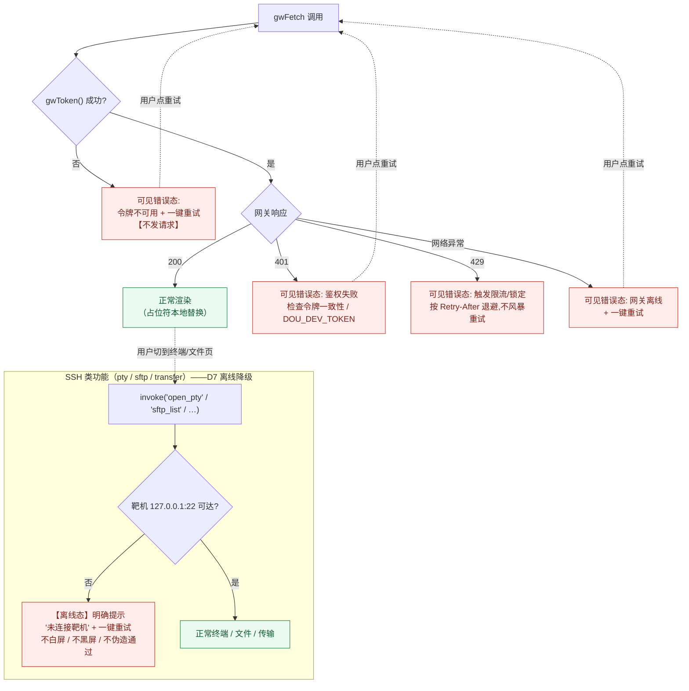
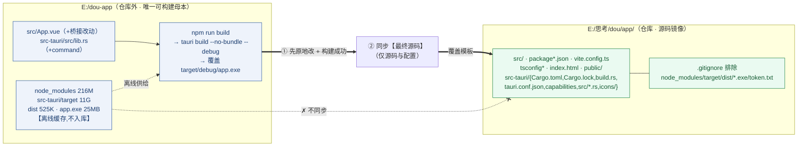

# 08 · 桥接设计与构建方案 —— 完整客户端收编 + 令牌桥接 + 离线构建 + SSH 离线降级

> 作者：高见远（Gao）· 架构师 ｜ 版本 **v1.0** ｜ 日期：2026-11-12
> 派发：齐活林（交付总监）· 标准 SOP **第 3 轮增量设计**（用户诉求「1→2→3 修到真能用」，团队四人并行）
> 上游：`docs/handover/00`~`06`，重点 `05-增量架构设计与实施任务列表.md`（关键路径 §11.2 / 42.0 人天 / ADR-003）、`06-本轮实施与验证报告.md`（偏差清单 §5 / 遗留 §6）；`04-增量PRD` 兼容矩阵 §4.1；`02-系统架构设计与任务分解.md`（§5.6 鉴权矩阵 / §12.2 关键路径 / §14.3 Q4 门禁）。
> 只读核验源码：`E:/dou-app/src/App.vue`、`E:/dou-app/src-tauri/src/lib.rs`、`E:/dou-app/src-tauri/{Cargo.toml,tauri.conf.json,capabilities/default.json}`、`E:/dou-app/package.json`、仓库 `E:/思考/dou/app/**`、`E:/思考/dou/crates/dou-gateway/src/{main.rs,auth.rs}`、`E:/思考/dou/.gitignore`。
> 本阶段动作：**只读核验源码与环境；只新增/补记文档（`08` 主文档 + 对 `05` 的 25H2 补记）；未改任何现有源码、未写实现代码、未写测试用例 / 测试策略、未运行构建 / 测试、未启动任何服务、未尝试 `wsl.exe`、未绕过任何黑名单、未替发起人拍板 Q4/Q5、未替交付总监推翻已定方案**。

---

## 阅读标记法（全文通用，沿用 `05 §0`）

| 标记 | 含义 |
|---|---|
| 【代码已验证】 | 本轮只读打开源码 / 配置核对过，附可核对相对路径 / 行号 |
| 【实测环境】 | 交付总监 / 用户本轮实测事实（`M-*` 编号），非推断 |
| 【交付总监裁定】 | 派发消息中「已定方案」的 6 条，本轮细化并复核，除硬阻塞不推翻 |
| 【架构裁定】 | 本设计确定的方案 / 接口 / 口径澄清 / 数字差异处置（架构师职责内） |
| 【独立复核】 | 对上游数字 / 口径的复核意见（含差异与依据） |
| 【待拍板】 | Q4/Q5/NEW 及本轮新发现，需发起人或交付总监裁定，架构师只给选项与代价 |

> **基线铁律（沿用 `00 §0` / `05 §1.2`）**：唯一基线 = 当前工作区代码；`docs/` 中带 ✅ 的完成状态一律「历史态 / 目标态」，未经代码复核不得采信。`05` 的 **42.0 人天**、`02` 的 **85.0**、`01` 的 **74.0** 三套口径互不相减，**均不得冒充本轮人天**（本轮不产出人天复核值，实施任务只给估算与依赖，见 §8）。

---

## 1. 文档信息与增量范围

### 1.1 文档元数据

| 项 | 内容 |
|---|---|
| 文档名 | `08-桥接设计与构建方案.md` |
| 版本 | v1.0（第 3 轮增量设计首版） |
| 作者 / 角色 | 高见远（Gao）· 架构师 |
| 派发 / 阶段 | 齐活林（交付总监）· 标准 SOP 增量开发 **第 3 轮**（承接第 1 轮 `04` 增量 PRD、第 2 轮 `05` 设计 + `06` 落地报告） |
| 下游读者 | 齐活林（汇总）、寇豆码（后端 / 构建工程师）、前端工程师、严过关（QA）、发起人巫伟鑫（§9 待拍板项） |
| Language | 中文 |
| 性质 | 增量架构设计 + 决策表 + 接口签名 + 收编映射 + 构建命令 + 文件级实施任务；**非** 实现代码、**非** 测试用例 / 策略、**非** 拍板结论 |

### 1.2 「1→2→3 修到真能用」的三段映射（用户诉求对齐）

| 轮次 | 已完成产出 | 用户视角状态 | 本设计关系 |
|---|---|---|---|
| **1** | `04-增量PRD`（24 条 INC / Windows 兼容 + 风控） | 明确「要修什么」 | 上游需求源，不改 |
| **2** | `05-增量架构设计与实施任务列表`（ADR-003 / 42.0 人天 / 34 工单 / 5 批次）+ `06-本轮实施与验证报告`（网关侧 P0 安全 + 状态模型 + W-15 鉴权 + 兼容基础**已真实落地并验证**） | 网关「安全了」，但**客户端连不上**：W-15 统一鉴权后 12 处裸 `fetch` → 401 → 连续触发防爆破 429 | `06 §3` 24 单测 / 32 鉴权 / 7 限流 / 重启持久化全 PASS；`06 §5/§6` 明确 `app/**` 未改、Q4 未拍板、SSH 靶机缺失 |
| **3（本轮）** | `08`（本文）：**令牌桥接 + 前端统一注入 + 占位符本地替换 + 完整客户端收编 + 离线构建 + SSH 离线降级** | 让 `E:/dou-app` 的真实完整客户端**带上 Bearer 连上网关**，并把源码收编进仓库、离线构建可复现 | 只在**客户端侧**增量；**不动网关侧**（网关已被 `06` 验证通过、改动会推翻已验证成果）；不重开 Q4 |

> 【架构裁定】本轮唯一目标 = 消除「`06` 已加固的网关 ↔ `E:/dou-app` 未注入令牌的完整客户端」之间的**鉴权断点**，并把分散在仓库外的真实源码纳入仓库可追溯。**不是**重做 `05` 的全量分层、不是桌面形态选型（Q4）、不是覆盖率 / 打包实测（T05）。

### 1.3 实测事实表（【实测环境】`M-*` + 【代码已验证】补核）

| # | 事实 | 来源 / 证据 |
|---|---|---|
| M-01 | 完整客户端在仓库外 `E:/dou-app/`：`src/App.vue` 27KB、`src-tauri/src/{lib,pty,sftp,transfer}.rs`、`src-tauri/target/debug/app.exe`（25MB，内嵌 dist，进程无到 1420 的 TCP 连接）、`node_modules` 216M、`src-tauri/target` 11G（完整离线编译缓存）、`dist` 525K | 【实测环境】派发；【代码已验证】本轮 `ls` 复核目录结构一致 |
| M-02 | 仓库 `E:/思考/dou/app/` 是 Tauri+Vue **模板**（greet、800×600、productName app）；两份源码并存 | 【实测环境】派发；【代码已验证】本轮复核 `app/src-tauri/src/` 仅 `lib.rs`+`main.rs`（缺 `pty/sftp/transfer`）、`app/package.json` 仅 `vue`/`api`/`opener` 三依赖 |
| M-03 | 旧客户端 12 处裸 `fetch` 不带 Bearer → W-15 后 401 → 连续请求触发防爆破 429；带主令牌同样请求全部 200 | 【实测环境】派发；【代码已验证】本轮精确命中 **8 个** `fetch(`${GW}...`)`（见 §1.4 差异登记） |
| M-04 | `E:/dou-app/src-tauri/Cargo.toml` 已有 `reqwest 0.12 {blocking,json}`、`russh 0.65(ring)`、`russh-sftp 3.0`、`tokio full`、`uuid v4`、`sha2 0.10`；`lib.rs` 已有 `gateway_status` 用 `reqwest::blocking::get`；`generate_handler![]` 在 114 行 | 【实测环境】派发；【代码已验证】`Cargo.toml:27-32`、`lib.rs:17-22,114` |
| M-05 | `E:/dou-app/src-tauri/tauri.conf.json`：`productName: dou`、`identifier com.mrhua.dou`、窗口「豆 Dou」1320×1000 / min 960×600、`csp: null`、`frontendDist ../dist` | 【实测环境】派发；【代码已验证】`tauri.conf.json:3-5,15-19,23,10` |
| M-06 | 网关 `/onboard/config` 返回 `Bearer ${DOU_TOKEN}` **占位符**（安全改造消除明文回吐）；`/health` 是唯一豁免端点 | 【实测环境】派发；【代码已验证】`main.rs:400` `"Bearer ${DOU_TOKEN}"`、`main.rs:185` `.layer(authz::require_auth)` 单层收口、`main.rs:171` `/health` |
| M-07 | `wsl.exe` 被安全策略黑名单拦截且禁止绕过；Windows OpenSSH Server 未安装；`127.0.0.1:22` CLOSED | 【实测环境】派发；**本轮硬约束**：不启动 `wsl.exe`、不绕过黑名单 |
| M-08 | GNU + MSVC 双 toolchain 均验证可用；`cargo` 需注入 `C:/Users/mrhua/.cargo/bin` 与 MinGW `mingw64/bin` 到 PATH；构建走 `E:/dou-target` 或各工程自身 `target` | 【实测环境】派发；与 `05` E-02/E-03/E-04 一致 |
| M-09 | 上游 `00`~`06` 齐备；`06` 偏差清单 = 保留扁平结构 / 未做 `lib.rs` 抽取 / 未新增 N1~N7 / `app/**` 未改 / Q4 未拍板 / 本机仅 Win11 25H2 | 【代码已验证】本轮通读 `06 §5/§6` |
| M-10 | `dou-gateway` 进程当前未运行、TCP 7419 空闲 | 【实测环境】派发；与 `05` E-11 一致；构建 / 启动前置 |
| M-11 | **paramiko 未安装**（`pip show paramiko` 无输出、`site-packages` 无 `paramiko`/`cryptography`），且离线无网络 | 【实测环境】本轮只读元数据核验（未 import、未启动服务）→ SSH 方案 (a) 不可行，见 §7 |
| M-12 | 网关 `data_dir()` 回退链 = `LOCALAPPDATA → USERPROFILE → HOME → "."` 再 `.join("dou")`；`load_or_create_token()` **优先** `DOU_DEV_TOKEN` 环境变量再读 `token.txt` | 【代码已验证】`auth.rs:14-20,31-50`；Tauri command 必须复用同一路径口径，风险见 §2 D9 |
| M-13 | `/onboard/write` 是**网关服务端本地代写**真令牌（`format!("Bearer {}", st.token)`），不是前端回传 | 【代码已验证】`main.rs:471`；前端不可把替换后片段 POST 回网络（§2 D4 关键裁定） |
| M-14 | 仓库根 `.gitignore` 已排除 `target/` `*.exe` `node_modules/` `dist/` `token.txt` `audit.*` `keys/` `quarantine/` 等 | 【代码已验证】本轮 `cat .gitignore`；收编不入库清单依据 |

### 1.4 【独立复核】裸 fetch 数量差异登记（不编造、给机器兜底）

| 项 | 内容 |
|---|---|
| 主理人实测口径 | 「旧客户端 **12 处**裸 `fetch`（`App.vue` 行 377/390/412/433/442/453/460/470，`const GW` 在 198 行）」——列出 **8 个行号** |
| 本轮只读核验 | `rg "fetch\(" E:/dou-app/src/App.vue` 精确命中 **8 个 `fetch(`${GW}...`)` 调用点**，行号 `377 / 390 / 412 / 433 / 442 / 453 / 460 / 470`，**与主理人列出的 8 个完全一致**；`const GW = 'http://127.0.0.1:7419'` 在 `:198` ✓ |
| 差异 4 处的可能来源 | 【架构裁定·不臆断】推测为：① `refresh()`（`:285`）经 `invoke('gateway_status')` 的间接探活；② `copySnippet`（`:385`）/ `copyIssued`（`:476`）的剪贴板写入；③ `probeHandshake`（`:409`）心跳轮询内 `fetch` 的重复计数；④ 历史版本残留。**均为推测，不作为事实** |
| 处置 | 设计以**主理人 12 处口径为准做覆盖要求**，但判据给机器兜底：替换后 `rg "fetch\(" E:/dou-app/src/App.vue` 除 `gwFetch` 定义内 1 处外**直接调用点 = 0**；工程师须对 §5.2 列出的 8 个精确行号 + `rg` 全量结果逐条核对，确保 12 处（含任何派生调用）全部经 `gwFetch`。**不编造第 9~12 处的位置** |

### 1.5 本轮解决 / 不解决 / 硬边界

| 类别 | 内容 |
|---|---|
| **解决（6 块，均【交付总监裁定】）** | ① 令牌桥接 command；② 前端 `gwToken()`+`gwFetch()` 统一注入；③ 占位符 `${DOU_TOKEN}` 本地替换；④ `E:/dou-app` 源码收编进仓库 `app/`（覆盖模板）；⑤ 原地离线构建 + 产物覆盖；⑥ SSH 靶机替代评估与推荐 |
| **不解决** | 不重做 `02`/`05` 全量分层 / `lib.rs` 抽取（W-04）；不新增 N1~N7 端点（网关 `.route()` 仍 14）；不改网关侧任何源码（`06` 已验证）；不改 `00`~`06` 专业内容；不做覆盖率 / 性能九项实测（T05）；不做桌面形态选型（Q4）；不实际轮换令牌（Q5）；不引新前端依赖 / 新 Rust crate |
| **硬边界（本轮新增，不可协商）** | **不启动 `wsl.exe`、不绕过安全策略黑名单**；不改任何现有源码；不运行构建 / 测试 / 服务；不写实现代码（仅签名 / 命令）；不写测试用例 / 策略；令牌**绝不**写入前端源码 / 文档 / 提交 / 日志 / clipboard 之外的持久化；构建**仍在 `E:/dou-app` 原地**（离线缓存），仓库 `app/` 仅作源码镜像 |
| **沿用 `05` 三条不可协商约束** | ① P0 硬门禁已由 `06` 执行完毕（commit `2007a81` / tag `handover-baseline`）；② 限流 / 锁定状态唯一落 W-11 统一模型（第 13 表 + `DbPool` + `StateCache` 写穿，禁 HashMap）——本轮**不触碰**；③ 不重做 `02` 已有设计 |

### 1.6 与 `02`/`05`/`06` 的关系（哪些复用 / 哪些增量）

| 上游章节 | 关系 |
|---|---|
| `02 §5.6` 鉴权矩阵（14 端点 / M-only / `/health` 豁免） | **原样复用**；`06` 已落地 `authz::require_auth`，本轮客户端必须按其注入 Bearer |
| `05 §11.2` 关键路径 `I-01→W-03→W-11→W-15→出口四项` | **已由 `06` 走完网关侧**；本轮是路径末端「出口四项」的**客户端联调补完**，不重走 |
| `05 §2` ADR-003（限流算法 / 第 13 表 / 中间件 / `EXEMPT_PATHS`） | **原样复用**，本轮不改；客户端只需「带对令牌」不触发 401→429 |
| `05 §9` 文件清单（`app/**` 不动 / `03` 五行 / `00`~`04` 一字不动） | **第 3 轮授权调整**：交付总监明确要求收编 `app/`（覆盖模板），此为用户「3 修到真能用」授权；但 `00`~`06` 文档仍不改专业内容，25H2 补记已单独落 `05 §1.5.1` |
| `06 §5` 偏差清单（保留扁平 / 未抽 lib.rs / app 未改 / Q4 未拍板） | **全部保持**；本轮只补「app 未改」这一项（收编 + 桥接），其余偏差不推翻 |
| `06 §6` 遗留（Win11 25H2 / Q4 / Q5 / Q7 / 覆盖率 / 路径逃逸 / clippy warnings） | 本轮只处理「SSH 靶机缺失」的**客户端侧降级**，其余遗留不触碰；Win11 版本口径已并入 `05 §1.5.1` + 本文 §7 |
| `05 §12.3` Q4 门禁 / `/health` 裁定 | Q4 **仍不拍板**；本轮桥接与 Q4 两方案都兼容（§2 D8） |

---

## 2. 架构决策表（ADR-桥接，10 项 ≥ 要求 7 项）

> 【交付总监裁定】6 条方案本轮细化并复核，**除硬阻塞不推翻**；D1~D6 对应 6 条，D7~D10 为架构师补充裁定。每项给备选 / 选型 / 理由 / 代价 / 可回退性。**硬阻塞检查结果：无**——`M-04` 证明无需新增 Rust 依赖、`M-12` 路径口径可复用、`M-14` gitignore 已就绪。

| # | 决策点 | 备选方案 | 【架构裁定】选型 | 理由（代码依据） | 代价 | 可回退性 |
|---|---|---|---|---|---|---|
| **D1** | **令牌存放位置**（对应方案 1） | (a) `%LOCALAPPDATA%/dou/token.txt`；(b) 环境变量注入前端；(c) 前端硬编码 / 常量；(d) 网关代发令牌到前端 | **选 (a)**：与网关同源同文件，`gateway_token()` 从 `token.txt` 读；回退 `USERPROFILE/HOME`（复用 `auth.rs:14-20` 口径） | ① 网关 `load_or_create_token()`（`auth.rs:31-50`）本就读写该文件，同源保证令牌一致；② 令牌只存在 Rust 侧 + 本机文件，**不进前端源码 / 文档 / 提交 / 日志**（硬边界）；③ (b)(c)(d) 分别违反「不写进前端」「不落提交」「不回吐明文」（`06` NEW-4 / `main.rs:400` 占位符改造） | 依赖 `token.txt` 存在且可读；首次启动前需网关已生成（由 `ensure_gateway_started()` 保证，`lib.rs:86-96`）；`DOU_DEV_TOKEN` 环境变量优先级差异需登记（D9） | **高**：command 只读不写、无副作用；删除 command 即回退，不触碰网关 |
| **D2** | **注入层**（对应方案 2） | (a) 前端 `gwFetch` 封装 + Tauri command 取令牌；(b) Rust 侧 `reqwest` 代理**所有** HTTP 请求；(c) 每处 `fetch` 单独 `invoke` 取令牌；(d) service worker / 拦截层 | **选 (a)**：`gwToken()` 模块级缓存 + `gwFetch(path, opts)` 统一注入 `Authorization: Bearer <token>`，替换全部裸 `fetch` | ① 改动面最小：只加 1 个 command + 1 个前端封装 + 替换调用点，不重写 8~12 处业务逻辑；② (b) 需把 reqwest 代理做成通用 command 并改写所有返回类型，改动面指数放大且 `gateway_status`（`lib.rs:17-22`）已是 reqwest 直连可复用；③ (c) 重复 invoke、无缓存、易漏；④ (d) Tauri webview 无稳定 SW 生命周期 | 令牌短暂进入前端 JS 内存（仅 `gwToken()` 缓存变量，不持久化、不落 storage、不拼接进 URL）；需在 §4 明确「内存态」边界 | **高**：`gwFetch` 是薄封装，逐个调用点可 revert；缓存变量生命周期 = 页面会话 |
| **D3** | **失败态**（对应方案 2 后半） | (a) 令牌读取失败抛可见错误态；(b) 沉默降级为无令牌请求；(c) 弹窗后仍发起无令牌请求；(d) 静默重试 | **选 (a)**：`gwToken()` 失败 throw；`gwFetch` 不吞错，向上抛可见错误态（错误面板 / 状态灯变红 + 「令牌不可用，请检查 token.txt」） | **硬阻塞级理由**：(b)(c)(d) 会发无令牌请求 → 401 → 连续触发防爆破 429（正是 `M-03` 用户要修的根因），沉默降级等于没修；`05 §5.2` FC1「fail-closed，不确定 ≠ 允许」同精神 | 需前端新增错误态呈现（不白屏 / 不黑屏，给明确原因 + 一键重试）；错误文案不得含令牌 | **高**：错误态是增量 UI，可独立回退；`gwFetch` 不吞错是默认行为 |
| **D4** | **占位符替换**（对应方案 3） | (a) 前端展示 / 复制 / 代写前用 `gwToken()` **本地替换** `${DOU_TOKEN}`；(b) 网关回吐真令牌；(c) 不替换让用户手填；(d) 前端把替换后片段 POST 给 `/onboard/write` | **选 (a)**：`replaceTokenPlaceholder(snippet)` 在**前端本地**把 `${DOU_TOKEN}` 换成真实令牌仅用于展示 / 复制；**`writeConfig()` 仍只 POST `{client}`，由网关服务端本地代写**（`main.rs:471`），前端绝不回传令牌 | ① `main.rs:400` 已用占位符消除 HTTP 回吐，(b) 推翻 `06` 已验证的安全改造成果（硬阻塞）；② (d) 把明文令牌 POST 回网络 = 明文回传，**违反硬边界**，且 `/onboard/write` 本就服务端生成（`main.rs:471`）；③ (c) 体验差但语义安全，保留为 D4 的降级备选 | 替换后片段含真令牌，禁止进入日志 / 提交 / `console.log` / 审计 detail / 持久化；复制走 `navigator.clipboard` 不落盘 | **高**：替换函数纯前端、可逆；不改网关 |
| **D5** | **收编映射**（对应方案 4） | (a) `E:/dou-app` 原地改 + 构建，**最终源码**同步回仓库 `app/`（覆盖模板）；(b) 先把源码搬进仓库再在仓库内构建；(c) 全量复制含 `node_modules`/`target`/`dist`/`app.exe` | **选 (a)**：仅 2 处先改（`lib.rs` + `App.vue`），原地离线构建成功后，把「源码 + 配置」同步回仓库（清单见 §5.3），`node_modules`/`target`/`dist`/`*.exe` 不入库 | ① `M-01` `E:/dou-app` 有 11G target + 216M node_modules 完整离线缓存，**唯一受支持的构建点**；仓库 `app/node_modules` 是模板残留且被 gitignore 排除，仓库内无法独立离线构建 → (b) 会破坏「离线可完成」；② (c) 违反 `M-14` gitignore 与 30MB 包体约束；③ 收编后仓库 = 可追溯源码镜像，构建产物不入库 | 两份源码短期并存，需同步纪律（§9 风险 R-5）；仓库 `app/` 收编后**不保证可独立构建**（文档需标注） | **高**：同步是文件复制，可 `git revert`；`E:/dou-app` 始终是可构建母本 |
| **D6** | **构建形态**（对应方案 5） | (a) `npm run build` + `npm run tauri build -- --no-bundle --debug`（或等价 `cargo build --offline`），产物覆盖 `target/debug/app.exe`；(b) release bundle（msi/nsis）；(c) 仅 `npm run build` 不重编 exe | **选 (a)**：两步，全程 `--offline` / `CARGO_NET_OFFLINE=true` / `npm --offline`，不依赖 crates.io / npm 网络；`--no-bundle` 免安装包下载 | ① 现有 `app.exe` 在 `target/debug`（`M-01`），`tauri build` **默认 release**，须显式 `--debug` 才落 debug 目录（§6 标注此差异）；② (b) 触发 bundle 资源下载 / 签名，离线不可保证且非本轮目标；③ (c) exe 内嵌 dist，不重编则前端改动不生效 | 需 PATH 注入（M-08）；`vue-tsc --noEmit` 可能因模板残留类型报错（§6 失败回退）；Tauri GNU 下 `ld.exe: export ordinal too large`（`00 §4-4`）需注意 toolchain 选择 | **高**：构建命令可重跑；旧 `app.exe` 先备份再覆盖（§6） |
| **D7** | **SSH 靶机替代**（对应方案 6） | (a) paramiko 本地 SSH 服务；(b) 客户端离线态优雅降级（不白屏 / 明确「未连接靶机」+ 一键重试）；(c) 安装 Windows OpenSSH / 外部真靶机 / russh 内置 server | **选 (b) 为主 + (c) 为可选手动**：前端对 `open_pty`/`sftp_*`/`transfer_*` 的 `invoke` 失败给明确离线态与重试入口；**不启动 wsl.exe、不绕过黑名单** | ① `M-11` paramiko 未装且离线无网络 → (a) 不可行；② `M-07` wsl 黑名单 + 22 CLOSED + OpenSSH 未装 → (c) 需用户手动装角色 / 提供外部靶机，非本轮可自动完成；③ (b) 零外部依赖、离线可完成、符合「受限即受限、不伪造通过」（`05 §14.2`） | SSH 类功能（终端 / 文件 / 传输）在无靶机时不可用，须**如实标注受限**；HTTP 管理类功能不受影响 | **高**：降级是前端错误态增量；靶机就绪后无需改代码即自动恢复 |
| **D8** | **Q4 关系**（本轮补充裁定） | (a) 重开 Q4 拍板桥接形态；(b) 默认按方案 A（HTTP 7419）推进；(c) **不重开、声明本轮与 Q4 两方案都兼容** | **选 (c)**：本轮不重开 Q4、不替发起人拍板 | ① `E:/dou-app` 已同时具备「前端 `fetch(GW)` 直连 7419」（方案 A）与 `ensure_gateway_started()` spawn 网关进程（`lib.rs:86-96`），形态**已事实落地**；② 新增 `gateway_token` 只是**本地凭据读取 command**（IPC 数据通道），不改变「HTTP 直连 vs Tauri command 代理」的桥接形态——无论 Q4 最终选 A 还是 B，客户端都需要主令牌；③ `06 §5` 明确 Q4 未拍板但网关侧已完成，本轮无需其结论 | 若发起人后续改判 Q4=方案 B（in-process / cdylib 链接网关），令牌来源可能从 `token.txt` 变为共享内存，D1 需复核（登记为 §9 待拍板 Q4） | **高**：`gateway_token` 与形态解耦；改判只影响令牌来源，不影响 `gwFetch` 注入层 |
| **D9** | **`data_dir()` 口径一致性**（本轮补充裁定） | (a) Tauri command 复刻 `auth.rs:14-20` 回退链；(b) 只认 `LOCALAPPDATA`；(c) 前端传路径 | **选 (a)**：`gateway_token()` 内部按 `LOCALAPPDATA → USERPROFILE → HOME` 回退并 `.join("dou/token.txt")`，与网关 `data_dir()` **逐字一致** | `M-12` 网关回退链含 `USERPROFILE/HOME`，(b) 在精简环境会读不到同一文件导致 401→429；(c) 把路径暴露给前端且易被篡改 | **风险登记**：`auth.rs:32` `DOU_DEV_TOKEN` 环境变量**优先于** `token.txt`；若网关以该变量启动（值 ≠ 文件内容），客户端读 `token.txt` 会拿到不同令牌 → 401。处置：构建 / 启动脚本**不设** `DOU_DEV_TOKEN`，并在 §9 列为验收核对项；Q5 未拍板不轮换 | **高**：command 只读；口径常量化便于单点修改 |
| **D10** | **权限 / capabilities**（本轮补充裁定） | (a) command 用 `std::fs` 直接读，不动 capabilities；(b) 前端用 `@tauri-apps/plugin-fs` 读并加 `fs:allow-read` 权限；(c) 加 broad capability | **选 (a)**：`gateway_token()` 用标准库 `std::fs::read_to_string`，**不需要新增 capability 权限** | ① `default.json` 仅 `core:default`+`opener:default`（`M-05` 复核），(b)(c) 需扩权限且令牌会**经过前端 JS 文件系统 API**，扩大暴露面；② command 在 Rust 侧读、只回 `String`，最小权限 | 需在 §4 约束 command 返回值脱敏（日志 / 错误串不含令牌）；capabilities 既有 `notification`/`fs` 插件未声明权限属 `E:/dou-app` 既有问题，本轮不扩范围（§9 风险 R-7 登记） | **高**：零配置改动；不碰 `default.json` |

> **硬阻塞复核结论**：6 条交付总监裁定均**无硬阻塞**——D1 无需新依赖（`M-04` 已有 `reqwest`/标准库足够）、D2/D3/D4 纯前端增量、D5/D6 离线缓存齐备（`M-01`）、D7 paramiko 不可行但已有 (b) 兜底（`M-11`）。**故不推翻任何一条**。

---

## 3. 目标数据流（Mermaid）

### 3.1 全链路时序图（前端 → gwFetch → Tauri command → token.txt → Bearer → 网关 → 审计）

```mermaid
sequenceDiagram
    autonumber
    participant U as 用户操作（接入向导 / 审批 / 凭据）
    participant V as App.vue 视图
    participant GF as gwFetch(path, opts)
    participant GT as gwToken() 缓存
    participant CMD as Tauri command<br/>gateway_token()
    participant FS as %LOCALAPPDATA%/dou/token.txt
    participant GW as 网关 127.0.0.1:7419<br/>authz::require_auth
    participant H as commands/* handler
    participant AU as AuditWriter（脱敏）

    U->>V: 触发请求（如 fetchOnboard / loadTasks / issueToken）
    V->>GF: gwFetch('/onboard/config?client=…', opts)
    GF->>GT: 取令牌（模块级缓存）
    alt 缓存未命中
        GT->>CMD: invoke('gateway_token')
        CMD->>FS: std::fs::read_to_string<br/>data_dir 回退 LOCALAPPDATA→USERPROFILE→HOME
        alt 读取成功且前缀 dou_ak_
            FS-->>CMD: 令牌串
            CMD-->>GT: Ok(String)（仅内存态,不落日志）
            GT->>GT: 缓存（会话级）
        else 文件缺失 / 不可读 / 格式错
            FS-->>CMD: Err
            CMD-->>GT: Err（错误串不含令牌）
            GT-->>GF: throw
            GF-->>V: 【可见错误态】令牌不可用,请检查 token.txt + 一键重试
            Note over V: 绝不发出无令牌请求<br/>（否则 401→连续 429,正是本轮要修的根因）
            GF--xGW: 无请求
        end
    end
    GT-->>GF: token（内存）
    GF->>GW: fetch(GW+path, {…, headers:{Authorization:'Bearer '+token}})
    GW->>GW: ① /health 豁免短路；② Bearer 解析（唯一 authz.rs）<br/>③ RateLimiter→④ Lockout→⑤ 定长比较校验
    alt 令牌有效
        GW->>H: next.run(req) + Extension<AuthContext>
        H-->>GF: 200 / 业务结果（片段含 ${DOU_TOKEN} 占位符）
        GF-->>V: Response
        V->>V: replaceTokenPlaceholder(snippet) 本地替换<br/>仅用于展示 / 复制,不回传、不落日志
        H->>AU: 写业务审计（detail 经 Sanitizer,无明文令牌）
    else 无效 / 超限 / 锁定
        GW->>AU: auth_deny / auth_throttled / auth_locked
        GW-->>GF: 401 / 429 + 稳定码
        GF-->>V: 【可见错误态】按状态区分,不静默重试
    end
    Note over V,AU: /onboard/write 只 POST {client},由网关服务端<br/>本地代写真令牌(main.rs:471);前端绝不回传令牌
```

### 3.2 失败态与降级分支（fail-closed，不沉默降级）



### 3.3 收编数据流（原地构建 → 源码同步 → 仓库镜像）



> 【架构裁定】三张图共同锁定：① 令牌**只在 Rust command ↔ 前端内存**之间流动，绝不落前端源码 / 日志 / 提交 / 网络回传；② 任何失败都**可见且不发无令牌请求**（D3，直击 `M-03` 根因）；③ 收编是「源码同步」而非「产物搬运」，构建产物与离线缓存留在 `E:/dou-app`（D5）。

---

## 4. Rust / TS 接口签名清单（不写实现）

> 【架构裁定】本节全部为**签名 + 约束**，不含函数体 / SQL / 组件模板（工作流边界）。工程师按签名落地，`05 §4` 的网关侧签名原样复用、本轮不触碰。事实锚点：`E:/dou-app/src-tauri/src/lib.rs`（`generate_handler![]` 在 `:114`）、`E:/dou-app/src/App.vue`（`<script setup lang="ts">` 起于 `:157`、`GW` 在 `:198`）、`E:/思考/dou/crates/dou-gateway/src/auth.rs:14-20,31-50`。

### 4.1 Rust 侧（`E:/dou-app/src-tauri/src/lib.rs`，仅签名）

```rust
// 【新增 command】读取主令牌，供前端注入 Bearer；只读、无副作用、不落日志
// 路径口径与网关 auth.rs:14-20 逐字一致：
//   base = LOCALAPPDATA | USERPROFILE | HOME | "."；PathBuf::from(base).join("dou").join("token.txt")
// 约束：① 仅 std::fs，不新增 crate（M-04 已足够）；② 返回 Ok(String) 仅当内容 trim 后
//       以 "dou_ak_" 开头且长度 > 16（复用 auth.rs:42 校验语义）；
//       ③ 错误串不得含令牌内容 / 绝对路径以外的敏感值；
//       ④ 不缓存到静态变量导致轮换后读到旧值（Q5 未拍板，读时实时读文件）；
//       ⑤ 令牌只经 IPC 返回，不写文件 / 不打印 / 不进 tauri 日志。
#[tauri::command]
fn gateway_token() -> Result<String, String>;

// 【注册】在 lib.rs:114 的 generate_handler![] 追加 gateway_token（不改动其余 13 个 command）
// tauri::generate_handler![
//     greet, gateway_status, gateway_token,           // ← 新增
//     open_pty, pty_write, sftp_list, sftp_download, sftp_upload,
//     sanitize_ansi, download_chunked, remote_stat, download_dir,
//     upload_dir, download_resume
// ]
// 约束：generate_handler! 是编译期宏，漏注册 → 前端 invoke 运行时报 "command not found"（§6 验证点）。

// 【可选·架构裁定，非本轮必须】把 data_dir 口径抽成私有 helper 避免与 command 内联字符串漂移：
fn dou_data_dir() -> std::path::PathBuf;   // 纯函数，回退链同上，便于 D9 单点维护
```

**Rust 侧不改动清单**（硬边界）：`gateway_status`（`lib.rs:17-22`）、`ensure_gateway_started()`（`:86-96`）、`run()`（`:99-117`）、`Cargo.toml`（依赖已够）、`tauri.conf.json`、`capabilities/default.json`（D10 用 `std::fs` 免权限）、`pty.rs`/`sftp.rs`/`transfer.rs`（SSH 逻辑不动，D7 只做前端降级）。

### 4.2 TS 侧（`E:/dou-app/src/App.vue` `<script setup lang="ts">`，仅签名）

```ts
// 【模块级缓存】令牌只在内存态，绝不写 localStorage / sessionStorage / 常量 / 文档
// 约束：进程内缓存一次成功值；Q5 轮换后可提供显式失效（见下方 reset）
let _gwTokenCache: string | null;                       // 模块作用域，非响应式 ref（避免被渲染进 DOM）

// 取令牌：失败必须 throw（D3），错误对象携带可见文案，不含令牌
// 约束：① 内部 invoke('gateway_token')；② 命中缓存直接返回；
//       ③ 失败 throw new Error('令牌不可用，请检查 %LOCALAPPDATA%/dou/token.txt') 之类可见文案；
//       ④ 绝不返回空串 / 静默降级。
function gwToken(): Promise<string>;

// 统一请求：替换全部裸 fetch 调用点（§1.4 的 8 个精确行号 + rg 全量兜底）
// 约束：① 内部 await gwToken() 后注入 Authorization: Bearer <token>；
//       ② 保留调用方原有 method / Content-Type / body / query，不改写业务参数；
//       ③ 不把令牌拼进 URL / query / body；④ 失败（含 401/429/网络异常）向上抛、不吞；
//       ⑤ 429 不自动风暴重试（按 Retry-After 或交给调用方可见错误态）。
function gwFetch(path: string, opts?: RequestInit): Promise<Response>;

// 占位符本地替换（D4）：仅用于「展示 / 复制」，不回传网络
// 约束：① 把 snippet 中 ${DOU_TOKEN} 替换为 gwToken() 的真实值；
//       ② 替换结果仅赋给展示变量 / clipboard.writeText，不进 console.log / 日志 / 提交 / 审计；
//       ③ writeConfig() 仍只 POST { client }（main.rs:471 服务端代写），绝不传替换后片段。
function replaceTokenPlaceholder(snippet: string): Promise<string>;

// 【可选】显式失效缓存（Q5 轮换后一键重取；本轮可留占位）
function resetGwToken(): void;

// 【失败态类型】供视图渲染可见错误（不白屏 / 不黑屏 / 一键重试）
interface GwErrorInfo {
  code: 'TOKEN_UNAVAILABLE' | 'AUTH_FAILED' | 'THROTTLED' | 'GATEWAY_OFFLINE' | 'SSH_TARGET_OFFLINE';
  message: string;       // 人话，绝不含令牌
  retryable: boolean;
}
```

**TS 调用点改造映射**（§1.4 的 8 个精确行号，逐一 `fetch` → `gwFetch`；行号以 `E:/dou-app/src/App.vue` 为准）：

| # | 行 | 原调用 | 端点 | 改造 | 备注 |
|---|---|---|---|---|---|
| 1 | `:377` | `fetch(`${GW}/onboard/config?client=…`)` | `GET /onboard/config` | `gwFetch('/onboard/config?client=…')` | 返回片段含 `${DOU_TOKEN}`，`fetchOnboard` 后须本地替换展示 |
| 2 | `:390` | `fetch(`${GW}/onboard/write`, {POST…})` | `POST /onboard/write` | `gwFetch('/onboard/write', {…})` | **body 仍 `{client}`，不回传令牌**（D4） |
| 3 | `:412` | `fetch(`${GW}/audit/query?…`)` | `GET /audit/query` | `gwFetch('/audit/query?…')` | 心跳轮询 `probeHandshake` 内，429 不风暴重试 |
| 4 | `:433` | `fetch(`${GW}/tasks`)` | `GET /tasks` | `gwFetch('/tasks')` | |
| 5 | `:442` | `fetch(`${GW}/approve`, {POST…})` | `POST /approve` | `gwFetch('/approve', {…})` | M-only 端点，主令牌可过 |
| 6 | `:453` | `fetch(`${GW}/scope/tokens`)` | `GET /scope/tokens` | `gwFetch('/scope/tokens')` | M-only |
| 7 | `:460` | `fetch(`${GW}/scope/tokens`, {POST…})` | `POST /scope/tokens` | `gwFetch('/scope/tokens', {…})` | M-only |
| 8 | `:470` | `fetch(`${GW}/scope/revoke`, {POST…})` | `POST /scope/revoke` | `gwFetch('/scope/revoke', {…})` | M-only |

> 【架构裁定】`GW`（`:198`）保留为常量但只被 `gwFetch` 内部使用；`refresh()`（`:285`）走 `invoke('gateway_status')` → `reqwest::blocking::get(/health)`（豁免端点），**不需要 Bearer、不改造**；`copySnippet`（`:385`）/ `copyIssued`（`:476`）的剪贴板写入需经 `replaceTokenPlaceholder`（仅 #1 涉及占位符）。判据：`rg "fetch\(" E:/dou-app/src/App.vue` 除 `gwFetch` 定义内 1 处外直接调用 = 0。

### 4.3 网关侧接口（**本轮不改**，供注入层对齐）

| 端点 | 鉴权（`02 §5.6` / `06`） | 客户端注入要求 |
|---|---|---|
| `/health` | **唯一豁免**（`EXEMPT_PATHS.len()=1`） | 不发也 200；`gateway_status` 走此端点无需令牌 |
| 其余 13 端点 | `authz::require_auth` 单层（`main.rs:185`），Master/Device Bearer；M-only 6 类 | 必须 `Authorization: Bearer <主令牌>`，否则 401 → 连续 429（防爆破） |
| `/onboard/config` | 需鉴权；返回 `snippet` 含 `${DOU_TOKEN}` 占位符（`main.rs:400`） | 展示 / 复制前本地替换 |
| `/onboard/write` | 需鉴权；**服务端本地代写**真令牌（`main.rs:471`） | 前端只 POST `{client}`，不回传令牌 |
| `/mcp` | 需鉴权；`initialize` 等 | 外部 Agent 客户端注入由接入向导片段承接（非本轮前端 8 处） |

---

## 5. 文件级改动清单（相对路径，全量）

> 【架构裁定】「可独立回退」= 收编后（`06` 已 git 化，`commit 2007a81` / tag `handover-baseline`）该改动能否单独 `git revert`。本轮**不删除任何整文件**；两份源码（`E:/dou-app` 母本 ↔ 仓库 `app/` 镜像）并存期间以 `E:/dou-app` 为构建母本。

### 5.1 新增文件表

| # | 相对路径 | 所属任务 | 改动性质 | 可独立回退 | 说明 |
|---|---|---|---|---|---|
| A01 | `docs/handover/08-桥接设计与构建方案.md` | 本阶段 | 本文档 | 是 | 第 3 轮主交付物 |
| A02 | `docs/handover/08-bridge-dataflow.mermaid`（可选抽取件） | 本阶段 | §3 数据流图抽取 | 是 | 与 `02-*`/`05-*` 抽取件命名惯例一致；内容以本文为准 |

> 【架构裁定】**源码侧 0 新增文件**：`gateway_token` 内联进现有 `lib.rs`、`gwToken/gwFetch` 内联进现有 `App.vue`（D2 最小改动面）。若工程师偏好可拆 `app/src/gateway.ts`，但那会新增文件且需改 import —— **本设计不推荐、不列入清单**（避免扩大改动面）。

### 5.2 修改文件表（先在 `E:/dou-app` 原地改，再同步回仓库）

| # | `E:/dou-app` 母本路径 | 同步后仓库路径 | 改动性质 | 所属任务 | 可独立回退 |
|---|---|---|---|---|---|
| M01 | `src-tauri/src/lib.rs` | `app/src-tauri/src/lib.rs` | 新增 `gateway_token` command + `generate_handler![]`（`:114`）追加注册 | C-01 | 是（command 只读无副作用） |
| M02 | `src/App.vue` | `app/src/App.vue` | 新增 `gwToken()`/`gwFetch()`/`replaceTokenPlaceholder()`/`GwErrorInfo`；替换 §4.2 的 8 处裸 fetch；失败态可见；占位符本地替换 | C-02 / C-03 | 否（与 M01 联调，需同批） |
| — | **不修改**：`src-tauri/{Cargo.toml,tauri.conf.json,capabilities/default.json,build.rs,src/{main,pty,sftp,transfer}.rs}` | — | 依赖 / 配置 / SSH 逻辑均不动 | — | — |
| — | **不修改**：`package.json`/`vite.config.ts`/`tsconfig*`/`index.html`/`public/` | — | 仅随收编同步（内容不变） | C-04 | — |

### 5.3 收编映射表（`E:/dou-app/` → `E:/思考/dou/app/`，覆盖模板）

> 【交付总监裁定·方案 4】下表逐条列出**同步进仓库**的源码与配置；`node_modules`/`target`/`dist`/`*.exe` 不入库（`M-14` `.gitignore` 已排除）。

| # | 源（`E:/dou-app/`） | 目标（`E:/思考/dou/app/`） | 类别 | 动作 | 备注 |
|---|---|---|---|---|---|
| S01 | `src/App.vue` | `src/App.vue` | 前端源码 | **覆盖**（模板 greet → 完整客户端 + 桥接） | 含 M02 改动 |
| S02 | `src/main.ts` | `src/main.ts` | 前端源码 | 覆盖 | |
| S03 | `src/vite-env.d.ts` | `src/vite-env.d.ts` | 前端源码 | 覆盖 | |
| S04 | `src/assets/` | `src/assets/` | 前端资源 | 覆盖 | |
| S05 | `package.json` | `package.json` | 清单 | 覆盖 | 完整依赖（xterm/monaco/plugin-fs/notification）替换模板三依赖 |
| S06 | `package-lock.json` | `package-lock.json` | 锁文件 | 覆盖 | 离线构建依赖锁定依据 |
| S07 | `vite.config.ts` | `vite.config.ts` | 构建配置 | 覆盖 | `1420 strictPort` / HMR 1421 保持 |
| S08 | `tsconfig.json` | `tsconfig.json` | TS 配置 | 覆盖 | |
| S09 | `tsconfig.node.json` | `tsconfig.node.json` | TS 配置 | 覆盖 | |
| S10 | `index.html` | `index.html` | 入口 | 覆盖 | |
| S11 | `public/`（`tauri.svg`,`vite.svg`） | `public/` | 静态资源 | 覆盖 | |
| S12 | `src-tauri/Cargo.toml` | `src-tauri/Cargo.toml` | Rust 清单 | 覆盖 | `M-04` 依赖；含 `[lib] crate-type` |
| S13 | `src-tauri/Cargo.lock` | `src-tauri/Cargo.lock` | Rust 锁 | 覆盖 | 离线解析依据（与网关 `Cargo.lock` 独立） |
| S14 | `src-tauri/build.rs` | `src-tauri/build.rs` | 构建脚本 | 覆盖 | |
| S15 | `src-tauri/tauri.conf.json` | `src-tauri/tauri.conf.json` | Tauri 配置 | 覆盖 | `M-05` productName `dou` / 1320×1000 |
| S16 | `src-tauri/capabilities/default.json` | `src-tauri/capabilities/default.json` | 权限 | 覆盖 | `core:default`+`opener:default`（D10 不改） |
| S17 | `src-tauri/src/lib.rs` | `src-tauri/src/lib.rs` | Rust 源码 | 覆盖 | 含 M01 改动 |
| S18 | `src-tauri/src/main.rs` | `src-tauri/src/main.rs` | Rust 源码 | 覆盖 | |
| S19 | `src-tauri/src/pty.rs` | `src-tauri/src/pty.rs` | Rust 源码 | **新增**（模板无） | |
| S20 | `src-tauri/src/sftp.rs` | `src-tauri/src/sftp.rs` | Rust 源码 | **新增**（模板无） | |
| S21 | `src-tauri/src/transfer.rs` | `src-tauri/src/transfer.rs` | Rust 源码 | **新增**（模板无） | |
| S22 | `src-tauri/icons/`（16 个图标文件） | `src-tauri/icons/` | 资源 | 覆盖 | `32x32.png`/`icon.ico`/`icon.icns` 等 |
| S23 | `README.md` | `README.md` | 文档 | 覆盖（可选） | 【架构裁定】不在交付总监清单明确项内，列为「建议同步、可跳过」，不强制 |

> 【架构裁定】`src-tauri/gen/`（Tauri 生成的 schema）**不列入收编**（生成物，`00 包 §3` 记为被忽略）；若目标仓库已存在则保持不动，不覆盖、不删除。

### 5.4 不入库 / 不同步清单（硬边界）

| # | 路径 | 理由 |
|---|---|---|
| X01 | `E:/dou-app/node_modules/`（216M） | 生成物；`M-14` `.gitignore` `node_modules/` 已排除；仓库 `app/node_modules` 为模板残留、保持被忽略 |
| X02 | `E:/dou-app/src-tauri/target/`（11G，含 `debug/app.exe` 25MB） | 离线缓存 + 构建产物；`.gitignore` `target/`、`*.exe` 已排除；**仅留在母本原地** |
| X03 | `E:/dou-app/dist/`（525K） | 构建产物（已内嵌进 `app.exe`）；`.gitignore` `dist/` 已排除 |
| X04 | `%LOCALAPPDATA%/dou/token.txt` 及 `audit.*`/`known_hosts.json`/`keys/`/`quarantine/` | **凭据与运行时数据绝不入库**（`05` E-09 / `M-14`）；本轮硬边界 |
| X05 | `E:/dou-target/`（网关构建产物） | 仓库外 ASCII 产物目录，`.gitignore` 已排除 |
| X06 | 任何含真实令牌的日志 / 提交 / 文档 / 剪贴板持久化 | 硬边界；`06` NEW-4 已全局占位符化，本轮不得回退 |

### 5.5 「删除」表（文件内逻辑删除，不删整文件）

| # | 位置 | 逻辑删除内容 | 所属任务 | 可独立回退 |
|---|---|---|---|---|
| L01 | `E:/dou-app/src/App.vue:377,390,412,433,442,453,460,470` | 8 处裸 `fetch` 调用（+ `rg` 兜底任何派生调用）替换为 `gwFetch` | C-02 | 是 |
| L02 | `E:/dou-app/src/App.vue:385`（`copySnippet`） | 直接 `writeText(onboardSnippet.value)`（含占位符）→ 先本地替换再复制 | C-03 | 是 |
| L03 | `E:/dou-app/src/App.vue` 各 `catch {}` 静默吞错 | 沉默降级 / 空 catch → 可见错误态（D3） | C-03 | 是 |

> 【架构裁定】L03 是本轮**最易漏改**项：`probeHandshake`（`:409-427`）的 `setInterval` + `catch{}`、`loadTasks`/`loadTokens` 的空 `catch`、以及 `writeConfig`/`decideTask` 未检查响应状态，都可能在令牌失败时沉默发无令牌请求或吞掉 401/429 → 必须统一改为「可见错误态 + 不风暴重试」。判据见 §8/§9。

---

## 6. 构建命令序列（含 PATH 注入 / 离线参数 / 产物 / 失败回退）

> 【交付总监裁定·方案 5】**在 `E:/dou-app` 原地做**（`M-01` 完整离线缓存），全程离线、不依赖 crates.io / npm 网络；产物覆盖 `src-tauri/target/debug/app.exe`，再把最终源码同步回仓库。以下为**命令序列规格，本设计不运行**；PowerShell 语法，工程师 / QA 可执行。
> 【实测环境】M-08（PATH 注入）、M-10（`dou-gateway` 未运行 / 7419 空闲）。

### 6.1 前置断言（每次构建必做）

```powershell
# 0) 环境：cargo/rustc/rustup 在 C:/Users/mrhua/.cargo/bin 但未进 PATH（M-08）
$cargoBin = "C:/Users/mrhua/.cargo/bin"
$mingwBin = "<WinLibs mingw64/bin 绝对路径，同 05 E-04>"      # 由交付总监实测注入，dlltool.exe 所在
$env:Path = "$cargoBin;$mingwBin;" + $env:Path
if (-not (Get-Command cargo -ErrorAction SilentlyContinue)) { throw "cargo 不在 PATH" }
if (-not (Test-Path (Join-Path $mingwBin "dlltool.exe")))    { throw "dlltool.exe 缺失" }
$env:CARGO_NET_OFFLINE = "true"                                  # 强制 cargo 离线
$env:CARGO_TARGET_DIR  = "E:/dou-app/src-tauri/target"           # 或各工程自身 target（M-08）

# 断言 7419 空闲 / dou-gateway 未运行（M-10；避免 Build 时被锁 exe / os error 5）
$proc = Get-Process -Name "dou-gateway" -ErrorAction SilentlyContinue
if ($proc) { throw "dou-gateway 仍在运行，先停止再构建" }
# 端口占用检查（可选，联网探测无副作用）
# Test-NetConnection 127.0.0.1 -Port 7419 | Should -Be False
```

### 6.2 构建两步（原地、离线）

```powershell
Set-Location "E:/dou-app"

# 1) 前端构建：vue-tsc --noEmit && vite build（package.json 的 build script，M-01 node_modules 已在）
#    --offline / --prefer-offline 保证不触网；产物 dist/（随后内嵌进 exe）
npm run build --offline
#    等价：npm run build（脚本本身不联网；若 npm 触发网络用 npm_config_offline=true）

# 2) 重编 Tauri exe（--no-bundle 免安装包下载；--debug 确保产物落 target/debug/）
#    注意：tauri build 默认 release → 必须显式 --debug（否则产物在 target/release/，见 §6.4）
npm run tauri build -- --no-bundle --debug
#    等价 cargo 命令（若 tauri CLI 不接受透传参数时兜底）：
#    Set-Location "E:/dou-app/src-tauri"; cargo build --offline --manifest-path Cargo.toml
#    （tauri-build 的 build.rs 会调用 tauri::generate_context! 读取 ../dist 与 tauri.conf.json）

# 3) 产物断言
$exe = "E:/dou-app/src-tauri/target/debug/app.exe"
if (-not (Test-Path $exe)) { throw "未生成 $exe" }
Get-Item $exe | Select-Object FullName, Length, LastWriteTime
```

### 6.3 源码同步回仓库（构建成功后，仅源码与配置）

```powershell
# 4) 同步 §5.3 映射表（S01~S23），排除 §5.4 不入库清单
#    用 robocopy /XD 排除生成物，/XF 排除凭据；或用 git 归档后人工核对
$src = "E:/dou-app"; $dst = "E:/思考/dou/app"
robocopy $src $dst /MIR /XD node_modules target dist gen /XF token.txt *.exe *.log *.bak
#    【架构裁定】/MIR 会删除目标多余文件——收编是「覆盖模板」，但须先备份模板（§6.4 回退），
#    且严禁 /MIR 指向仓库根（仅限 app/ 子树）。建议改用「逐文件 Copy-Item」按 §5.3 清单执行更安全。

# 5) 仓库侧一致性核对（同步后）
Set-Location "E:/思考/dou"
git status --porcelain                 # 应只见 app/** 源码与配置变更 + 08 文档
git diff --stat                        # 应无 node_modules/target/dist/*.exe/token.txt
rg "dou_ak_[0-9a-f]{24,}" app/ docs/  # 命中必须 = 0（令牌不入库，06 NEW-4 门禁）
rg "fetch\(" app/src/App.vue           # 除 gwFetch 定义内 1 处外直接调用 = 0（§4.2 判据）
```

### 6.4 失败回退表

| 失败点 | 症状 | 回退 / 处置 |
|---|---|---|
| `cargo` 找不到 / `dlltool` 乱码 | PATH 未注入 / 中文路径 | 重跑 §6.1 注入；产物放 ASCII 的 `E:/dou-app/...`（本就在 ASCII 路径，规避 `05` E-06 中文路径问题） |
| `npm run build` 类型错误 | `vue-tsc --noEmit` 报模板残留 / 新增签名的类型缺失 | 先核对 `gwFetch`/`gwToken` 类型声明与 `GwErrorInfo`；**不改业务源码绕过类型检查**；必要时 `npx vue-tsc --noEmit` 单独定位 |
| `tauri build` 默认产出 release | 产物在 `target/release/app.exe`，未覆盖 debug | 显式 `-- --debug`；或直接用 `cargo build --offline`（debug 默认） |
| `tauri build` 尝试联网下载 bundle/sidecar | 离线环境失败 | `--no-bundle`；`CARGO_NET_OFFLINE=true` + `npm_config_offline=true`；不回退到在线 |
| Tauri GNU `ld.exe: export ordinal too large` | 链接失败（`00 §4-4`） | 切 MSVC toolchain（`cargo +stable-x86_64-pc-windows-msvc build --offline`，M-08 双 toolchain 均可用）；不改代码 |
| `app.exe` 被占用 / 覆盖失败 | `os error 5` | 停止运行中的 `app.exe` 进程后再构建（不改网关进程，M-10 网关本就未运行） |
| 覆盖后启动 401/429 | 令牌未注入 / `DOU_DEV_TOKEN` 干扰 | 按 §9 验收逐项核对；确认启动脚本**未设** `DOU_DEV_TOKEN`（D9 风险） |
| 同步误删模板 / 误入库 | `git status` 出现删除或大文件 | 用 §6.4 备份 + `git checkout`/`git revert` 回滚 `app/` 子树；母本 `E:/dou-app` 始终完整，可重来 |

> 【架构裁定】构建**唯一受支持点 = `E:/dou-app`**；仓库 `app/` 收编后 `node_modules` 为模板残留、被 `.gitignore` 排除，**不保证可独立离线 `npm run build`**（D5 代价）。文档须在 `app/README.md`（若同步 S23）或本文 §9 交接摘要明确标注此边界，避免工程师误在仓库内构建。

---

## 7. SSH 靶机替代方案对比与推荐（含受限标注）

> 【交付总监裁定·方案 6】要求评估 (a) paramiko 本地 SSH 服务、(b) 客户端离线态优雅降级、(c) 其他；**不启动 `wsl.exe`、不绕过黑名单**；若都不可行如实标注受限并给用户手动动作。
> 【实测环境】M-07（wsl 黑名单 / OpenSSH 未装 / 22 CLOSED）、M-11（paramiko 未装、离线无网络）、M-01（`E:/dou-app` 的 `pty/sftp/transfer` 三模块 + `App.vue:176-179` 的 `SSH_HOST=127.0.0.1:22`）。

### 7.1 三方案对比表

| 维度 | (a) paramiko 本地 SSH 服务 | (b) 客户端离线态优雅降级 ✅**推荐** | (c) 其他可行路径 |
|---|---|---|---|
| 做法 | Python 起一个本地 SSH server（127.0.0.1:22），让 `russh` 客户端连上 | 前端对 `open_pty`/`sftp_*`/`transfer_*` 的 `invoke` 失败给**明确「未连接靶机」提示 + 一键重试**；不白屏 / 不黑屏；HTTP 管理类功能照常可用 | (c1) 装 Windows OpenSSH Server；(c2) 用户提供外部真实靶机；(c3) russh 内置 server 端；(c4) 纯 mock 数据 |
| 可行性【实测】 | ❌ **不可行**：`M-11` paramiko 未安装、`cryptography` 无、离线无网络无法 pip install；且起 22 端口服务属「启动服务」，本设计边界禁止 | ✅ **可行**：纯前端错误态增量、零外部依赖、离线可完成、不碰黑名单 | ⚠️ (c1) 需管理员装角色 + 可能联网（OpenSSH 未装，M-07）；(c2) 需用户外部资源（Q7 类，发起人）；(c3) 要新写 Rust SSH server，改动面大且超出本轮「不改网关侧」；(c4) 易伪造「通过」，违反「不伪造通过」 |
| 是否满足硬约束 | 触「启动服务」边界；且依赖不可用 | ✅ 不启动 `wsl.exe`、不绕黑名单、不启服务、不联网 | (c1)(c2) 需用户手动，非本轮自动完成；(c3) 改 Rust 源码 |
| 改动面 | 需额外 Python 脚本 + 服务进程 + 密钥配置 | 仅 `App.vue` 的 SSH 相关 `invoke` 调用点加错误态（§3.2 分支） | 大 / 外部 |
| 用户体验 | 假装可用（若真能起） | **如实标注受限**：终端 / 文件 / 传输页显示「未连接靶机 + 重试」，其余页正常 | 靶机就绪后自动恢复 |
| 代价 | 无（不可行） | SSH 类功能在无靶机时不可用；需明确文案 + 重试入口 | 管理员权限 / 网络 / 外部资源 / 开发量 |
| 可回退性 | — | **高**：错误态增量可 revert；靶机就绪后无需改代码自动恢复 | — |
| 结论 | **排除**（受限如实标注） | **本轮主选** | (c1)(c2) 列为「用户手动动作」；**(c3)(c4) 不推荐** |

### 7.2 推荐（【架构裁定】）

> **推荐 = (b) 客户端离线态优雅降级 为「本轮实现」 + (c1)/(c2) 为「用户手动动作说明」**；(a) 因 `M-11` 依赖不可用 + 禁止启动服务而**如实标注受限、不判通过**。

**理由链**：
1. `M-07` 已封死 wsl / 22 端口 / OpenSSH 三条自动路径，`M-11` 又排除 paramiko；本轮**不存在可在不改网络 / 不装软件 / 不启服务前提下自动起靶机的方案**——强行做即违反硬约束。
2. 用户诉求「修到真能用」的**可交付部分** = 让客户端连上网关的 **HTTP 管理类功能**（接入向导 / 审批 / 凭据 / 审计 / MCP 握手）全部可用；这由令牌桥接（D1~D4）保证，与 SSH 靶机无关。
3. SSH 类功能（终端 pty / 文件 sftp / 传输 transfer）依赖 `127.0.0.1:22`，缺失时**最优解是如实告知 + 一键重试**，而非白屏 / 黑屏 / 伪造数据（对齐 `05 §14.2` M7「受限即受限、不判通过」、`03 §7.4`）。
4. 降级是**前端增量**，不碰 `pty.rs`/`sftp.rs`/`transfer.rs`（§4.1 不改动清单），靶机一旦由用户就绪即自动恢复，零返工。

### 7.3 用户需手动执行的动作（如实标注受限）

| # | 动作 | 触发条件 | 归属 |
|---|---|---|---|
| U-1 | 安装并启动 **Windows OpenSSH Server**（`Add-WindowsCapability -Online -Name OpenSSH.Server~~~~0.0.1.0` + `Start-Service sshd` + 防火墙放行 22）或提供**外部可连 SSH 靶机** | 用户需要终端 / 文件 / 传输功能 | **用户手动**（需管理员 / 可能联网）；架构师不执行、不绕过黑名单 |
| U-2 | 把 `App.vue:176-179` 的 `SSH_HOST/SSH_PORT/SSH_USER/SSH_KEY` 改为真实靶机参数（若非 127.0.0.1:22） | 外部靶机地址不同 | 用户 / 工程师后续增量（本轮不改业务源码） |
| U-3 | 确认 `%LOCALAPPDATA%/dou/keys/id_ed25519` 与靶机 `authorized_keys` 匹配 | 密钥认证 | 用户手动 |
| U-4 | 靶机就绪后在客户端点「一键重试」（D7 的 `retryable=true`） | 恢复连接 | 用户 |

> **【待拍板】受限标注**：SSH 靶机自动拉起能力（`07` 类）需发起人 / 用户决定 U-1 是否执行；本轮**不启动 `wsl.exe`、不尝试任何绕过、不伪造「靶机已连接」**。网关侧 `DOU_SSH=dou@127.0.0.1:22` 由 `ensure_gateway_started()`（`lib.rs:91`）注入，靶机缺失时 SSH 工具调用同样降级，与前端一致。

### 7.4 功能可用性矩阵（本轮完成后的真实状态）

| 功能类 | 依赖 | 令牌桥接后 | 无 SSH 靶机时 |
|---|---|---|---|
| `/health` 状态灯、`gateway_status` | 网关 7419（豁免端点） | ✅ 可用 | ✅ 可用 |
| 接入向导 / 审批 / 凭据 / 审计查询 / MCP 握手 | 网关 7419 + Bearer | ✅ 可用（本轮核心修复） | ✅ 可用 |
| 终端 pty / 文件 sftp / 传输 transfer | SSH 靶机 `:22` | ⚠️ 不受令牌桥接影响 | ❌ **离线降级**（明确提示 + 重试，不白屏） |
| 网关 `dou.exec` 等 SSH 工具调用 | 靶机 | ⚠️ 不变 | ❌ 降级（`06 §6` 已如实标注，非本轮引入） |

---

## 8. 实施任务列表（按实现顺序，含依赖 / 承接角色 / 机器可验判据）

> 【架构裁定】编号沿用 `05` 的「不与 W-01~W-38 / I-01~I-24 冲突」原则，本轮用 **`C-01~C-10`**（C = 第 3 轮 Client 桥接）。**4 个批次**（≥ 交付总监要求的按实现顺序）：`R0 前置与备份` → `R1 桥接实现` → `R2 收编与构建` → `R3 验收与降级`。**不产出人天复核值**（本轮不重做 `05` 42.0 口径，§1.5）。

### 8.1 批次与出口

| 批次 | 任务 | 出口标准（机器可验） |
|---|---|---|
| **R0 前置与备份** | C-00 | 母本 `E:/dou-app` 完整可读；`app.exe`/模板已备份；7419 空闲断言通过；PATH 注入验证 `cargo`/`dlltool` 可用；`rg "dou_ak_"` 基线 = 0 |
| **R1 桥接实现** | C-01, C-02, C-03 | `lib.rs` 有 `gateway_token` 且注册进 `generate_handler![]`；`App.vue` 8 处（+ 兜底）裸 fetch 全改 `gwFetch`；失败态可见、无静默空 catch；占位符本地替换 |
| **R2 收编与构建** | C-04, C-05, C-06, C-07 | 离线两步构建成功、`target/debug/app.exe` 更新；§5.3 映射表逐条同步；`git status` 无大文件 / 无令牌 / 无 `fetch(` 残留 |
| **R3 验收与降级** | C-08, C-09, C-10 | 带令牌 13 端点全 200 / 无令牌可见错误态不发请求 / 占位符不回传 / SSH 离线降级提示；QA 验收输入就绪 |

### 8.2 任务明细（12 字段压实表）

| 任务 | 标题 | 涉及文件（相对路径） | 目标与产出 | 依赖 | 承接角色 | 串/并 | 完成判据（机器可验） | 风险与回退 |
|---|---|---|---|---|---|---|---|---|
| **C-00** | 前置断言与母本备份 | `E:/dou-app/src-tauri/target/debug/app.exe`（备份）、`E:/思考/dou/app/`（模板备份） | PATH 注入验证、`dou-gateway` 未运行 / 7419 空闲、备份旧 exe 与仓库模板 | — | 交付总监 / 后端工程师 | 串行·前置 | `Get-Command cargo` 成功、`dlltool.exe` 存在、`Get-Process dou-gateway` 为空、备份文件存在 | 未备份直接覆盖不可回退 → 无回退，必须先做 |
| **C-01** | Rust `gateway_token` command | `E:/dou-app/src-tauri/src/lib.rs`（+ 同步 `app/src-tauri/src/lib.rs`） | 新增 `#[tauri::command] fn gateway_token()` + 注册 `generate_handler![]`（`:114`）；复用 `auth.rs:14-20` 路径口径 | C-00 | 后端工程师（寇豆码） / 架构师(C 签名) | 串行（R1 首） | `rg "gateway_token" lib.rs` 命中 ≥2（定义 + 注册）；`cargo build --offline` 通过；错误串不含令牌；不新增 crate / 不动 capabilities | command 只读无副作用，删定义即回退；`DOU_DEV_TOKEN` 一致性风险见 D9 |
| **C-02** | 前端令牌注入层 | `E:/dou-app/src/App.vue`（+ 同步 `app/src/App.vue`） | 新增 `gwToken()`（缓存）/`gwFetch()`/`GwErrorInfo`；替换 §4.2 的 8 处裸 fetch（+ `rg` 兜底至 12 处口径） | C-01 | 前端工程师 | 串行（依赖 command） | `rg "fetch\(" App.vue` 除 `gwFetch` 定义内 1 处外直接调用 = 0；`rg "gwFetch\(" App.vue` 覆盖 §4.2 全部 8 端点；每处保留原 method/body/query；令牌不拼进 URL/body | 漏改任一处 → 401→429；逐调用点可 revert；缓存变量非响应式不进 DOM |
| **C-03** | 失败态 + 占位符本地替换 | `E:/dou-app/src/App.vue` | `gwToken()` 失败 throw 可见错误态、不沉默降级；`replaceTokenPlaceholder` 本地替换 `${DOU_TOKEN}` 仅用于展示/复制；`copySnippet`/`writeConfig` 改造；空 `catch` 全改可见错误态 | C-02 | 前端工程师 | 串行（与 C-02 同批强耦合） | 令牌读取失败时**不发任何请求**（网络面板 0 请求）；401/429/网络异常各给可见错误态；`replaceTokenPlaceholder` 结果不进 `console.log`/提交/审计；`/onboard/write` body 仍 `{client}` 无令牌 | 沉默降级即未修 → 全局搜 `catch {` 与空 catch = 0；可独立 revert |
| **C-04** | 收编映射同步 | §5.3 的 S01~S23（`E:/dou-app/` → `E:/思考/dou/app/`） | 逐文件 Copy-Item 覆盖模板；排除 §5.4 不入库清单 | C-01, C-02, C-03（最终源码） | 后端工程师 | 串行（构建成功后） | `git diff --stat` 仅含 `app/**` 源码/配置 + `08`；`git status` 无 `node_modules`/`target`/`dist`/`*.exe`/`token.txt`；`rg "dou_ak_[0-9a-f]{24,}" app/ docs/` = 0 | `/MIR` 误删 → 用 C-00 备份 + `git revert`；建议逐文件 Copy 而非 `/MIR` |
| **C-05** | 离线前端构建 | `E:/dou-app/`（原地） | `npm run build --offline` → `dist/` | C-02, C-03, C-00 | 后端工程师 | 并行（可与 C-06 前的准备并行） | `vue-tsc --noEmit` exit 0；`dist/` 更新且时间戳新于源码；全程无网络请求 | 类型错误 → 修类型不改业务；离线失败 → `npm_config_offline=true`，不回退在线 |
| **C-06** | 离线 Tauri exe 重编 | `E:/dou-app/src-tauri/`（原地） | `npm run tauri build -- --no-bundle --debug` 或 `cargo build --offline` → 覆盖 `target/debug/app.exe` | C-05 | 后端工程师 | 串行（依赖 dist） | `target/debug/app.exe` 存在、时间戳更新、内嵌新 dist；`--debug` 确保落 debug 目录；无网络下载 | GNU 链接失败 → 切 MSVC；占用 → 停 `app.exe`；旧 exe 已备份（C-00） |
| **C-07** | 启动与联调冒烟 | `E:/dou-app/src-tauri/target/debug/app.exe`、网关 `E:/dou-target/debug/dou-gateway.exe` | 启动网关 + 启动客户端，验证 13 端点带令牌全 200、无令牌可见错误态 | C-06, C-03 | 后端工程师 / QA(C) | 串行 | 带主令牌请求主理人验证过的同样请求全部 200；无令牌请求不发（或仅 1 次即可见错误态，无 429 风暴）；`/health` 仍 200 | 401/429 → 核对 D9 `DOU_DEV_TOKEN` / `token.txt` 一致性；不改网关侧 |
| **C-08** | SSH 离线降级实现 | `E:/dou-app/src/App.vue`（SSH `invoke` 调用点） | `open_pty`/`sftp_*`/`transfer_*` 失败给「未连接靶机 + 一键重试」可见态，不白屏/黑屏 | C-02 | 前端工程师 | 并行（可与 R2 并行，只依赖注入层） | 无靶机时终端/文件/传输页显示明确受限提示 + `retryable=true`；其余页不受影响；**不启动 wsl.exe、不绕黑名单、不启服务** | 伪造通过 → 判失败；纯前端增量可 revert；靶机就绪自动恢复 |
| **C-09** | QA 验收输入对齐 | `03 §4.1` 行（增补）、`docs/handover/08` §9 | 新增验收点挂接、专项口径（不写测试用例） | C-07, C-08 | QA（严过关）/ 架构师(C) | 串行（R3） | §9.4 挂接表落地；QA 下一阶段可据此写用例；保留 Q4/Q5/受限分支开关 | 本文不代写用例 |
| **C-10** | 全文一致性与终审 | `08` 主文档 + `05 §1.5.1` 补记 | 全局一致性审查（5 唯一真源 + 5 静态检索）、三类标记无混淆、回退点可 revert | C-01~C-09 | 架构师 / 交付总监(A) | 串行（末） | `git status` 干净可追溯至 `handover-baseline`；`rg` 五条静态判据全过；`08` 数字 / 路径 / 行号与源码一致 | `git revert --no-commit` 演练可回退 |

> 【架构裁定】**串并行**：C-00 全串行前置；R1 的 C-01→C-02→C-03 强串行（command → 注入层 → 失败态，逐层依赖）；C-08（SSH 降级，只依赖 C-02 注入层的错误态框架）**可与 R2 的 C-04~C-07 并行**；C-05→C-06 串行；C-04 必须在 C-06 构建成功后取「最终源码」；C-09/C-10 收尾。

---

## 9. 验收判据、风险与回退点、给工程师与 QA 的交接摘要

### 9.1 验收判据（机器可验，对齐 `04 §8.2` 出口四项 + 本轮新增）

| # | 判据 | 命令 / 方式 | 通过线 |
|---|---|---|---|
| V1 | 裸 fetch 清零 | `rg "fetch\(" E:/dou-app/src/App.vue` | 除 `gwFetch` 定义内 1 处外直接调用 = **0**；§4.2 的 8 行号全改 |
| V2 | 令牌注入 | 启动后抓 13 端点请求头 | 每个 `gwFetch` 请求含 `Authorization: Bearer dou_ak_…`；带主令牌主理人验证过的请求全 **200** |
| V3 | 失败态 fail-closed | 临时移走 / 改名 `token.txt` 后触发请求 | 客户端**不发无令牌请求**（网络面板 0）、显示可见错误态 + 一键重试、**不出现 401→429 风暴** |
| V4 | 占位符不回传 | 抓 `/onboard/write` 的 POST body | body 仅含 `{client}` 等原参数，**不含 `dou_ak_` / `${DOU_TOKEN}` 替换值**；`/onboard/config` 响应仍含占位符 |
| V5 | 无明文令牌 | `rg "dou_ak_[0-9a-f]{24,}" E:/思考/dou/app/ E:/dou-app/src/ docs/handover/08*` + `git diff` | 命中 = **0**（`06` NEW-4 门禁口径）；令牌不进日志 / 提交 / 文档 |
| V6 | command 注册 | `rg "gateway_token" E:/dou-app/src-tauri/src/lib.rs` | ≥2 处（定义 + `generate_handler![]`）；`cargo build --offline` 通过 |
| V7 | 收编完整 | `git diff --stat` + §5.3 逐条核对 | S01~S23 到位；`pty.rs`/`sftp.rs`/`transfer.rs` 已入仓库；无 S/X 清单外文件入库 |
| V8 | 离线构建 | §6 命令序列 | `npm run build` + `tauri build --no-bundle --debug` 全离线 exit 0；`target/debug/app.exe` 时间戳更新 |
| V9 | 网关不被改 | `git diff -- crates/dou-gateway/` | = **空**（本轮硬边界，网关侧 `06` 已验证） |
| V10 | SSH 降级 | 无靶机下打开终端 / 文件页 | 明确「未连接靶机」+ 重试，不白屏 / 不黑屏 / 不伪造通过；**未启动 wsl.exe / 未绕黑名单** |
| V11 | `/health` 不受影响 | `curl /health` | 仍 `200 {"status":"ok"}` 最小体（`05` ADR-003 ⑤ / Q4 分支开关保留） |
| V12 | 文档边界 | `git diff -- docs/handover/00..06` | `05 §1.5.1` 仅 25H2 补记，其余 `00`~`06` 专业内容零改动 |

### 9.2 风险与回退点

| # | 风险 | 等级 | 触发 | 回退 / 处置 |
|---|---|---|---|---|
| R-1 | **`DOU_DEV_TOKEN` 环境变量优先**（`auth.rs:32`）与 `token.txt` 内容不一致 → 客户端读到不同令牌 → 401→429 | 高 | 网关以 `DOU_DEV_TOKEN` 启动 | 启动脚本**不设** `DOU_DEV_TOKEN`（§9.3 交接第 4 条）；列为验收 V2 核对项；Q5 未拍板不轮换 |
| R-2 | 12 处 vs 8 处数量差异（§1.4）导致漏改 | 中 | 工程师只改 8 个行号 | `rg "fetch\("` 全量兜底 + V1 判据「除定义外 = 0」；不臆断第 9~12 处位置 |
| R-3 | 空 `catch`/静默吞错残留 → 令牌失败仍沉默发请求 | 高 | `probeHandshake`/`loadTasks` 等 | C-03 全局搜空 catch = 0；V3 网络面板 0 请求判据 |
| R-4 | 占位符替换结果误进日志 / 提交 / POST body | 高 | `copySnippet`/`writeConfig` 改造 | V4 + V5 双判据；`replaceTokenPlaceholder` 仅喂展示 / clipboard |
| R-5 | 两份源码并存，收编后仓库与母本漂移 | 中 | 后续只改一侧 | 明确 `E:/dou-app` = 唯一可构建母本、仓库 `app/` = 源码镜像（D5）；每次改动先母本后同步 |
| R-6 | 仓库 `app/` 收编后**无法独立离线构建**（node_modules 模板残留被排除） | 中 | 误在仓库内 `npm run build` | §6.4 / §9.3 明确「唯一构建点 = `E:/dou-app`」；仓库仅作追溯 |
| R-7 | `capabilities/default.json` 未声明 `fs`/`notification` 权限（既有） | 低 | 运行时权限报错 | 属 `E:/dou-app` 既有问题、本轮不扩范围；`gateway_token` 用 `std::fs` 不受影响（D10）；登记不修 |
| R-8 | Tauri GNU `ld.exe: export ordinal too large` | 中 | GNU 链接 | 切 MSVC toolchain（M-08 双可用，§6.4） |
| R-9 | SSH 靶机永久缺失 | 中 | 用户不执行 U-1 | D7 离线降级 + 如实标注受限，不判通过；HTTP 管理类功能不受影响 |
| R-10 | Q4 后续改判方案 B（in-process）致令牌来源变化 | 低 | 发起人拍板 | D8 声明本轮与 Q4 两方案兼容；改判只复核 D1 令牌来源，`gwFetch` 注入层不变 |
| R-11 | Q5 令牌轮换（未拍板） | 低 | 发起人拍板 | 本轮不实际轮换；`gwToken` 提供 `resetGwToken()` 失效入口（§4.2 可选） |
| R-12 | 覆盖 `app.exe` 时进程占用 | 低 | 客户端仍运行 | §6.1 前置停 `app.exe`；旧 exe 已备份（C-00） |

### 9.3 给工程师（寇豆码 / 前端）的交接摘要 10 条

1. **母本优先**：所有源码改动**先在 `E:/dou-app` 原地做**，离线构建成功后再按 §5.3 同步回仓库 `app/`；仓库内不构建（R-6）。
2. **P0 硬边界**：不改网关侧 `crates/dou-gateway/**`（`06` 已验证，V9 判 `git diff` 为空）；不动 `00`~`06` 专业内容；不启动 `wsl.exe`、不绕过黑名单、不启动任何服务（本设计阶段）；不改 `Cargo.toml`/`tauri.conf.json`/`capabilities`。
3. **PATH 注入命令**：照 §6.1 注入 `$cargoBin`/`$mingwBin` + `CARGO_NET_OFFLINE=true` + `CARGO_TARGET_DIR`；`cargo`/`dlltool.exe` 存在性断言先跑。
4. **启动脚本不设 `DOU_DEV_TOKEN`**（R-1）：网关与客户端必须读同一 `token.txt`；若网关联调按 `06 §7` 用隔离数据目录，客户端 `data_dir()` 也要指到同一目录（否则令牌不一致）。
5. **5 个唯一真源（全局一致性审查）**：① 令牌路径口径 = `auth.rs:14-20`；② `gwFetch` 是唯一 `fetch(` 出口；③ `gateway_token` 是唯一令牌来源；④ `${DOU_TOKEN}` 仅 `main.rs:400` 定义、仅 `replaceTokenPlaceholder` 消费；⑤ `/onboard/write` 服务端代写（`main.rs:471`）。任何「顺手再读一次文件 / 再写个 fetch」都破坏 V1~V5 判据。
6. **8 处逐行改 + `rg` 兜底**：照 §4.2 表改 8 个行号，再用 `rg "fetch\("` 确认「除定义外 = 0」；`GW`(`:198`) 只被 `gwFetch` 内部用，`refresh()` 的 `invoke('gateway_status')` 不改造。
7. **失败态必须可见且不发请求**：`gwToken()` 失败 throw；所有空 `catch` 改可见错误态；429 不风暴重试（照 `Retry-After` 或交调用方）——这是本轮「修到真能用」的关键，沉默降级等于没修（M-03 根因）。
8. **占位符只本地替换、绝不回传**：`copySnippet` 展示/复制前替换；`writeConfig` 只 POST `{client}`，不传替换后片段；替换值不进 `console.log`/日志/提交/审计。
9. **每批可 revert**：C-00 先备份旧 `app.exe` 与仓库模板；R1 三任务按 command→注入层→失败态顺序提交；收编用逐文件 `Copy-Item` 而非 `robocopy /MIR`（防误删）。
10. **受限即受限**：SSH 无靶机就显示「未连接靶机 + 重试」，不伪造数据、不填假目标值、不把占位/受限渲染为「通过」（`03 §4.2 #5` 存在≠通过）；构建失败按 §6.4 回退，不回退到在线。

### 9.4 给严过关（QA）的验收输入清单

> 【架构裁定】以下**不是测试用例 / 策略**（QA 下一阶段独立产出）。本文只给「新增验收点挂 `03 §4.1` 哪些行、需新增哪个专项、压测口径」，沿用 `04 §8.1`「增量行 / 附加静态断言，不改写不削弱原判据」。

| 新增验收点 | 挂 `03 §4.1` 行 | 对齐 `03 §5` 专项 | 类型 | 形态 |
|---|---|---|---|---|
| 13 端点带主令牌全 200 / 无令牌可见错误态不风暴 | W-15 / W-33 行 | 专项 1（端点鉴权负例矩阵） | SEC + API | 增量行；**保留 Q4/Q5 分支开关** |
| `gwFetch` 唯一出口、Bearer 注入、占位符不回传 | W-15 / W-16 行 | 专项 1 / 专项 10（脱敏） | S + API | 增量行 |
| 令牌读取失败 fail-closed（0 请求、无 401→429 风暴） | W-15 行 | 专项 2（fail-closed） | SEC | 增量行 |
| 反 DoS / 限流边界客户端侧不触发（M-03 根因） | W-15 行 | 专项 2 / 专项 14（防爆破压测，编号 QA 定） | SEC + PERF | 增量行 |
| 收编完整性 / 无大文件 / 无令牌入库 | W-33 / W-34 / W-36 行 | 专项 10（脱敏样本） + `03 §7.4` | CI + S | 增量行 |
| 离线双步构建 + `--debug` 产物覆盖 | W-34 / W-36 / W-37 行 | 专项 13 + `03 §7.4` | CI + PERF | 增量行；**Win11 25H2 本机可实测、22H2/23H2/24H2 受限·未实测**（`05 §1.5.1`） |
| SSH 离线降级（不白屏 / 不黑屏 / 重试 / 不伪造通过） | W-30（前端四态）行 | 专项 12（前端四态与降级） | UV + E2E | 增量行；受限如实标注 |
| 本机 `local smoke` ≠ CI runner 矩阵覆盖 | W-34 行 | `03 §7.4` | CI | 增量行（沿用 `05 §1.5.1` 裁定 2） |

**建议新增专项**：「**桥接联调与离线降级**」专项（编号 QA 定，建议专项 15），口径并入专项 1 / 2 / 10 / 12。**压测口径**：① 无令牌连发 20 次不得产生 429 风暴（因不发请求）；② 带令牌高频 `tools/call` 不误伤限流；③ 临时移走 `token.txt` 后网络面板 0 请求 + 可见错误态；④ `/onboard/write` body 无令牌；⑤ 全仓 `rg "dou_ak_[0-9a-f]{24,}"` = 0。**门禁口径**：Q4/Q5 未拍板前不把「`/health` 豁免」「旧令牌 401」写成既定断言；SSH 受限项标「受限·未实测」不判通过（`05 §14.2` M7）。

### 9.5 待明确事项（不替发起人 / 交付总监拍板）

| # | 事项 | 状态 | 谁拍板 |
|---|---|---|---|
| Q4 | 桥接形态（HTTP 7419 vs Tauri command spawn） | **【待拍板·不阻塞本轮】**：D8 声明本轮与两方案兼容，`E:/dou-app` 已事实采用 A + 自启 spawn；改判只复核 D1 令牌来源 | 发起人（沿用 `05 §12.3`） |
| Q5 | 已泄露令牌是否实际轮换 | **【待拍板·不阻塞本轮】**：本轮只桥接、不轮换；`resetGwToken()` 预留失效入口 | 发起人（账号/授权） |
| NEW-1 | 多版本 Win11 覆盖度 / runner | **已降级**（`05 §1.5.1`）：本机 25H2 可实测基本可用性，剩余仅多版本覆盖度 | 发起人 + 交付总监 + QA |
| NEW-桥1 | SSH 靶机 U-1 是否执行 | **【待拍板】**：用户手动动作，本轮不自动拉起、不启动 wsl、不绕黑名单 | 用户 / 发起人 |
| NEW-桥2 | 12 处 vs 8 处口径确认 | **【待明确】**：主理人 12 处、本轮核验 8 个精确行号一致；差异以 `rg` 兜底，不臆断 | 交付总监（备案） |
| NEW-桥3 | `README.md`（S23）/ `08-*.mermaid`（A02）是否同步 / 抽取 | **【架构裁定】可选、不强制**，不阻塞 | 架构师（已给默认：README 建议同步、抽取件可选） |

### 9.6 全文结论

| 项 | 结论 |
|---|---|
| 本轮定位 | 第 3 轮：把 `06` 已加固的网关与 `E:/dou-app` 未注入令牌的完整客户端之间的**鉴权断点**打通，并收编源码 / 离线构建 / SSH 降级 |
| 6 条裁定复核 | **全部无硬阻塞、不推翻**（D1~D6）；补充 D7~D10 四项架构裁定 |
| 关键裁定 | 令牌同源 `token.txt`（D1）、`gwFetch` 唯一注入层（D2）、失败态 fail-closed 不发无令牌请求（D3）、占位符仅本地替换不回传（D4）、母本原地构建 + 源码镜像收编（D5/D6）、SSH 离线优雅降级（D7）、Q4 不重开（D8） |
| SSH 推荐 | **(b) 客户端离线态优雅降级（本轮实现）+ (c1/c2) 用户手动动作**；(a) paramiko 因 `M-11` 未装 + 离线 + 禁启服务**排除、如实标注受限** |
| 任务与批次 | **11 条实施单元**（`C-00~C-10`）/ **4 批次** R0~R3；每条含依赖 / 承接角色 / 机器可验判据；**不产出人天复核值** |
| 数字差异 | 裸 fetch 主理人 12 处 / 核验 8 个精确行号一致（§1.4），以 `rg` 兜底、不编造 |
| 工作流边界 | 未写实现代码（仅签名 / 命令）、未写测试用例 / 策略、未改任何现有源码、未运行构建 / 测试 / 服务、未启动 `wsl.exe`、未绕过黑名单、未替拍板 Q4/Q5、未推翻交付总监方案、`85.0`/`74.0`/`42.0` 未冒充本轮人天 |
| 交付物 | ① `docs/handover/08-桥接设计与构建方案.md`（本文，9 分节）；② `docs/handover/05-增量架构设计与实施任务列表.md`（仅补记 `§1.5.1` 25H2 兼容矩阵 + E-10/E-11 + NEW-1 降级，未动主体 / 数字）；③ `docs/handover/08-bridge-dataflow.mermaid`（§3 抽取件，可选） |

---

*（本文完 · 版本 v1.0 · 所有事实性结论均附可核对的相对路径 / 行号 / 任务 ID / `M-*` 实测编号；【代码已验证】/【实测环境】/【交付总监裁定】/【架构裁定】/【独立复核】/【待拍板】六类标记全文区分；不含任何实现代码、测试用例或拍板结论。）*


